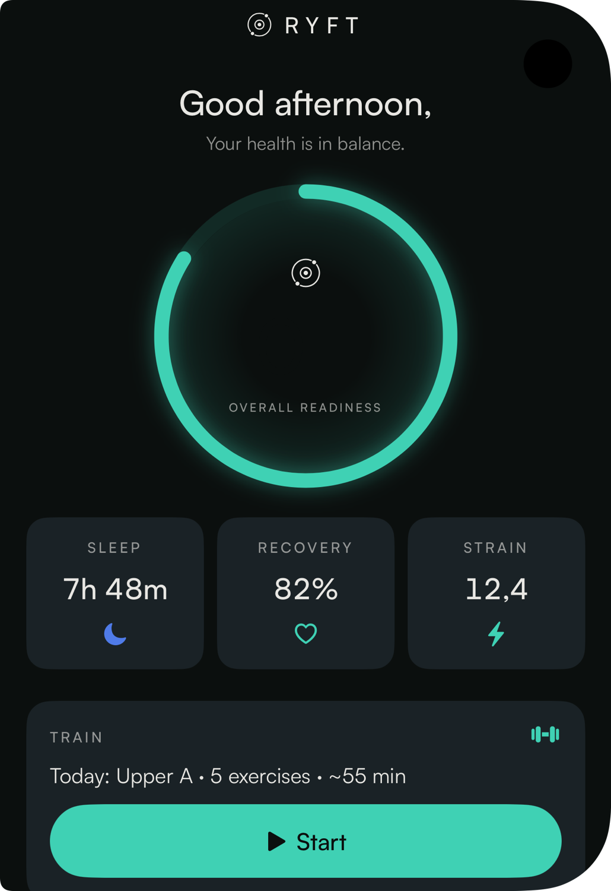
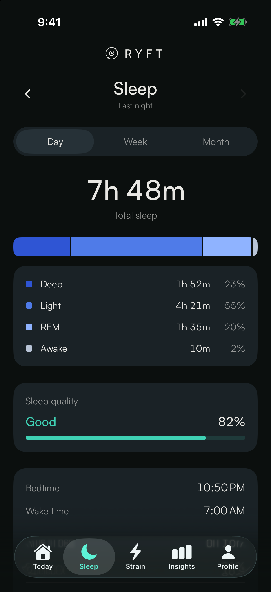
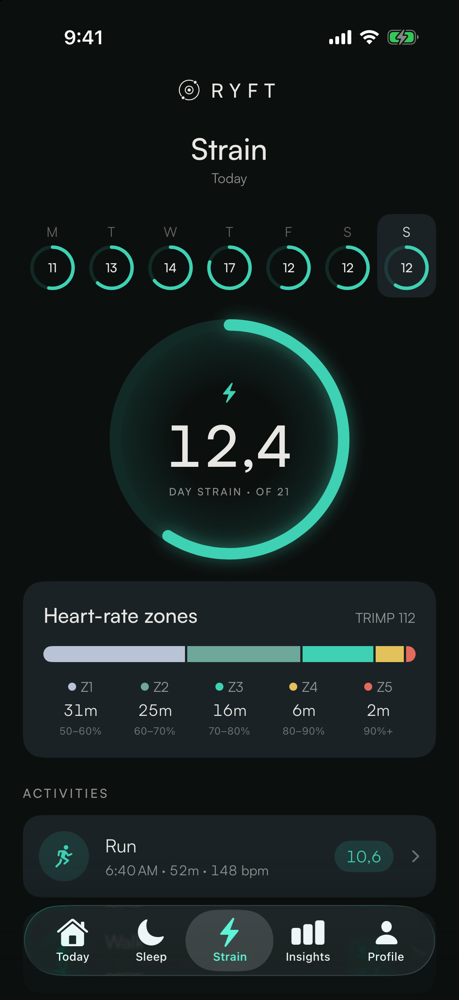
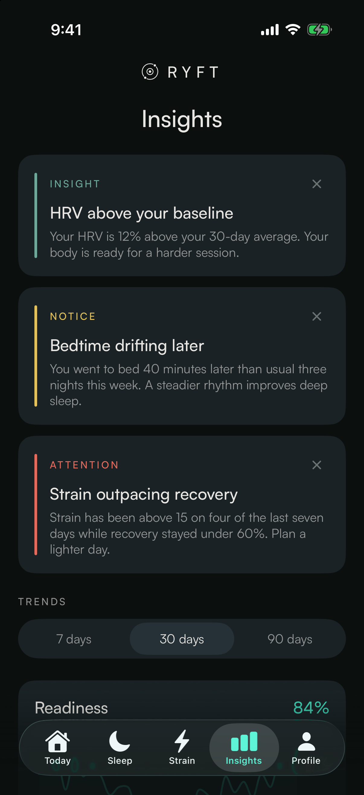
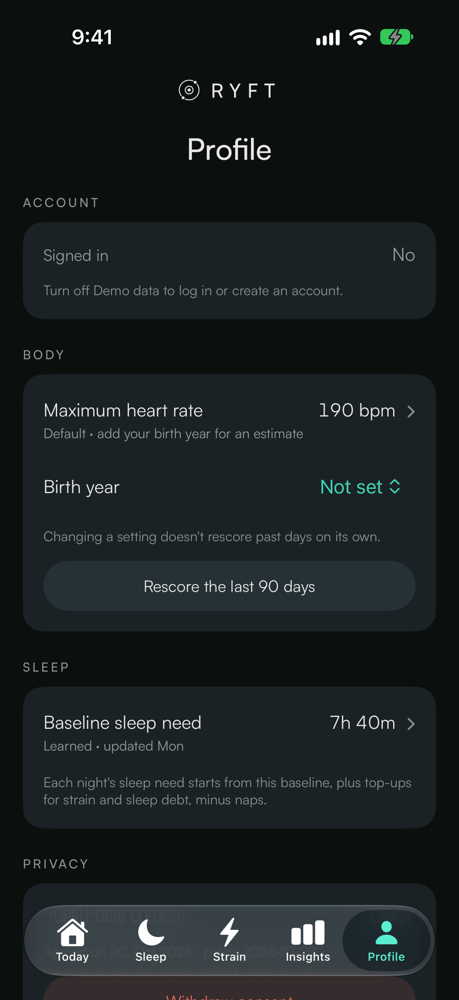
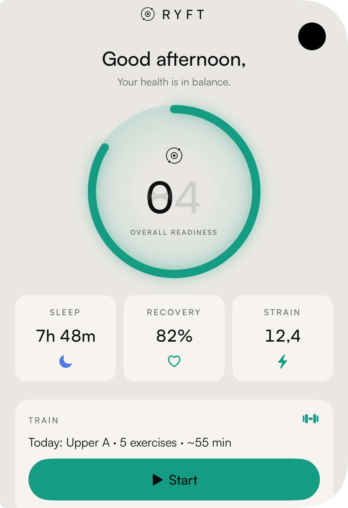
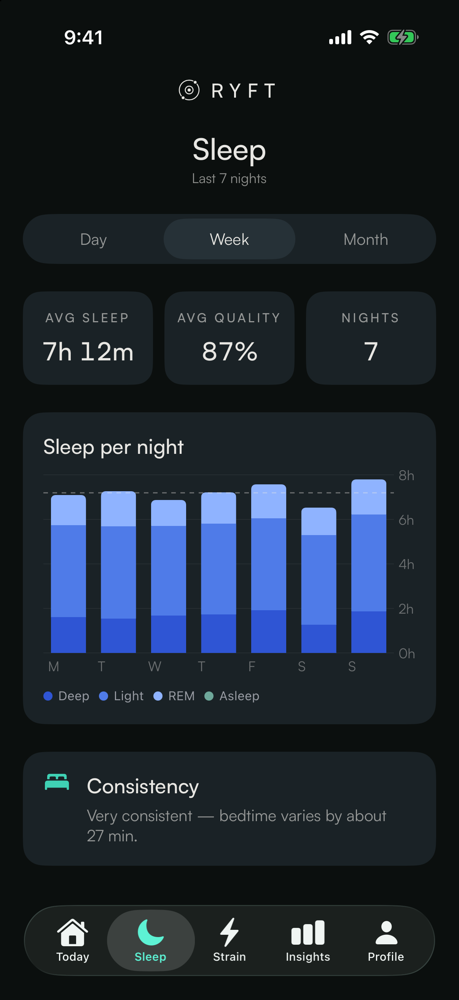
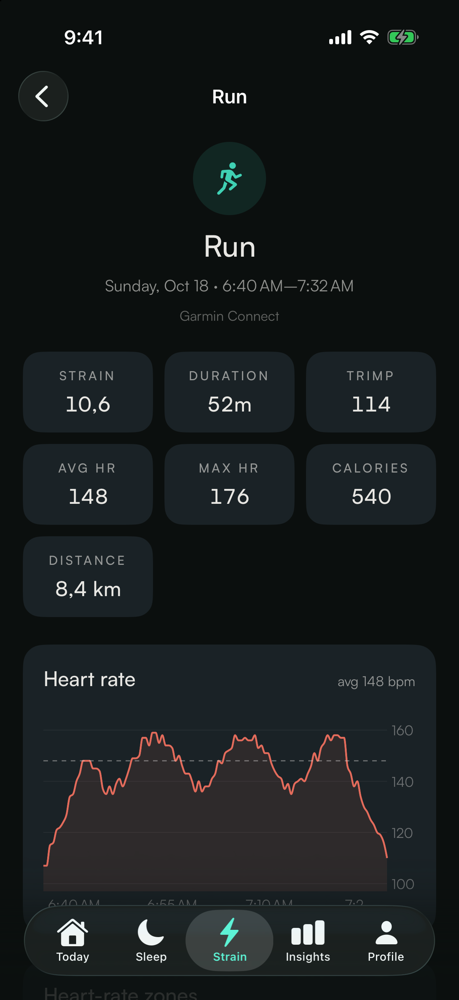
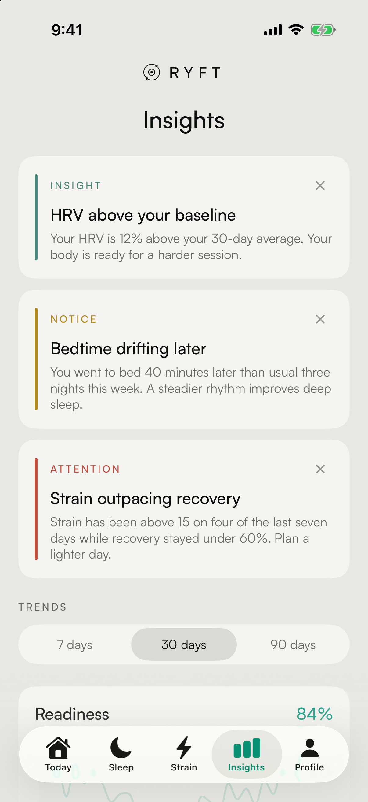
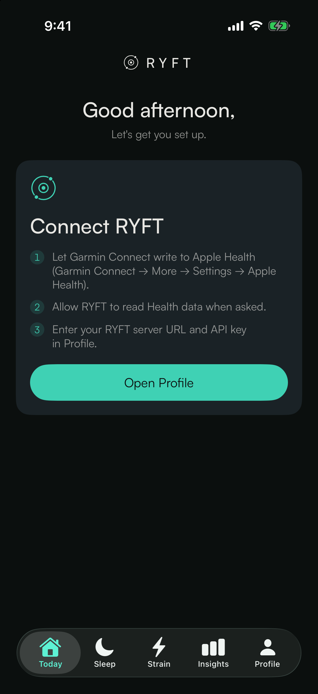

# RYFT — iOS app

*Your whole health.* RYFT reads your watch's data out of Apple Health, syncs it to the
RYFT platform (`https://api.ryftapp.de`, source in `../plattform`) and shows daily
**Readiness, Sleep, Recovery and Strain**. You create an account (email + password, or
**Continue with Apple**), allow Health access, and see your data: no server address, no
API key, no settings.

| Today | Sleep | Strain | Insights | Profile |
|---|---|---|---|---|
|  |  |  |  |  |
|  |  |  |  |  |

Screenshots come from the simulator with the built-in mock data (`scripts/screenshots.sh`).

## Requirements

- Xcode 16.3 or newer (supabase-swift needs Swift tools 6.1; built with Xcode 27.1), iOS 17+
- A **paid Apple Developer Program** membership for device builds: the app uses Sign in
  with Apple, which free Personal Teams can't provision (see *Apple developer setup*)
- An iPhone for real data. HealthKit has no data in the simulator, which runs in demo mode.
- One dependency: [supabase-swift](https://github.com/supabase/supabase-swift) 2.x, product
  `Auth` only (Swift Package Manager, already in `Ryft.xcodeproj`)

## Setup

`Ryft.xcodeproj` is the source of truth (see `CLAUDE.md`): open it and change targets,
capabilities and packages in Xcode. `project.yml` only documents the original XcodeGen setup;
don't regenerate the project from it.

```bash
scripts/fetch-fonts.sh      # optional: Satoshi from Fontshare (see "Fonts")
make config                 # Config/Debug.xcconfig + Config/Release.xcconfig from the examples
open Ryft.xcodeproj
```

`make build` / `make test` build and test for the simulator from the command line.

> **Package pin.** `swift-clocks` must stay at **1.1.0** (the version supabase-swift itself
> pins). 1.1.1 moved to `swift-issue-reporting`, which collides with supabase-swift's
> `xctest-dynamic-overlay` ("multiple packages declare targets with a conflicting name:
> IssueReporting"). The pin lives in `Ryft.xcodeproj/…/Package.resolved`; if SPM resolves
> 1.1.1 again, set swift-clocks back to 1.1.0 there and resolve without updating.

### Production configuration

Three build-time values, all publishable, committed in **`Config/Production.xcconfig`**.
Fill them in once:

| Setting | Where from |
|---|---|
| `RYFT_API_URL` | `https://api.ryftapp.de` (already set): serves `/v1/sync` and every other `/v1/*` route |
| `RYFT_SUPABASE_URL` | Supabase → Project Settings → API → Project URL, `https://<project-ref>.supabase.co` |
| `RYFT_SUPABASE_PUBLISHABLE_KEY` | Supabase → Project Settings → API Keys → publishable key (`sb_publishable_…`, or the legacy anon key) |

`//` starts a comment in xcconfig files, so URLs are written `https:/$()/host`. `Info.plist`
exposes them as `RyftAPIURL`, `RyftSupabaseURL` and `RyftSupabasePublishableKey`; nothing is
hard-coded in Swift. Committing them is fine: the platform's RLS and revoked grants mean
Supabase's Data API exposes nothing, and the app talks only to Supabase Auth. While a value is
missing, Welcome says which one instead of crashing (demo data still works).

Release builds use the production values: point the Release configuration at
`Config/Production.xcconfig` in Xcode (Project → Info → Configurations), or keep the
git-ignored `Config/Release.xcconfig`, which just includes it. `Config/Debug.xcconfig`
(git-ignored) includes the production file and may override any value, e.g. for a second
Supabase project.

### Supabase project

The platform's `../plattform/docs/SUPABASE.md` has the full checklist. For the app:

1. **Authentication → Sign In / Providers → Email**: enabled. Set the minimum password
   length to **10** at most (the app requires 10). With *Confirm email* on, sign-up shows
   "Check your inbox" and the link finishes the sign-in.
2. **Authentication → URL Configuration → Redirect URLs**: add **`ryft://auth/callback`**.
   Confirmation and password-reset links return there (PKCE). The app registers the `ryft`
   URL scheme. The link must be opened on the iPhone that requested it, because the PKCE
   code verifier lives in that phone's Keychain.
3. **Authentication → Sign In / Providers → Apple**: see below.

### Apple developer setup

Prepare these in the Apple Developer account (paid membership):

- **App ID** `dev.timkrebs.ryft` with the capabilities **Sign in with Apple**, **HealthKit**
  (with background delivery) and the Background Modes the project already declares.
- For Supabase's Apple provider:
  - a **Services ID** (e.g. `dev.timkrebs.ryft.auth`), configured for Sign in with Apple
    with the App ID above as primary
  - your **Team ID** (Membership details)
  - a **Key** with Sign in with Apple enabled: its **Key ID** and the downloaded **`.p8`**
    file (it can be downloaded only once)
  - in Supabase, the app's bundle ID `dev.timkrebs.ryft` in the provider's client IDs (the
    native flow sends an ID token for the bundle ID)
- Signing: `DEVELOPMENT_TEAM` is `M77SKHKG63`, a free Personal Team. Personal Teams **can't**
  provision Sign in with Apple, so device builds fail ("Personal development teams … do not
  support the Sign In with Apple capability") until the project uses a paid team. Simulator
  builds work.

### Capabilities

Already in the project: **HealthKit** (with background delivery), **Background Modes**
(background fetch and processing, BGTask `dev.timkrebs.ryft.refresh`), **Sign in with Apple**,
and the **`ryft`** URL type.

**Live Activities** (the Train rest timer) need no capability and no push: the app sets
`NSSupportsLiveActivities = YES` in `Info.plist` and starts, updates and ends the activity
locally. The UI lives in the **RyftWidgetsExtension** target (`RyftWidgets/`, iOS 17), which is
embedded in the app. For device builds the extension needs its own App ID,
`dev.timkrebs.ryft.RyftWidgets`, under the same team. `RestTimerAttributes` is declared in
both targets (`Ryft/Train/RestActivity.swift` and `RyftWidgets/RestTimerAttributes.swift`) and
the two must stay identical. Alternatively, give the app's file membership in both targets in
Xcode's File inspector and delete the copy.

Garmin Connect must write to Apple Health: *Garmin Connect → More → Settings → Apple Health*.

### Fonts

Headlines and UI use **Satoshi** (Fontshare, ITF Free Font License). The licence allows
embedding the font in apps but **not** redistributing it through a repository, so the
font files are git-ignored. `scripts/fetch-fonts.sh` downloads Regular/Medium/Bold into
`Ryft/Resources/Fonts/`. Without them the app falls back to SF Pro Rounded automatically.

## Running

### Device

1. Install, then **Create account** (or **Continue with Apple**, or **Log in**).
2. Allow Health access when asked. The first sync uploads 90 days, then Today loads.
3. After that, sync runs on every foreground, through HealthKit background delivery (sleep,
   workouts, HRV) and through a `BGAppRefreshTask`. The SDK keeps the session in the
   Keychain and refreshes it; relaunching goes straight to Today.

**Profile → Account** has Change password (email accounts), Log out and Delete account.
Log out drops the session, cached responses, HealthKit anchors and per-user settings, so
another account on the same phone re-syncs from scratch. Delete account calls
`DELETE /v1/me` (all data, then the Supabase user) and then logs out.

### Simulator (demo mode)

Demo mode is on by default in the simulator, and it skips Welcome. The app serves a
deterministic 90-day history (`Ryft/Preview/MockData.swift`) whose "today" matches the brand
board. Toggle it in **Profile → Data → Demo data**, or with launch arguments:

| Argument | Effect |
|---|---|
| `-demoMode YES/NO` | Force demo data on or off (`NO` shows Welcome) |
| `-appearance dark/light/system` | Colour scheme (dark is the default) |
| `-RyftTab today/sleep/strain/insights/profile` | Initial tab |
| `-RyftSleepMode day/week/month` | Initial Sleep segment |
| `-RyftOpenWorkout YES` | Push the first workout on the Strain tab |
| `-RyftResetTrain YES` | (Debug) Start with an empty Train store: no sessions, no upload queue |

In demo mode Train works end to end against `MockTrainSource`: a 28-exercise library, four
built-in plans plus one custom plan, an active Upper/Lower enrolment and 90 days of logged
sessions. Completing a workout returns a demo load, strain and PRs.

**Tests.** `RyftTests` (Swift Testing) runs on the `Ryft` scheme. The UI test (start → log two
sets → kill → resume → finish) runs on the `RyftUITests` scheme. It finds the app by bundle
ID; to use `XCUIApplication()`, set the target's *Target Application* to Ryft in Xcode.

`scripts/screenshots.sh ["iPhone 17 Pro"]` builds the app, launches each tab in both
colour schemes and writes PNGs to `docs/screenshots/`.

### Against a local platform (compose, `AUTH_MODE=apikey`)

Debug builds have **Profile → Developer** (not compiled into Release). With
`-demoMode NO`, Welcome also offers "Developer: use an API key".

1. Run the platform with `docker compose up` in `../plattform`. It uses
   `AUTH_MODE=apikey` with `ALLOW_INSECURE_APIKEY_AUTH=true`.
2. In **Profile → Developer**:
   - **API URL override**: `http://<lan-ip>:8082` (the api service)
   - **Ingest URL override**: `http://<lan-ip>:8081` (compose serves ingest on its own port)
   - **API key mode** on, **API key** = the compose `API_KEY` (default `dev-api-key-change-me`;
     `<API_KEY>:<uuid>` acts as another user)
   - **Test connection**, then pull to refresh on Today
3. **Show request IDs** lists recent failed requests with their `X-Request-ID`.

Plain `http://` works for local addresses because `NSAllowsLocalNetworking` is set. Find the
IP with `ipconfig getifaddr en0`. You can also set `RYFT_API_URL` in `Config/Debug.xcconfig`.

## Architecture

```
Ryft/
  App/         entry, AppState (read-side store + disk cache), Settings, SupabaseConfig, formatting
  Auth/        AuthService (Supabase Auth: Apple, email, links, deletion), AppleSignInButton
  Design/      Theme, Typography, RyftMark and components (ScoreRing, MetricTile, Card,
               SegmentedPicker, StageBar, Hypnogram, InsightCard, TrendChart, status views)
  Features/    Auth (Welcome, Create account, Log in, reset), Today, Sleep, Strain
               (+ WorkoutDetail), Insights, Profile, Train (live session, plans, history)
  Health/      HealthKitManager: anchored queries, background delivery
  Sync/        SyncService: page → upload → persist anchor
  Train/       SwiftData store (Model/), TrainSyncService (offline queue, 409 merge),
               TrainLibrary (exercises, plans, today), maths, rest timer, Live Activity
  Networking/  APIClient (status handling), APIStatus, v1 wire models, response cache
  Preview/     MockData + MockDataSource, MockAuthClient, preview helpers
  Resources/   Fonts (fetched), string catalogs (en, de)
RyftTests/     Swift Testing unit tests + JSON fixtures from API.md
RyftUITests/   XCUITest: the Train session flow
RyftWidgets/   widget extension: rest timer Live Activity
Config/        Production.xcconfig (committed) + Debug/Release examples
scripts/       fetch-fonts.sh, render-icon.swift, screenshots.sh
```

- **Auth.** `AuthService` wraps the SDK behind `AuthClientProtocol`. The SDK persists and
  refreshes the session; every request's bearer is its access token. `RootView` shows Welcome
  without a session. On the first sign-in the app calls `GET /v1/me` (which creates the user)
  and `PATCH /v1/me {"tz": …}`.
- **Status handling** (`API.md` → Errors):
  - `401`: refresh once and retry once; a second `401` logs out.
  - `503`: never logs out; waits `Retry-After` (≤ 30 s, up to 3 times) and shows
    "RYFT is catching up".
  - `429`: waits and retries once.
  - `413`: halves the HealthKit page size for the rest of the sync.
  - Failures keep the request ID, shown under an inline message's **Details**.
- **Offline.** The last successful Today payload (with the 7-day readiness trend) is written
  to `Caches/ryft-responses/` and shown at launch with an "Updated 5 min ago" line.
- **Nulls.** Fields can be `null` while the platform calibrates; every view shows "–".
- **Train (local-first).** A workout is logged into SwiftData (`Train/Model/`) and survives
  app kills. Every set change is queued in a persisted outbox and sent 2 s later as a
  whole-document `PUT /v1/sessions/{id}`. Offline, the queue waits and `NWPathMonitor` (or
  the app becoming active) replays it in order.
  - A `409` carries the server's copy. The app merges it by set id (later `updated_at` wins)
    and PUTs again.
  - Finishing offline marks the session `pendingCompletion`; `POST …/complete` runs on
    reconnect.
  - Exercises, plans, today's plan and recent sessions are cached for browsing in the gym.
  - Sessions are not written to Apple Health.
- **App icon.** `make icon` renders the light, dark and tinted 1024 px PNGs from
  `Ryft/Design/RyftMark.swift`, so the icon and the in-app mark share one geometry.
