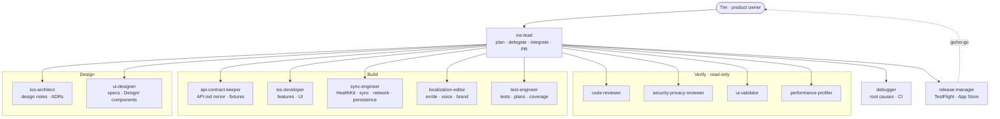
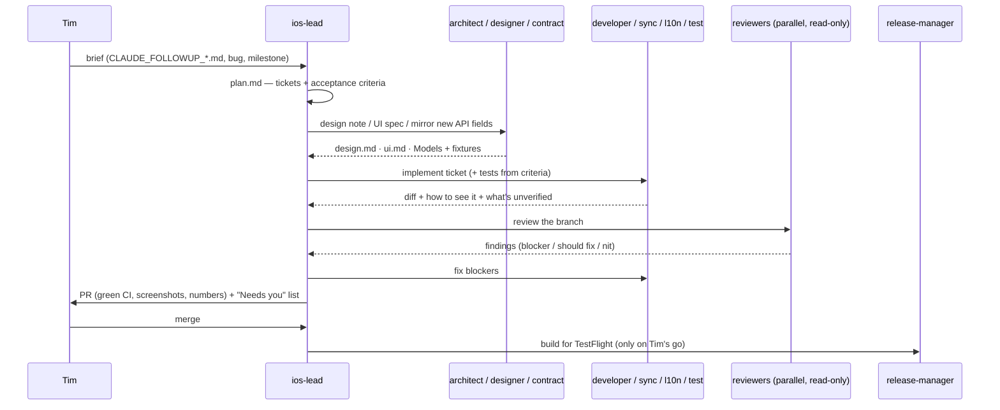

# RYFT iOS — agent fleet

How Claude Code works on `app/` as a small software team: one lead, specialists who build, independent
reviewers who verify, and a release manager who ships. Definitions live in `.claude/agents/`; the shared
rules every agent preloads are `.claude/skills/ryft-app-conventions/SKILL.md`; guard rails are
`.claude/settings.json` + `.claude/hooks/`.

## Org chart



## Roster

| Agent | Role in a real team | Writes code | Model | Typical trigger |
| --- | --- | --- | --- | --- |
| `ios-lead` | Tech lead / EM | glue only | session's | any brief spanning > 1 specialist |
| `ios-architect` | Staff engineer | `docs/work`, `docs/adr` only | opus | changes to Sync/, Persistence/, Environment/, StateMachines/, concurrency |
| `ios-developer` | Feature engineer | yes | session's | screens, view models, Train, Profile, onboarding |
| `sync-engineer` | Platform/data engineer (client) | yes | session's | Health/, Sync/, Networking/, Persistence/, sessions |
| `api-contract-keeper` | API owner | Models, PlatformAPI, fixtures | sonnet | `../plattform/docs/API.md` changed |
| `ui-designer` | Product designer | specs, `Design/` primitives | sonnet | new screen or state, off-brand view |
| `localization-editor` | UX writer / localiser | strings | haiku | any user-facing text |
| `test-engineer` | QA engineer | tests | sonnet | every behaviour change; flaky tests |
| `code-reviewer` | Senior reviewer | no | opus | every PR |
| `security-privacy-reviewer` | AppSec / DPO | no | opus | auth, tokens, HealthKit, logging, URLs, entitlements, onboarding |
| `ui-validator` | Visual QA | no (screenshots only) | sonnet | anything visible changed |
| `performance-profiler` | Performance engineer | targeted fixes | sonnet | sync, launch, lists, charts, background |
| `debugger` | On-call engineer | minimal fixes | sonnet | red build/CI, crash, wrong numbers |
| `release-manager` | Release engineer | release files | sonnet | TestFlight / App Store / hotfix |

Adapted from agents in [lecole/claude-code-agents](https://github.com/lecole/claude-code-agents)
(MIT © Seth Hobson) — `ios-developer`, `ui-ux-designer`, `ui-visual-validator`, `test-automator`,
`tdd-orchestrator`, `code-reviewer`, `architect-review`, `mobile-security-coder`, `security-auditor`,
`performance-engineer`, `debugger`, `error-detective`, `deployment-engineer` — rewritten for RYFT's stack and
rules. The generic capability catalogues were dropped on purpose: specific rules and files beat long lists.

## The standard workflow (one feature brief)



1. **Plan** — `docs/work/<date>-<slug>/plan.md`: tickets, testable acceptance criteria, owner, risks.
2. **Design first** where structure or UI is new (architect, designer); **contract first** where platform
   fields are new (api-contract-keeper).
3. **Build** — one writer per file set; tests from the criteria in parallel once interfaces are agreed.
4. **Verify in parallel** — code-reviewer always; the others by trigger above. Findings go to
   `docs/work/…/review.md`; blockers go back to the owner; re-verify.
5. **Ship** — PR per `CLAUDE.md`, CI green, screenshots + numbers; release-manager only on your go.
6. **Close** — `docs/STATUS.md`, `CHANGELOG.md`, device-vs-simulator notes, "Needs you".

Other flows: **Bug** → debugger (failing test first) → owner fixes → code-reviewer → PR. **Platform changed**
→ api-contract-keeper → test-engineer → PR. **Release** → release-manager pre-flight → your go → workflow.

## Running it

From VS Code's terminal in `app/`:

```bash
claude --agent ios-lead          # the lead is the main session and delegates
```

Then paste a brief, e.g. "Run `CLAUDE_FOLLOWUP_SYNC_PERFORMANCE.md`." In a normal session you can also
address one agent directly: "Use the code-reviewer agent on this branch." `/agents` lists and edits them.

**Cost and context:** each agent is a separate context. Reviewers in parallel are cheap and worth it; don't
fan out ten writers. The lead keeps summaries, not file dumps. For long multi-PR briefs, run one lead session
per PR.

**Worktrees:** `isolation: worktree` branches from the default branch, not the current one — use it only for
independent tickets that start from `main`; never for a ticket that builds on an unmerged branch.

## Guard rails (enforced, not just written)

- `pre-edit-guard.sh` (PreToolUse): blocks edits to `project.pbxproj`, `*.entitlements`, anything in
  `../plattform/`, and new text containing a denylisted brand name.
- `post-edit-format.sh` (PostToolUse): runs SwiftFormat on edited Swift files when it's installed.
- `settings.json` permissions: no force-push, no push to `main`, no `--no-verify`, no admin merges, no
  release creation or uploads from an agent; tags, merges and workflow dispatches always ask.
- Reviewers have `Write`/`Edit` removed; implementers never approve their own work.

## Changing the fleet

Edit the files in `.claude/agents/` (they reload automatically). Keep each agent's description precise —
it's what the lead uses to pick it. Add a rule to the shared skill when it applies to every agent, to one
agent's file when it doesn't. A new agent needs a row in the roster above.
