# 0003 — GPS tracks are smoothed by a constant-velocity Kalman filter, not a moving window

- Status: proposed (2026-10-22, My Day and activities, `docs/work/2026-10-22-my-day-activities/design.md` §3.3)
- Amended: 2026-10-23, amendment 1 (A3a): distance from the filter's speed; a still-phone guard; a settle window;
  the re-init counts both gates
- Amended: 2026-10-24, amendment 2 (A3a.2): a re-init is provisional until its settle window closes; the sport's
  limit applies to the filter's speed, with a `.tooFast` state
- Deciders: ios-lead, on ios-architect's proposal; sync-engineer implements (A3)
- Applies to: `Ryft/Activities/Recording/TrackPipeline.swift`, `KalmanTrack.swift`, `Geodesy.swift`,
  `Ryft/Activities/Sport.swift` (per-sport parameters)

## Context

RYFT records runs, rides and hikes with the phone's GPS. Distance, live pace, km splits and auto-pause all come from
the fixes.

**What the fixes are like:**
- **Rate and noise.** About 1 Hz, with a reported horizontal accuracy of 3–30 m. Accuracy is worse under tree
  canopy and between buildings.
- **Raw sums overestimate.** Summing the distances between raw fixes adds the noise as length: several percent at
  jogging speed, and tens of metres an hour for a phone lying still.
- **Outliers can look good.** Multipath in cities produces jumps of 50 m or more whose *reported* accuracy is good.
  A gate on accuracy alone doesn't catch them.
- **Tight turns.** Trails have switchbacks with radii of 10–20 m, so heavy smoothing cuts corners and *under*states
  the distance.

**What we need from the smoothing:**
- live values on the recording screen: it must be **causal**, with no look-ahead;
- velocity for auto-pause and pace;
- **±2 %** of ground truth on the brief's fixture tracks: a 5 km road run, a trail with switchbacks and bad fixes,
  and a stationary phone;
- cheap enough for the ≤ 8 %/h battery target;
- deterministic in unit tests.

## Decision

1. **Hard gates first:**
   - a fix is dropped when its accuracy is invalid or above 25 m, when it's stale (older than 10 s) or out of order;
   - it's dropped when its implied speed from the last *filtered* position (minus both accuracies) exceeds the sport's
     `maxSpeed`.
2. **A constant-velocity Kalman filter, two states per axis (position, velocity):**
   - **Frame.** East and north metres in a local tangent plane: WGS84 meridional and prime-vertical radii at the
     anchor latitude, re-anchored every 5 km. The anchor lives in memory only. It's never part of a checkpoint
     (ADR 0005), so a resume re-initialises the filter at its first fix.
   - **Measurement variance** is `max(horizontalAccuracy, 3 m)²`, so every fix is weighted by what Core Location
     says about it.
   - **Process noise** is white acceleration with σa per sport: 1.0 for walking and hiking, 1.5 for running, 3.0 for
     cycling, 5.0 for snow sports.
   - **Innovation gate** at 3.5σ. Three rejections in a row re-initialise the filter at the measurement (a real jump,
     a tunnel exit). Δt over 15 s resets the velocity variance.
3. **Distance and pace:**
   - **Distance** is the sum of geodesic steps between consecutive *filtered* positions, counted only while
     recording and while the filter's speed is ≥ 0.3 m/s. Gaps over 10 s are bridged by the straight line when the
     implied speed is plausible.
   - **Pace** is a rolling 30 s of moving time.
   - **Splits** interpolate the 1000 m crossing between filtered points.
   - **Auto-pause** uses the filter's speed with hysteresis.
4. **The pipeline is a pure value type** (`TrackPipeline.ingest(_:) -> [PipelineEvent]`), owned by the
   `ActivityRecorder` actor. Unit tests drive it with seeded synthetic fixture tracks of known length
   (`scripts/make-tracks.py`), without an actor or a clock.
5. **The distance shown live is the distance saved.** Nothing re-smooths after Finish.

## Consequences

**Good:**
- **Causal and accuracy-weighted.** A 30 m fix moves the estimate a little; a 4 m fix moves it a lot.
- **Outliers.** The innovation gate rejects multipath jumps that the accuracy gate lets through.
- **One estimate for everything.** The filter's velocity serves auto-pause, stationary detection and pace, so
  there's no second speed estimate.
- **Cheap.** A few dozen floating-point operations per fix; no allocation per fix.
- **Testable.** Pure, deterministic, and every parameter sits in the sport catalogue.

**Costs:**
- **Tuning.** σa per sport needs device validation (D1). Too low cuts switchback corners; too high passes jitter.
- **Corner lag.** A constant-velocity model lags for one or two fixes on a hairpin when the fixes are poor.
- **Horizontal only.** Distance ignores slope, as GPS watches do. Steep trails read a little shorter than their
  slope length.

**Follow-ups:**
- Tune σa and the gates with D1's real run.
- Add one real track from a public course as a regression fixture.
- Revisit Core Location's own `speed` as a filter input if D1 shows lag.

**Rejected alternatives:**
- **A moving average or a centred window.**
  - It lags (a centred one needs look-ahead), so live values trail.
  - It cuts corners in proportion to the window.
  - It weights a 30 m fix like a 4 m one, and an outlier pulls the mean.
- **A moving median.** Better with outliers, but it still lags, quantises the path into steps and ignores accuracy.
- **Raw fixes behind an accuracy gate only.** It overestimates by several percent at jogging speed, and a stationary
  phone drifts.
- **A Rauch–Tung–Striebel smoother at Finish.** It's more accurate after the fact, but it changes the number the user
  watched, and the splits with it. It may come later as a separately labelled corrected distance.
- **Map matching.** No offline map data, trails are often unmapped, and MapKit offers no matching API.

## Amendment 1 (2026-10-23, A3a): distance from the filter's speed; a still-phone guard; a settle window; the re-init counts both gates

- Status: proposed by ios-architect after A3a (`activities: track pipeline`), reconciled with what A3a built
  (`b059151`); the lead confirms.
- Replaces the first bullet of decision 3. Decision 2's re-init rule stands as written and is spelled out below.
- Numbers are A3a's own unless marked "probe" (ios-architect's scratch harness over `make-tracks.py`'s noise model, not
  committed).

### What A3a measured

- **The evidence uses drifting noise, not white noise.** `make-tracks.py` draws each fix's error as Gauss–Markov
  processes that wander (design §11.2): τ up to 600 s, and about 300 s for a phone lying still.
  - **Why drifting.** Receivers smooth their output (Doppler-aided, over about 30 s), so consecutive fixes share most
    of their error. White noise of σ = accuracy / 2 at 1 Hz would make every 1 s step mostly noise, which no phone
    reports. It would test the filter against a receiver that doesn't exist.
  - **What white noise does.** It makes position steps read +17 to +125 % long and the velocity +2 to +12 % (A3a
    review).
  - **What drifting noise hides.** A slow drift looks like slow motion. That's the hard case for walking speeds and
    for a still phone, so D1 measures both on a device.
- **Position steps read long under canopy.** On `trail-switchbacks` over 20 seeds, summing the steps between filtered
  positions read +2.7 % on average, outside ±2 % on 15 of the 20. Two causes:
  - measurement jitter reaches the position through the filter's position gain;
  - a lagging estimate overshoots a hairpin and comes back, and a position sum counts both ways.
- **The filter's speed doesn't.** As built, on the committed seeds:
  - road +0.31 % (20 seeds −0.10…+0.45 %);
  - trail −0.34 % (20 seeds −0.95…+2.04 %);
  - stationary 0.0 m.
- **The probe agrees on other tracks.** 20 seeds per row, run through A3a's first code (before the guards below):

| Track | Position steps | Ground speed |
| --- | --- | --- |
| Hike under canopy, 1.2 m/s, a 5-min stop, auto-pause off | +2.84 % (17 of 20 outside ±2 %) | +0.73 % (1 of 20) |
| Urban walk, 1.4 m/s, three 60 s stops, auto-pause off | +2.15 % (12 of 20) | +0.75 % (0 of 20) |
| Jog under canopy, 2.2 m/s | +1.58 % (5 of 20) | +0.83 % (1 of 20) |
| Open road, 3 m/s, one stop | +0.35 % | +0.20 % |

- **A still phone without Core Location's flag drifts into distance.** Under drifting noise at ±6–25 m, a still phone
  with auto-pause off accrued 15–228 m in 10 min (A3a review), and more with shorter correlation times. The 0.3 m/s
  floor alone wasn't a guard. The fixtures never set `isStationary`, which is the guard on a real phone.
- **A coarse first fix inflated the restart.** Before the settle window below:
  - a still phone whose first fix was 20 / 40 m off read +20.5 / +42.0 m;
  - at 3 m/s it read +16.9 / +34.6 m;
  - a restore whose first fix was 30 m off read +30.7 m.

  The filter's walk back from a bad first fix isn't distance.

### Decision

- **Distance** is the trapezoid of the filter's ground speed between consecutive accepted fixes, counted while
  recording.
- **A still phone adds nothing, in two layers** (also with auto-pause off, the walking and hiking default):
  1. **`CLLocationUpdate.isStationary` first.** A fix Core Location flags adds no distance. This is the guard on a
     real phone. The still fixture now flags its fixes after 15 s, as `liveUpdates` does.
  2. **A dead-band as the backstop**, for a phone the flag misses. A step counts only when the mean of the two speeds
     is at least half the sport's auto-pause threshold, clamped to 0.3–0.5 m/s:
     - run, bike and ski: 0.5 m/s;
     - trail: 0.4 m/s;
     - walk and hike: 0.3 m/s.
     - **Without the flag** (run profile, 5 seeds, worst / mean), the dead-band cut the still phone's distance:

       | Error correlation τ | Before | With the dead-band |
       | --- | --- | --- |
       | 300 s | 19.2 / 9.8 m | 4.7 / 0.9 m |
       | 120 s | 38 m | 10.4 m |
       | 60 s | 61 m | 18.1 m |
       | 30 s | 132 m | 70 m |

     - **Walk and hike keep the 0.3 m/s floor and rely on the flag.** Without it, their worst case is 10.3 m (τ 300 s)
       to 116 m (τ 30 s).
     - **Slow movers:** walk at 1.4 m/s +1.1 %, hike at 0.6 m/s +2.0 %, hike at 0.4 m/s −4.8 % (the floor bites).
     - **Why not one global value:** 0.4 m/s would cost the 0.4 m/s hike −34 %.
- **A settle window after the filter (re)starts.** After the filter initialises or re-initialises, or resets its
  velocity (Δt > 15 s), nothing accrues for 10 s (up to 30 s with fewer than 4 fixes). Then the window counts the
  shorter of two lengths:
  - **a Theil–Sen line through its raw fixes:** the median of the pairwise velocities, so one bad fix tilts nothing,
    and a flying start keeps its speed;
  - **the filtered track's length.**

  They fail in opposite directions: a coarse first fix lengthens the track as the filter walks back, and an
  acceleration (a standing start) lengthens the line. Measured: every coarse case above → 0.0 m.
  - **The cost:** the first 10 s of distance appears at the window's end, all at once.
  - **Why not a `positionSigma` gate** (this amendment's first draft: steps only once σ ≲ 8 m): under canopy the
    steady-state σ is 10–12 m, so it would never open.
- **Position steps for 10 s only after an auto-resume.** The filter is settled then. The steps recover its velocity's
  lag behind the acceleration, which integrating the velocity would lose.
- **Gaps** over 10 s are bridged by the straight line, as before.
- **`Tuning.distanceFromVelocity = false`** keeps the old sum for D1 only. After D1 the losing branch and the flag are
  deleted.
- **Re-init (decision 2, spelled out).** Three rejections in a row, **by the speed gate or the innovation gate**,
  re-initialise the filter at the third fix (and a settle window follows). Accuracy, stale and out-of-order rejections
  neither count nor break the run. Measured on a 60 m, 15 s multipath offset: +75.4 m with only innovation rejections
  counting, −18.0 m with both.
  - **Side effect:** a movement steadily faster than the sport's `maxSpeed` re-initialises every third fix and
    records 0 m (a "run" at 16 m/s: a car, a train, the wrong sport). That's intended for implausible speeds. *Lead:
    adjust this sentence if the code review finds a legitimate profile that can exceed its `maxSpeed`.*
- **Unchanged:** live = saved, splits on the recorded distance, the filter, the other gates, σa per sport.

### Why it works

- **Less noise.** The velocity state takes far less of the measurement noise than the position (its gain is smaller),
  and a speed never doubles back at a hairpin.
- **Lag cancels over a stop.** A linear filter's velocity lags at an acceleration and gives the lag back at the next
  deceleration, so over a go–stop cycle the integral loses nothing. It loses distance only where the integral is cut:
  at a (re)start, which the settle window covers, and below the dead-band.

### Risks

1. **Low-speed bias.** The length of a noisy velocity is biased upward: at rest its mean is about 1.25 σv, and a
   drifting error adds a real-looking speed on top.
   - The flag and the dead-band handle it (numbers above).
   - The dead-band's cost is real slow motion below it: a hike at 0.4 m/s reads −4.8 % at the 0.3 m/s floor. A slow
     scramble, a queue or a crowded start lose a little. D1's walk measures it.
2. **Stops.** The decaying velocity keeps adding until it falls under the dead-band. The probe measured about 4–5 m
   per 60 s stop at 1.4 m/s, where position steps added 2–3 m. Totals stay better.
3. **Auto-resume may count the lag twice.**
   - Why: the deceleration tail is counted during the 10 s auto-pause confirmation, and the position steps after the
     auto-resume recover the start lag again.
   - Without those position steps (probe): the urban walk with auto-pause on reads +0.54 % instead of +1.08 %, and the
     road +0.15 % instead of +0.21 %.
   - But then a noiseless instant start reads 3–4 m short per stop.

   So it's about ±3 m per auto-pause either way. D1 decides.
4. **Hairpins.** The speed lags the turn and reads slightly short (trail −0.34 %).
5. **Sustained multipath on rides stays open.**
   - **The mechanism.** The speed gate ages open as Δt grows; counting its rejections toward the re-init fixed runs
     (above).
   - **Rides.** With σa 3.0 the innovation gate opens after two rejections, so an offset of 10 s or more read about
     +70 m per episode under either rule (probe).
   - A3b adds a sustained-multipath ride fixture and settles the rule before D1.
6. **Correlated error.** To any filter, a wandering GPS error looks like motion. The fixtures model it (Gauss–Markov,
   30–600 s), but only D1 shows real receivers.
7. **Core Location's own speed** (`fix.speed`, usually Doppler-derived) isn't used. If D1 shows it beats the filter's
   speed, the follow-up feeds it into the filter as a velocity measurement. That needs `speedAccuracy` and `course`
   in `LocationFix`, a frozen type, so it goes through the lead. It never becomes a second distance.
8. **The settle window shows distance late.** For the first 10 s after Start, a resume after a kill or a tunnel exit,
   the distance stands still, then catches up at once. Splits crossed in the window are interpolated over it.

### What D1 compares

- **Shadow totals, with no coordinate on disk.** A3b adds them to Debug and TestFlight builds: running sums over the
  same fixes and gates, kept as numbers in `PipelineDiagnostics` and Copy diagnostics. They're deleted with the losing
  methods after D1.
  - (a) is the shipped total (ground speed);
  - (b) filtered-position steps, the old method;
  - (c) the trapezoid of Core Location's `speed` where it's ≥ 0;
  - (d) ground speed without the position steps after an auto-resume.
- **Five runs, each against a reference** (a measured course, such as lane 1 of a 400 m track or a certified 5 km, and
  the tracker's distance):
  1. An open road, 5 km, with at least 10 stops and auto-pause on: totals (a)–(d), and split times against the
     tracker.
  2. A forest trail with switchbacks: totals.
  3. **Slow speed.** A walk at about 1.4 m/s over a measured 2 km, with three 2-minute stops at marked points,
     auto-pause off: the total, and the distance added during each stop.
  4. The phone on a bench for 10 min, then in a pocket while standing for 10 min, auto-pause off: the distance
     (target < 20 m each), how many fixes Core Location flagged `isStationary`, and what the dead-band caught.
  5. A city ride: totals, re-initialisations, and fixes flagged `isStationary` while the filter said moving.
- **The rule.** Keep (a), unless one other total is closer to the reference by more than 0.5 % on at least four of the
  five runs.

### Consequences

- **Tests** (design §11.1):
  - still phone with auto-pause off, with and without the flag;
  - the dead-band per sport;
  - a coarse first fix, still and at 3 m/s, and after a restore;
  - a sustained offset on a run;
  - `flyingStartLosesNothing`.
- **The fixture noise model** is drifting Gauss–Markov noise (design §11.2), not white noise.
- **Unchanged:** the ±2 % fixture bounds and every other rule of this ADR.

## Amendment 2 (2026-10-24, A3a.2): a re-init is provisional; the sport's limit applies to the filter's speed

- Status: proposed by ios-architect for A3a.2 (code re-review N2; plan → A3a.2). The lead confirms; sync-engineer
  implements.
- **Replaces:**
  - decision 1's second bullet (the speed gate);
  - Amendment 1's "Re-init" bullet and its side effect;
  - Amendment 1's risk 5.

  The rest of decision 2 and Amendment 1 stands.
- **Numbers marked "probe"** come from ios-architect's scratch harness, which isn't committed:
  - `main` at `377f2a6` (the pipeline as merged) and a copy with each guard behind a switch;
  - seeded synthetic 1 Hz tracks with drifting noise at a reported 5 m unless stated;
  - 20 extra seeds of each `make-tracks.py` fixture (seed 00 is the committed file, byte for byte).

### What N2 found, and what the probe added

| Case | `main` (probe) |
| --- | --- |
| A ghost (60 m offset, a falsely good 10 m accuracy) on a run: 3–6 fixes | −18 … −27 m (as the reviewer measured) |
| The same ghost on a run: 8–12 fixes | −33 … −45 m |
| The same ghost on a ride (σa 3.0): 3–6 fixes | −17 … +36 m |
| The same ghost on a ride: 8 fixes or more | +55 … +68 m, no re-init (risk 5) |
| Sustained offset, 15 s and 30 s | run −18.0 m; ride +55 … +65 m |
| A cycling descent at 33 m/s for 2 min (limit 25) | −58.8 % at a reported 2 m, −57.6 % at 3 m, 0.0 % at 5 m; silent |
| "Running" chosen on a bike at 15 m/s | 67–90 m of 4.6 km at 2–3 m, the full 4.6 km at 4–5 m; silent |
| A train after a run | +243 … +334 m; silent |

Two causes:
1. **A re-init is final.** The filter restarts at the third rejected fix and the rejected seconds are lost, so a ghost
   costs one re-init out and one back. On a ride the innovation gate ages open before the third rejection, and the
   ghost is accepted with a kick to the velocity (the +55 m rows).
2. **The speed gate is two rules in one.** It rejects a jump from the last filtered position "minus both accuracies".
   - At 1 Hz that makes the real limit `maxSpeed + 2 × accuracy`, 6–10 m/s above the catalogue value.
   - So a fast stretch counts in full or not at all, depending on whether Core Location reports 2.9 m or 3.1 m.
   - Above the real limit, the filter re-initialises every third fix and records nothing, without a word.

### Options

| | A: the reviewer's proposal | B: a provisional re-init, the limit on the filter's speed (chosen) | C: minimal |
| --- | --- | --- | --- |
| What | A shadow filter restored when fixes fit it (about 10 s); a bridge after a chain of speed-gate re-inits if it's at most `maxSpeed`; `speedGateReinits`, `.tooFast` on a chain; cycling 25 → 36 m/s | The decision below | The shadow restore only; cycling 25 → 36 m/s |
| Ghost 3–12 fixes, run | 0 (±1.3 m) | 0 (±2.0 m) | 0 (±1.3 m) |
| Sustained 15 and 30 s, run | −18 m | 0 (±3.2 m) | −18 m |
| Ghost 3–30 fixes, ride | −19 … +67 m (no re-init to restore) | 0 (±3.9 m) | −19 … +67 m |
| GPS trouble: offsets of 40–70 m hop every 3–5 fixes for 40 s (run / ride, 10 seeds) | +44 … +130 / +16 … +201 m; a false `.tooFast` on 5 of 10 run seeds | −44 … +1 / −98 … +20 m; no `.tooFast` | +44 … +130 / +16 … +201 m |
| Descent at 33 m/s, cycling | 0.0 % | 0.0 % | 0.0 % |
| "Running" on a bike at 15 m/s | 69–80 m and `.tooFast` at 2–3 m; 4.6 km and no event at 4–5 m | 57–59 m and `.tooFast` at 12 s, at every accuracy | as `main` |
| A train after a run | +243 … +334 m, `.tooFast` | +98 … +109 m, `.tooFast` | +243 … +334 m, silent |
| Fixtures (committed seeds) | unchanged | unchanged | unchanged |

**Why not A:**
- **The bridge can't fire for speed.** A chain of speed-gate re-inits exists only while the speed is above
  `maxSpeed + 2 × accuracy`, so the chain's average is always above `maxSpeed`. It bridged 0 of 18 descent runs. The
  higher limit recovered the descent, in every option.
- **The shadow restores onto the next ghost.**
  - In GPS trouble, a filter 4–8 s old has a gate wide enough to take the next hop: +36 … +130 m.
  - A stricter test still gave up to +82 m (a 2σ gate, a shadow at most 8 s old).
  - The decision below fills the span when the window closes instead, and never restores.
- **A chain isn't speed.** Hops of 40–70 m every 3 s look like 15–20 m/s to the gate, so `.tooFast` from chains was
  false on 5–8 of 10 run seeds.
- **Rides keep risk 5:** the ghost is accepted before any re-init.

**Also rejected:**
- *Waiting longer before a re-init* (more rejections, or a time): the gates age open first. That's the +75 m of
  Amendment 1.
- *An elevation test for cycling above 25 m/s* (only while descending): the barometer is optional for cycling, and GPS
  altitude is too noisy over 10 s. It may come back with Core Motion's activity type (below).

### Decision

1. **The speed gate is an outlier gate.**
   - It measures the jump from the filter's *predicted* position (position + velocity × Δt), still minus both
     accuracies, over Δt ≥ 1 s, against `maxSpeed`.
   - So it limits the change of velocity a fix implies.
   - A fresh filter (velocity 0) gates exactly as before.
   - It rejects the same ghosts (the trail fixture's gate counts are unchanged), and no longer rejects a fast mover the
     filter is following.
2. **Association.**
   - After a rejection, a fix that the gates would accept still counts as rejected when it lies nearer the last
     rejected fix (moved on at the filter's velocity) than the prediction. It belongs to the rejected run.
   - This stops an aged-open gate from accepting a ghost with a kick (rides: +55 … +68 m → 0).
   - Legitimate manoeuvres never meet it, because they cause no rejection. Probe, 5 seeds each, all identical to
     `main`: a U-turn at 3 m/s, a hairpin at 10 m/s, a 90° corner at 12 m/s, an emergency stop.
3. **A re-init takes the rejected run's velocity.**
   - It's the line from the run's first fix to the third, when the middle fix lies on it within the accuracies.
     Otherwise the velocity is 0, as now.
   - So a filter restarted on a train or after a flying start follows it, and rule 5 judges it.
   - Without this rule, the probe recorded 0 m with no event on a train with a fresh filter.
4. **A re-init is provisional until its settle window closes.**
   - **The anchor.** The pipeline keeps the last *settled* filtered position, its time and its ground speed (memory
     only, like the settle window), and counts the re-inits since then.
   - **When the window closes:**
     - **One re-init, the anchor at most 10 s before it:** the span is dead-reckoned at the anchor's ground speed,
       when that speed is between the dead-band and `maxSpeed`. That's what the filter already does over one rejected
       fix.
     - **A chain** (two or more re-inits before a window closes), **or a longer span:** the gap rule from the anchor
       to the window's first position. The straight line counts if its speed is at most `maxSpeed`; a train's
       doesn't.
   - **The anchor is dropped** by Start, Pause, a resume, Finish, a velocity reset or a gap inside the window.
   - **While a chain is open,** `gpsQuality` says `.weak` (ui.md G4: "Distance may be low"): the fixes disagree with
     each other.
   - **Nothing restores a filter, and nothing copies one.**
   - **Result:**
     - a ghost of up to 12 fixes is a chain of two re-inits, bridged once;
     - from 13 fixes, the ghost's own window closes in the ghost, so it's two single re-inits, each dead-reckoned
       (the ghost runs parallel to the track).
5. **The sport's limit applies to the filter's ground speed.**
   - **No distance above it.** A step whose mean ground speed is above `maxSpeed` adds nothing, at any accuracy.
     Neither does a settle window whose line is faster; it also starts the too-fast count at its start.
   - **The state.** 3 s above the limit → `.tooFast(since:)`; 3 s at or below → `.tooFastEnded(since:)`.
     `TrackSnapshot.tooFastSince` holds the state.
   - **While too fast:** no `.route` points, current pace and speed are nil, and the time keeps running (it's not a
     pause).
6. **`maxSpeed` is the fastest the sport is done**, not a gate threshold with a hidden allowance:

   | Sport | Before | After | Why |
   | --- | --- | --- | --- |
   | Running | 9 | 9 | a sprint finish is 7–8.5 m/s (probe: 12 s at 8.5 m/s, no `.tooFast`) |
   | Trail running | 8 | 8 | |
   | Walking, hiking | 4 | 6 | a jog or a run for the bus stays on foot. At 4, a walk with 60 s at 4.5 m/s lost 272 m (probe) |
   | Cycling | 25 | 36 | road descents reach 110–130 km/h |
   | Gravel | 22 | 30 | paved descents on a gravel bike |
   | Mountain biking | 22 | 25 | bike-park descents |
   | Skiing, ski touring | 40, 30 | unchanged | |

7. **Diagnostics** (counts only, `PipelineDiagnostics`):
   - `speedGateReinits`: re-inits whose rejected run included a speed-gate rejection (N2's counter);
   - `reinitSpansDeadReckoned`, `reinitSpansBridged`, `reinitSpansDropped`: what each closed window did with its
     span;
   - `tooFastEpisodes`, `tooFastSec`;
   - `tooFastDistanceM`: the filter's speed integrated while too fast. It's never distance, never saved as distance and
     never shown; it's for D1 and a later "change sport".

```mermaid
stateDiagram-v2
    [*] --> Settled
    Settled --> Provisional: 3 rejections (either gate, or joining the rejected run)
    Provisional --> Provisional: another re-init (a chain; GPS reads weak)
    Provisional --> Settled: window closes / fill the span from the anchor
    Settled --> Settled: accepted fix / count unless too fast
```

### Consequences

**Good:**
- **No ghost costs distance:** 2–30 fixes, run, ride, walk and MTB, within 5 m (probe), and the sustained 15 s case
  goes from −18.0 m to +0.0 m.
- **The same movement gives the same result at every reported accuracy.**
- **0 m is never silent.** Too fast is a state with an event, and an open chain reads as weak GPS.
- **One speed estimate.** The filter's speed decides distance, auto-pause, pace and now plausibility.
- **No filter copies.** The anchor is a position, a time and a speed.

**Costs:**
- **Distance shows late during a ghost:** it holds for the ghost plus up to 10 s, then catches up at once, like the
  settle window (Amendment 1, risk 8). Splits crossed in that time are interpolated over the filled span.
- **The higher cycling limit counts a car or a train below 130 km/h after a ride.** Probe: 5 min of train at 33 m/s on
  a ride added 11.2 km (at 25 m/s: +0.8 km, the acceleration and braking). Speed can't tell a vehicle from a bike below
  any limit a descent needs.
- **Below its limit a vehicle is a sprint.** A train after a run adds its acceleration and braking up to 9 m/s:
  +98 … +109 m (probe).
- **About 120 more lines** in `KalmanTrack` and `TrackPipeline`, and the catalogue values above.

**Risks:**
1. **False too-fast in real GPS.** A velocity kick above the limit for 3 s would flash the state. The probe saw none (GPS
   trouble, manoeuvres, the fixtures), but D1 counts `tooFastEpisodes` on every run.
2. **A wrong velocity at a re-init.** A collinear ghost run gives the restarted filter a ghost's velocity. The
   prediction gate then rejects the true fixes, which ends in a chain: weak GPS, and the bridge from the anchor.
3. **Dead reckoning trusts the anchor's speed for at most 10 s,** capped by `maxSpeed`.
4. **Walking and hiking at 6 m/s** count a slow bike ride recorded as a walk.
5. **Core Motion's activity type** (`automotive`) would tell a vehicle from a bike at any speed. It needs Motion
   permission, which cycling may not have. It's a follow-up after D1, not this PR.

**Tests:** design §11.1, rev. A3a.2 (the acceptance table).

**D1 adds:**
- `tooFastEpisodes` (target 0) and the span counts on every run;
- a ride with a real descent (as fast as is safe): distance against the tracker, no `.tooFast`;
- "Running" recorded on a bike above 10 m/s for 2 min: the state appears within 5 s, VoiceOver announces it;
- a passenger in a car or train with "Running": one episode over the fast part, and at most about 120 m added per
  stop;
- a walk between tall buildings: re-inits, spans, weak-GPS time, and the distance against a measured course.
