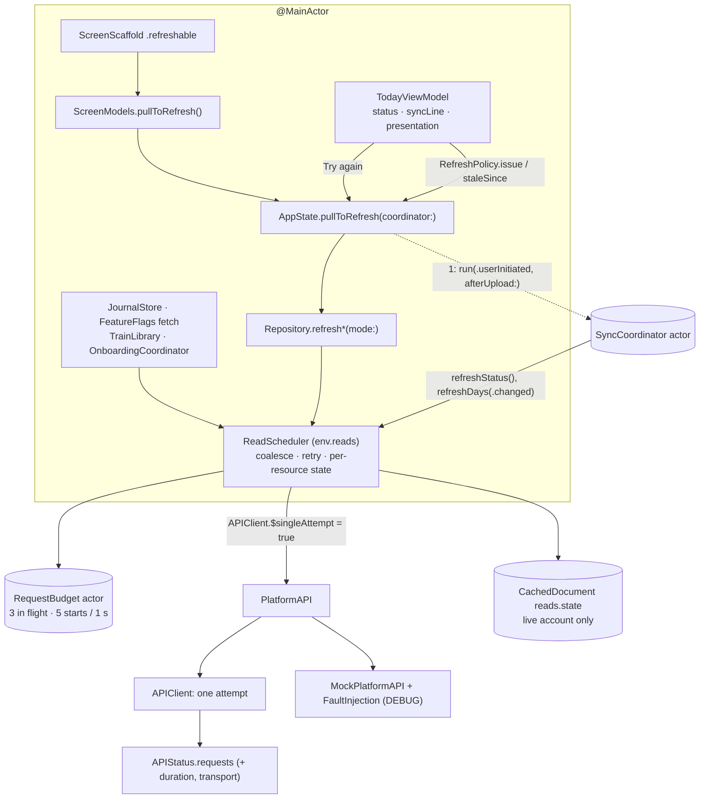

# Refresh resilience — design note (D1)

Brief: `CLAUDE_FOLLOWUP_REFRESH_RESILIENCE.md`. Plan: `plan.md` in this folder. UI spec: `ui.md` (D2). ADR:
`docs/adr/0001-one-retry-layer-for-reads.md`. Code refers to `99f6edb`; line numbers are from that commit.

This note fixes the states, types, owners, file placement and the seams between T1, T2 and T3. `ui.md` owns copy,
layout and visuals, and this note follows it. Where `ui.md` says `TodayState.decide(...)`, read
**`TodayPresentation.decide(_:)`** (finding 1). All three tickets start from `99f6edb` and build in parallel. None
of them needs another ticket's types to compile (§9).

## 0. What the code says (it changes the brief in places)

1. **The name `TodayState` is taken.** It is the API.md Swift mirror of `SyncStatus.today` (`Models.swift`
   L1019, API.md L1582), so it can't be renamed. The new decision is `TodayPresentation.decide(_:)`.
2. **Pull to refresh waits for the whole pipeline, then reads everything again.** `ScreenModels.pullToRefresh`
   (L64) runs `await coordinator.run(.userInitiated)`: upload, a scoring wait of up to 5 min, `refreshDays`,
   then trends and insights in parallel. After that it calls `state.refresh(force: true)`. The spinner lasts
   that whole time, and day, history, trends and insights are each fetched twice.
3. **The retry layers we have today:**
   - `APIClient` retries a `429` once, waiting up to 60 s. It retries a `503` up to 3 times, waiting up to
     30 s each time.
   - It doesn't retry transport errors.
   - The upload retries transport errors and 5xx at 2 s and 4 s, on top of that.
   - `APIClient` waits with its own `Task.sleep` closure, not `env.clock`.
   - Demo mode and the unit tests run on `MockPlatformAPI`, which never goes through `APIClient`. A read retry
     inside `APIClient` therefore can't be exercised by the demo UI test or by `AppEnvironment.test`.
4. **Hidden bursts and hidden cancellations.**
   - `.task(id: state.lastUpdated)` reloads several screens whenever today is fetched again:
     - Sleep (`SleepView` L23);
     - Insights (`InsightsView` L69: 14 metrics × up to 2 ranges);
     - the journal (`TodayView` L80: 2 GETs);
     - Bedtime (`RyftApp` L138).
   - `.task(id:)` cancels the run before it. Its `URLError.cancelled` comes back wrapped as
     `APIError.transport` (T0 test) and is treated like a failure.
5. **Transport failures leave no trace.** They aren't recorded in `APIStatus.requests`, and the card has no
   Details for them (T0).
6. **"— vs 7 d" is a flat delta, not a missing one.** The change is under 2 %, and `DeltaLabel.text` prints a
   flat delta as "—" (T0, `ChartStyleTests`).
7. **The screenshot is case (b).** T0 reproduces it with a scored today (`readiness 80, recovery 75,
   calibrating true, baseline_days 0`) and 30 scored days in the history. A separate bug: an *unscored* today
   (`computed_at 0001`, `state calibrating`, `calibrating false`) gives `TodayHero.score` with an empty gauge,
   not the pending state.
8. **API.md has no "app too old" signal.** `code` is a closed enum: `invite_required` and `consent_required`
   (open question 1; `ui.md` open question 1).
9. **`FeedbackPost.diagnostics` is `[String: String]?` in the mirror** (API.md L1630). Keep it.
10. **No new files in `Ryft/` or `RyftTests/`.**
    - Both are classic groups: in the pbxproj only `RyftWidgets` and `RyftUITests` are synchronized folders.
    - The `ryft-app-conventions` skill says all three are synchronized. That's drift, reported.
    - New UI test files in `RyftUITests/` are fine.
11. **Read decoding runs on the main actor.** This is pre-existing: `SWIFT_APPROACHABLE_CONCURRENCY = YES`, so
    `APIClient`'s nonisolated `send` runs on the caller's actor, and the caller is the `@MainActor` Repository.
    This note doesn't change it. A follow-up should move it to a `@concurrent` decode (§11).

## 1. Shape



**One owner per fact:**

| Fact | Owner |
| --- | --- |
| Request outcomes per resource | `ReadScheduler` |
| Row freshness | the SwiftData rows |
| Sync pipeline | `SyncCoordinator` |
| Gates | `OnboardingCoordinator` / `APIStatus` |
| What Today shows | `TodayPresentation.decide` |
| Whether staleness or an error is shown | `RefreshPolicy` |

## 2. Per-resource state (T1)

### Types and placement

All of these go into `Ryft/Persistence/Repository.swift`, appended at EOF under `// MARK: - read pipeline`
(T2 edits that file only inside `publishWidget` and `ReadinessSnapshot.make`).

```swift
/// What the app reads from the platform, as the read pipeline tracks it.
enum ReadResource: String, Codable, CaseIterable, Sendable {
    case today        // GET /v1/days/{today}
    case day          // GET /v1/days/{day}, a past day (Sleep, Strain, touched days)
    case history      // GET /v1/days?from&to (AppState.historyDays)
    case me           // GET /v1/me
    case syncStatus   // GET /v1/me/sync
    case trends       // GET /v1/trends (Today's readiness week, Insights' series)
    case insights     // GET /v1/insights
    case journal      // GET /v1/behaviors, /v1/journal/{day}, /v1/behaviors/impact
    case config       // GET /v1/config
    case train        // TrainLibrary: exercises, plans, plans/today
    case sleepRange   // GET /v1/sleep
    var priority: RequestBudget.Priority { self == .today || self == .syncStatus ? .high : .normal }
    /// ui.md §6 names (Today, History, Profile, Sync status, …); nil for `day` and `sleepRange`, which appear
    /// in Copy diagnostics only.
    var displayName: String? { get }
}

/// One request's identity for coalescing: `ReadKey(.trends, id: "readiness-7d")`, `ReadKey(.day, id: "2026-10-19")`.
struct ReadKey: Hashable, Sendable { let resource: ReadResource; var id = "" }

/// How fresh the caller needs it.
enum ReadMode: Equatable, Sendable {
    case ifStale               // Repository.Policy TTLs; nothing is sent while fresh
    case latest                // pull to refresh: fetch now, or join a fetch already in flight
    case changed(since: Date)  // the server's data changed at `since` (scores landed, a push): only a fetch
                               // started at or after `since` counts; an older one in flight gets one shared follow-up
}

struct ResourceError: Codable, Equatable, Sendable {
    let kind: FailureKind      // §3
    let status: Int?           // HTTP status; nil without a response
    let code: String?          // the error body's `code` exactly as sent
    let requestID: String?     // exactly as received
    let transport: String?     // URLError code name ("timedOut") when there was no response
    let attempts: Int          // 1 + retries
    let at: Date               // the last failed attempt
}

struct ResourceState: Codable, Equatable, Sendable {
    /// The last successful fetch. AppState's snapshot replaces it for `.today` with the row's
    /// `detailFetchedAt` (exact for the current day, also across midnight).
    var fetchedAt: Date?
    var lastError: ResourceError?
    /// Failed fetches in a row, after retries. A success resets it. Cancellation and gates never count.
    var consecutiveFailures = 0
    /// Retry-After beyond what a refresh waits (§3): automatic refreshes send nothing before this.
    var retryNotBefore: Date?
    /// Copy diagnostics, ui.md §6:
    /// "today | 2026-10-21T14:05:12Z | 503 - 01a14ffa-… 2026-10-21T16:11:02Z | 3". Never a health value.
    func diagnosticLine(_ resource: ReadResource) -> String
}
```

### Where the state lives

It lives in **`ReadScheduler`**, one per `AppEnvironment` (live, preview and test graphs), as
`lazy var reads = ReadScheduler(env: self)` in `Ryft/Environment/AppEnvironment.swift` (T1).

- **Why the environment and not the Repository:** `JournalStore(env:)`, `TrainLibrary`, `FeatureFlags`' fetch
  closure and `OnboardingCoordinator` read the platform without a Repository. They must share one budget and
  one coalescing map.
- **How it's observed:**
  - `ReadScheduler` is `@MainActor @Observable`, with `private(set) var states: [ReadResource: ResourceState]`
    and `private(set) var inFlight: Set<ReadKey>`.
  - `AppState.resourceStates` is computed from `env.reads.states`, with today's `fetchedAt` taken from the
    store (`repository.detailFetchedAt(todayKey)`, already persisted).
  - SwiftUI re-renders on either change.
- **How it persists:**
  - `fetchedAt` for days, trends, insights, user and documents already persists in their rows. Those rows stay
    the owners of TTL decisions.
  - The outcome record (`[String: ResourceState]`) persists as a `CachedDocument` with key `reads.state`
    through `env.persistence`, for the **live account only** (never in demo mode).
  - `Persistence.wipe()` removes it on sign-out with everything else.
  - It's written when `lastError` or `consecutiveFailures` changes, or when `fetchedAt` moves by more than
    60 s.
  - Why persist: a tester who force-quits and then reports still sends what failed, and the count of failures
    in a row survives the relaunch.
- **Account change:** `AppState.reset()` calls `env.reads.reset()`, which cancels everything in flight and
  forgets the in-memory states. An outcome that lands for another account is dropped (captured `accountID`),
  the same way `Repository.fetching` drops the answer.

```swift
@MainActor @Observable
final class ReadScheduler {
    init(env: AppEnvironment)
    private(set) var states: [ReadResource: ResourceState]
    private(set) var inFlight: Set<ReadKey>
    /// Jitter source; tests set a fixed one.
    @ObservationIgnored var random: @Sendable (ClosedRange<Double>) -> Double = { .random(in: $0) }

    /// Runs `fetch` for `key`, or joins the fetch in flight (see `ReadMode`). Offline (not demo): nothing is sent,
    /// returns nil, nothing is recorded. Retries per §3 (`.background` policy while `APIClient.runsInBackground`).
    /// Records the outcome for `key.resource`. Throws the last error when it failed, `CancellationError` when it
    /// was cancelled. `userInitiated` (pull, Try again) ignores `retryNotBefore`.
    @discardableResult
    func run<T: Sendable>(_ key: ReadKey, mode: ReadMode = .latest, userInitiated: Bool = false,
                          _ fetch: @escaping @MainActor () async throws -> T) async throws -> T?
    func cancelAll()
    func reset()
    var diagnosticLines: [String] { get }
}
```

### Rules

**The shared fetch.**
- The fetch runs in an **unstructured `Task` the scheduler owns**. Callers await its value, so a cancelled
  caller doesn't cancel it: `.refreshable` and `.task(id:)` cancellations stop mattering.
- `Task {}` inherits task-locals (`APIClient.runsInBackground`, `singleAttempt`). Never use `Task.detached`
  here.
- Only `cancelAll()` cancels the shared fetch.

**Reentrancy.** `run` checks and inserts into the in-flight map with no `await` in between.

**Joining.**
- With `.latest` / `.ifStale`, a call joins anything in flight for the same key.
- With `.changed(since:)`, a call joins only a fetch that started at or after `since`. Otherwise it queues
  one follow-up that later `.changed` callers share (the coordinator's "one rerun" pattern).

## 3. One retry layer for reads (T1) — decision

**The decision.**
- The single retry layer for *reads*, foreground and background, is `ReadScheduler`. It sits above
  `PlatformAPI`, so it covers `APIClient` and `MockPlatformAPI` alike.
- `APIClient` makes one attempt for every scheduled read:
  - `ReadScheduler` sets the task-local `APIClient.$singleAttempt` to `true` around the fetch;
  - `exchange` then skips its `429`/`503` loop and puts `Retry-After` on the error;
  - it uses the fail-fast session (`backgroundConfiguration`: 20 s request, 25 s resource, doesn't wait for
    connectivity);
  - it doesn't set `APIStatus.retryNotice`.
- The `401` refresh-once stays. That's auth, not a retry.

**Why not in `APIClient`.**
- `APIClient` doesn't know the resource, so it can't coalesce or keep per-resource state.
- It can't tell a user watching from a screen revalidating.
- Demo and tests bypass it.
- The limiter must release its slot during a backoff, which means waiting outside the request.
- The full trade-off is in the ADR.

**What happens to the existing retries.**

| Path | Retries after this change |
| --- | --- |
| Scheduled GETs (§4 list) | `ReadScheduler` only (policy below) |
| GETs not yet scheduled (workout detail, exercise history, sleep plan, plan detail, sessions list) | `APIClient`'s loop unchanged (legacy). It's deleted when the last GET is scheduled (ADR). Never two layers on one request, because `singleAttempt` switches the loop off exactly when the scheduler retries. |
| `POST /v1/sync` | Unchanged: `APIClient`'s 429/503 loop plus `SyncCoordinator.uploadWithBackoff` (2 s, 4 s). It's idempotent, has its own budget (2/s), runs off screen, and anchors commit only after acceptance. Their stacking (up to 12 attempts) is a follow-up, not part of a stability release. |
| Other writes | Unchanged. `POST /v1/feedback` (T3) uses `unavailableRetries: 0` plus its queue. Once T1 is in, it also uses `singleAttempt`, so a `429` (10 a day) doesn't wait out the legacy 60 s (§9). |

**`APIError`.** `case http(Int, String, requestID: String? = nil, code: APIErrorCode? = nil, retryAfter: Int? = nil)`.
- Every thrown HTTP error carries `Retry-After` in whole seconds.
- There are 15 pattern sites to give an extra `_`:
  - 12 in `APIClient.swift`;
  - `SyncCoordinator.swift` L388;
  - `TrainSyncService.swift` L158;
  - `JournalSheetModel.swift` L158.
- All of them are T1's. No other ticket touches those lines.

**Cancellation.**
- `APIClient.perform` rethrows `URLError.cancelled` as `CancellationError` (T0's known issue).
- Classification also treats `.transport(URLError.cancelled)` as a cancellation, because the mock's `cancel`
  fault throws that shape.

**Classification** (`APIClient.swift`, next to `APIError`; pure):

```swift
enum FailureKind: String, Codable, Sendable {
    case transient   // retried, counted after retries
    case cancelled   // never retried, recorded or counted
    case signedOut   // a final 401 (after APIClient's refresh-once), APIError.signedOut
    case gate        // 403 + invite_required / consent_required: onboarding's to show; not counted
    case appTooOld   // reserved: API.md has no signal (open question 1); never produced today
    case other       // not retried, counted
    var isActionable: Bool { self == .signedOut || self == .gate || self == .appTooOld }
    static func of(_ error: Error) -> FailureKind
}
```

| Input | Kind |
| --- | --- |
| `CancellationError`; `URLError.cancelled` (bare or in `.transport`) | `cancelled` |
| `.transport(URLError …)` (timed out, connection lost, not connected, DNS, TLS…), bare `URLError` | `transient` |
| `.http(408)`, `.http(429)`, `.http(500…599)` except `501` | `transient` |
| `.http(401)`, `.signedOut` | `signedOut` |
| `.http(403, code: .inviteRequired / .consentRequired)` | `gate` |
| `.http(403)` without code, `400`, `404`, `405`, `409`, `413`, `422`, `501`, other 4xx, `DecodingError`, `.notConfigured`, anything else | `other` |

**Policy** (`APIClient.swift`; pure):

```swift
struct RetryPolicy: Equatable, Sendable {
    var maxRetries: Int, base: Duration, maxBackoff: Duration, retryAfterCap: Duration
    static let foreground = RetryPolicy(maxRetries: 2, base: .seconds(1), maxBackoff: .seconds(4), retryAfterCap: .seconds(5))
    static let background = RetryPolicy(maxRetries: 1, base: .seconds(1), maxBackoff: .seconds(2), retryAfterCap: .seconds(2))
    /// Wait before retry `attempt` (1-based), or nil: don't retry.
    func delay(before attempt: Int, after error: Error, random: (ClosedRange<Double>) -> Double) -> Duration?
}
extension APIClient {
    /// One attempt: no 429/503 loop, `retryAfter` on the error, the fail-fast session, no retryNotice.
    /// Set by `ReadScheduler` (and by `postFeedback`). The 401 refresh-once stays.
    @TaskLocal static var singleAttempt = false
}
```

- **Full jitter:** `j = random(0 ... min(maxBackoff, base · 2^(attempt−1)))`, so retry 1 waits 0–1 s and retry 2
  waits 0–2 s.
- **Retry-After.**
  - Let `R` = `Retry-After`. A `429` without one counts as `R = 1`.
  - If `R ≤ retryAfterCap`, the wait is `max(R, j)`.
  - If `R > retryAfterCap`, there's no retry now. The outcome is a transient failure (counted), and
    `retryNotBefore = now + min(R, 300 s)`. Until then, automatic refreshes of that resource send nothing and
    count nothing; pull and Try again ignore it.
  - That is how `Retry-After` is honoured with a cap.
- **The budget is released during a backoff.** A retry takes a new budget slot and a new start.
- **All waits use `env.clock.sleep(for:)`.** So does `RequestBudget`, and so do the pull's 2 s and 3 s gates
  (§4). Jitter comes from `env.reads.random`.
- **Tests:**
  - set `random = { $0.upperBound }` (or fixed);
  - drive with `eventually { clock.pendingSleeps == n }` then `clock.advance(by:)`;
  - no real sleeps.
  - `APIClient`'s `sleep:` closure stays for the legacy and write paths.

**Recording.** `APIClient` records every outcome in `APIStatus.requests`, including transport failures
(status `0`). `APIStatus.RequestFailure` gains `var durationMs: Int? = nil` and `var transport: String? = nil`.

## 4. Scheduling (T1)

### Limiter

The limiter is **both a semaphore and a sliding-window log** in one `actor RequestBudget`, appended at EOF of
`Ryft/Networking/APIStatus.swift`.

- **`maxInFlight 3`:** never more than 3 scheduled reads at once.
- **`maxStarts 5` per `window 1 s`:** a start waits until the 5th most recent start is at least 1 s old. That
  is exact "no burst > 5". A token bucket of 5 would still allow 10 in the first second.
- **Waiters:** high priority (today, sync status) first, then FIFO.
- **Reentrancy:** `acquire` re-checks after every suspension, and a cancelled waiter leaves the queue.
- **Scope:** only scheduled reads. The upload has its own platform budget, and user writes never queue behind
  reads.

```swift
actor RequestBudget {
    enum Priority: Int, Comparable, Sendable { case high, normal }
    init(clock: AppClock, maxInFlight: Int = 3, maxStarts: Int = 5, window: Duration = .seconds(1))
    func acquire(_ priority: Priority) async throws
    func release()
}
```

### Which reads are scheduled (T1)

**Must:**
- today and past days (`Repository.refreshDay`);
- history (`refreshHistory`);
- me (`refreshUser`);
- sync status: `LiveSyncSteps.syncStatus` and `OnboardingCoordinator.check` (`HealthPermissionView.swift`
  L298–300);
- trends (`refreshTrend`);
- insights (`refreshInsights`).

**Should:**
- journal: `JournalStore.load`, `loadDay`, `loadImpacts`;
- config: the `FeatureFlags` fetch closure, `ScreenModels` L55, plus the onboarding config reads;
- Train: `TrainLibrary.refresh`, each part with its own `try?`, so it's per resource and no longer
  all-or-nothing;
- sleep ranges.

Whatever isn't scheduled keeps the legacy path, so nothing regresses.

### Pull to refresh

`AppState.pullToRefresh(coordinator:)` is the single path for `ScreenModels.pullToRefresh`,
`TodayViewModel.refresh` (Try again, both on the line and on the card), `ProfileViewModel.syncNow` and
`SyncDetailsModel.resendRecent`.

```mermaid
sequenceDiagram
  participant R as .refreshable
  participant A as AppState
  participant C as SyncCoordinator
  participant S as ReadScheduler
  R->>A: pullToRefresh(coordinator)
  A-)C: Task { run(.userInitiated, afterUpload: gate.open) }
  par phase 2 (high priority)
    A->>S: today (.latest, userInitiated)
  and
    A->>C: refreshStatus() → S: syncStatus
  end
  A-->>R: returns when phase 2 settled, or 3 s on the clock
  Note over R: spinner ends; the line shows the rest (ui.md §2.2)
  C--)A: afterUpload → gate opens
  Note over A: phase 3 when the gate opens or 2 s, whichever first
  A->>S: history, me, readiness 7d, insights (.latest)
  C->>C: awaitScoring ("Scoring your night")
  C->>S: refreshDays(.changed(since:)), trends, insights
```

1. **Phase 1, the upload.** The pull starts it in an unstructured `Task` and never awaits it. `afterUpload`
   (it already exists; it fires after this run's upload, or after the queued rerun's, or when the run is
   dropped) opens a one-shot gate (an `AsyncStream<Void>`).
2. **Phase 2, at once and at high priority:**
   - `repository.refreshDay(now, mode: .latest)`;
   - `coordinator.refreshStatus()`, a new actor method that calls `steps.syncStatus()`. That function goes
     through the scheduler (`ReadKey(.syncStatus)`), so a scoring poll in flight is joined, and it keeps its
     side effects: `state.syncStatus`, the gate observation and `sync.receive`.
3. **Phase 3, once the gate opens or 2 s pass on the clock** (first one wins, task group): history, me,
   readiness 7d and insights, all `.latest`.
   - The journal, config and Train are **not** in the list. Their own triggers already revalidate them through
     the same budget: the journal on `lastUpdated`, config on its TTL and app active, Train on app active and
     reconnect. Putting them in the pull would double those requests (open question 4).
4. **Return.** The function returns when phase 2 has settled or after `spinnerCap` = 3 s, whichever is first
   (`ui.md` §2.2.1 agrees).
   - Phases 2 and 3 run in tasks `AppState` owns, so a cancelled `.refreshable` cancels neither of them.
   - Offline, or without a data source, it returns at once and sends nothing. The line already says "Offline —
     will sync when back".
5. **What the line shows meanwhile** (`TodayStates.line`):
   - "Syncing · sleep" (`activity`);
   - then "Scoring your night" (`awaitingScores`);
   - then "Updating…" (`refreshing`, or `AppState.isLoading`, which is now derived as "a read of today,
     history, me, sync status, trends or insights is in flight");
   - then "Up to date · just now" (or `stale`, §5).
   - The 600 ms minimum per line in `ui.md` is the view's debounce.

**After a sync or a silent push.** `AppState.refreshDays(_:)` uses the same path:
- today, every touched day and the history run with `mode: .changed(since: clock.now())`, through the
  scheduler and budget;
- read failures are recorded per resource and **never thrown**; it throws only `CancellationError`, so the
  coordinator reports `.idle`;
- the pipeline's `refreshTrends` and `refreshInsights` likewise use `.changed(since:)` and never throw read
  failures;
- in the background the scheduler uses `RetryPolicy.background`.

**Other callers.**
- `AppState.refresh(force:touched:)` keeps its signature for bootstrap, `refreshStale`, demo toggle and
  rescore. Each resource is now independent: `force` means `.latest`, `touched` means `.changed(since:)`. It
  has no error side effect.
- Repository refresh functions take `mode: ReadMode = .ifStale`. A `force:` shim maps to `.latest`, so tests
  churn less. The TTL check happens before the scheduler; offline is decided in the scheduler.

## 5. Staleness and the error decision (T1)

`Ryft/App/AppState.swift`, after the class (T2 doesn't touch this file):

```swift
struct RefreshIssue: Equatable, Sendable {
    /// ui.md §3.3 classes. busy: 429/5xx/408 after retries; unreachable: no response; unexpected: `other`.
    enum Reason: Equatable, Sendable { case busy, unreachable, unexpected, signedOut, appTooOld }
    let reason: Reason
    let resource: ReadResource
    let dataFrom: Date?         // "Showing data from 14:05"; nil: nothing cached
    let failures: Int
    let error: ResourceError
    /// The Details sheet's rows as plain text (Copy details): what failed, status, code, request ID, time,
    /// data from, failed in a row. No health values.
    var copyText: String { get }
}

enum RefreshPolicy {
    static let failuresBeforeIssue = 3
    static let staleAfter: [ReadResource: TimeInterval] = [.today: 2 * 3600, .history: 24 * 3600]
    /// ui.md §2.1 line 7: today's data time, when today (or history) is older than its threshold and its last
    /// fetch failed. nil when offline, fresh, or the last fetch succeeded.
    static func staleSince(for states: [ReadResource: ResourceState], now: Date, online: Bool) -> Date?
    /// ui.md §3.1: the calm card.
    static func issue(for states: [ReadResource: ResourceState], now: Date, online: Bool) -> RefreshIssue?
}
```

### `issue` (the card)

In order:
1. `online == false` → `nil`. Offline is never an error.
2. Any resource whose `lastError.kind` is `signedOut` or `appTooOld` → that issue. Gates → `nil`: the existing
   `.actionNeeded` path owns them, so they never show twice.
3. For `.today`, then `.history`: let `f = consecutiveFailures`. The resource is an issue when either holds:
   - `f ≥ 3` and (`fetchedAt == nil` or `now − fetchedAt > staleAfter`);
   - `f ≥ 1` and `fetchedAt == nil` for both today and history.

   The second condition is new: with nothing cached at all, a blank Today is the alternative ("never a blank
   screen", open question 3).
4. Otherwise `nil`. Other resources (`me`, `trends`, the journal…) never produce the card. Their state shows in
   Sync details → "Loaded data".

### `staleSince` (the line)

- It is set when today's `consecutiveFailures ≥ 1` and `now − fetchedAt > 2 h`, or history's
  `consecutiveFailures ≥ 1` and its age is over 24 h.
- It returns today's `fetchedAt`.
- Under the age thresholds, failed reads change nothing on screen (`ui.md` §2.1).

### Who consumes it

- **`AppState`** gets `refreshIssue` and `staleSince` (computed over `resourceStates`, `clock.now()` and
  `connectivity`).
- **`TodayViewModel.Status`:** `.error(message:details:)` becomes `.refreshIssue(RefreshIssue)`. The order is
  `actionNeeded › retrying (the upload's 503 wait) › refreshIssue › syncPaused`.
- **`TodayStates.line(_ f: TodaySyncFacts, staleSince: Date?, cardShown: Bool) -> SyncLine`.** Separate
  parameters, so `TodaySyncFacts` stays T2's.
  - It adds `case stale(since: Date, offersRetry: Bool)`.
  - `stale` is placed after `.updating` and before `.paused`, so it only shows when idle.
  - `offersRetry` is `!cardShown` (one Try again on screen).
  - `syncLine` becomes `TodayStates.line(facts, staleSince: state.staleSince, cardShown: state.refreshIssue != nil)`.
- **Taps** (`ui.md` §2.3):
  - `actionNeeded` → the gate;
  - `stale`'s Try again → `refresh()`;
  - anything else, including `stale`'s text → Sync details, as a sheet from Today with its own
    `NavigationStack`.
  - `SyncStatusLineView` in `StatusViews.swift` becomes tappable throughout.
- **The card** (`InlineMessage`, extended in `StatusViews.swift`):
  - reason, data age, Try again ("Trying again…" while running) and Details;
  - Details opens `RefreshDetailsSheet(issue:)`, also in `StatusViews.swift` and T1's. Its rows follow
    `ui.md` §3.4. It has "Copy details" (`issue.copyText`).
  - "Send to RYFT" pushes the destination from the environment (§9). The button is hidden when there is none.

**What replaces `AppState.error` / `errorDetails`.** Both are deleted. `AppState.refreshIssue` and
`AppState.staleSince` take their place.

| Reads them today | Migration |
| --- | --- |
| `TodayViewModel.status` L87–92 | `.refreshIssue` (above) |
| `TodayView.status` L199–201 | the issue card |
| `AppState.refresh` / `refreshDays` / `reset` (writers) | removed; `reset()` calls `env.reads.reset()` |
| `ViewModelTests` L57–80 | rewritten: a 500 with no cache → issue after 1 pass; with cache → no card until 3 failures and 2 h |
| `SleepUpgradeTests` L202, L252 (`state.error == nil`) | `state.refreshIssue == nil` |
| T0's `RefreshAllOrNothingTests` (`state.error`, `.error`) | T1 removes the `withKnownIssue` wrappers and asserts on `vm.status` / `resourceStates` |

Other screens keep their own errors: Sleep, Strain, Plans and `TrainLibrary`, `BodySettingsEditor`,
`AuthService`, onboarding. None of them reads `AppState.error`. `Error.diagnosticDetails` stays.

**Sync details.**
- T1 adds the "Loaded data" section (`ui.md` §6) to `SyncDetailsView` (`ProfileView.swift` L522–640), plus its
  preview next to L1144–1165.
- `SyncDetailsModel.diagnostics` (L357–381) gains:
  - one `diagnosticLine` per resource;
  - `duration_ms` and `transport` on each request line.

## 6. Fault injection (T1 ends with this; DEBUG only)

T0's commit `4b7c83c` adds `FaultInjection` and `MockPlatformAPI.faults` in `PlatformAPI.swift`. T1
cherry-picks it and extends it to this shape, compiled out of Release (`#if DEBUG` around the type, the
property and the hook):

```swift
#if DEBUG
enum FaultInjection {
    enum Fault: Equatable, Sendable {
        case status(Int, retryAfter: Int?)   // "429", "429:7", "503:2", "500", "404"
        case timeout                         // .transport(URLError(.timedOut))
        case offline                         // .transport(URLError(.notConnectedToInternet))
        case cancel                          // .transport(URLError(.cancelled))
        /// What one attempt throws (scheduled reads are single attempts now, so this is the raw shape):
        /// `.http(status, …, requestID: "fault-<route>", retryAfter:)` or `.transport(URLError)`.
        func error(route: String) -> Error
    }
    struct Rule: Equatable, Sendable { var fault: Fault; var remaining: Int? }   // nil: every call
    /// `-RyftFault "/v1/me=429:2x1,/v1/days=timeout,/v1/days/{day}=503:1x2"`: `x<n>` fails the first n calls only.
    static func parse(_ spec: String?) -> [String: Rule]
    /// Path → MockPlatformAPI call name; adds /v1/behaviors, /v1/journal/{day}, /v1/behaviors/impact,
    /// /v1/plans, /v1/plans/today, /v1/exercises, /v1/sleep to T0's table.
    static let routes: [String: String]
}
#endif
```

- **Hook:** `MockPlatformAPI.enter(_:)`, which consumes `remaining`. This is below the scheduler, so demo UI
  tests exercise the real retry path.
- **Optional:** the same parser behind `#if DEBUG` in `APIClient.exchange` before `perform`, for reproducing
  on a device against production.
- **T3 doesn't depend on this.** It must not append at the end of `PlatformAPI.swift`, where T0's enum lives.

## 7. Today: one decision (T2)

### Types

**`Ryft/Networking/Models.swift`**, after `nightsToGo` (L303). This is app-side, not a wire field:

```swift
/// What a row says about its day. The platform's placeholder for a day it hasn't scored (`computed_at` 0001,
/// `state: calibrating`, `calibrating: false`) and `DailyScore.empty` are `.unscored`, never calibrating.
enum ScoreStanding: Equatable, Sendable { case unscored, calibrating(baselineDays: Int), scored }
extension DailyScore {
    /// `.unscored`: no readiness and `computed_at` nil or not after 1970. Else `calibrating` → `.calibrating`.
    var standing: ScoreStanding { get }
}
static func empty(day: String) -> DailyScore { DailyScore(day: day) }   // state nil: unknown, not calibrating
```

`ReadinessState` stays a closed wire enum (no new case). `resolvedState` keeps the platform's semantics.
Presentation branches on `standing`, never on `state == .calibrating` or `calibrating` alone.

**`Ryft/Features/Today/TodayViewModel.swift`**, inserted after `enum TodayStates` (after L494, before
`TodayScenario`):

```swift
/// What the day's numbers are decided from: a subset of `TodaySyncFacts`, also built by the widget snapshot.
struct TodayScoreFacts: Equatable, Sendable {
    var day: String                 // today, yyyy-MM-dd
    var today: DailyScore?          // today's row (detail score, else list), any standing
    var scoringState: ScoringState? // GET /v1/me/sync's today when it's about `day`, else the row's
    var prior: [DailyScore]         // days before `day`, oldest first, as cached (decide filters)
    var expectedWithinSec: Int?
    var lastNight: RawNight?        // Apple Health, unscored (RawNightCard)
}

/// Gauge, tiles and note from one source (brief §2, ui.md §1), decided once; tested as the decision table.
struct TodayPresentation: Equatable, Sendable {
    enum Row: Equatable, Sendable { case scored, calibrating, pending, recalculating, firstImport }   // ui.md A B C D E
    enum Gauge: Equatable, Sendable {
        case readiness(Int?)            // the source day's readiness (rows A, D)
        case baselines(nights: Int)     // baseline_days of the latest scored day (= today when shown) (B)
        case pending(PendingNight)      // outline; latest readiness dimmed + dated (C)
        case firstImport                // (E)
    }
    struct Tiles: Equatable, Sendable {
        var source: DailyScore?         // the one day all three tiles show; nil: placeholders ("—", no caption)
        var isEarlierDay: Bool          // source isn't today: dimmed, caption = its date
        var calibrating: Bool           // row B: caption "calibrating" on all three
    }
    enum Note: Equatable, Sendable { case recalculating }   // GaugeNote under the gauge (row D)
    var row: Row
    var gauge: Gauge
    var tiles: Tiles
    var note: Note?
    /// Row C while scoring (not waiting for sleep): last night from Apple Health for `RawNightCard`.
    var rawNight: RawNight?
    /// The gauge's delta is allowed only in row A (ui.md §4).
    var showsDelta: Bool { row == .scored }
    static func decide(_ f: TodayScoreFacts) -> TodayPresentation
}
```

### The decision table

Definitions:
- `scored(d) = d.standing != .unscored`
- `prior = f.prior.filter(scored)`
- `latestPrior = prior.last { $0.readiness != nil }`
- `vitals = prior.suffix(30).count { $0.hrvMs != nil && $0.rhr != nil }`

`vitals` mirrors API.md's `baseline_days`: the nights with HRV and resting HR among the 30 scored days
before. The rows are evaluated first-match; the ui.md letter is in brackets.

| # | Inputs | Gauge | Tiles | Note / raw night |
| --- | --- | --- | --- | --- |
| 1 (E) | `today` nil or unscored, and `prior` empty | `.firstImport` | nil (hidden) | — |
| 2 (C) | `today?.readiness == nil` and (`today` nil or unscored, or `scoringState ∈ {pending, waitingForSleep}`) | `.pending(PendingNight(waitingForSleep: scoringState ∈ {waitingForSleep, stale}, expectedWithinSec, previousReadiness: latestPrior?.readiness, previousDay: latestPrior?.date))` | `source: latestPrior`, `isEarlierDay: true` | `rawNight: waitingForSleep ? nil : f.lastNight`. Never "0 of 7". |
| 3 (D) | `today.calibrating` and `vitals ≥ 7` (platform says calibrating, history disagrees) | `.readiness(today.readiness ?? latestPrior?.readiness)` | the same day as the gauge: today if it has a readiness, else `latestPrior` with `isEarlierDay` | `.recalculating` |
| 4 (B) | `today.calibrating` | `.baselines(nights: today.baselineDays)` | today, `calibrating: true` | — |
| 5 (A) | otherwise (today scored, not calibrating) | `.readiness(today.readiness)` | today | — |

- **The screenshot's inputs** (`readiness 80, recovery 75, strain 0.9, calibrating true, baseline_days 0`,
  30 prior days with HRV/RHR) give row 3: gauge 80 with "Recalculating your baselines", today's tiles, no delta.
  The gauge, tiles and Trends card agree.
- **An unscored today with scored history**, and `DailyScore.empty`, give row 2 (C). It is never "0 of 7", and
  never D: D needs a *scored* row that says `calibrating`.
  - `ui.md` §1 "C or D by scoring_state" and its preview 7 therefore need a scored today without a readiness:
    `computed_at` set, `readiness: nil`, `calibrating: true`, `scoring_state: scored`.
- **A phone-only account** (scored days without HRV, so legitimately calibrating) gives row 4, not
  "Recalculating". That's why row 3 counts `vitals` and not just scored days (open question 2).
- **Where "latest scored day" comes from:**
  - `today` once it's scored (rows 3–5);
  - otherwise the cached `GET /v1/days` rows in `TodaySyncFacts.prior`.
  - `TodayViewModel.facts` fills `prior` from `state.history`, which is already read there.
- **`Baselines · n of 7`** only appears in row 4, where today is scored, so `n` is never an unscored row's.
- **Row C's tiles** carry the latest scored day's values, including its sleep, dimmed and dated. Last night's
  raw Apple Health total stays in the shipped `RawNightCard`, labelled "not scored yet" (`ui.md` §1.2 C; this
  refines the brief's tile column).

### TodayHero: wrap it, don't replace it

`TodayStates.hero(_:) -> TodayHero` keeps its signature and cases. `TodayStates.line` (T1) depends on
`.pending(PendingNight)` and `waitingForSleep`.

- It still returns `.importing(progress)` first while `isImporting(f) && !f.hasScoredDay`.
- Otherwise it maps `decide(f.scores).gauge`:
  - `.readiness` → `.score`;
  - `.baselines(n)` → `.calibrating(nights: n)`;
  - `.pending(p)` → `.pending(p)`;
  - `.firstImport` while not importing → `.score` (today's behaviour: an empty gauge and "Your scores appear
    after the first synced night").
- `TodayStates.isScored` becomes `score.standing != .unscored`.
- **New members:**
  - `TodayViewModel.presentation`, plus `facts.prior` and `facts.scores`;
  - the tile accessors (`sleepText`, `recovery…`, `strainText`, captions, dimming) read `presentation.tiles`;
  - `rawNight` reads `presentation.rawNight`;
  - `readinessDelta` is `nil` unless `presentation.showsDelta`;
  - `sentence` follows the row (`ui.md` §1.5);
  - `ReadinessCopy.sentence(score:)` never says "Learning your baseline" for `.unscored`.
- **Components** (`ui.md` §1.7, T2): `MetricTile.isDimmed`, and `GaugeNote` in `MetricGauge.swift`. The
  hero's cross-fade becomes `Theme.Motion.quick`.
- **`TodayScenario`** gains `recalculating`, `recalculatingYesterday`, `waitingForSleep` and `pendingNoPrevious`
  (`ui.md` §1.6) for previews, UI tests and screenshots.
- **Tests:** the existing import, pending and watch tests stay. One fixture changes: the `ViewModelTests`
  helper L153–156 sets `computedAt: nil` for rows without a readiness. Scored calibrating rows need a real
  `computedAt`.

### Every use of `DailyScore.empty` and of the calibrating fields (T2 audits them)

| Kind of use | Where |
| --- | --- |
| `.empty(day:)` | `MockData.swift` L43 (the only call) |
| `resolvedState` | `Models.swift` L290, `ReadinessCopy.swift` L34; tests `ReadinessCopyTests` L34–47, `DecodingTests` L96, L130 |
| `calibrating` / `baselineDays` / `nightsToGo` | `TodayViewModel.swift` L61, L433; `TodayView.swift` L134, L220; `Repository.swift` L575–577 (widget); `MetricGauge.swift` L191–193; `MockData.swift` L144–146, L226–242 |
| Widget target | `RyftWidgets/ReadinessWidget.swift` L94–227 reads only snapshot kinds; no change needed (below) |
| Tests | `ViewModelTests` L153–156, L266–270, L390–391; `RepositoryTests` L355–368; `MirrorDecodingTests` L203; `DecodingTests` L87–131 |

### Widget

`Repository.publishWidget()` (L381–390) builds `TodayScoreFacts` from the store:
- `score(key)`;
- `todayStatus` when it's about today, else the row's state;
- `history(−30 … −1)`.

It then calls `ReadinessSnapshot.make(day:presentation:now:bedtime:)` (L561–582), which replaces
`make(day:today:previous:state:now:bedtime:)`. The mapping:

| Gauge | Snapshot |
| --- | --- |
| `.readiness(r?)` from today | `.score(r)` |
| `.readiness` from an earlier day (row 3), or `.readiness(nil)` | `.waitingForSleep`, `previousReadiness` |
| `.baselines(n)` | `.calibrating`, `baselineNights: n` |
| `.pending(p)` | `p.waitingForSleep ? .waitingForSleep : .pending`, `previousReadiness` |
| `.firstImport` | `nil` |

- The JSON shape is unchanged, so `RyftWidgets/` needs no edit.
- A calibrating day that has a readiness now shows baselines on both Today and the widget. Today the widget
  shows the score while Today shows the baseline gauge.

## 8. Report a problem (T3)

**`Ryft/Environment/PlatformAPI.swift`:**
- Protocol: `func postFeedback(_ post: FeedbackPost) async throws`, after `redeemInvite`.
- `APIClient` extension (after `behaviorImpact`):
  `_ = try await exchange("POST", path: "/v1/feedback", body: post, unavailableRetries: 0)`. `0` because the
  queue retries, and a `503` after the server stored the report would duplicate it.
- `MockPlatformAPI`, in the services section after `postAppleAuthorization`: `try enter("feedback")` and
  `private(set) var feedbackPosts`.
- Nothing at EOF.

**`Ryft/Features/Profile/ProfileViewModel.swift`**, at EOF:

```swift
/// What a report is about, when it comes from the error card's Details (ui.md §5.3 chip and prefill).
struct ReportContext: Equatable, Sendable { let resource: String; let status: String; let requestID: String? }

@MainActor @Observable
final class ReportProblemModel {
    enum Result: Equatable { case sent, queued, rateLimited, rejected, saveFailed }   // ui.md §5.4
    init(env: AppEnvironment, apiStatus: APIStatus, diagnostics: @escaping @MainActor () -> String)
    var message = ""
    var category: FeedbackCategory = .other      // `.bug` when opened with a context
    var includeDiagnostics = true
    private(set) var context: ReportContext?
    private(set) var result: Result?
    private(set) var waiting = 0                 // "1 waiting to send"
    func prepare(_ context: ReportContext?)      // sets category, prefill, request ID
    /// Saves to the queue first, then posts; 204 → sent, transient → queued, 429 → rateLimited (message kept,
    /// not queued), 400/413/422 → rejected (dropped).
    func send() async
    /// Reconnect, app active: posts what's queued, oldest first.
    func flush() async
}
/// The request within API.md's limits: message 1–4000, ≤ 20 request IDs of ≤ 64, diagnostics ≤ 32 KiB,
/// strings ≤ 64.
enum FeedbackPayload {
    static func make(message: String, category: FeedbackCategory, includeDiagnostics: Bool, diagnosticsText: String,
                     requests: [APIStatus.RequestFailure], gates: Set<APIErrorCode>, flags: [String: Bool],
                     context: ReportContext?) -> FeedbackPost
}
```

**`ProfileViewModel`** gets `let report: ReportProblemModel`, created in `init` (L18–27) with
`diagnostics: { [syncDetails] in syncDetails.diagnostics }`.

**The queue.**
- It's a Codable `QueuedFeedback` mirror in `CachedDocument` `feedback.queue`, through `env.persistence`,
  wiped on sign-out. `FeedbackPost` stays `Encodable` as in the mirror.
- `flush()` runs from `RyftApp`'s `onChange(of: connectivity.isOnline)` and from scene `.active`.

**Diagnostics** (`[String: String]` per the mirror):
- `sync_details`: `SyncDetailsModel.diagnostics`, the same text as Copy diagnostics;
- `gates`;
- `flags`: `key=0|1`, comma-separated;
- `locale`.

App version, build, device and OS go in the top-level fields. `request_ids` are the failed requests' IDs,
newest first, plus the context's. No health values: the text holds counts, times, statuses and IDs only.

**UI** (`ProfileView.swift`, `ui.md` §5):
- `ReportProblemView(model: ReportProblemModel, context: ReportContext? = nil)` is a **pushed** screen. It calls
  `model.prepare(context)` once on appear.
- It's reached from Profile → About (first row, with "N waiting to send"), and from the Details sheet (§9).
- Its Previews go at EOF of `ProfileView.swift`.

## 9. Merge seams

**No ticket needs another's types to compile.** The cross-ticket links are values, strings or an environment
closure:

| Seam | T1 provides | Consumer provides | Wiring (whoever merges second) |
| --- | --- | --- | --- |
| Diagnostics: per-resource state and request durations | Extends `SyncDetailsModel.diagnostics` (resource lines, `duration_ms`, transport) and `RequestFailure.durationMs/transport`. This is acceptance criterion 10. | T3 sends `sync_details` = that text | none: T3 reads a `String` that exists on `main` |
| "Send to RYFT" in `RefreshDetailsSheet` (push onto the sheet's stack) | In `StatusViews.swift`: `typealias ReportProblemDestination = @MainActor (_ resource: String, _ status: String, _ requestID: String?) -> AnyView` and `EnvironmentValues.reportProblemDestination: ReportProblemDestination?`. The sheet shows a `NavigationLink` "Send to RYFT" only when it's non-nil. | T3: `ReportProblemView(model:context:)`, `ReportContext` | one modifier on `RootView`'s content (`RyftApp.swift`): `.environment(\.reportProblemDestination) { r, s, id in AnyView(ReportProblemView(model: screens.profile.report, context: ReportContext(resource: r, status: s, requestID: id))) }` |
| Feedback without the legacy 60 s `429` wait | `APIClient.$singleAttempt` | T3: `postFeedback` | wrap the `exchange` in `APIClient.$singleAttempt.withValue(true)` |
| Today's line uses the hero (T1 ↔ T2) | `TodayStates.line` calls `hero(f)` | T2 keeps `hero(_:) -> TodayHero` and `.pending(PendingNight).waitingForSleep` | none |
| `isLoading` (T1 ↔ T2) | `AppState.isLoading` becomes derived (same name) | T2's `facts` keeps reading `state.isLoading` | none |

**Regions in shared files** (at `99f6edb`; nobody reformats outside their own):

| File | T1 | T2 | T3 |
| --- | --- | --- | --- |
| `TodayViewModel.swift` | L18–27 `Status`; L84–99 `status` (+ new props right after); **L145 only** of L142–151; L166–176; L327–383 `SyncLine`; L464–482 `line` | L47–82; L106–142 (not L143–146); L147–151; L229–265; L305–325; L402–435; new types after L494; L496–557 `TodayScenario` | — |
| `TodayView.swift` | L189–212 `status`; sheets (Sync details, `RefreshDetailsSheet`) as modifiers after L70 | L117–187 hero (+ `GaugeNote`), ring, tiles, trends; L214–228; previews (`ui.md` §1.6) | — |
| `Repository.swift` | L211–308 refresh; `fetching`; EOF `// MARK: - read pipeline` | L360–390 `todayStatus`/`publishWidget`; L525–582 snapshot | — |
| `PlatformAPI.swift` | cherry-pick T0 (init, `enter`, EOF enum) and extend | — | protocol line; `APIClient` extension end; mock services section |
| `ProfileViewModel.swift` | L166–169, L340–346, L357–381 | — | `init` L16–27; EOF |
| `ProfileView.swift` | `SyncDetailsView` L522–640 ("Loaded data") and its previews L1144–1165 | — | About row; `ReportProblemView` and previews at EOF |
| `ScreenModels.swift` | L63–67 | — | — |
| `RyftApp.swift` | — | — | `onChange(isOnline)` and `.active` flush; the environment line (second merger) |
| `StatusViews.swift`, `APIClient.swift`, `APIStatus.swift`, `AppState.swift`, `AppEnvironment.swift`, `SyncCoordinator.swift`, `JournalStore.swift`, `TrainLibrary.swift`, `HealthPermissionView.swift`, `TrainSyncService.swift` L158, `JournalSheetModel.swift` L158 | T1 only | — | — |
| `Models.swift`, `ReadinessCopy.swift`, `DeltaLabel.swift`, `MetricTile.swift`, `MetricGauge.swift`, `MockData.swift`, `TrendChart.swift` | — | T2 only | — |
| `Localizable.xcstrings` | adds keys | adds keys | adds keys — resolve at merge, then `make lint` |

**Tests, so that two tickets don't both append to the same file:**
- **T1:**
  - `APIClientStatusTests` (EOF, after T0's block);
  - `SyncCoordinatorTests` (EOF): scheduler, budget, retry and pull phases;
  - `ViewModelTests`: rewrites L57–80 in place, plus T0's EOF block from `fd1f070`;
  - `RyftUITests/RefreshResilienceUITests.swift` (new), added to UISmoke's `selectedTests`. That edit may
    conflict trivially with the open `NotificationsUITests` PR; keep both.
- **T2:**
  - `ViewModelTests`: the decision-table suite inserted **after the existing TodayStates tests** (≈ L391), not
    at EOF;
  - `ReadinessCopyTests`, `ChartStyleTests`, and `RepositoryTests`' `ReadinessSnapshotTests` (mid-file);
  - T0's uncommitted calibration and delta tests (open question 6).
- **T3:** `MirrorDecodingTests` (the `FeedbackPost` shape against the API.md example) and a `ReportProblemTests`
  suite at EOF of `EnvironmentTests`.

## 10. The Trends delta (T2)

A delta is a value or it's absent; "—" is never rendered (`ui.md` §4).
- A flat delta (under 2 %) reads **"Steady"** followed by "vs 7 d", in `textSecondary`. VoiceOver keeps saying
  "No change".
- `nil` (fewer than 2 valued points, or no earlier point in the 7 days) renders nothing, and leaves no gap in
  `ChartHeader`.
- The rule lives in `DeltaLabel.text`, so the gauge, `ChartHeader` and every chart follow it.
- On Today the gauge's delta appears only in row A (`presentation.showsDelta`).

## 11. Migration order, test strategy, risks, follow-ups

**T1 order:**
1. `APIError.retryAfter`, `FailureKind`, `RetryPolicy`, `singleAttempt`, the fail-fast session, and the
   transport and duration records.
2. `RequestBudget` and `ReadScheduler`, with persistence.
3. Repository refresh through the scheduler.
4. `AppState`: `refresh`, `refreshDays`, `pullToRefresh`, `RefreshPolicy`; delete `error`.
5. Coordinator: `refreshStatus`, non-throwing read stages.
6. Today: status, line, card, Details sheet.
7. Sync details "Loaded data".
8. Routing for journal, config and Train.
9. Fault injection.

**T1 tests:**
- **Unit, all on `TestClock` with a fixed `random`:**
  - each resource failing on its own (T0's tests flip);
  - single attempt per scheduled GET on `429`/`503`;
  - `Retry-After` within and beyond the cap;
  - backoff bounds;
  - coalescing (`.latest` joins; `.changed` follows up once);
  - the budget (4 held → 3 in flight; 7 starts → 5, then 2 after 1 s);
  - cancellation (no count, no `lastError`);
  - background policy;
  - offline (nothing sent, nothing counted);
  - `RefreshPolicy.issue` / `staleSince` as tables;
  - pull phases (phase 2 before phase 3; the gate at 2 s or at upload end; the return at phase 2 or 3 s).
- **UI** (demo, `-RyftFault "/v1/me=429:1x1,/v1/days=503:1x1"`): after a pull the line ends at
  "Up to date · just now", and `today.refreshIssue` never appears.
- **Second UI test:** with nothing cached (`/v1/days/{day}=timeout` always), the card and Details appear after
  one pass.

**T2 order:**
1. `standing` and `.empty`.
2. `decide` and its table tests.
3. Wrap `hero`.
4. Tiles and note in view and view model.
5. Previews per row (dark, light, de, AX3).
6. Widget mapping.
7. Delta.

**T2 tests:**
- every row, including the screenshot's inputs, unscored today plus history, and phone-only calibrating;
- the widget mapping per row;
- `DeltaLabel` flat → "Steady".

**T3** is independent.

**T3 tests:**
- the payload against the API.md example;
- the caps;
- the queue: offline → queued → flushed on reconnect; `429` not queued;
- no health values: the diagnostics contain none of `MockData`'s score fields or values.

**What could go wrong:**
- **Silent retries hide an outage.** Counts and `lastError` persist and show in Sync details. The line goes
  stale after the age threshold, and the card appears past 3 failures, or at once with nothing cached.
- **Double retry.** A scheduled read without `singleAttempt` would stack two layers. A test asserts one
  attempt. Never `Task.detached` in the scheduler.
- **A joined fetch returns pre-scoring data.** `.changed(since:)` prevents it, and a test covers it.
- **The budget actor's reentrancy, or a waiter that is never resumed.** Re-check in a loop, and test
  cancellation while waiting.
- **Midnight.** `.today`'s data age comes from the current day's row, not from the last success.
- **`retryNotBefore` swallows automatic refreshes.** It's capped at 300 s, and pull ignores it.
- **The "Recalculating" heuristic misfires** if rows lack `hrv_ms`/`rhr` for another reason. Row 4 is the safe
  fallback.
- **An environment closure building `AnyView` is a soft seam.** If the line in `RootView` is missing, "Send to
  RYFT" silently hides. T3's UI test, or a review check, opens Details → Send to RYFT.
- **The cascades keep firing.** `.task(id: lastUpdated)` still fires; the budget bounds it. Follow-up: key
  those tasks on a refresh generation.
- **Read decoding stays on the main actor** (finding 11). Follow-up: a `@concurrent` decode in
  `APIClient.send`, measured with the existing signposts.
- **Follow-ups:** delete the legacy GET loop once every GET is scheduled, and revisit the upload's stacked
  retries (ADR).

## 12. Open questions (the lead decides; each has a recommendation)

`ui.md` already settles the spinner end (phase 2 or 3 s), when the line goes stale (age threshold after a
failed fetch), and the flat delta ("Steady"). This note follows it.

1. **"App too old" has no contract.** Recommendation: a platform request in `API_REQUESTS.md` (T4) for `426`
   with `code: "app_update_required"` (and/or `GET /v1/config` → `min_build`). `FailureKind.appTooOld` and
   `Reason.appTooOld` stay reserved and never produced until then, so there's no such card in this release.
2. **The "Recalculating" trigger.** The brief says "≥ 7 scored days". Recommendation: ≥ 7 of the 30 prior
   scored days with HRV and resting HR, which is API.md's own `baseline_days` input. Otherwise phone-only
   accounts show "Recalculating" forever.
3. **With nothing cached** (today and history never loaded), the card shows after 1 failed pass instead of 3.
   Recommendation: yes; otherwise Today is blank.
4. **The journal, config and Train** are scheduled (budget, retries, state), but not part of pull's phase 3,
   because their own triggers already run. Recommendation: accept this deviation from the brief's list.
5. **Persist per-resource state** for the live account (`CachedDocument reads.state`). Recommendation: yes.
   Diagnostics survive a force-quit, and failures in a row survive a relaunch.
6. **The T0 tests.** Recommendation: the debugger commits the calibration and delta tests (`RepositoryTests`,
   `ChartStyleTests`, still uncommitted on `wt-debug`) separately from `fd1f070`, so that T1 cherry-picks only
   the refresh tests and T2 only the Today tests.
7. **`ui.md` wording** (no decision needed, just an edit for D2):
   - `TodayState.decide` → `TodayPresentation.decide`;
   - row D can't come from an unknown or unscored today;
   - preview 7 needs a scored row without a readiness.

## Errata after review (lead, 2026-10-22): what shipped differs from §7 here
- **Row B with `needsVitals`** (`prior.count ≥ 7 && vitals < 7`): the gauge shows today's readiness if there is one, with
  `Note.needsVitals`, and the tiles have no "calibrating" caption. Without a readiness, the baselines gauge counts `vitals`
  (nights with HRV and RHR), captioned "n of 7 nights with heart-rate data". Row B with "n of 7 nights" is only for
  `prior.count < 7`.
- **Row E** doesn't apply while the platform says `pending`/`waitingForSleep` (that's row C, `pendingNoPrevious`).
- **Row C** counts as waiting-for-sleep when `scoringState` is nil (nothing claims "Scoring your night" without the platform's
  word). Its sentence names the date when the dimmed day isn't yesterday.
- **The delta** shows only in row A with a readiness (`TodayPresentation.showsDelta`).
- **The widget** reads the same 90-day history as Today and writes `previousReadiness` in every kind.
- **Reads (§3–§5):** `ReadScheduler.run` waits through cancellation-aware continuations and stores results in the flight. Nothing
  is recorded without an account, and the scheduler resets on every account change. History's `fetchedAt` comes from the store.
  After any 429 the `RequestBudget` holds back all starts. Request paths are redacted (`redactedPath`) wherever they're shown or
  logged. (These are in the T1 fix batch; check #27 for the final shape.)
- **Report a problem (§8):** the diagnostics are an allow-list (`FeedbackPayload.keys`), not the Copy diagnostics text; see #26.
