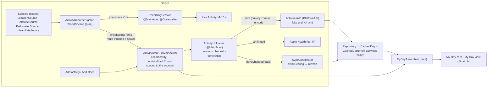
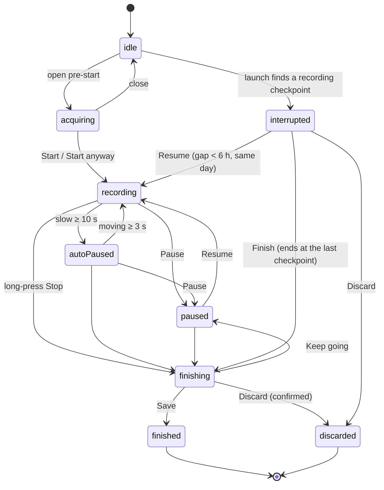
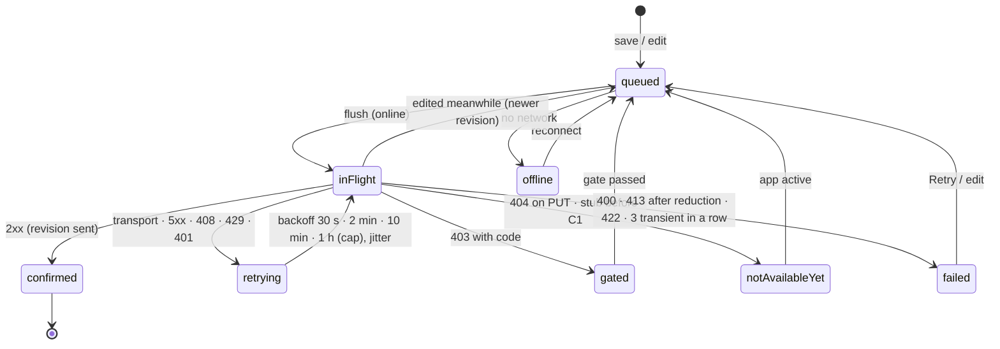
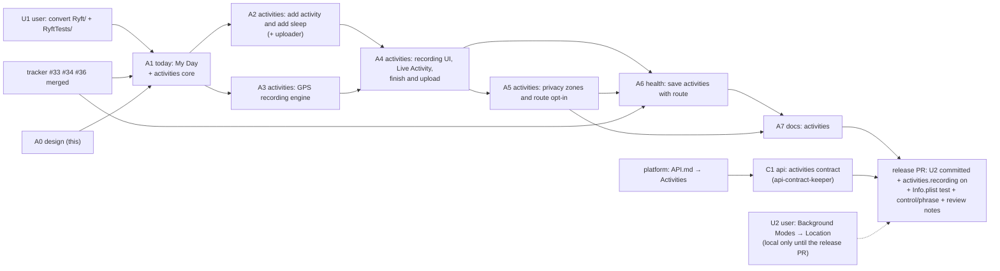

# My Day, Add activity, Start activity (GPS): design note (A0)

**Inputs**
- Brief: `brief.md` in this folder (copy of `CLAUDE_FOLLOWUP_MY_DAY_ACTIVITIES.md`).
- Platform half: `platform-brief.md` (planned contract; `API.md` → Activities isn't published, checked 2026-10-22).
- Plan: `plan.md`. UI spec D2 (`ui.md`, ui-designer) owns copy, layout and visuals; this note owns types, logic,
  isolation, storage and the ticket seams.
- In flight: tracker setup #33 (T1), #34 (T2), #36 (T3), design `docs/work/2026-10-22-tracker-setup/design.md`.
- ADRs written with this note: 0003 (track smoothing), 0004 (local-first recording), 0005 (route privacy),
  0006 (My Day as a merged read model). ADR 0002 is on the tracker branch.

Code anchors (`File.swift:N`) are from `main` at `58b696c`. Tracker-branch anchors say so.

**Revised 2026-10-22 after the security and privacy review** (B1–B3, S1–S7 and the nits). The changes are in:
- §2.3–§2.4: storage;
- §3.9: checkpoints and resume;
- §4: upload;
- §5: Apple Health delete, read and write types;
- §6: Live Activity names, no intents;
- §7.2–§7.3: no route in reads;
- §8: zones, accounts, at rest, export, App Review;
- §10–§15.

**What this note decides**
- the data model: the sport catalogue, the wire draft, the local model, where each datum lives and for how long;
- `ActivityRecorder`: its machine, sources, pipeline, observation, isolation, checkpoints and resume;
- the upload queue and its states; Apple Health; the Live Activity, intents and control;
- My Day: placement, reads, the merged read model, editing;
- privacy; file layout (converted folders, plus a fallback); tickets, frozen interfaces, tests, risks, requests.

## 0. What the code says

1. **There is no `DateStrip`.** Strain draws its week strip inline (`StrainView.swift:62–91`, model
   `StrainViewModel.StripDay` `:20–34`); the journal has `JournalDateStrip` (`JournalViews.swift:150–178`).
   §7.3 extracts Strain's strip.
2. **`Activity` is taken.** ActivityKit's `Activity<Attributes>` is used in `RestActivity.swift:69, 76, 120, 135`; a
   module-level `struct Activity` would shadow it. The wire type is **`SportActivity`**, the same kind of rename as
   `TrainSession` for API.md's `Session` (`API_REQUESTS.md` → Train).
3. **RYFT's own workouts are already kept out of the upload.** `SyncEngine.withoutOwnWorkouts`
   (`SyncService.swift:720–730`, applied at `:688`, tested at `EnvironmentTests.swift:1778`) drops every workout
   whose `sourceBundleId` is the app's bundle ID. It filters **workouts only**. That is enough today, because RYFT
   writes no type a sync stream reads: distance and routes aren't in `HealthKitManager.quantities`
   (`HealthKitManager.swift:50–59`).
4. **The Apple Health tidy is strength-only for every own workout.** `removeOwnWorkoutsRecordedElsewhere`
   (`HealthStore.swift:286–297`) asks `recordedElsewhere` (`:299–311`), which looks for *strength* workouts from
   other sources. A RYFT run covered by a strength workout would be deleted. A6 makes the check per sport family.
5. **The store.** `TrainStore` (`TrainStore.swift:10–37`) is the account's one SwiftData container. It uses the main
   context only, and it falls back to an in-memory store when the file can't open (`:26–35`).
   - Its `ModelConfiguration` leaves `groupContainer` at `.automatic`. The app has the App Group entitlement
     (`Ryft.entitlements:16–19`), so SwiftData most likely places `Train.store` in the `group.dev.timkrebs.ryft`
     container. **Verify on a device** (A3: log the configuration's URL once in Debug).
6. **Sign-out wipes the whole store with batch deletes** (`TrainStore.swift:167–184`, called from
   `AuthService.wipeSharedLocalData` `AuthService.swift:654–671`), on any sign-out, expiry or account switch
   (`:622–647`). Train's unsent outbox goes with it today. Unconfirmed activities would too (§8.4).
   - It deletes every `CachedDocument` (`TrainStore.swift:182`), so anything kept there is gone after any wipe.
   - On sign-out `apply(nil)` also removes `lastUserKey` (`AuthService.swift:631–632`). So the next sign-in of
     *another* account sees no previous id and wipes nothing (`:627`). Anything kept across a sign-out must carry its
     account and be filtered by it (§8.4).
7. **`StateMachine` is `@MainActor`** (`StateMachine.swift:8–15`). `TransitionTable` is a plain struct, so an
   actor can check `allows(_:_:)` without the GameplayKit engine.
8. **`DayDetail`** (`Models.swift:662–684`) has `sleep`, `workouts` (each with `source`, `sourceBundleId`, `strain`,
   `sessionId`) and `strain.sessions`. It has no activities. `SleepDetail` (`:404–420`) has no source and no origin.
9. **The contract check compiles `Models.swift` only** (`scripts/contract/run.sh:9–11`). Wire types go there.
10. **Info.plist.** `UIBackgroundModes` is fetch, processing and remote-notification (`Info.plist:75–80`).
    `NSHealthUpdateUsageDescription` ends "It writes nothing else" (`:60`), which becomes false in A6.
    `Ryft/Resources/InfoPlist.xcstrings` exists, so usage strings get German there.
11. **The Health opt-in** is `WorkoutHealthExport` (`TrainCoordinator.swift:426–535`): per account in defaults, a
    `.shared` singleton. `requestWorkoutWriteAccess` asks for workouts only (`HealthStore.swift:258–263`).
12. **Live Activity and control.** `RestActivityController` (`RestActivity.swift:62–141`), the widget UI
    (`RyftWidgets.swift:16–68`), `StartWorkoutControl` with a duplicated `OpenWorkoutIntent`. Duplicates are kept
    identical by `scripts/check-shared-types.py`.
13. **`WorkoutLauncher`** (`TrainCoordinator.swift:256–325`) makes intents wait for the tabs and an account.
14. **Strain already merges workouts with sessions** (`StrainViewModel.swift:97–112`). `ActivityStyle`
    (`StrainComponents.swift:4–44`) names HealthKit's activity strings.
15. **No read resource for activities** (`Repository.swift:700–712`).

## 1. Shape



**One owner per fact:**

| Fact | Owner |
| --- | --- |
| What the user recorded or typed, until the platform confirms it | `LocalActivity` (`ActivityStore`) |
| Strain, scoring state, merge, HR source | the platform; cached by `Repository` |
| The running recording's numbers | `ActivityRecorder` (in memory), checkpointed to `LocalActivity` |
| Upload state | derived from `LocalActivity` revisions plus the uploader's last attempt |
| My Day's list | computed by `MyDayAssembler` on read; never stored |
| Privacy zones, route default, auto-pause | the device, per account (zones sealed, §8.6) |
| Which account a local row belongs to | `LocalActivity.account`; every fetch filters by it (§8.4) |

## 2. Data model

### 2.1 The sport catalogue (`Ryft/Activities/Sport.swift`, A1)

`enum Sport: String, CaseIterable, Codable, Sendable` with the **API `sport` value as its raw value**. One static table
gives every property; §2 (Add) and §3 (Start) read the same table. Unknown wire values decode as `.other`.

| Sport (API) | Symbol (proposal) | GPS | `HKWorkoutActivityType` · location | Elevation | Auto-pause default · threshold | Max speed | σa | Family |
| --- | --- | --- | --- | --- | --- | --- | --- | --- |
| `running` | `figure.run` | yes | `.running` · outdoor | secondary | on · 1.0 m/s | 9 m/s | 1.5 | foot |
| `trail_running` | `figure.run` + trail badge | yes | `.running` · outdoor | **primary** | on · 0.8 | 8 | 1.5 | foot |
| `walking` | `figure.walk` | yes | `.walking` · outdoor | secondary | off · 0.4 | 6 | 1.0 | foot |
| `hiking` | `figure.hiking` | yes | `.hiking` · outdoor | **primary** | off · 0.3 | 6 | 1.0 | foot |
| `cycling` | `figure.outdoor.cycle` | yes | `.cycling` · outdoor | secondary | on · 1.5 | 36 | 3.0 | cycle |
| `mountain_biking` | `bicycle` | yes | `.cycling` · outdoor | **primary** | on · 1.2 | 25 | 3.0 | cycle |
| `gravel` | `bicycle` | yes | `.cycling` · outdoor | secondary | on · 1.5 | 30 | 3.0 | cycle |
| `indoor_running` | `figure.run` (treadmill if on iOS 17) | no: pedometer | `.running` · indoor | none | on · cadence 0 | — | — | foot |
| `indoor_cycling` | `figure.indoor.cycle` | no | `.cycling` · indoor | none | off | — | — | cycle |
| `rowing` | `figure.rower` | no (plan D1-8) | `.rowing` | none | off | — | — | water |
| `swimming` | `figure.pool.swim` | no | `.swimming` | none | off | — | — | water |
| `strength` | `dumbbell.fill` | no; suggests Train | `.traditionalStrengthTraining` | none | off | — | — | gym |
| `hiit` | `figure.highintensity.intervaltraining` | no | `.highIntensityIntervalTraining` | none | off | — | — | gym |
| `yoga` | `figure.yoga` | no | `.yoga` | none | off | — | — | gym |
| `mobility` | `figure.flexibility` | no | `.flexibility` | none | off | — | — | gym |
| `climbing` | `figure.climbing` | no | `.climbing` | none | off | — | — | gym |
| `skiing` | `figure.skiing.downhill` | yes | `.downhillSkiing` · outdoor | secondary | off · 1.0 | 40 | 5.0 | snow |
| `ski_touring` | `figure.skiing.crosscountry` | yes | `.crossCountrySkiing` · outdoor (closest) | **primary** | off · 0.3 | 30 | 5.0 | snow |
| `football` | `figure.soccer` | no | `.soccer` | none | off | — | — | ball |
| `tennis` | `figure.tennis` | no | `.tennis` | none | off | — | — | ball |
| `padel` | `figure.tennis` | no | `.tennis` (Apple has no padel; plan D1-8) | none | off | — | — | ball |
| `other` | `figure.mixed.cardio` | no | `.other` | none | off | — | — | other |

- **Max speed (rev. A3a.2):** the fastest each sport is actually done (walking and hiking 6, cycling 36, gravel 30,
  mountain biking 25 m/s); it bounds the filter's ground speed, and above it the pipeline reports "too fast" (§3.3, ADR 0003
  amendment 2). `Sport.swift` changes with the A3a.2 code PR.
- **Elevation:** *primary* asks for Motion & Fitness and uses the barometer (the brief's list). *Secondary* uses the
  barometer only if Motion is already allowed, else GPS altitude. *None* shows no elevation.
- **More per entry:** `paceStyle` (`.pace` per km for foot and snow, `.speed` km/h for cycle), the HealthKit distance
  type (`distanceWalkingRunning`, `distanceCycling`, `distanceDownhillSnowSports`, `distanceSwimming`; none for the
  rest on iOS 17), and a localized name key.
- **Symbols are proposals.** ui-designer confirms each exists on iOS 17 (SF Symbols → availability).
  `SportCatalogTests` checks `UIImage(systemName:)` on CI, but CI runs a newer iOS.
- **`family`** is used for the Apple Health overlap rule (§5). The platform's merge rule ("same sport family") must
  use the same families. That is API request R10.
- **HealthKit names → sports.** `Sport(healthKitActivity:)` maps `HealthKitManager.activityName` strings where they
  correspond: `soccer` → `football`, `functional_strength` → `strength`, `crossfit` → `hiit`. `ActivityStyle` keeps the
  names that have no sport (elliptical, stairs, cooldown) and asks the catalogue first for the rest.

### 2.2 Wire draft (`Networking/Models.swift`, `// MARK: - Activities`, inserted before `// MARK: - Helpers` `:2100`)

A mirror of the **platform brief**, not of API.md yet. api-contract-keeper reconciles it when API.md publishes (C1).
No field beyond the brief; everything else is an API request (§13).

```swift
enum ActivityOrigin: String, Codable, Sendable { case manual, recorded }
enum StrainSource: String, Codable, Sendable { case heartRate = "heart_rate", perceivedEffort = "perceived_effort", none }
struct ActivitySplit: Codable, Hashable, Sendable { let index: Int; let distanceM: Double; let durationSec: Double; let ascentM: Double? }
/// API.md → Activities `Activity` (renamed: ActivityKit owns `Activity`).
struct SportActivity: Codable, Hashable, Identifiable, Sendable {
    let id: UUID                       // the app's, idempotent
    var sport: Sport; var origin: ActivityOrigin
    var start: Date; var end: Date; var movingSec: Double
    var distanceM: Double?; var ascentM: Double?; var descentM: Double?
    var perceivedEffort: Int?          // 1–10
    var notes: String?                 // ≤ 500
    var splits: [ActivitySplit]?
    var route: String?                 // encoded polyline, trimmed on the device; only with the route opt-in
    var hrSamples: [HRPoint]?          // BLE only; HRPoint {t, bpm} already mirrors this shape
    var clientUpdatedAt: Date
    // set by the platform, never sent
    var strain: Double?; var strainSource: StrainSource?; var hrSource: String?
    var mergedWith: UUID?; var scoringState: String?   // values unspecified: R2
}
struct ManualSleepPut: Codable, Sendable { let bed: Date; let wake: Date }
```

Encoding for `PUT` omits the server fields (a dedicated `encode(to:)`).

### 2.3 Local model (`Ryft/Activities/LocalActivity.swift`, A1; added to `TrainStore.schema` `TrainStore.swift:14–15`)

```swift
@Model final class LocalActivity {            // one per manual or recorded activity, until compaction
    @Attribute(.unique) var id: UUID
    var account: String                        // Supabase user id at creation; every fetch filters by it (§8.4)
    var parkedAt: Date?                        // set when a session expiry kept the row (§8.4); 30-day limit
    var sportRaw: String; var originRaw: String
    var phaseRaw: String                       // RecordingPhase while recording; "saved" for documents
    var start: Date; var end: Date?; var movingSec: Double
    var distanceM: Double?; var ascentM: Double?; var descentM: Double?
    var perceivedEffort: Int?; var notes: String
    var recordRoute: Bool
    var zoneCountAtRecording: Int              // privacy zones active when recording started (§8.2, withhold rule)
    var routeWithheld: Bool                    // the route isn't attached until the user decides (§8.2)
    var routeDroppedAt: Date?                  // unconfirmed for 30 days: the route went, the activity stayed (§8.6)
    var splitsData: Data?                      // [ActivitySplit], wire JSON
    var pausesData: Data?                      // [PauseInterval] (manual · auto · interruption), written at Save (§3.9; rev. 2026-10-23)
    var headerData: Data?                      // RecordingHeader (§3.9) while recording / interrupted
    var localRevision: Int                     // bumped by every save or edit
    var confirmedRevision: Int                 // the newest revision the platform answered 2xx to
    var deletedAt: Date?                       // tombstone until DELETE is confirmed
    var lastAttemptData: Data?                 // UploadAttempt: at, status, code, request ID, kind; never a body
    var healthStateRaw: String?                // nil · saved · alreadySaved · recordedElsewhere · failed
    var createdAt: Date; var updatedAt: Date
}
@Model final class ActivityTrackChunk {        // append-only, one per checkpoint and kind; no relationship
    var activityID: UUID; var account: String; var seq: Int; var kindRaw: String   // profile · route · heartRate
    var data: Data                             // TrackCodec, ≤ ~1 KB; route and heartRate sealed (AES-GCM, §8.6)
    var count: Int; var first: Date; var last: Date
}
@Model final class LocalPrivacyZone {          // the account's zones (§8.2); kept and parked like the rows
    @Attribute(.unique) var id: UUID
    var account: String; var parkedAt: Date?
    var sealed: Data                           // PrivacyZone JSON, AES-GCM with the account's zone key (§8.6)
    var createdAt: Date
}
@Model final class LocalManualSleep {          // "Add sleep", until confirmed
    @Attribute(.unique) var day: String
    var account: String; var bed: Date; var wake: Date
    var localRevision: Int; var confirmedRevision: Int; var deletedAt: Date?; var lastAttemptData: Data?
}
```

- **Chunks have no relationship.** `TrainStore.wipe()` uses batch deletes, which skip cascades. Chunks are fetched
  and deleted by `activityID`.
- **The kinds split location from everything else:**
  - `profile` holds time, cumulative distance, altitude and speed: no coordinates. Charts, splits and resume use it.
  - `route` holds time, latitude, longitude, horizontal accuracy and altitude. It's written **only with the route
    opt-in**, **already trimmed by the zones active at recording** (§8.2), and **sealed** (§8.6).
  - `heartRate` holds time and bpm (BLE), sealed.
- **No coordinate anywhere else.** `RecordingHeader` holds no Kalman anchor and no last position: the filter
  re-initialises at the first fix after a resume (§3.9). A test decodes a header and asserts it.
- **`TrackCodec`** (`Recording/TrackCodec.swift`): a 4-byte magic with version, the kind, the count, a base time
  (Float64), then packed little-endian records. A profile record is 16 B, a route record 28 B, a heart-rate record 6 B.
  So 2 h at 1 Hz is about 115 KB of profile and 200 KB of route. Encoding runs in the recorder actor.

### 2.4 What's stored where, and for how long

| Datum | Where | Lifetime | Sign-out / deletion | Export | Uploaded |
| --- | --- | --- | --- | --- | --- |
| `LocalActivity` (no coordinates) | account store (§0.5) | confirmed + 30 days, then compaction | wiped; parked on expiry ≤ 30 days (§8.4) | yes, while unconfirmed | yes |
| `profile` chunks | account store | as the row | as the row | no (splits are) | no |
| `route` chunks | account store, trimmed at checkpoint, sealed with a per-activity key | **until the platform confirmed the route and Apple Health, if on, saved its copy; at most 30 days unconfirmed** (§8.6) | key deleted, then rows | trimmed again, while unconfirmed | trimmed again, simplified, opt-in |
| `heartRate` chunks | account store, sealed | until confirmed; at most 30 days | key deleted, then rows | as `hr_samples` | as `hr_samples` |
| Per-activity and zone keys | Keychain, `AfterFirstUnlockThisDeviceOnly`, not synchronizable | until confirm, discard, 30 days, wipe | deleted | never | never |
| `LocalManualSleep` | account store | until confirmed | wiped; parked on expiry | yes, while unconfirmed | yes |
| Server copies (`SportActivity` per day) | `CachedDocument activities.<day>`, **never with `route` or `hr_samples`** (§7.2) | compaction with days (1 year) | wiped | from the platform | — |
| A route the detail screen fetched | memory of the detail view model only | while the screen is open | — | — | — |
| Privacy zones | `LocalPrivacyZone` rows, sealed with the account's zone key | until changed | wiped; parked with the rows on expiry | **never** (they'd reveal the place they hide) | **never** |
| Route default, auto-pause | `UserDefaults`, keyed per account | until changed; the route default resets to "not chosen" after a restore (§8.6) | wiped | no | no |
| Live Activity content | ActivityKit (no route, no coordinates) | ends with the recording | ended on wipe | — | — |
| Export file | `tmp/RYFT-export-<day>.json`, `.completeFileProtection` | until the share sheet closes; any left is deleted at launch (§8.7) | — | — | — |

- **Nothing is written to App Group files.** `readiness.json` stays the only shared file. Whether the SwiftData file
  itself sits in the group container is §0.5's verification. We don't move it: moving it would orphan every existing
  store.
- **File protection** stays the default (`completeUntilFirstUserAuthentication`), so checkpoints land while the phone
  is locked. Never raise it to `.complete` for this store. Device test D4 checks it.
- **Device backups** include the store, as they do today. Route and heart-rate chunks and the zones are sealed with
  keys that are `ThisDeviceOnly`, so a backup restored anywhere else, or read in Finder, can't open them. Deleting a
  key makes its chunks unreadable at once, including copies left in SQLite's free pages (§8.6).

### 2.5 My Day items (`Features/MyDay/MyDayAssembler.swift`, A1; ADR 0006)

```swift
struct MyDayItem: Identifiable, Equatable {
    enum Kind: Equatable { case sleep(day: String), workout(UUID), session(UUID), activity(UUID) }
    enum Strain: Equatable { case scored(Double), pending, noHeartRate, notApplicable }
    enum Source: Equatable { case ryftRecorded, ryftManual, addedByYou, tracker(name: String), train }
    let id: String; let kind: Kind
    let symbol: String; let title: String
    let start: Date; let end: Date; let distanceM: Double?
    let strain: Strain
    let sources: [Source]           // 1–2; two when merged
    let upload: UploadState?        // own activities and manual sleep only
    let editable: Bool              // manual and recorded activities, manual sleep: any day
}
enum MyDayAssembler {
    static func items(_ input: MyDayInput, catalog: TrackerCatalog, now: Date) -> [MyDayItem]   // pure
}
struct MyDayInput {
    var day: String
    var server: Server                       // what the platform said
    enum Server { case dayDetail(DayDetail?, activities: [SportActivity]); case myDay(/* R1's shape */) }
    var local: [LocalActivitySnapshot]       // value copies of unconfirmed or tombstoned rows, and their upload states
    var localSessions: [SessionSummary]      // TrainLibrary.merged(local:remote:) input, as Strain does today
    var localSleep: ManualSleepSnapshot?
}
```

**Rules, in order:**
1. **Server layer.** Sleep, workouts, sessions and activities come from `DayDetail` plus the activities read. Once the
   platform ships R1, they come from its items.
2. **Merged rows.** An activity with `mergedWith == W` hides workout `W`. Its row carries `[.ryft…, .tracker(name of
   W)]` and the activity's strain, which the platform computed from the better HR source. The client never predicts
   a merge (ADR 0006).
3. **Workouts.** A workout with a `sessionId` and that Train session are one row, as in `StrainViewModel.swift:97–112`.
4. **Local overlay.**
   - An unconfirmed `LocalActivity` replaces the server item with the same id: the user's edit wins until confirmed.
     The server's last strain stays visible, else `.pending`.
   - A tombstone hides it.
   - Local sessions not on the server yet are added.
5. **Sleep.**
   - No sleep, no `localSleep`, and T1's `nightGap` is nil: a "No sleep recorded · Add sleep" row. We don't invite a
     manual entry while the tracker's night is only late.
   - A pending manual sleep shows as "added by you".
6. **Order and names.** Sorted by start (sleep first). Tracker names come from
   `env.trackerCatalog.displayName(SourceRef(name: w.source, bundleID: w.sourceBundleId, deviceModel: nil))`, T1's
   frozen API.

**Strain state per item:**
- `strain != nil` → `.scored`;
- `strainSource == .none` → `.noHeartRate` ("No heart rate for this time");
- otherwise `.pending`;
- sleep → `.notApplicable`.

## 3. `ActivityRecorder` (A3)

### 3.1 The machine (`StateMachines/Machines.swift`, appended: `RecordingPhase`, `RecordingMachine`)



- **One table, two users.** `RecordingMachine.table()` is the edge list.
  - The actor checks `table.allows(phase, next)`, with no closures, so it works off the main actor.
  - `RecordingMachine.make()` builds the GameplayKit engine for `StateMachineTests`, which walks every pair on both
    engines like the other machines.
  - `RecordingSession` mirrors the phase for the UI. It never decides.
- **24 h cap.** At 24 h of elapsed time the recorder moves to `finishing` by itself, with a notice. The platform
  refuses longer activities.

### 3.2 Sources (`Recording/Sources.swift`; live ones in `LiveLocationSource.swift`, `LiveMotionSources.swift`, `HeartRateSensor.swift`)

```swift
struct LocationFix: Sendable, Equatable, CustomStringConvertible {
    let timestamp: Date; let latitude: Double; let longitude: Double
    let altitude: Double?; let horizontalAccuracy: Double; let verticalAccuracy: Double?
    let speed: Double?; let isStationary: Bool
    var description: String { "fix(±\(Int(horizontalAccuracy)) m)" }   // never the coordinates (§8.3)
}
enum LocationAccess: Equatable, Sendable { case notDetermined, denied, restricted, whenInUse(precise: Bool) }
protocol LocationSource: Sendable {
    func access() async -> LocationAccess
    func requestWhenInUse() async -> LocationAccess
    func requestTemporaryPrecise() async -> Bool              // purpose key "ActivityRecording"
    func fixes() -> AsyncStream<LocationFix>                   // ends when the consuming task is cancelled
    func beginBackgroundSession() async -> BackgroundLocationToken   // CLBackgroundActivitySession; invalidated on deinit
    var canRunInBackground: Bool { get }                       // Info.plist UIBackgroundModes contains "location"
}
protocol AltitudeSource: Sendable { var isAvailable: Bool { get }; func relative() -> AsyncStream<AltitudeSample> }
protocol PedometerSource: Sendable {
    var isAvailable: Bool { get }
    func updates(from: Date) -> AsyncStream<PedometerSample>              // cumulative distance, cadence
    func total(from: Date, to: Date) async throws -> PedometerSample      // resume after a kill
}
protocol HeartRateSource: Sendable {
    func sensors() -> AsyncStream<[HeartRateSensorInfo]>                  // scan for service 0x180D
    func readings(from sensor: UUID) -> AsyncStream<HeartRateReading>     // characteristic 0x2A37
}
struct ActivitySensors: Sendable {
    var location: LocationSource; var altitude: AltitudeSource; var pedometer: PedometerSource; var heartRate: HeartRateSource
    static let unavailable: ActivitySensors      // every source empty; tests and previews start here
}
```

- **`AppEnvironment` gets one parameter, `sensors: ActivitySensors = .unavailable`.** `.live` passes
  `ActivitySensors.live`, `.preview` passes a replay, `.test` passes `.unavailable` or a test's fakes. One parameter
  keeps the init change to one line next to T2's `content:`.
- **The live location source:**
  - fixes from `CLLocationUpdate.liveUpdates(.fitness)` (iOS 17);
  - authorization, `accuracyAuthorization` and `requestTemporaryFullAccuracyAuthorization` through one
    `CLLocationManager` it keeps on the main actor;
  - `CLBackgroundActivitySession` on Start, which shows the blue pill;
  - When In Use only, never Always.

  Fixes older than 10 s (cached) are dropped at the source.
- **Why `liveUpdates` and not `CLLocationManager` updates:**
  - it pauses itself while the device is stationary (`isStationary`), which is the brief's "lower GPS frequency when
    stationary" without our own accuracy toggling;
  - it's an async sequence, so it needs no delegate threading.

  If device test D2 shows dropped background updates or > 8 %/h, the seam lets A3 swap in a manager-based source
  (`activityType = .fitness`, `distanceFilter = 5`, best accuracy, `allowsBackgroundLocationUpdates`,
  `pausesLocationUpdatesAutomatically = false`) without touching the pipeline.
- **Fakes:**
  - `FixtureLocationSource(fixes:)` yields an array at once; the pipeline runs on the fixes' own timestamps.
  - `ClockedLocationSource(fixes:, clock:)` yields on a `TestClock`, for checkpoints and auto-pause in time.
  - `ReplayLocationSource(track:, speedup:)`: DEBUG and previews (§11.3).
  - `FakeAltitudeSource`, `FakePedometerSource`, `FakeHeartRateSource`.

### 3.3 The location pipeline (`Recording/TrackPipeline.swift`, `KalmanTrack.swift`, `Geodesy.swift`, `TrackPoints.swift`; ADR 0003)

**rev. 2026-10-23 (A3a).** Amended for what the implementation learned. A3 lands in two PRs: A3a
(`activities: track pipeline`, the pure core) and A3b (the recorder, sources, vault and store). Rows and bullets
marked *rev.* are new or changed:
- distance comes from the filter's speed, with a still-phone guard and a settle window (ADR 0003, amendment 1);
- the re-init counts both gates;
- the split, pause and auto-pause details;
- route points only while recording;
- the clock holds while an auto-pause is pending;
- the calls A3b makes.

Reconciled with what A3a built (`b059151`).

**rev. A3a.2 (2026-10-24).** The speed-gate guard (code re-review N2; ADR 0003, amendment 2). Text marked
*rev. A3a.2* replaces the A3a text it follows:
- the speed gate measures from the filter's prediction; association; a re-init takes the rejected run's velocity
  (steps 2–3);
- a re-init is provisional until its settle window closes, and its span is filled from the anchor (steps 3–5);
- the sport's limit applies to the filter's speed, with a too-fast state (step 4 and *Too fast* below);
- `maxSpeed` is the fastest the sport is done. That replaces §2.1's "Max speed" column for walking and hiking (6),
  cycling (36), gravel (30) and mountain biking (25 m/s);
- *rev. review (2026-10-26):* **the anchor in a window, and gaps** (ADR 0003, amendment 2, "Revision after the code
  review: the anchor in a window, and gaps"; step 4);
- *rev. review (2026-10-26):* **the entry speed and held steps** (ADR 0003, amendment 2, "Revision after the code
  review: the entry speed and held steps"; step 4 and *Too fast* below);
- *rev. review (2026-10-26):* **the Doppler veto** (ADR 0003, amendment 2, "Revision after the code review: the
  Doppler veto"). A step or settle window counts toward the too-fast state only if Core Location's Doppler speed
  (`LocationFix.speed`) is above 0.9 × the limit too; a window takes its fixes' median. It vetoes entering only:
  inside an episode the filter's speed alone decides when steps count again. A fix without a usable Doppler speed
  takes the last one from up to 8 s back, raised by 0.5 m/s² per second of its age; one with `speedAccuracy` above
  2 m/s counts as unknown. With neither, the filter decides alone.

*Open after the review (2026-10-26):* sliding multipath that moves slower than the gates' tolerance is accepted. Where
the fixes carry a valid Doppler speed, it no longer enters the too-fast state: 0 false episodes in 80 runs with Doppler
on 70–100 % of fixes (6–10 s slides). What stays open is the distance, not the state: a slow slide still adds distance
below the limit (+74 … +556 m in the review's 180 s scenarios). D1 measures it and logs the share of fixes with a
valid Doppler speed; then it's a topic for the architect. A3b must map `CLLocation.speed` and `speedAccuracy` into
`LocationFix`, or the Doppler veto never applies.

*Carried to A3b (the code-reviewer's re-verification at `c33883f`, 2026-10-26).* N1–N3 are this review's nits, not
the re-review's N2 above.
- **The mapping.** `CLLocation.speed` and `speedAccuracy` into `LocationFix` (above).
- **The Doppler share.** `PipelineDiagnostics` gains `fixesWithDoppler`: accepted fixes whose own Doppler speed is
  usable (valid, `speedAccuracy` ≤ 2 m/s). D1 reads its share of `fixesAccepted`. A count only; an older checkpoint
  decodes it as 0.
- **N1, a slide inside an episode.** Inside an episode the filter alone decides, so a slide that starts during one can
  extend it: up to 20 s on the walking profile with fast slides. Option: end the episode after about 5 s of fresh,
  valid Doppler below the limit.
- **N2, the holdover across a pause.** `lastDoppler` survives Pause and auto-pause: +27 m and a 2 s delay in a car
  scenario. Reset it in `pause(at:)` and `enterAutoPause`.
- **N3, gaps longer than the holdover.** After 8 s without a usable Doppler speed the veto fails open again. With
  10-fix gaps: 7/4/4/3 false episodes per 20 runs. D1 logs the gap lengths: `PipelineDiagnostics` gains
  `longestDopplerGapSec` and `dopplerGapsOverHoldover` (gaps longer than 8 s).

`struct TrackPipeline` is a **pure value type**. It imports Foundation only and is `Sendable`. It reads no clock:
every input and control carries its time. The actor owns one. Unit tests drive it directly with fixture arrays, with
no actor and no clock.
- **Inputs:** `ingest(_ fix:)` (frozen), `ingest(_:receivedAt:)`, `ingest(_: AltitudeSample)`,
  `ingest(_: PedometerSample)` and `advance(to:)`.
- **Controls:** `start(at:)`, `pause(at:)`, `resume(at:)`, `lap(at:)` and `finish(at:)`.
- **Reads:** `snapshot(at:)`, `movingTime(at:)` and `gpsQuality(at:)`, plus the checkpoint state `Resume` and
  `init(configuration:restoring:interruptedAt:)` (§3.9).
- *rev.* **Files:**
  - `TrackPoints.swift` holds `RoutePoint`, `ProfilePoint` and `LocationRedacting`, the redaction every location type
    shares (§8.3);
  - `Geodesy.swift` holds `Coordinate`, `Displacement` and `LocalTangentPlane`;
  - `TrackProfile` is A1's (`Sport.swift`). A3a carries a copy until A1 merges, then deletes it.

| Step | Rule |
| --- | --- |
| 1 Pre-gate | Drop `horizontalAccuracy` < 0 or > 25 m, and non-finite coordinates (counted `accuracy`). Drop timestamps not after the last accepted one (`outOfOrder`), or more than 10 s older than the newest time seen (`stale`). *rev.:* The recorder passes `receivedAt:` from its clock, so a cached fix that arrives late is stale. Only receipt times and fixes that pass the accuracy gate move "the newest time seen": one bad timestamp can't age the rest. Before Start, fixes warm the filter and the GPS indicator and record nothing. The button activates at ≤ 20 m (or "Start anyway"). |
| 2 Speed gate | *rev. A3a.2:* **An outlier gate, not the sport's limit** (that's step 4). The distance from the filter's **predicted** position (position + velocity × Δt) to the fix, minus the two accuracies, over Δt (≥ 1 s): if it's above `sport.maxSpeed`, reject (counted `implausible`). It limits the change of velocity a fix implies. A fresh filter (velocity 0) gates as before, and the trail fixture's gate counts don't change. *rev.:* The gate ages open: Δt keeps growing while fixes are rejected. So its rejections count toward step 3's re-init. *rev. A3a.2,* **why not from the last filtered position (A3a):** "minus both accuracies" made the real limit `maxSpeed + 2 × accuracy` at 1 Hz. A fast stretch then counted in full or not at all, depending on the reported accuracy. A "run" at 15 m/s recorded 67–90 m of 4.6 km at 2–3 m, and all of it at 4–5 m (probe). |
| 3 Filter | Constant-velocity Kalman per axis in a local tangent plane (WGS84 meridional and prime-vertical radii at the anchor latitude; re-anchored every 5 km). Measurement variance `max(hAcc, 3 m)²`; white-acceleration process noise `σa` from the catalogue. Innovation gate at 3.5σ. Δt > 15 s resets the velocity variance. *rev.:* **Three rejections in a row, by the speed gate or the innovation gate,** re-initialise at the third fix (a real jump, a tunnel exit, sustained multipath). The jump adds no distance. Accuracy, stale and out-of-order rejections neither count nor break the run. A settle window follows (step 4). *rev. A3a.2:* **Association.** After a rejection, a fix that the gates would accept still counts as rejected when it lies nearer the last rejected fix (moved on at the filter's velocity) than the prediction: it belongs to the rejected run. Without it, a ride's gate aged open after two rejections and took a ghost with a kick (+55 … +68 m, probe). Turns and stops never meet it, because they cause no rejection. **The re-init's velocity** is the rejected run's: the line from its first to its third fix, when the middle one lies on it within the accuracies; else 0. **The re-init is provisional** until its settle window closes; step 4 then fills the rejected span from the anchor. Gone: the A3a side effect, where a movement above `maxSpeed` re-initialised every third fix and recorded 0 m silently. The filter now follows it, and step 4 refuses it openly. |
| 4 Distance | *rev.:* The trapezoid of the filter's **ground speed** between consecutive accepted fixes, while `recording`. **A still phone adds nothing, in two layers, also with auto-pause off.** (1) A fix Core Location flags `isStationary` adds no distance. (2) A dead-band is the backstop: a step counts only when the mean of the two speeds is at least half the sport's auto-pause threshold, clamped to 0.3–0.5 m/s (run, bike and ski 0.5; trail 0.4; walk and hike 0.3, which rely on the flag). **A settle window after the filter (re)initialises or resets its velocity:** nothing accrues for 10 s (up to 30 s with fewer than 4 fixes). Then the window counts the shorter of a Theil–Sen line through its raw fixes and the filtered track's length; a coarse first fix lengthens the track, an acceleration lengthens the line. A coarse first fix (20–40 m off) now adds 0.0 m instead of up to +42 m. The cost: the first 10 s of distance appears at the window's end. **Position steps** (the geodesic between filtered positions) replace the speed for 10 s only after an auto-resume, recovering the velocity's lag. Distance is horizontal, like every GPS watch; ascent is separate. `Tuning.distanceFromVelocity = false` keeps the position sum for D1 only. *rev. A3a.2:* **The provisional span.** At a re-init, the pipeline keeps an **anchor**: the last settled filtered position, its time and its ground speed (memory only). Start, Pause, a resume, Finish, a velocity reset and a gap inside the window drop it. When the re-init's window closes: **one re-init, the anchor at most 10 s before it** → the span is dead-reckoned at the anchor's ground speed, if that's between the dead-band and `maxSpeed`; **a chain** (two or more re-inits before a window closes) **or a longer span** → the gap rule (step 5) from the anchor to the window's first position. A ghost of up to 12 fixes is one bridged chain. From 13 fixes, its own window closes inside the ghost, so it's two dead-reckoned spans. *rev. review S3, N-e, N-d:* **A window without an anchor** (Start's, or one opened by a velocity reset or a gap): a re-init inside it anchors at the window's first filtered position and time, at the Theil–Sen line speed of its fixes so far. With fewer than 3 fixes there's no line, so the gap rule. **A gap over 10 s inside a provisional window**, a velocity reset included, no longer drops the anchor: the gap rule runs in one line from the anchor to the fix after the gap, and a fresh window starts there. Only Pause, a manual resume and Finish drop it, and a re-init while paused keeps none. A checkpoint counts an open anchor as dropped (a restore can't fill it); the live pipeline keeps it. **The sport's limit:** a step whose mean ground speed is above `maxSpeed` adds nothing, at any accuracy. Neither does a settle window whose line is faster (*Too fast* below). *rev. review S1:* outside an episode only a step or window above the **entry speed** is refused, and it's held until the too-fast state confirms (then refused) or not (then distance); inside an episode every step above the limit is refused (*Too fast* below). |
| 5 Gaps | Δt > 10 s between accepted fixes *within one running process*: bridge with the straight line if the implied speed is ≤ `maxSpeed`, else don't (counted `gap`). A resume after a kill never bridges (§3.9). *rev.:* Nothing is bridged from a fix before Start ("Start anyway" after a silent GPS). A step is clipped to the last Start or resume, so a fix delivered late never counts time before them. *rev. A3a.2:* A chain of re-inits is a gap from the anchor (step 4). While a chain is open, `gpsQuality` says `.weak` (ui.md G4: "Distance may be low"), because the fixes disagree with each other. |
| 6 Pace | Rolling 30 s of moving time over (t, cumulative distance): pace = Δt/Δd once Δd ≥ 20 m and ≥ 10 s of data, else none ("—"). Average pace = moving time / distance. Cycling shows speed. *rev.:* Under canopy a 30 s window is noisy by physics. The probe measured a p95 error of 10–20 % at 2.2 m/s, against 2–4 % on an open road. D1 shows whether trail sports need a longer window. |
| 7 Splits | When the recorded distance crosses k × 1000 m, interpolate the crossing time within the step. *rev.:* `TrackSplit` is `{index, distanceM, durationSec, ascentM, end}`. **`index` is 1-based** (R20). `durationSec` is the moving time in the split. `end` stays on the device; the other four are the wire's `ActivitySplit`. Finish adds the partial last split, with its real distance, **only from 5 % of a split (50 m)**: a shorter remainder at a round-number finish is GPS overshoot, not a split. Its distance and time stay in the totals, so the splits may sum to less than `distance_m` (R20). **A split crossed inside a pause that's backdated later** (auto-pause, or a manual pause while one was pending) is revised: its `.split` event carried a provisional duration, while `splits` and `checkpoint` hold the revised one. A3b stores splits from the checkpoint, never from the events. Laps are local (§13 R7). |
| 8 Auto-pause | If enabled: enter when the filter's speed is below the sport's threshold for 10 s of fix time, or `isStationary` for 5 s (also when the fixes stop, through `advance(to:)`). Indoor runs enter after 10 s without new steps. Leave at ≥ 1.5 × threshold for 3 s. *rev.:* **Backdated both ways:** the pause starts when the user stopped and ends when they moved again, and the distance of the 3 s confirmation is replayed. **The clock holds while an auto-pause is pending** (below). A manual pause while one is pending starts at the pending moment. The filter keeps running while auto-paused. Manual pause and resume always work; a manual pause during an auto-pause stays manual. |

- *rev.* **The clock while an auto-pause is pending** (ui.md G3):
  - **The hold.** From the first slow or stationary fix (indoor runs: 3 s without new steps) until the auto-pause
    confirms or is denied, `snapshot(at:)` returns `movingAnchor = nil` and the moving time at the pending moment. A
    manual pause in that time starts at the pending moment too.
  - **Confirmed:** the pause is backdated to exactly that moment, so the held value is already right.
  - **Denied:** the clock catches up, forward.
  - **GPS weak:** the hold ends when the GPS turns weak (no accepted fix for 10 s). The clock runs on, and a later
    confirmation may then step it back. That's rare: a stop with no usable fix.
  - **Why.** Without the hold, every auto-pause moved the clock back by 10 s or more (the probe: 10–15 s).
- *rev.* **Route points only while recording:**
  - `.route` is emitted only in `recording`. Where the user went while paused or auto-paused isn't the activity's
    route, and the disk shouldn't learn it (ADR 0005; security-privacy reviews).
  - `.profile` points continue; they hold no coordinate.
  - Built in A3a (`routePointsOnlyWhileRecording`).
  - *rev. A3a.2:* none while too fast either (below).
- *rev. A3a.2* **Too fast** (ADR 0003, amendment 2):
  - **Enter.** The filter's ground speed is above `maxSpeed` for 3 s → `.tooFast(since:)`, backdated to the first fast
    step. A settle window whose Theil–Sen line is faster starts the count at the window's start. *rev. review S1:*
    above the **entry speed**, max(limit × 1.05, limit + 0.6 m/s) (`Tuning.tooFastEnterFactor`,
    `tooFastEnterMargin`): 9.6 m/s for running, 6.6 for walking, 26.25 for mountain biking, 37.8 for cycling. A step
    is judged by the mean of its two ground speeds, also in the position steps after an auto-resume (review X4). With
    a valid Doppler speed, it must agree (the Doppler veto above).
  - **Leave.** 3 s at or below the limit → `.tooFastEnded(since:)`, backdated to the first slow step. *rev. review
    S1:* the limit itself, not the entry speed, so the state doesn't flap near the limit. *rev. review N-a:* Pause and
    an auto-pause end it too, at the pause or where the speed had already dropped.
  - *rev. review S1* **Held steps.** Before the state confirms, a step or window above the entry speed is held, not
    refused:
    - the state confirms → what was held is refused, from the first of it;
    - a slow step, Pause, Finish or a checkpoint comes first → what was held counts as distance, with no episode. A
      checkpoint saves it as distance (a restore can't confirm it); the live pipeline keeps holding (review X3);
    - a re-init's span faster than the limit stays refused either way.

    Held steps normally wait less than 3 s. Near the limit nothing is refused now (within 15 m over 20 seeds); before,
    up to 25 episodes in 20 seeds and −621 m on a ride at 35.5 m/s.
  - **Meanwhile:**
    - `TrackSnapshot.tooFastSince` is set;
    - no distance: a step above the limit never counts, even before the 3 s; *rev. review S1:* that holds inside an
      episode; before one, see *Held steps*;
    - no `.route` points: where a vehicle went isn't the activity's route (security-privacy confirms with A3b);
    - `currentPace` and `currentSpeed` are nil;
    - the time keeps running, and auto-pause works as before.
  - **Not a phase.** `RecordingPhase` stays `recording`; it isn't a pause.
  - **Why the speed of the filter.** It's smooth and doesn't depend on the reported accuracy. Probe, "running" on a bike
    at 15 m/s, at a reported 2, 3, 4 and 5 m: 55–59 m recorded and `.tooFast` 3 s after the filter passed 9 m/s, every
    time.
  - **What A4 shows** (copy direction; ui-designer writes it into ui.md as G11, en and de):
    - **A state line** like G4's. It ranks below G6, G5 and G4: with weak GPS the speed isn't trustworthy.
    - **The copy says** what happened (distance paused), why (faster than the sport) and what to do (nothing, it
      resumes when you slow down; in a vehicle, stop the recording). It names the sport, never GPS, never an error.
      For example "Faster than running speed. Distance pauses until you slow down." / "Schneller als Lauftempo. Die
      Distanz pausiert, bis du langsamer wirst." For cycling, the limit in the locale's unit may read better ("Faster
      than 130 km/h").
    - **Values.** Current pace "–:–"; the distance stands still.
    - **Feedback.** A `.warning` haptic once, and a VoiceOver announcement on entry and exit ("Distance paused …" /
      "Distance resumed"), never repeated.
    - **Live Activity.** The caption slot that shows "Weak GPS" says "Distance paused". A4 adds a `tooFast` flag to
      `ContentState` (in both copies; `check-shared-types.py`).
    - **Finish summary (Z1).** When `tooFastSec` is at least 10 s, a caption under the distance: "Distance paused for
      6 min: faster than running speed." No second distance number.
- *rev.* **Who decides what:**
  - The pipeline decides auto-pause. The recorder mirrors `.autoPaused` and `.autoResumed` into `RecordingPhase`
    through the table (§3.1).
  - Every other transition flows from the recorder to the pipeline.
  - The pipeline's own `State` is never stored: the header keeps `RecordingPhase` and the `Resume`.
- *rev.* **The calls A3b makes:**
  - **Every fix:** `ingest(_:receivedAt: clock.now)`, in `acquiring` too, for the filter and pre-start's accuracy.
  - **Every snapshot tick (≤ 10 s apart) and every input:** `advance(to: clock.now)`, for the stationary and
    step-less auto-pause and for weak GPS.
  - **Start, Pause, Resume and Lap:** `start(at:)`, `pause(at:)`, `resume(at:)` and `lap(at:)`.
  - **Stop:** `pause(at: stopTime)`. Totals freeze. Keep going leaves the pipeline paused (§3.1), and Resume then
    calls `resume(at:)`.
  - **Save:** `finish(at: stopTime)`. It closes that pause with zero length and ends the partial split at the stop.
    `finish` is terminal, so it's never called at Stop.
  - **Interrupted:** Finish calls `finish(at: lastCheckpoint)`; Resume calls `resume(at: now)` (indoor runs: §3.9).
  - **Pedometer after a restore:** the first live sample comes after `resume(at:)` (§3.9).
  - **Splits:** stored from `checkpoint`, never from `.split` events (step 7).
  - *rev. A3a.2* **Too fast:** forward `.tooFast` and `.tooFastEnded` as `RecorderEvent`s, and send a snapshot at
    once on each, as on a phase change, so the Live Activity follows. `RecorderSnapshot` (§3.7) gains
    `tooFastSince: Date?`.
  - **Snapshots:** `snapshot(at: clock.now)`. The recorder adds the phase, heart rate and route tail, maps
    `TrackSplit` to `ActivitySplit`, and converts m/s to km/h.
  - **Naming:** the checkpoint property is `checkpoint`. It was `resume`, which read like the control `resume(at:)`.
- **Diagnostics.**
  - `RecordingDiagnostics` holds counts only: fixes accepted, rejected per reason, gaps, longest gap, checkpoints and
    their failures, snapshots, Live Activity updates, and battery level at start and end (Debug and TestFlight).
  - It's attached to Copy diagnostics for the last recording. No coordinates.
  - *rev.:* Until D1 decides, Debug and TestFlight builds also keep three shadow distance totals: position steps,
    Core Location's speed, and ground speed without the auto-resume position steps. They're numbers only (ADR 0003,
    amendment 1). A3b adds them; A3a doesn't have them.
  - *rev. A3a.2:* `PipelineDiagnostics` adds:
    - `speedGateReinits`: re-inits whose rejected run included a speed-gate rejection (N2's counter);
    - `reinitSpansDeadReckoned`, `reinitSpansBridged`, `reinitSpansDropped`: what each closed window did with its span;
    - `tooFastEpisodes` and `tooFastSec` (*rev. review S1:* refusals a confirmed episode made, only);
    - `tooFastDistanceM`: the filter's speed integrated while too fast. It's a number for D1 and a later "change
      sport", never distance;
    - *rev. review (A3b):* `fixesWithDoppler`, `longestDopplerGapSec` and `dopplerGapsOverHoldover` (carried to A3b
      above).

    They're `Codable` in the checkpoint. No checkpoint is on disk before A3b ships; after that, a new field decodes
    with a default.
- *rev.* **Redaction:**
  - `LocalTangentPlane` keeps two scale factors from the anchor's latitude, and `metresPerRadianEast` (N·cos φ)
    gives that latitude back exactly. Before A3a's fix, `dump` of the filter or the pipeline printed it.
  - The plane and the filter now render nothing, and `RedactionTests.filterPlaneAndPipelineRenderNoLocation` dumps a
    pipeline after a few fixes.
  - *rev. A3a.2:* the anchor and `KalmanTrack`'s rejected run hold coordinates in memory, never in a checkpoint.
    `Coordinate` and `KalmanTrack` already render nothing. The test also dumps a pipeline during a provisional
    re-init.

### 3.4 Elevation (`Recording/ElevationFusion.swift`)

- **Barometric (primary sports, and secondary ones with Motion already allowed):**
  - `CMAltimeter.startRelativeAltitudeUpdates` gives `relAlt`.
  - Absolute altitude = `relAlt + offset`. The offset is the median of `gpsAlt − relAlt` over 5 min of fixes with
    `verticalAccuracy` ≤ 10 m, which absorbs slow weather drift.
  - Ascent and descent accumulate on `relAlt` with a **2 m hysteresis**.
- **GPS only** (no barometer, or no Motion permission): altitude from fixes with `verticalAccuracy` ≤ 15 m, median of
  5 samples, **5 m hysteresis**.
- **None** for indoor sports and sports without GPS.
- **The prompt.** Motion & Fitness has no request API: starting the altimeter in `acquiring` triggers the prompt for
  a primary sport, before Start, after D2's pre-prompt line.
- *rev. 2026-10-23 (A3a)* **Counted only while recording.**
  - Paused, auto-paused and interrupted time add no ascent or descent.
  - The altitude is still followed, and the barometric offset keeps learning.
  - The count restarts from wherever the altitude is when recording resumes, so a climb during a pause adds nothing.
  - An auto-pause stops the count when it confirms. The 10 s before that are counted; at a stop they're flat.
- *rev.* **The altitude can be unknown.** The barometric altitude is nil until a fix with `verticalAccuracy` ≤ 10 m
  gives the first offset, so profile points carry nil (NaN in the codec).
- *rev.* **Ascent and descent are nil until an altitude is counted.** That's never a false 0. The first count comes
  from the first altimeter sample while recording (barometric, on `relAlt`) or the first fix with
  `verticalAccuracy` ≤ 15 m (GPS only). `Resume.ascentM` and `descentM`, and with them the checkpoint's, are
  optional.
- *rev.* **Per split:** the ascent at the crossing minus the ascent at the previous one.
- *rev.* **After a kill** only the totals carry over (§3.9).
- *rev.* **Open for A3b and D1: a still phone on GPS-only elevation counts false ascent.** At 5–30 m of vertical
  noise, about 17 m of ascent in 10 min got past the 5 m hysteresis. Elevation doesn't check `isStationary`. A3b
  decides whether a flagged fix stops the count, as it stops distance. D1's bench test (ADR 0003, amendment 1, run 4)
  reports the ascent with the barometer off.

### 3.5 Indoor runs (`indoor_running`)

- `CMPedometer.startUpdates(from: start)` gives cumulative distance and cadence.
- Rolling pace comes from distance deltas. Auto-pause triggers on cadence 0 for 10 s.
- **Resume after a kill is lossless:** `queryPedometerData(from: start, to: now)` gives the total, minus the deltas
  recorded during pauses (kept in the header).
- **Finish lets the user correct the distance** ("Treadmill said …"). It's stored and sent as `distance_m`.
- **Without Motion permission:** time only, plus the distance typed at Finish.

### 3.6 Live heart rate (`Recording/HeartRateSensor.swift`, behind `activity.live_hr`; a follow-up PR, plan D1-6)

- **Core Bluetooth, standard Heart Rate service `0x180D`, measurement `0x2A37`.** It parses the uint8/uint16 flag.
  RR intervals are ignored.
- **No `CBCentralManager` exists until the user taps "Connect heart-rate sensor"** in pre-start. That tap triggers the
  Bluetooth prompt (`NSBluetoothAlwaysUsageDescription`, en + de, added with the flag).
- Readings go to `heartRate` chunks and the snapshot.
- **Without a sensor:** "Heart rate is added after your tracker syncs." No value is ever estimated (brief: never fake
  HR).
- **Screen off needs Background Modes → "Uses Bluetooth LE accessories"** (user step U3, App Review text). Until that
  step, live HR shows only while the app is in the foreground and says so.

### 3.7 Observation and throttling

```swift
actor ActivityRecorder {
    init(id: UUID, sport: Sport, options: RecordingOptions, sensors: ActivitySensors, clock: AppClock,
         restoring: RestoredRecording? = nil)
    nonisolated let snapshots: AsyncStream<RecorderSnapshot>   // .bufferingNewest(1): the UI only wants the latest
    nonisolated let events: AsyncStream<RecorderEvent>         // .unbounded: checkpoints must never be dropped
    func acquire() async                 // idle → acquiring: location (foreground), the altimeter for primary sports
    func start() async                   // acquiring → recording: begins the background session
    func pause(); func resume(); func lap()
    func stop() async                    // → finishing: final checkpoint, totals frozen
    func keepGoing()                     // finishing → paused
    func save() async -> RecordingResult // finishing → finished: sources stopped
    func discard() async                 // → discarded: sources stopped
    func setObserved(_ observed: Bool)   // snapshot cadence: 1 s observed, 10 s otherwise
}
struct RecordingOptions: Sendable {
    var recordRoute: Bool; var autoPause: Bool; var liveHR: Bool; var barometer: Bool; var pedometer: Bool
    var zones: [PrivacyZone]               // the account's zones at Start: route chunks are trimmed by them (§8.2)
    var keys: ChunkKeys?                   // the activity's route and heart-rate keys from ActivityVault, in memory only (§8.6)
}
struct RecorderSnapshot: Sendable, Equatable {
    let phase: RecordingPhase; let movingAnchor: Date?   // now − moving time while recording, so clocks tick on their own
    let movingSec: Double; let elapsedSec: Double; let distanceM: Double
    let currentPace: Double?; let averagePace: Double?; let speedKmh: Double?; let ascentM: Double?
    let heartRate: Int?; let gps: GPSQuality             // good ≤ 10 m, fair ≤ 25 m, weak (no fix 10 s), off
    let lastSplit: ActivitySplit?; let routeTail: [RoutePoint]   // new points since the last snapshot, only while the map shows
}
enum RecorderEvent: Sendable { case checkpoint(Checkpoint), split(ActivitySplit), phase(RecordingPhase), gps(GPSQuality) }
```

- **Snapshots are rate-limited in the actor on the injected clock:**
  - at most 1/s while a screen observes (`RecordingSession.setObserved(true)` on appear and scene active);
  - at most 1 per 10 s otherwise (screen off: only the Live Activity needs them);
  - on any phase change, at once.
- **The UI's clock** uses `movingAnchor` in a `TimelineView(.periodic(by: 1))`. It needs no snapshot per second.
- **`RecordingSession`** (`@MainActor @Observable`, `Features/Activities/RecordingSession.swift`, A4) formats values.
  It forwards actions and feeds `ActivityTrackingController` (§6). Voice cues on `.split` are a follow-up PR
  (plan D1-5).
- **The map** is off by default (battery). While shown, it appends `routeTail` to an in-memory polyline,
  Douglas–Peucker-simplified at 2 m.

### 3.8 Concurrency and isolation

| Work | Where |
| --- | --- |
| Fix, altitude, pedometer and HR handling; the Kalman; splits; codec encoding | `ActivityRecorder` (actor), one child task per source in a task group |
| Core Location authorization, `CLBackgroundActivitySession` | `LiveLocationSource`, hopping to the main actor internally (CL wants a run-loop thread) |
| CMAltimeter / CMPedometer / CB callbacks | their own private serial queues, bridged to `AsyncStream` |
| SwiftData writes (checkpoints, documents) | `ActivityStore`, `@MainActor`, the main context (ADR 0004): one insert and save per 30 s |
| Formatting, Live Activity calls, speech | `RecordingSession`, `@MainActor` |
| Route trimming, polyline encoding, downsampling | `@concurrent static func ActivityPayload.make(…)` (§4.2) |

- **No `Task.detached`.** The recorder's source tasks are children of its `run()` task. `RecordingSession` holds the
  `run()` task and cancels it on `save` and `discard`.
- **Two streams.** Snapshots and events are separate, so a slow main actor can drop stale UI states but never a
  checkpoint.

### 3.9 Checkpoints and resume

```swift
struct Checkpoint: Sendable {
    let activityID: UUID; let seq: Int
    let header: RecordingHeader        // phase, sport, options (without zones or key), and the pipeline's Resume:
                                       // start, pauses (with kind), distance, splits, split start, ascent/descent,
                                       // laps, last sample time, pedometer baselines, diagnostics. No coordinates:
                                       // no Kalman anchor, no last position (a test asserts it). rev. 2026-10-23:
                                       // no elevation offset; no moving time (derived from start and pauses)
    let profile: Data?                 // TrackCodec, since the previous checkpoint
    let route: Data?                   // TrackCodec, points inside a zone already dropped, then sealed
    let heartRate: Data?               // TrackCodec, sealed
}
```

- **When.** Every 30 s on `env.clock`. On every phase change and every lap. When the scene goes to the background
  (`RecordingSession` asks the actor for one).
- **How.** `ActivityStore.apply(_:) -> Bool` upserts the header and inserts the chunks in one `save()`. A failed save
  is counted and shown as "Progress isn't being saved" on the recording screen. Store errors are logged by domain and
  code only, never with `localizedDescription` (it can quote values).
- **Trimming and sealing happen before the write**, in the actor: `RouteTrimmer.drop(_:zones:)` removes every point
  inside a zone, then `ActivityVault.seal` encrypts the chunk (§8.2, §8.6). The in-memory map shows the untrimmed
  tail; the disk never sees it.
- **Not durable.** `ActivityStore.isDurable` is false when `TrainStore` fell back to memory (§0.5). Pre-start then
  warns that the recording can't survive the app closing.
- **On launch.** `RecordingCoordinator.restore(inBackground:)` runs in `RyftApp.init`, next to the HealthKit observers
  (`RyftApp.swift:83–85`). It looks for a `LocalActivity` whose phase is recording, paused or auto-paused.
  - **Background launch** (Core Location relaunched the app for a background session; **verify on a device**, D3):
    - **Gap since the last checkpoint ≤ 10 min, and the row belongs to the signed-in account:** re-create the
      `CLBackgroundActivitySession` and the fix loop at once, and continue `recording` with the gap counted as a
      pause.
    - **Otherwise:** phase `interrupted`, and the background session is invalidated at once, with no fix loop. Nobody
      is told they're being located for a run they may have finished an hour ago. The Live Activity ends; the next
      foreground launch asks.
  - **Foreground launch** (force-quit, crash): phase `interrupted`, and the cover shows "Resume your run?" (ui.md
    U1/U2):
    - **Gap < 6 h and the same calendar day:** Resume, Finish and Discard.
    - **Otherwise:** "Finish your run?" with Finish and Discard only.
    - Finish ends the activity at the **last checkpoint's** time, not at the launch time. The 24 h cap (§3.1) still
      applies to a resumed recording.
  - **Rebuilding the state.** The pipeline is rebuilt from the header. The filter re-initialises at the first new fix.
    - **Decision: a gap across a kill is never bridged.** The time from the last checkpoint to the resume counts as
      a pause and adds no distance, with the route on or off. Distance continues from the first new fix.
    - Resume therefore needs no stored coordinate, and route chunks are never opened to resume.
    - Indoor runs re-query the pedometer (§3.5). That isn't a GPS bridge: the pedometer measured the steps.
      *rev.:* The steps count with their time, or not at all (below).
  - *rev. 2026-10-23 (A3a)* **What the rebuild is.**
    - **The call.** `TrackPipeline(configuration:restoring:interruptedAt:)`, with the last checkpoint's time. It
      starts paused:
      - an open manual pause stays open;
      - an open auto-pause closes at the checkpoint;
      - from the checkpoint on, the time is an `interruption` pause until `resume(at: now)` or
        `finish(at: lastCheckpoint)`.
    - **No barometric offset.** `CMAltimeter`'s relative altitude starts again at 0 in the new process, so an offset
      learned against the old one means nothing.
      - Ascent and descent carry over (nil stays nil until something is counted, §3.4), and the hysteresis starts
        afresh.
      - The altitude is unknown until GPS gives a new offset (§3.4).
      - GPS-only elevation restarts its median.
    - **Moving time isn't stored.** It's derived from start and pauses. `LocalActivity.movingSec` is a copy for
      lists, written from the same state.
    - **Pauses have one owner while recording:** the header's `Resume.pauses`, with their kind (manual, auto,
      interruption).
      - At Save, `pausesData` is written from them as `[PauseInterval]`, kind included. Apple Health then gets
        `.pause` and `.resume` for manual and interruption pauses, and `.motionPaused` and `.motionResumed` for auto
        ones.
      - A resume reads the header, never `pausesData`.
      - §2.3 says `[DateInterval]`; the lead amends it. It's `Data`, so the schema doesn't change.
    - **Indoor runs: the kill's distance with its time, or neither.**
      - **The problem.** A3a's rebuild keeps the pedometer baseline and makes the kill a pause. A 20-minute kill on a
        treadmill would add its whole distance at 0 s of moving time, so pace and split durations go wrong.
      - **A3a's contract:** after a restore, the first pedometer sample comes after `resume(at:)`, and it counts from
        the checkpoint's baseline.
      - **The fix.** The recorder asks the pedometer for the gap (`total(from: lastSample, to: now)`) and decides:
        - **Average cadence ≥ 1 step/s → both.** Call `resume(at: lastCheckpoint)`, then ingest the total. The gap
          is moving time, and its distance counts.
        - **Otherwise, or when the recording was paused at the kill → neither.** The baseline has to move past the
          gap without counting, and under the contract that can't be a sample. A3b adds
          `rebasePedometer(_ sample:)` to the pipeline: paused only, it moves the baseline and counts nothing. A3b
          calls it, then `resume(at: now)`.
      - The user can still correct the distance at Finish (§3.5).
      - `pedometerRestoreIsLossless` pins the old behaviour: distance at zero time. It changes with A3b.
  - **Another account's row** found at launch (parked, or left by a crash) is never resumed. §8.4 decides its fate.
    Signed out after an expiry, a killed recording stays parked; the account's next sign-in shows it as `interrupted`.
- **The Live Activity** gets `staleDate = now + 90 s` on each update, so a killed app's activity reads as paused
  rather than frozen-live. On launch, `ActivityTrackingController.endAll(except:)` keeps only the restored one.

### 3.10 Permissions and degraded modes

| Situation | Behaviour |
| --- | --- |
| Location not asked | Pre-prompt sheet (why, When In Use only, the blue pill) → `requestWhenInUse()`. Asked at the first Start, never at launch. |
| Location denied or restricted | Pre-start says so, with Open Settings and "Record without GPS": time; for foot sports also pedometer distance if Motion is allowed. |
| Precise Location off | `requestTemporaryPrecise()` (Info.plist `NSLocationTemporaryUsageDescriptionDictionary`, key `ActivityRecording`, en + de). Declined: as denied, with an explanation. |
| No background location in the build (`canRunInBackground == false`) | Recording works with the screen on only: `isIdleTimerDisabled` while recording, and a banner. `activities.recording` never ships in such a build: the release PR commits U2 with a unit test asserting `UIBackgroundModes` contains `location` (§8.5). |
| Motion denied | GPS-only elevation; indoor run is time plus the typed distance. |
| Bluetooth denied | No live HR; the "after your tracker syncs" line. |
| Live Activities off | Recording unaffected; no Live Activity. |
| Strength session in progress | Start activity offers "Resume strength workout" instead; likewise, Start strength while recording offers the recording. One full-screen live flow at a time. |
| Store not durable | Pre-start warning (§3.9). |

### 3.11 Battery (target ≤ 8 %/h, screen off, iPhone 17)

- GPS via `liveUpdates(.fitness)` with Core Location's own stationary pause.
- In the background, no snapshots at 1 Hz (10 s cadence), no MapKit, and one SwiftData save per 30 s.
- Live Activity updates ≤ 1 per 10 s, only when a shown value changed: distance to 0.01 km, pace to 5 s.
- Barometer and pedometer are negligible. The BLE central exists only on request.
- **A lever for the profiler, not built yet:** HealthKit deliveries during a recording trigger syncs (radio
  wake-ups). If D2 shows they matter, coalesce `.healthKit` triggers to one per 15 min while `recording`.
- **Measurement (performance-profiler, D2):**
  - a 60-min outdoor run, screen off, from 100 % (`RecordingDiagnostics` battery levels);
  - Instruments Energy Log on one run;
  - Xcode Organizer energy reports after TestFlight.

## 4. Upload (A2 lands the uploader; A4 hooks recordings in)

### 4.1 `ActivityUploader` (`Ryft/Activities/ActivityUploader.swift`, `@MainActor @Observable`, sync-engineer)

The `TrainSyncService` precedent, without its `.shared`, legacy `.now` and `Task.sleep`. The queue is **the rows
themselves**: an activity needs uploading when `localRevision > confirmedRevision`, or when it has a tombstone. There
is no second op table, so state lives in one place.

```swift
enum UploadState: Equatable, Sendable {
    enum Pending: Equatable, Sendable { case queued, offline, retrying(at: Date), inFlight, notAvailableYet, gated }
    case pending(Pending)            // My Day: cloud with an arrow
    case failed(UploadAttempt)       // My Day: retry. The platform refused, or 3 transient failures in a row while online
    case confirmed                   // then the server copy decides: hollow dot (pending strain) or the strain value
}
@MainActor @Observable final class ActivityUploader {
    init(env: AppEnvironment, store: ActivityStore)
    func saved(_ id: UUID)                          // after a save or edit (the store bumped localRevision)
    func deleted(_ id: UUID)                        // tombstone; never uploaded → removed at once
    func flush(userInitiated: Bool = false) async   // in order of createdAt; one request at a time
    func retry(_ id: UUID) async
    func state(of id: UUID) -> UploadState
    func accountChanged()                           // generation += 1; the replay stops; answers for it are dropped
    private(set) var pendingCount: Int
    @ObservationIgnored var onConfirmed: (@MainActor (SportActivity, _ days: [String]) -> Void)?
}
```



- **Idempotent by client id.** `PUT /v1/activities/{id}` sends the whole document as of `sentRevision`. On 2xx,
  `confirmedRevision = sentRevision`, so an edit made during the request causes one more PUT, never a lost edit.
- **`DELETE`:** 2xx or 404 removes the row and its chunks. Otherwise the tombstone stays.
- **Never lost.** No path deletes a row before the platform confirms it, except Discard during recording, a delete of
  a never-uploaded row, and the account wipe (§8.4). `failed` is a state, not a deletion.
- **Error classes** reuse `TrainSyncService.isRetryable` (`TrainSyncService.swift:246–253`) and add `404 →
  notAvailableYet`. `401` keeps `APIClient`'s refresh-once-then-sign-out (API.md → Errors).
- **Request IDs.** The request ID of the last failure goes into `lastAttemptData`, and the row's Details show it.
- **Triggers:**
  - save, edit and delete;
  - reconnect (`RyftApp.swift:168`) and app active;
  - the `BGAppRefreshTask` handler (`ScheduledWork.swift`);
  - backgrounding, with a `beginBackgroundTask` for the request in flight;
  - after sign-in, for rows of that account.
- **Generation:** an account counter plus `TrainStore.epoch`, exactly like `TrainSyncService.Generation`.
- **Only the signed-in account's rows.** `flush` reads through `ActivityStore`, whose every fetch filters
  `account == env.auth.accountID` (§8.4). Signed out, nothing is sent. A row is never sent under another account's
  token, even before the sign-in purge has run.
- **On confirm**, `onConfirmed`:
  - stores the answer in the read model (`Repository.store(activity:)`), **without `route` and `hr_samples`** (§7.2);
  - once Apple Health is done or off, deletes the activity's key, then its `route` and `heartRate` chunks (§2.4,
    §8.6);
  - triggers the scoring follow-up (§4.3) and the Health save (§5).

### 4.2 Payload (`Ryft/Activities/ActivityPayload.swift`, A4; the route part in A5)

`@concurrent static func make(_ row: LocalActivitySnapshot, chunks: [ChunkSnapshot], zones: [PrivacyZone], key: SymmetricKey?) async -> ActivityPayload`
(the JSON, plus whether the route was attached or withheld):
1. **Totals and splits** come from the row. They're always sent.
2. **Route**, only if `recordRoute`, A5 has merged and the withhold rule (§8.2) allows it:
   - open the sealed chunks with the activity's key;
   - **trim again** by the account's *current* zones (the chunks were trimmed at checkpoint by the zones of the
     moment);
   - **always simplify** with Douglas–Peucker at ≥ 3 m;
   - encode latitude and longitude only, as a polyline (precision 5 unless API.md says 6, R4): **no altitude, no
     timestamps**;
   - join the segments (R5).
3. **`hr_samples`:** 5 s means.
4. **Size.** If the JSON exceeds 240 KiB (the platform's limit is 256 KiB), Douglas–Peucker the route at 5, 10, then
   20 m, then the HR at 15 s and 30 s, until it fits. Still too big → `failed` (413) with Details.

The final JSON encode happens inside `APIClient`'s `send` on the caller's actor, as Train's PUTs do (≤ 256 KiB, a few
ms). The expensive parts happen above, off the main actor.

### 4.3 Scoring follow-up: one pipeline

`SyncCoordinator.Trigger` gains **`.daysChanged(days: [String])`** (`SyncCoordinator.swift:70–83`; *rev. A2:* named
for what it reports, since the training import's batch upload sends it too):
- like `.silentPush`, it skips the HealthKit upload;
- unlike it, it runs `awaitScoring(days)`, then the refresh (`:313–356`);
- its priority is `.utility`; it coalesces with `.silentPush` the same way (`:271`).

It needs the platform to put the activity's day into `pending_days` until rescored (R3). *Rev. A2 (R21 (3)):* until
the platform lists those days, the wait ends at the first status answer that doesn't list them (after
`expected_within_sec`, 30 s by default), not at the 5-minute cap, so the refresh can still show the day's old strain.
My Day shows the hollow dot meanwhile.

### 4.4 The `ActivitiesAPI` seam (`Ryft/Activities/ActivitiesAPI.swift`, A1)

```swift
protocol ActivitiesAPI {
    func putActivity(_ a: SportActivity) async throws -> SportActivity     // PUT /v1/activities/{id}
    func activities(from: Date, to: Date) async throws -> [SportActivity]  // GET /v1/activities?from&to
    func activity(id: UUID) async throws -> SportActivity                  // GET /v1/activities/{id}
    func deleteActivity(id: UUID) async throws                             // DELETE /v1/activities/{id}
    func putManualSleep(day: String, _ body: ManualSleepPut) async throws  // PUT /v1/sleep/manual/{day}
    func deleteManualSleep(day: String) async throws                       // DELETE /v1/sleep/manual/{day}
}
protocol PlatformAPI: RyftDataSource, TrainDataSource, ActivitiesAPI        // PlatformAPI.swift:6
```

- **`MockActivitiesSource`** is the in-memory fake used by demo, previews and tests (`Preview/MockActivities.swift`).
  - It stores by id; a PUT upserts and answers with `scoringState: "pending"`.
  - After `scoreDelay` (tests: 0; demo: 15 s on the clock) a GET returns a canned strain from a fixed table.
  - The demo data includes one recorded run merged with a mock tracker workout, so merged rows and their two badges
    are visible.
  - `MockPlatformAPI` forwards to it through `enter(name)`, so `failure`, `failNext` and `-RyftFault` work unchanged.
- **The live `APIClient` before C1** conforms with methods that throw `ActivitiesError.notPublished` without sending
  anything. The uploader maps that to `notAvailableYet`. The flags keep it dark.
- **C1** (api-contract-keeper, once API.md → Activities is published):
  - replaces the stub with `Networking/APIClient+Activities.swift`;
  - reconciles §2.2;
  - adds one fixture-decoding test per shape from API.md's examples;
  - adds the headings to `scripts/contract/extract.py`'s `MAP`.
  - If the platform chooses `GET /v1/my-day/{day}`, it adds `func myDay(_ day: String)`; that call is not frozen
    here.

## 5. Apple Health (A6)

- **Only with the existing opt-in.** `WorkoutHealthExport.isWriting` (`TrainCoordinator.swift:477`) gates it. Profile's
  toggle text becomes "Save workouts to Apple Health" (`ProfileView.swift:368–383`, after T2 merges).
- **New `HealthStore` requirement**, after `:148`; live after `:311`; mock after `:482`:

```swift
struct ActivityWorkout: Sendable {
    let id: UUID; let sport: Sport; let start: Date; let end: Date
    let pauses: [DateInterval]; let laps: [Date]
    let distanceM: Double?; let ascentM: Double?
    let route: [[RoutePoint]]                 // already trimmed (§8.2); empty without the route opt-in
}
/// One HKWorkout per activity: HKWorkoutBuilder (configuration from the catalogue: activity and location type),
/// .pause/.resume and .lap events, one distance sample of the catalogue's type, metadata brand "RYFT",
/// HKMetadataKeyExternalUUID = id, HKMetadataKeyElevationAscended, HKMetadataKeyIndoorWorkout; then
/// HKWorkoutRouteBuilder with the route's points as CLLocations (timestamps inside start…end) → finishRoute(with:).
/// .alreadySaved when ours with that external UUID exists; .recordedElsewhere when another source's workout of the
/// same family covers ≥ 60 % (the platform's merge rule).
func saveActivityWorkout(_ w: ActivityWorkout) async throws -> WorkoutSaveResult
```

- **Write access.** `requestWorkoutWriteAccess` asks for `workoutType` plus `HKSeriesType.workoutRoute()` and the
  catalogue's distance types.
  - Someone who already allowed workouts is asked once more at their first activity save. iOS shows only the new
    types.
  - Route or distance refused: the workout is saved without them.
- **The tidy generalises.** `recordedElsewhere(_:)` (`:299–311`) takes the own workout's family:
  - strength: strength types, ≥ 50 % (unchanged);
  - activities: same family, ≥ 60 %.

  `removeOwnWorkoutsRecordedElsewhere` (`:286–297`) passes each own workout's family (§0.4).
- **Never re-uploaded.** Workouts RYFT wrote carry the app as their source, and `SyncEngine.withoutOwnWorkouts`
  drops them (`SyncService.swift:720–730`, `:688`). A6 adds the rule to that function's comment and pins it with a
  test.
  - RYFT never writes heart rate or active energy to Health, because the sync *does* read those (samples aren't
    filtered).
  - If that ever changes, the filter learns samples first.
  - `NSHealthUpdateUsageDescription` (`Info.plist:60` + `InfoPlist.xcstrings`) says workouts, with route and
    distance if recorded, only when on.
- **When.** After the platform confirms (so a refused upload doesn't leave a Health-only activity), or at Save when
  `activities.*` runs against the stub. Once per id, never in demo mode.
  - The phone must be unlocked: HealthKit is unreadable while locked (`ProtectedData`). A save that hits a lock waits
    for `protectedDataDidBecomeAvailable`.
  - The route given to Health goes through the same trimming as the upload (current zones, ≥ 3 m simplification),
    with timestamps (HealthKit requires them) but only inside start…end.
- **Read and write types.**
  - RYFT never asks to *read* `HKSeriesType.workoutRoute()` or the distance types.
  - A test pins it: the share set minus `workoutType` doesn't intersect `HealthKitManager.readTypes`, and
    `readTypes` contains no route type.
  - `workoutType` is the one deliberate overlap: trackers' workouts are read, RYFT's are written. That's been so since
    the strength opt-in, and the sync drops RYFT's own.
- **Deleting (decision).**
  - **Deleting an activity** in RYFT also deletes RYFT's own workout in Apple Health and its route. The query is
    `HKMetadataKeyExternalUUID == id` *and* `predicateForObjects(from: .default())`. The route goes explicitly with
    `HKWorkoutRoute`s of that workout, then the workout.
    - The confirmation says "Also removes it from Apple Health" when `healthStateRaw == saved`.
    - If write access was taken away meanwhile, the delete in RYFT still happens, and the confirmation says "The copy
      in Apple Health stays; delete it in the Health app."
  - **Deleting the account** leaves RYFT's workouts in Apple Health. The deletion confirmation says "Workouts RYFT
    saved to Apple Health stay there. You can delete them in the Health app."
  - Why the difference: deleting one activity means "this is wrong". Deleting the account means "stop using RYFT",
    not "erase my Fitness history"; the Health copies are the user's own data, written at their request.

## 6. Live Activity, App Intents, the control (A4)

- **`ActivityTrackingAttributes: ActivityAttributes`**, with ui.md §6's names. The widget copy is
  `RyftWidgets/ActivityTrackingAttributes.swift`; the app copy is
  `Ryft/Activities/Recording/ActivityTrackingActivity.swift` (ui.md's spot next to `RestActivity` is the §9.2
  fallback). Both are in `check-shared-types.py`.
  - Attributes: `sport: String` (display name), `symbol: String`, `startedAt: Date`, `activityID: UUID`,
    `usesGPS: Bool`.
  - `ContentState`: `isPaused: Bool`, `autoPaused: Bool`, `movingSec: Double` (frozen while paused), `resumedAt:
    Date?`, `distanceM: Double?`, `paceSecPerKm: Double?`, `speedMps: Double?`, `gpsState` (`good`, `weak`, `lost`).
  - No place name, coordinate or route ever goes in.
- **The clock** is `Text(timerInterval:)` from `resumedAt − movingSec` while running, and static text while paused,
  so the lock screen ticks without updates.
- **`ActivityTrackingController`** follows `RestActivityController`'s shape: `start`, `update` (throttled per §3.11,
  `staleDate` +90 s), `end`, `endAll(except:)`. It isn't a `.shared` in new code; `RecordingCoordinator` owns it.
- **The widget** (`RyftWidgets/ActivityTrackingLiveActivity.swift`, synchronized) shows time, distance and pace, or
  "Paused".
  - **No interactive controls in v1** (plan decision 3): no Pause, no Resume, no Stop. A pocket can't press them, and
    finishing needs effort, notes, Save or Discard and an unlocked phone for Health.
  - Tapping opens `ryft://activity/recording`.
- **One Live Activity at a time.** The rest timer's and the recording's don't coexist, because of the mutual
  exclusion in §3.10.
- **Intents** (`Features/Activities/ActivityIntents.swift`):
  - `SportChoice: AppEnum` mirrors the GPS sports and indoor running.
  - `StartActivityIntent(sport:)` is `openAppWhenRun`, `requiresAuthentication`, and **opens pre-start with the sport
    selected** (permissions, GPS lock and the Start tap stay with the user; plan D1-7).
  - `OpenRunIntent` is the control's action, duplicated in `RyftWidgets/` like `OpenWorkoutIntent`.
  - `StartRunControl` (`RyftWidgets/StartRunControl.swift`, iOS 18, kind `dev.timkrebs.ryft.run`) is "Start run".
- **`WorkoutLauncher`'s pending start generalises** to `enum LaunchRequest { case workout(QuickStart), activity(Sport)
  }` (`TrainCoordinator.swift:256–301`), so intents wait for tabs and an account the same way.
- **Static surfaces ship with the flag.** Control Center controls and App Shortcut phrases can't be hidden by a flag.
  `StartRunControl` is added to `RyftWidgetsBundle` and the phrase to `RyftShortcuts` (`TrainCoordinator.swift:414–424`)
  **in the release that turns `activities.recording` on**. The code lands in A4 unregistered.

## 7. My Day on Today (A1)

### 7.1 Placement

- **The card** goes into `TodayView`'s body after the push prompt (`TodayView.swift:42–50`) and before the journal
  card (`:52`).
  - So it sits below the scores and their hints, and above Journal, Tonight, Train and Trends (`:61`).
  - It's shown while the first import runs too: a run can be recorded on day one.
- **Inside the card:**
  - the header "My Day" with **＋** (Add activity, Start activity, Start strength workout, Add sleep) and an expand
    control;
  - up to four rows, then "Show all";
  - **Add activity** and **Start activity** at the bottom.
- **Hidden entries.** Entries behind a flag that is off are hidden. "Start strength workout" follows `train.enabled`.
- **No change to `TodayViewModel`.** It is T1, T2 and T4's hot spot. The card has its own model,
  `screens.myDay: MyDayViewModel`, built in `ScreenModels.init` (one line next to T2's `devices`).

### 7.2 Reads

- **`MyDayViewModel.items(for:)`** reads only caches:
  - `state.cachedDayDetail(for:)`;
  - `repository.activities(day:)` (new, kind `.activities`, memoised per revision like the others);
  - `activityStore.snapshots(onDay:)`;
  - local sessions.
- **`load(day)` revalidates** through the Repository:
  - `refreshDay(day)`, which already exists and is Today's own read, so no extra request;
  - plus **`refreshActivities(day, mode:)`**:
    - `ReadKey(.activities, id: day)`;
    - `ReadResource.activities` is added to `Repository.swift:700–728`, normal priority, display name "Activities";
    - TTLs follow days: 5 min today, 24 h for a past day;
    - stored as `CachedDocument "activities.<day>"`.
- **No route in any list or day read.** `GET /v1/activities?from&to`, the day detail and `PUT` answers are expected
  without `route` and `hr_samples` (R16). If one arrives anyway, `Repository.store(activities:)` and
  `store(activity:)` strip both before writing. A test pins it.
  - The card runs it on `.task(id: state.lastUpdated)`. `AppState.refreshDays` (after a sync's `days_touched`) adds
    it for the touched days.
- **Once the platform decides (R1):**
  - **DayDetail extended** with activities (recommended): `.activities` leaves My Day's path. My Day is then exactly
    Today's read, already refreshed by every `days_touched`, the silent push and pull to refresh.
  - **`GET /v1/my-day/{day}`**: `ReadResource.myDay` replaces `.activities` in My Day, stored as `CachedDocument
    "myday.<day>"`, with the same TTLs.
- **Strain's "Activities" list** switches to the same assembler without the sleep row, so RYFT activities appear
  there too. This deletes `StrainViewModel.activities`' own merge (`:97–112`).

### 7.3 Day switching and editing

- **The full-screen My Day view** (a push in Today's stack) has the **`DateStrip`**:
  - Strain's week strip (`StrainView.swift:62–91`, `StrainViewModel.StripDay`) moves to `Design/DateStrip.swift`;
  - Strain and My Day use it, 7 days back.
- **The Today card is always today**, like everything else on Today. D2 may add more days to the strip.
- **Past days (plan decision 1):**
  - Add activity and Add sleep work for the last 14 days. Start activity is today only.
  - Manual and RYFT-recorded activities and manual sleep can be edited and deleted on any day; everything else is
    read-only.
  - Manual activities: every field.
  - Recorded activities: sport within the same family, perceived effort and notes. Times, distance and route came
    from the recording.
  - Delete: a confirmation (with §5's Apple Health sentence), then a tombstone (§4.1).
- **Taps:**
  - sleep → the Sleep tab for that night (`DeepLinkRouter`);
  - workout → `WorkoutDetailView`;
  - session → `TrainRoute.session`;
  - activity → `ActivityDetailView`.
- **`ActivityDetailView`** (A2 builds it without a map; A4 adds the rest):
  - the map with the route:
    - for this device's unconfirmed activity, from its sealed chunks, trimmed by the current zones;
    - otherwise fetched on demand with `GET /v1/activities/{id}` and kept **in the view model's memory only**, never
      cached. It's fetched again when the screen opens again; offline, "Route available when you're online";
  - splits;
  - pace (a bar per km) and elevation (area, from `profile`) charts per `ChartStyle`;
  - the HR curve and zones:
    - from `WorkoutDetail` of `mergedWith`, which exists;
    - else from `hr_samples`;
    - else from the platform once R6 exists;
  - strain and its source ("Heart rate from …", with `hrSource` verbatim until R8);
  - notes, Edit, Delete.
- **Other devices.** Charts need `profile`. For an activity recorded on another device, they're built from splits
  only (R9).

### 7.4 Add activity and Add sleep (A2)

- **`AddActivityModel`** (pure validation, shared with edit):
  - start defaults to the last hour, ending now;
  - start up to 14 days back (plan decision 1);
  - end > start; duration ≤ 24 h; end ≤ now (env.clock);
  - optional distance 0.01–1000 km; perceived effort 1–10; notes ≤ 500 characters.
- **Strength** shows "Log it in Train for sets and load", which opens the Train start sheet; saving it as a manual
  activity stays possible.
- **The sport picker** searches, with recents first (the last 5 sports per account in defaults).
- **`AddSleepModel`:**
  - a night whose wake day is within the last 14 days; wake ≤ now; bed < wake; 1–16 h (ui.md S2);
  - offered only per §2.5 rule 5;
  - stored in `LocalManualSleep`, uploaded by the uploader, deletable.

## 8. Privacy (A3 trims and seals at checkpoint; A5 owns zones, the route opt-in and export; security-privacy-reviewer signs off A3–A6)

### 8.1 Route opt-in

- **Per activity.** The pre-start "Record route" toggle defaults to the account's setting.
- **The setting** (Profile → Activities) is **unset until the first GPS Start**. Then one explicit choice is asked
  and remembered (plan decision D1-3).
- **After a restore or migration** to another iPhone, or when zones can't be opened, the setting goes back to "not
  chosen" and the zones message shows (§8.6, S8).
- **Without the route:**
  - distance, pace, splits and elevation are computed on the device;
  - no coordinate is written to disk (§2.3), sent, exported or saved to Health;
  - the live map still works from memory.
- **Until A5 merges,** A4 uploads totals and splits only, never a route. This ordering makes it safe by construction.

### 8.2 Privacy zones (`PrivacyZone` and `RouteTrimmer` in `Recording/RouteTrimmer.swift`, A3; storage and editor A5)

```swift
/// Immutable. An edit of the place or the radius makes a new zone (new id, new offset): an old offset can never
/// outlive the radius it was drawn for.
struct PrivacyZone: Codable, Equatable, Sendable, CustomStringConvertible, CustomDebugStringConvertible, CustomReflectable {
    let id: UUID; let name: String            // "Home", user's words
    let place: Coordinate                     // what the user picked; never leaves the device
    let radiusM: Double                       // 200, 300, 400 or 500
    let offset: Displacement                  // east/north metres, secret
    var centre: Coordinate { get }            // place moved by offset (local tangent plane)
    /// The only initialiser for new or edited zones: the offset is uniform over the disc of radius radiusM − 100 m
    /// (r = (radiusM − 100)·√u, θ = 2πv, u and v from SystemRandomNumberGenerator), so the place stays ≥ 100 m inside.
    static func make(name: String, place: Coordinate, radiusM: Double) -> PrivacyZone
    func replacing(name: String? = nil, place: Coordinate? = nil, radiusM: Double? = nil) -> PrivacyZone   // a rename keeps id and offset; place or radius → make(...)
}
enum RouteTrimmer {
    /// Every point inside any zone's circle is dropped, wherever it is on the route (not only its ends).
    static func drop(_ points: [RoutePoint], zones: [PrivacyZone]) -> [RoutePoint]          // at each checkpoint
    /// The same, returning the remaining segments in order (payload, Health, export).
    static func trim(_ route: [RoutePoint], zones: [PrivacyZone]) -> [[RoutePoint]]
}
```

- **Zones are off by default.** After the first route save, the app suggests adding one. There can be up to 5.
  - They're stored as `LocalPrivacyZone` rows: per account, sealed with the account's zone key (§8.6), parked with
    the activities on expiry (§8.4).
  - They're **not** a `CachedDocument`: `TrainStore.wipe()` deletes every document (`TrainStore.swift:182`), which
    is how an expiry used to lose the zones while keeping the routes (review B1).
  - They're **never uploaded, never exported, and never logged**.
- **Trimming happens twice:**
  1. **At each checkpoint.** The recorder drops in-zone points (with the zones of the moment, passed in
     `RecordingOptions.zones`) before a route chunk is encoded and sealed. **No in-zone point ever reaches the
     disk.**
  2. **At every exit path:** `ActivityPayload.make`, the Health save, the export and the detail map of an unconfirmed
     activity trim again with the account's *current* zones. So a zone added later applies to everything not uploaded
     yet.

  Routes already on the platform aren't changed: the platform never learns the zones. The settings footer says so
  (ui.md open question 8). The summary and detail always show the trimmed route.
- **The withhold rule.**
  - **When:** the row was recorded with zones (`zoneCountAtRecording > 0`) and the account now has none.
  - **What happens:** the route is **not attached**. The activity uploads without it, `routeWithheld = true`, and
    its row shows "Route not sent · Review".
  - **Review offers** "Add your zones again" (the route is then re-trimmed and sent), "Send the route as recorded"
    (it was trimmed by your zones when you recorded it), or "Remove the route".
  - Nothing sends it automatically.
- **The offset.** The circle the trimmed ends trace isn't centred on the place, and an edit always draws a new
  offset (review B3).
- **Segments.** Until the API takes route segments (R5), segments are joined, so a mid-route pass shows as a chord
  across the circle.

### 8.3 Logging and diagnostics

- **No coordinate in any `Logger` call**, public or private, in any signpost, diagnostics string, Report a problem
  payload, error string, or `fatalError` / `precondition` / `assert` message.
- **Redacting types.** `LocationFix`, `RoutePoint`, `Coordinate`, `Displacement` and `PrivacyZone` implement
  `CustomStringConvertible`, `CustomDebugStringConvertible` and `CustomReflectable`. Their descriptions show
  accuracy or radius only, and their `customMirror` has no children, so `print`, `dump`, `debugPrint`, string
  interpolation and the debugger's summary show no coordinate. A test asserts that each of the three renderings
  contains no coordinate digits.
- **`RecordingDiagnostics`** holds counts and accuracies only (§3.3). `RecordingHeader` holds no coordinate (§2.3,
  tested).
- **Store and Keychain errors** are logged by domain and code only.
- **Copy diagnostics** gets one line per recording: phase, duration, counts. Nothing else.
  - The line is also named in the diagnostics comment of `PrivacyInfo.xcprivacy` (`:106`) and in `APP_STORE.md` §1
    (A5).
- **Review grep.** code-reviewer and security-privacy-reviewer grep every PR of this brief for
  `latitude|longitude|coordinate|CLLocation|CLLocationCoordinate2D|\.coordinate`. The grep covers log calls and
  `fatalError` / `precondition` / `assert` messages.

### 8.4 Accounts: sign-out, expiry, another account, deletion (review B2)

**Every read is scoped to the signed-in account:**
- **`ActivityStore` filters every fetch** by `account == env.auth.accountID`: activities, chunks, manual sleep and
  zones. Signed out, it returns nothing. The running recording lives in the recorder until it's saved.
- **The uploader reads only through the store** (§4.1), and My Day reads only through the store and the Repository.
  So another account's row can't be shown or sent, even before the purge below.

**At sign-in, before anything reads:**
- `AuthService` gets `onAccountWillChange: (@MainActor (_ from: String?, _ to: String?, _ reason: SignOutReason?) ->
  Void)?`. `apply(_:)` calls it **before** it publishes the new session (`AuthService.swift:622–647`), so before
  `RyftApp`'s `onChange(of: auth.accountID)`, the first flush and the first My Day read.
- `RyftApp.init` sets it next to `beforeSignOut` (`RyftApp.swift:70`). It calls:
  - `ActivityStore.purge(notBelongingTo: to)`: rows, chunks, manual sleep and zones of any other account, their keys
    first;
  - `ActivityUploader.accountChanged()`;
  - `RecordingCoordinator.accountChanged(reason:)`.
- It doesn't rely on `lastUserKey`, which sign-out removes (§0.6).
- The same account's parked rows are unparked (`parkedAt = nil`) and flushed.

**Per path:**

| Path | Activities, chunks, manual sleep, zones, keys | Running recording |
| --- | --- | --- |
| **User sign-out** | The confirmation lists what isn't confirmed ("2 activities haven't reached RYFT. Signing out deletes them from this phone.") and offers **Send first** (a flush, at most 10 s) or **Sign out anyway**. Then all of that account's rows are deleted, keys first. | Can't happen: the recording cover is full screen. |
| **Session expiry** (a final `401`) | Unconfirmed rows (and the recording's row), their chunks, the account's unconfirmed manual sleep, its zones and their keys are **parked**: `parkedAt = now`, still bound to `account`. Confirmed rows and their chunks go, keys first. | Keeps recording and checkpointing under **its own `account`** (below). Save waits: "Sign in to save". |
| **Another account signs in** | `purge(notBelongingTo:)` deletes everything else, parked or not. | A parked recording of the other account is discarded with its key. |
| **Same account signs in** | Unparked, then flushed. | Saved normally. |
| **Parked for 30 days** | Deleted at the next launch or nightly compaction, keys first. An account deleted on the web looks exactly like an expiry (a final `401`), so this limit is what removes its data from the phone. | The same. |
| **Account deletion in the app** | Everything is deleted. | n/a |

**Code:**
- `wipeLocalData` learns the reason (`AuthService.swift:549–565`, `:622–647`).
- **`TrainStore.wipe(parkingActivitiesOf: String?)`.**
  - With an account, it keeps, of the four activity models, only exactly what the table parks:
    - that account's unconfirmed or recording `LocalActivity` rows and their chunks;
    - its unconfirmed `LocalManualSleep`;
    - its `LocalPrivacyZone` rows.
  - Every other row of those models is deleted, keys first, like the rest of the store.
  - With `nil`, it deletes them all.
- **The recording keeps its own account.** `Checkpoint` carries the `account` captured at Start. `ActivityStore.apply`
  writes to the row with that id *and* that account, and never consults `env.auth.accountID`, which is nil while
  signed out. This one write path is the only exception to the account filter on reads.
- `onWipe` (same setter site) stops the uploader inside the sign-out itself, as `TrainSyncService.accountChanged()`
  does today.
- `wipeSharedLocalData` adds `ActivityPreferences.wipe(defaults:)` beside `WorkoutHealthExport.wipe`.

### 8.5 Manifest, texts, App Review (review S3)

- **`PrivacyInfo.xcprivacy`** gains `NSPrivacyCollectedDataTypePreciseLocation`: linked, not tracking, App
  Functionality. Its diagnostics comment gains the recording line (A5).
- **Info.plist (en + de via `InfoPlist.xcstrings`):**
  - `NSLocationWhenInUseUsageDescription`, `NSLocationTemporaryUsageDescriptionDictionary` (`ActivityRecording`) and
    `NSMotionUsageDescription` (A3);
  - `NSHealthUpdateUsageDescription` (A6);
  - `NSBluetoothAlwaysUsageDescription` only with the live-HR follow-up;
  - no `NSLocationAlways…`.
- **`UIBackgroundModes` → `location` can't hide behind a flag** (App Review 2.5.4: a declared background mode must
  serve a feature the reviewer can use).
  - So **U2 is committed only in the release PR that turns `activities.recording` on**. That PR also carries:
    - the Info.plist test (`location` present, no `Always` key);
    - the control and App Shortcut registration (§6);
    - the review notes.
  - Until then, `main` builds have `canRunInBackground == false` (§3.10). Device tests D1–D4 run from Xcode on a local,
    uncommitted U2.
- **App Review notes** (`APP_STORE.md`, written in A7, pasted by the user at submission):
  - "Location is used only while you record an activity. RYFT asks for When In Use access, never Always. While a
    recording runs with the screen off, iOS shows the blue location indicator; recording stops when you finish or
    discard."
  - The path: Today → My Day → Start activity → Running → wait for GPS → Start → lock the phone → unlock → long-press
    Stop → Save.
  - The review account has `activities.recording` and `activities.manual` on.
  - Routes are optional ("Record route"), trimmed by privacy zones on the device, and deletable.

### 8.6 At rest (review S1)

**The concern.** Trimming at send time alone wasn't safe at rest:
- the store (probably in the App Group container) goes into iCloud and Finder backups;
- SQLite free pages keep deleted rows;
- before C1 nothing is ever confirmed.

**`ActivityVault`** (`Ryft/Activities/ActivityVault.swift`, A3) sits behind a `KeyStore` seam: the Keychain live,
in memory in tests.
- **Keys.** One 256-bit `SymmetricKey` per activity and kind (`dev.timkrebs.ryft.activity.<id>.route`, `….hr`), and
  one per account for zones (`dev.timkrebs.ryft.zones.<account>`).
- **Keychain attributes.** `kSecAttrAccessibleAfterFirstUnlockThisDeviceOnly`, not synchronizable. The keys are never
  in a backup that restores elsewhere, and they're readable while the phone is locked, so checkpoints keep working.
- **Sealing.** `route` and `heartRate` chunks and `LocalPrivacyZone.sealed` use AES-GCM (CryptoKit). The associated
  data is the activity id, the kind and the sequence, so a chunk can't be moved between rows. The actor seals with
  the keys from `RecordingOptions.keys`, held in memory for the recording only.
- **If the Keychain fails** at Start or a checkpoint: no route or HR chunk is written. That's counted and shown
  ("Route isn't being saved"). An unsealed chunk is never written.
- **Key deletion = crypto-shredding.** A key is deleted, then its chunks:
  - at confirm (after Health);
  - at discard;
  - at the 30-day limit below;
  - at sign-out, purge and the parked limit;
  - at Remove route.

  Ciphertext left in free pages or backups is then unreadable.
- **Raw route at most 30 days unconfirmed.** At launch and in the nightly compaction, an activity whose route chunks
  are older than 30 days (counted from its end) and still unconfirmed loses the route key and chunks.
  - `routeDroppedAt` is set and the activity stays.
  - Its row and detail say "Route removed: it couldn't be sent within 30 days."
  - HR chunks stay until confirmed: they hold no location.
- **Orphans.** At launch, chunks whose key is missing are deleted.
- **Install, restore or migration (review S8)**, detected at launch, before any recording or upload, by a device
  marker:
  - a random value stored twice: as a Keychain item `dev.timkrebs.ryft.device` (`AfterFirstUnlockThisDeviceOnly`)
    and in `UserDefaults` (`activities.deviceMarker`);
  - **neither present → a fresh install.** Delete every `dev.timkrebs.ryft.activity.*` and `….zones.*` Keychain
    item (Keychain items survive an uninstall), then write both markers.
  - **`UserDefaults` has it and the Keychain doesn't (or they differ) → a restore or migration to another iPhone.**
    `UserDefaults` and the store came back; `ThisDeviceOnly` keys didn't. Then:
    - every account's route default is reset to "not chosen";
    - the unopenable zone rows and route and heart-rate chunks are deleted. The affected activities keep their
      totals and get `routeDroppedAt`;
    - a per-account `zonesLost` flag is set;
    - fresh markers are written.
  - **Any zone row that fails to open** at any time triggers the same reset for its account.
  - **While `zonesLost` is set,** pre-start and Activities settings show "Your privacy zones couldn't be restored on
    this iPhone. Add them again." (copy in ui.md). The flag clears when the user adds a zone or dismisses it.
  - **Why this closes the hole.** The next GPS Start asks the route question again, with that message in view. A run
    can't silently start with zero zones and an old "Record route: on" default.
- **File protection** stays `completeUntilFirstUserAuthentication`.

### 8.7 Export (review S7, A5)

- **What's added to `DataExport.Archive`:**
  - **`activities`:** the platform's copies, with trimmed routes (R14), `hr_samples` and splits;
  - **`manualSleep`:** what the platform's days mark as manual (R11), plus unconfirmed local manual sleep;
  - **`unconfirmedActivities`:** built by `ActivityPayload.make` (current zones, simplified; the withhold rule
    applies).
  - **Zones are never exported.** The export screen says so.
- **The file** keeps `.completeFileProtection` (`DataExport.swift:61`).
  - `ShareSheet` (`DataExport.swift:66–75`) sets `completionWithItemsHandler`, which deletes the file whether the
    user shared or cancelled.
  - At launch, any `tmp/RYFT-export-*` file is deleted (`DataExport.swift:59` writes there today and never removes
    it).

## 9. File layout

### 9.1 After the conversion (U1: `Ryft/` and `RyftTests/` as synchronized folders)

```
Ryft/Activities/                      domain, no views (like Ryft/Train/)
  Sport.swift                         A1  catalogue (§2.1)
  LocalActivity.swift                 A1  @Model LocalActivity, ActivityTrackChunk, LocalManualSleep, snapshots
                                          (A5 adds LocalPrivacyZone)
  ActivityStore.swift                 A1  @MainActor: documents, day queries, account filter, purge, parking,
                                          compaction; A3 adds checkpoint API
  ActivityVault.swift                 A3  KeyStore seam, per-activity and zone keys, AES-GCM seal/open (§8.6)
  ActivitiesAPI.swift                 A1  protocol, ActivitiesError, live stub
  ActivityUploader.swift              A2  §4.1
  ActivityPayload.swift               A4  §4.2 (route part A5)
  ActivityPreferences.swift           A2  route default, auto-pause per family, recents (per account)
  PrivacyZoneStore.swift              A5  LocalPrivacyZone storage, withhold rule
  ActivityHealthExport.swift          A6  ActivityWorkout mapping, the save after confirm
  Recording/
    ActivityRecorder.swift            A3  actor
    TrackPipeline.swift               A3  pure pipeline, splits, auto-pause, pace
    TrackPoints.swift                 A3  RoutePoint, ProfilePoint, LocationRedacting (rev. 2026-10-23)
    KalmanTrack.swift  Geodesy.swift  ElevationFusion.swift  TrackCodec.swift  RecordingDiagnostics.swift   A3
    Sources.swift                     A3  protocols, value types, ActivitySensors
    RouteTrimmer.swift                A3  PrivacyZone (immutable, make/replacing), RouteTrimmer.drop/trim
    LiveLocationSource.swift  LiveMotionSources.swift   A3
    HeartRateSensor.swift             live-HR follow-up PR, behind activity.live_hr (plan decision D1-6)
    ReplaySources.swift               A3  fixture, clocked and replay sources (DEBUG/preview/tests)
    ActivityTrackingActivity.swift    A4  ActivityTrackingAttributes (app copy), ActivityTrackingController
Ryft/Features/MyDay/                  A1  MyDayAssembler, MyDayViewModel, MyDayCard, MyDayView, MyDayRow
Ryft/Features/Activities/
  AddActivitySheet, AddActivityModel, AddSleepSheet, AddSleepModel, SportPicker,
  ActivityDetailView, ActivityDetailViewModel                                    A2 (detail: map and charts A4)
  PreStartView, PreStartModel, RecordingView, RecordingSession, RecordingCoordinator,
  FinishView, FinishModel, ResumeRecordingView, ActivityIntents                  A4
  ActivitySettingsView, PrivacyZoneEditor                                         A5
Ryft/Design/DateStrip.swift           A1   Ryft/Design/RouteMap.swift   A4 (SwiftUI Map + MapPolyline)
Ryft/Preview/MockActivities.swift     A1   MockActivitiesSource, demo items, a 400 m replay track literal
Ryft/Networking/Models.swift          A1   // MARK: - Activities (draft)   APIClient+Activities.swift   C1
RyftWidgets/ActivityTrackingAttributes.swift  ActivityTrackingLiveActivity.swift
            OpenRunIntent.swift  StartRunControl.swift                           A4 (no Live Activity intents in v1)
RyftTests/Activities/                 SportCatalogTests, MyDayAssemblerTests, ActivityStoreTests (A1);
                                      AddActivityValidationTests, ActivityUploaderTests (A2);
                                      TrackPipelineTests, KalmanTrackTests, SplitsTests, AutoPauseTests,
                                      ElevationFusionTests, TrackCodecTests, ActivityRecorderTests,
                                      RouteTrimmerTests, ActivityVaultTests, RedactionTests (A3);
                                      RecordingSessionTests, ActivityPayloadTests (A4);
                                      PrivacyZoneStoreTests, AccountScopeTests, DataExportTests (A5);
                                      ActivityHealthExportTests (A6)
RyftTests/Fixtures/Tracks/            road-5k.json, trail-switchbacks.json, stationary.json (+ .gpx), from
                                      scripts/make-tracks.py (A3)
RyftUITests/                          MyDayUITests (A1), AddActivityUITests (A2), RecordingUITests (A4)
scripts/make-tracks.py  scripts/gpx-play.sh (A3)    scripts/check-shared-types.py (+2 entries, A4)
```

### 9.2 Fallback without the conversion (bad for a feature of this size)

New files in `Ryft/` and `RyftTests/` wouldn't compile. Everything would have to go into existing files:

| Types | Existing file |
| --- | --- |
| `Sport`, wire draft | `Networking/Models.swift` (EOF of the Activities mark) |
| `LocalActivity`, chunks, manual sleep | `Train/Model/LocalSession.swift` (EOF) |
| `ActivityStore`, `ActivityUploader`, `ActivityPayload`, `ActivityPreferences` | `Train/TrainSyncService.swift` (EOF) |
| `ActivitiesAPI`, stub | `Environment/PlatformAPI.swift`; `MockActivitiesSource` in `Preview/MockTrain.swift` |
| Pipeline, Kalman, geodesy, elevation, codec, diagnostics | `Train/TrainMath.swift` |
| Recorder actor, sources, live sources, BLE, replay | `Health/HealthKitManager.swift` (EOF) |
| Recording Live Activity (app copy) | `Train/RestActivity.swift` (where ui.md §6 places it) |
| My Day model, assembler, card, view | `Features/Today/TodayViewModel.swift`, `TodayView.swift`: the tracker PRs' hot spots |
| Add, pre-start, recording, finish, detail, settings, zones | `Features/Strain/StrainComponents.swift`, `WorkoutDetailView.swift`, `Features/Train/Session/SessionView.swift`, `Features/Profile/ProfileView.swift` |
| Intents | `Features/Train/TrainCoordinator.swift` |
| Tests | `TrainMathTests.swift`, `ViewModelTests.swift`, `EnvironmentTests.swift`; fixture tracks as Swift literals (no resources), generated tracks shortened to fit |

**Why that's bad here:**
- about 6–8 k lines spread over files that other tickets and the tracker PRs edit (constant conflicts);
- several files past 2 000 lines (slow type-checking, unreviewable diffs);
- no ownership by folder, and test fixtures that can't be real files.

**If the conversion can't happen soon,** only A3's pure core (pipeline, Kalman, geodesy into `TrainMath.swift`, with
tests) should start. Everything else waits.

## 10. Tickets



| # | PR | Owner (reviewers beyond code-reviewer) | Owns alone | Needs the platform contract | In parallel |
| --- | --- | --- | --- | --- | --- |
| A1 | `today: My Day` | ios-developer; sync-engineer writes the core (`LocalActivity`, `ActivityStore`, `Repository` changes) (ui-validator) | `Activities/Sport, LocalActivity, ActivityStore, ActivitiesAPI`; `Features/MyDay/*`; `Design/DateStrip`; `Preview/MockActivities`; `MyDayUITests` | no: DayDetail exists; server activity rows show once C1 is in (R1 decides the read) | first to merge; A2 and A3 code against the frozen core with a throwaway copy |
| A2 | `activities: add activity and add sleep` | ios-developer; sync-engineer owns `ActivityUploader` (security-privacy for the sign-out copy) | `ActivityUploader`, `ActivityPreferences`; `Features/Activities/Add*`, `SportPicker`, `ActivityDetail*` | live uploads: `PUT`/`DELETE /v1/activities`, `/v1/sleep/manual` | with A3 |
| A3 | `activities: GPS recording engine` | sync-engineer (test-engineer for fixtures; performance-profiler later; **security-privacy**: trimming and sealing at checkpoint) | `Activities/Recording/*` except `ActivityTrackingActivity`; `ActivityVault`; `make-tracks.py`, `gpx-play.sh`, track fixtures | no | with A2; its pure core could start before the tracker merges (only `TrainStore.swift`, `Machines.swift`, `AppEnvironment` init, Info.plist) |
| A4 | `activities: recording UI, Live Activity, finish and upload` | ios-developer (UI, Live Activity, intents) + sync-engineer (coordinator, lifecycle, payload) (ui-validator, performance-profiler, security-privacy) | `Features/Activities/PreStart*, Recording*, Finish*, ResumeRecording*, ActivityIntents`; `ActivityPayload`; `ActivityTrackingActivity`; `RyftWidgets/ActivityTracking*`, `OpenRunIntent`, `StartRunControl`; `Design/RouteMap`; `RecordingUITests` | live uploads | A5 and A6 code in parallel against `ActivityPayload.make` and `ActivityWorkout` |
| A5 | `activities: privacy zones and route opt-in` | sync-engineer (zone store, payload route, export, account scoping tests) + ios-developer (settings, zone editor, withhold review) (**security-privacy sign-off**) | `PrivacyZoneStore`; `ActivitySettingsView`, `PrivacyZoneEditor`; the export part of `DataExport.swift` | no (R4 and R5 shape the route field) | with A4, A6 |
| A6 | `health: save activities with route to Apple Health` | sync-engineer (security-privacy) | `ActivityHealthExport`; the `HealthStore` additions | no | with A5 |
| A7 | `docs: activities` | ios-lead + localization-editor | `docs/ARCHITECTURE.md` (§ activities and recording; the seam table), `STATUS.md`, `CHANGELOG.md`, `APP_STORE.md`, `TESTFLIGHT_NOTES.md`, `docs/ACTIVITIES.md` (GPX playback, fixtures) | no | last |
| C1 | `api: activities contract` (plan decision D1-1) | api-contract-keeper (test-engineer) | `APIClient+Activities.swift`; fixtures; `scripts/contract/extract.py` MAP | **is** the contract | whenever API.md publishes |
| — | release PR (`release: activities`) | ios-lead + release-manager | U2's Info.plist change, the Info.plist test, the flag flip, `StartRunControl` and the phrase registered, review notes | after C1 and the platform deploy | — |

**File requests now.** The lead files §13 into `docs/API_REQUESTS.md` → Activities now, not in A7: the platform is
designing the contract today.

**Flags** (`Environment/Seams.swift`, `FeatureFlag`; compiled default off; demo values on in `MockPlatformAPI`'s
config, `PlatformAPI.swift:144`):

| Flag | Gates | On when |
| --- | --- | --- |
| `today.my_day` | the card, the full view, Strain's list change | A1 + ui-validator |
| `activities.manual` | Add activity, Add sleep, edit and delete | A2 + C1 + platform deployed |
| `activities.recording` | Start activity, pre-start, intents (and the control and phrase registration, §6) | the release PR: A4 + A5 + A6 + C1 + device tests + privacy sign-off, with U2 committed in the same PR (§8.5) |
| `activity.live_hr` | Connect heart-rate sensor | the follow-up PR, after U3 and a device test |

**Frozen interfaces** (changes go through the lead):
- **A1:**
  - `Sport` (cases, raw values, table fields);
  - §2.2 `SportActivity` and friends (until C1);
  - §2.3 models;
  - `ActivityStore`'s document API: `snapshots(onDay:)`, `save(manual:)`, `update(_:_:)`, `tombstone(_:)`,
    `unconfirmed()`, `confirm(_:revision:)`, `purge(notBelongingTo:)`, `isDurable`; every fetch filtered by account;
  - `ActivitiesAPI`;
  - `MyDayItem`, `MyDayInput`, `MyDayAssembler.items`;
  - `ReadResource.activities`, `Repository.activities(day:)` and `refreshActivities`;
  - `DateStrip`;
  - the four flags.
- **A2:** `UploadState`, `ActivityUploader`'s API, `SyncCoordinator.Trigger.daysChanged(days:)`,
  `ActivityPreferences`, `AuthService.onAccountWillChange` and `onWipe`, `TrainStore.wipe(parkingActivitiesOf:)`.
- **A3:**
  - §3.1 `RecordingPhase` and its table;
  - §3.2 sources and `ActivitySensors`;
  - `LocationFix`;
  - `RecordingOptions`, `RecorderSnapshot`, `RecorderEvent`, `Checkpoint`, `RecordingHeader`;
  - `ActivityRecorder`'s API;
  - `ActivityStore.begin`, `apply(_:)` and `activeRecording()`;
  - `TrackPipeline.ingest`;
  - `PrivacyZone` (immutable, `make`, `replacing`), `RouteTrimmer.drop` and `trim`;
  - `ActivityVault` and `KeyStore`.
- **A4:** `ActivityTrackingAttributes` (ui.md §6 names), `RecordingCoordinator.restore(inBackground:)`,
  `ActivityPayload.make`, `LaunchRequest`.
- **A5:** `LocalPrivacyZone`, the zone store's API, the withhold rule (`routeWithheld`).
- **A6:** `ActivityWorkout`, `HealthStore.saveActivityWorkout`.

**Shared regions after the tracker merge** (re-anchor on the merged `main`; nobody reformats outside their own):

| File | Ticket | Where | Tracker overlap |
| --- | --- | --- | --- |
| `Features/Today/TodayView.swift` | A1 | one `if` between the push prompt (`:42–50`) and Journal (`:52`); previews at EOF | T1 edits `:31–32`, `:123–125`, `:143–147`, `RawNightCard`: none |
| `App/ScreenModels.swift` | A1 | `+ let myDay`, one init line | T2's `devices` line, adjacent |
| `Environment/Seams.swift` `FeatureFlag` | A1 | 4 cases + the default line | T2's `devicesSetup`, same lines: resolve at merge |
| `Environment/PlatformAPI.swift` | A1 | the protocol line `:6`; `MockPlatformAPI` conformance; demo flags `:144` | T2 changes `:144` |
| `Environment/AppEnvironment.swift` | A3 | the `sensors:` init parameter next to `content:` | T2's init |
| `Persistence/Repository.swift` | A1 | `Kind`, revision, reads, `refreshActivities`, `ReadResource` | none |
| `Train/Model/TrainStore.swift` | A1 (schema, wipe), A2 (`wipe(parkingActivitiesOf:)`, §8.4) | `:14–15`, `:167–184` | none |
| `Sync/SyncCoordinator.swift` | A2 | `Trigger` `:70–83`, `merge` `:271`, pipeline `:313` | none |
| `App/RyftApp.swift` | A2 (uploader triggers), A4 (restore, cover, scene phase) | after `:83–85`; `:168`; `:190–240`; RootView `:408` | T2 and T3 add tasks and `DebugScreen` cases: adjacent |
| `Auth/AuthService.swift` | A2 | `onAccountWillChange` called in `apply` `:622–647` before the session is published; `onWipe` and the reason; `:654–671` | none |
| `Features/Profile/DataExport.swift` | A5 | `Archive` fields; `ShareSheet` `:66–75` completion handler; launch cleanup | none |
| `Features/Profile/ProfileView.swift` | A2 (sign-out confirmation), A5 (an "Activities" row), A6 (toggle text `:368–383`) | after T2's Data section edits | T2 `:351–366`, T3: start after they merge |
| `Environment/HealthStore.swift` | A6 | protocol after `:148`, live after `:311`, mock after `:482`, `recordedElsewhere` `:299–311` | T1 and T3 (start after) |
| `Features/Train/TrainCoordinator.swift` | A4 (`LaunchRequest`), A6 (`WorkoutHealthExport` gate) | `:256–325`, `:426–535` | none |
| `Features/Strain/StrainView.swift`, `StrainViewModel.swift` | A1 | strip `:62–91`, `StripDay` `:20–34`, activities `:97–112`, `:126–154` | none |
| `Ryft/Info.plist`, `Resources/InfoPlist.xcstrings` | A3, A6 (+ live HR) | usage strings | none (U2 edits `UIBackgroundModes` in Xcode) |
| `Ryft/PrivacyInfo.xcprivacy` | A5 | one collected type; the diagnostics comment (`:106`) | T2 edits 3 lines |
| `Localizable.xcstrings`, `TestPlans/UISmoke.xctestplan` | all | keys; `selectedTests` | all: resolve at merge, then `make lint` |

## 11. Tests

### 11.1 Unit (Swift Testing, `TestClock`, in-memory stores)

- **Catalogue.** Unique raw values; every case has a name, a symbol (`UIImage(systemName:)`), an HK type and a
  family. GPS sports have `maxSpeed` and `σa`. `Sport(healthKitActivity:)`. Unknown raw → `.other`.
- **Pipeline on fixture tracks** (§11.2). *rev. 2026-10-23 (A3a):* The split and pace bounds now say what GPS can
  deliver. Logic is checked exactly on noiseless tracks, accuracy on the fixtures. Measured as built (`b059151`).
  - Distances within **±2 %** of ground truth for `road-5k` (+0.31 %; 20 seeds −0.10…+0.45 %) and
    `trail-switchbacks` (−0.34 %; 20 seeds −0.95…+2.04 %).
  - `stationary`: under 20 m, auto-paused within 10 s, no split. *rev.:* With auto-pause **off** (the walking and
    hiking default; measured 0.0 m either way):
    - with Core Location's flag, under 1 m;
    - with the flag stripped, the dead-band keeps it under 5 m (5 seeds: at most 4.7 m at τ 300 s);
    - the dead-band per sport: run and bike 0.5 m/s, trail 0.4, walk and hike 0.3.
  - Gate counts: the trail's bad fixes and multipath jumps are rejected, and no clean fix is lost.
  - The tunnel gap is bridged.
  - *rev.* **Splits:**
    - **Logic, noiseless:** crossing times and durations within 0.1 s. Durations sum to moving time and leave out
      pauses. The partial last split appears only from 50 m.
    - **On `road-5k`:** each split ends where the recorded distance passes k km, so
      |crossing error + the recorded distance's error at the true crossing ÷ speed| ≤ 1.5 s. Each full split's
      duration is within ±2 % of its true moving time. The absolute crossing error ≤ 5 s stays as a smoke bound on
      the committed seed (20 seeds: worst 4.37 s for km 1–4).
    - **A split crossed inside a pause that's backdated later** is revised in `splits` and `checkpoint`; its `.split`
      event keeps the provisional duration.
    - **Why not ±2 s against ground truth:**
      - A crossing is early or late by the recorded distance's error divided by the speed. ±2 % at km 5 is ±100 m,
        which is ±33 s at 3 m/s. A ±2 s bound would claim ±0.12 % there, which no GPS gives.
      - The probe (20 seeds, open road) measured crossings −3.8…+2.8 s for km 1–4, the consistency −0.9…−0.1 s and
        the durations −1.3…+0.8 %.
      - km 5 is the finish. Its −4.45 s is the +0.31 % recorded distance: 15 m, about 5 s at 3 m/s.
      - Under canopy, one split can be ±5 % off while the total holds ±2 % (probe). There's no bound there; D1
        reports it.
    - **Why no other definition:** a split re-measured along the filtered track would disagree with the distance the
      user watched (ADR 0003: live = saved).
  - *rev.* **Rolling pace:**
    - **Noiseless:** within 0.5 % once the window holds one speed.
    - **On `road-5k`'s constant stretch:** mean within 1 %, p95 within 3 %, and every sample within 6 %. The 6 % is
      a guard against a broken window (a re-init inside it, for example), not an accuracy claim.
    - **Why not every sample within 3 %:**
      - 30 s at 3 m/s is 90 m. The open-sky along-track error over the window is about 1 m (1σ), so about 1.1 % per
        sample, and among ~450 correlated samples some pass 3 %.
      - The committed seed's worst sample is 3.6 %. Over the probe's 20 seeds, p95 was 2.2–4.0 % and the worst
        3.6–6.7 %.
      - So the bounds hold for the committed seed. `make-tracks.py --check` pins it, and `make lint` runs that.
  - *rev.* **Auto-pause:**
    - It enters and leaves on the road's traffic light, backdated: the pause starts within 4 s after the stop begins
      and ends within 6 s after it ends.
    - While an auto-pause is pending, the snapshot has no anchor, and its moving time never decreases across the
      entry.
    - A manual pause while one is pending starts at the pending moment.
  - *rev.* **Route points** come only while recording: none while paused or auto-paused.
  - *rev.* **Distance rules:**
    - a fix flagged `isStationary` adds nothing, also with auto-pause off;
    - a flying start loses nothing (the settle window's Theil–Sen line keeps its speed);
    - a coarse first fix adds nothing: 20 or 40 m off, still or at 3 m/s, auto-pause on or off, within 1.5 m (it
      was +16.9 to +42.0 m); after a restore with a 30 m-off fix, likewise (it was +30.7 m);
    - Start bridges nothing from a fix before it, and a late fix counts only from the last Start or resume;
    - position steps still apply after an auto-resume.
  - Elevation: barometric ascent within ±3 m of ground truth, GPS-only within ±10 %. *rev.:* Nothing is counted while
    paused, and split ascent follows the climb. Ascent is nil until an altitude is counted. After a restore, the
    totals continue and the altitude is nil until GPS gives an offset. Open (A3b, §3.4): false ascent on a still
    phone with GPS-only elevation.
- **Kalman.** Constant velocity converges; outlier gate; re-init after 3 rejections; variable Δt. *rev.:*
  - The 3 rejections may mix the speed gate and the innovation gate.
  - A sustained 15 s, 60 m offset with a 10 m reported accuracy on a run re-initialises twice and costs −25…+5 m
    (measured −18.0 m; A3a as first written: +75.4 m). *rev. A3a.2:* within 5 m (probe +0.0 m), with two
    dead-reckoned spans.
  - Movement steadily above `maxSpeed` records nothing. *rev. A3a.2:* **and says so** (`.tooFast`), at every reported
    accuracy (the table below). The A3a side effect in §3.3 step 3, a silent 0 m, is gone.
  - Rides: A3b adds the fixture (§11.2) and a bound. *rev. A3a.2:* the bound is set here: within 5 m per episode (the
    ghost rows below). A3b's `urban-ride` fixture (§11.2) checks it under drifting noise.
  - *rev. A3a.2,* new:
    - `predictedPosition(at:)` is position + velocity × Δt;
    - **association:** after a rejection, a fix nearer the last rejected fix than the prediction counts as rejected,
      and one nearer the prediction is accepted;
    - **the re-init's velocity** is the rejected run's when the middle fix lies on the line, else 0.
      `reinitialisesAfterThreeRejectionsInARow` changes: its consistent 300 m jump at 3 m/s now restarts at 3 m/s,
      bearing 60°, not at 0.
- *rev. A3a.2* **The speed-gate guard** (ADR 0003, amendment 2). The acceptance for A3a.2.
  - **Inputs.** The noiseless cases use `SyntheticTrack`. The noisy ones use a seeded drifting-noise helper in the test
    target (Gauss–Markov, τ 60 s, σ = accuracy / 2, plus 0.4 m of jitter), so no new JSON fixture is needed.
  - **Profiles.** The catalogue's, with the new limits.
  - **Numbers.** "Design (probe)" is ios-architect's harness on the design, before the code.

  | Case | Setup | `main` (probe) | A3a.2 must | Design (probe) |
  | --- | --- | --- | --- | --- |
  | Ghosts, 2–15 fixes | A 60 m offset at a falsely good 10 m from fix 100, three directions; running at 3 m/s, cycling 8, walking 1.4, mountain biking 5 | run −18 … −45 m (3–12 fixes); ride −17 … +68 m | Noiseless: within 1 m for every length. Drifting noise (5 seeds × 3 directions): within 5 m of the same seed without the ghost. Up to 12 fixes: 2 re-inits and 1 bridged span; 13–15 fixes: 2 re-inits and 2 dead-reckoned spans | ±0.1 m; −3.9 … +2.7 m. Code (the review's re-run, with noise and Doppler): −3.9 … +2.7 m |
  | Sustained 60 m, 15 s and 30 s | The same offset held for 15 and 30 fixes; running and cycling | run −18.0 m; ride +55 … +65 m | Within 5 m; 2 re-inits, 2 dead-reckoned spans | +0.0 / +0.1 m; with noise −3.9 … +3.2 m |
  | Descent, 2 min at 33 m/s | Cycling (36 m/s): 120 s at 10, +1 m/s² to 33, 120 s at 33, −1.9 m/s² to 10, 120 s at 10 (7,112 m); a reported 2, 3 and 5 m | at the old 25: −58.8 / −57.6 / 0.0 %, silent | Within ±1 %, no `.tooFast` and no re-init, at every accuracy | 0.0 %; none; 0. Code (the review's re-run): −0.05 … +0.15 %, no episode |
  | Descent above the limit (guard) | The same track on a test profile limited to 25 m/s | as above | `.tooFast(since:)` within 3 s after the truth passes 25 m/s, `.tooFastEnded(since:)` within 4 s after it drops below; the distance is the part below 25 m/s (2,800 m) ±1 %; the same at 2, 3 and 5 m. *rev. review S1:* one episode; `.tooFast(since:)` within 3 s after the truth passes the 26.25 m/s entry speed, `.tooFastEnded(since:)` within 4 s after it drops to 25; the distance is what that hysteresis allows (up the ramp to 26.25, then from 25 down): 2,829 m ±1 % without noise, ±1.5 % with it (5 seeds); the same at 2, 3 and 5 m | since 137 s (truth 135 s); ended since 269–270 s (truth 267 s); 2,803 m. Code (the review's re-run): +0.76 … +2.01 % against the part at or below 25 m/s (2,804 m), so 2,825 … 2,860 m; ended 1–2 s after the truth; 1 episode |
  | "Running" on a bike at 15 m/s | Running; a 15 s ramp from 0, then 300 s at 15 m/s (4,612 m); a reported 2, 3, 4 and 5 m | 67–90 m at 2–3 m, 4,596–4,600 m at 4–5 m; silent | At most 80 m (the ramp below 9 m/s is 40.5 m); `.tooFast(since:)` within 4 s after the truth passes 9 m/s; the same at every accuracy. *rev. review S1:* unchanged, though the state now enters above 9.6 m/s | 55–59 m; since 12 s (truth 9 s). Code (the implementer's and the review's runs): 54–68 m; `.tooFast` 2–3 s after the truth passes 9 m/s |
  | The same, flying start | 30 s at 15 m/s before Start | 0 m at 2–3 m, 4,498 m at 5 m; silent | 0 m; `.tooFast` within 15 s of Start, at every accuracy | 0 m; since 11 s after Start |
  | A train after a run | Running, auto-pause on: 300 s at 3 m/s, 120 s still, the train +0.7 m/s² to 33 m/s, 300 s, −1 m/s² to 0, 60 s still; a reported 3 and 5 m | +243 … +334 m, silent | *rev. review S1:* at most **135 m** added (the acceleration to the 9.6 m/s entry speed plus the braking below 9 m/s is about 107 m, and the filter crosses the entry speed 1–2 s late); one episode, from within 3 s after it passes the entry speed to within 4 s after it drops below 9 m/s. *rev. review X1:* with Doppler on every fix, what it adds without, in one episode; with Doppler on 30 % of fixes or missing in 5-fix gaps, at most 135 m over 20 seeds | Code (the review's re-run): +113 / +128 m noiseless (3 / 5 m), +107 … +131 m over 20 noisy seeds, 1 episode. Doppler on every fix: the same (vetoing inside the episode too read +129 … +141 m); on 30 % or in 5-fix gaps, 20 seeds: +112 … +127 m |
  | Sliding multipath (review S2, X1) | Walking 1.4, hiking 1.0, trail running 2.2 and running 3 m/s. From fix 100, for 180 s, the offset slides to a new 20–40 m every 6–10 s (and every 10–20 s), reported at 10 m, over drifting noise. Each fix reports Core Location's Doppler speed (truth ±0.3 m/s; multipath doesn't move it). *rev. review X1:* also with Doppler on 70 % and 30 % of fixes, and missing in 5-fix gaps (about 40 %), 6–10 s slides. 20 seeds | A3a.2 as first written: 6–10 s slides gave walk 54, hike 46, trail 33, run 22 episodes in 20 seeds; 10–20 s slides gave walk 7, hike 4, trail 1 | No `.tooFast` and no refused second with Doppler on every fix. *rev. review X1:* a fix without a usable one (missing, invalid, or less accurate than 2 m/s) takes the last from up to 8 s back, raised by 0.5 m/s² per second of its age; with none, the filter decides alone. 6–10 s slides, 80 runs: at most 0 episodes with Doppler on 70 %, 4 on 30 %, 8 in 5-fix gaps | 0 episodes and 0 s refused, every sport and slide; 70 % / 30 % / 5-fix gaps: 0 / 2 / 5 episodes in 80 runs (failing open on a missing fix: 4 / 34 / 49); without Doppler: walk 33, hike 24, trail 15, run 11 in 20 seeds |
  | GPS trouble | Running, walking, cycling: offsets of 40–70 m hop every 3–5 fixes for 40 s, at a reported 8 m; 10 seeds | run −133 … −41, walk −64 … −48, ride −345 … +6 m | No `.tooFast`; `gps == .weak` while a chain is open; never more than 25 m above the same seed without trouble | run −44 … +1, walk −9 … +1, ride −98 … +20 m; no `.tooFast` |
  | Fast but on foot (guard) | A walk with 60 s at 4.5 m/s; a run with a 12 s sprint at 8.5 m/s | +3.5 / +6.1 m | Within 10 m; no `.tooFast` | +3.5 / +6.1 m |
  | Manoeuvres (guard) | A U-turn (180° in 2 s at 3 m/s), a hairpin at 10 m/s, a 90° corner at 12 m/s, an emergency stop (12 → 0 m/s in 3 s); 5 seeds | −12.7 … +9.8 m; 0 re-inits | As `main` within 0.5 m; 0 re-inits | identical |
  | Fixtures, committed seeds | `road-5k`, `trail-switchbacks`, `stationary` | +0.31 %, −0.34 %, 0.0 m | Within their bounds, gate counts unchanged (trail: 6 speed-gate rejections, all 6 multipath fixes caught, 0 re-inits) | identical |
  | 20 more seeds (a probe check, not a test) | `make-tracks.py` with seeds + 7919·k | road −0.07 … +0.48 %, trail −2.31 … +2.35 % | No seed worse than `main` by more than 1 % | road identical; trail −2.31 … +1.83 % (worst change: one seed −0.56 → −1.40 %) |

  - **Tests that change:**
    - `speedGateUsesTheProfile`: the run at 16 m/s records 0 m and emits one `.tooFast`, instead of 20 speed-gate
      rejections and 10 re-inits. The ride records 480 ± 2 m and rejects nothing.
    - `sustainedMultipathCostsLittle`: within 5 m.
    - `TrackProfileFixture`'s comments, and anything else that pins the old limits.
  - **New, besides the table:**
    - `TrackSnapshot.tooFastSince` is set and cleared with the events; `currentPace` is nil while too fast; no
      `.route` while too fast;
    - the anchor is dropped by Pause, resume and Finish: nothing is filled across them;
    - `RedactionTests` dumps a pipeline during a provisional re-init;
    - the new `PipelineDiagnostics` fields count each case once.
- **Geodesy.** Against Vincenty reference values at 0°, 50° and 70° N.
- **Codec.** Round trip, version byte, truncation.
- **Recorder (actor):**
  - phase transitions refused and allowed per the table;
  - a checkpoint every 30 s on the clock and on each phase change;
  - snapshot cadence 1 s observed / 10 s not;
  - resume from a checkpoint never bridges: the gap is a pause with no distance, route on or off. *rev.:* Indoor runs
    count the gap's pedometer distance with its time (average cadence ≥ 1 step/s) or neither, through
    `rebasePedometer(_:)`; the first live sample comes after `resume(at:)` (§3.9);
  - splits are stored from the checkpoint, so a revised duration wins over the event's provisional one;
  - background launch: gap ≤ 10 min → resumes; gap > 10 min → `interrupted`, the background session invalidated
    and no fix loop running;
  - foreground `interrupted`: Resume offered only for a gap < 6 h on the same day; Finish ends at the last
    checkpoint;
  - the 24 h cap;
  - **route chunks never contain an in-zone point** (zones at Start; a fixture run that starts and ends inside a
    zone), and they're sealed: their bytes don't decode without the key;
  - Keychain failure → no route chunk is written, and it's counted;
  - `RecordingHeader` has no coordinate field: its encoded JSON has no latitude, longitude or anchor key (a
    reflection test over its stored properties).
  - nothing on the main thread (`MainThread.assertOff` counts with fakes, as `SyncEngineTests` do).
- **`StateMachineTests`:** `RecordingMachine` on both engines.
- *rev.* **`RecordingSession` (A4):** the displayed moving time never decreases across an auto-pause entry, an
  auto-resume, or a late snapshot (ui.md G3).
- **Store.** Checkpoint upsert and append; `activeRecording`; tombstones; compaction (30 days; raw route at
  confirm); not durable → `isDurable == false`.
- **Accounts (B2), one test each:**
  - every fetch returns only the signed-in account's rows, chunks, sleep and zones; signed out → none;
  - expiry parks unconfirmed rows *and* zones and keys; confirmed rows go;
  - account B signing in after A's expiry (with `lastUserKey` gone) purges A's rows, zones and keys **before** the
    first flush and the first My Day read (`onAccountWillChange` order);
  - the same account signing in unparks and uploads, with the route trimmed by the parked zones;
  - parked for 30 days → deleted, keys first;
  - the uploader never sends a row of another account, even with the purge stubbed out.
- **At rest (S1):** seal and open round trip; wrong activity, kind or sequence (AAD) fails; key deleted → chunks
  unreadable and then deleted; the 30-day unconfirmed route limit drops the route, keeps the activity and sets
  `routeDroppedAt`; orphan cleanup; the first launch after an install deletes old Keychain items.
- **Restore (S8), with an in-memory `KeyStore` and `UserDefaults` suite:**
  - **defaults marker present, Keychain marker missing:** the route default is "not chosen" for every account; zone
    rows and sealed chunks are deleted; `zonesLost` is set; the next pre-start asks the route question and shows the
    message;
  - **a zone row that fails to open:** the same for that account;
  - **neither marker:** a fresh install, Keychain items cleared, no message;
  - **both present and equal:** nothing changes.
- **Expiry while recording:** checkpoints keep landing under the recording's own account with `env.auth.accountID ==
  nil`; parking keeps exactly the table's rows, and confirmed rows go.
- **Uploader:**
  - **idempotency:** two flushes of one revision → one PUT; an edit in flight → a second PUT; a retry after a
    timeout reuses the id;
  - **offline:** nothing sent;
  - **errors:** backoff on the clock (30 s, 2 min, …); `422` → failed and kept; `404` / stub → `notAvailableYet`;
    `403` + code → gated;
  - **confirmation:** sets `confirmedRevision` and calls `onConfirmed`;
  - **account change:** an answer for another account is dropped (generation);
  - **delete:** never uploaded → local only; uploaded → `DELETE`; 404 → gone.
- **`SyncCoordinatorTests`:** `.daysChanged` skips the upload, waits for scoring, refreshes, and coalesces with a
  push.
- **Assembler** (a table): every rule of §2.5, merged rows with two badges and the tracker display name, local
  overlay over the server copy, tombstones, the sleep rules with `nightGap`, ordering, strain states.
- **Validation:** future end, more than 24 h, end ≤ start, effort range, notes length, sleep window.
- **Payload:**
  - totals only before A5; trimmed route after;
  - always simplified (≥ 3 m), latitude and longitude only, no altitude or timestamps in the polyline;
  - size reduction to 240 KiB; HR to 5 s;
  - **withhold:** recorded with zones and none now → no route, `routeWithheld`; "Send as recorded" attaches it;
    "Remove" deletes key and chunks.
- **Privacy:**
  - trimming keeps no point inside any circle, mid-route included;
  - **B3 invariant**, property-style over 10 000 seeded zones: `distance(place, centre) ≤ radius − 100 m`, and after
    every edit (500 → 200 m, a moved place) through `replacing`; offsets are uniform over the disc (a coarse
    histogram);
  - `print`, `debugPrint`, `dump` and interpolation of every location type are redacted. *rev.:* This includes
    `LocalTangentPlane`, and a dumped pipeline shows no coordinate digits and no plane scale;
  - zones never appear in the export or payload; zones apply at send time;
  - the zone store survives an expiry (B1 regression): park, sign in again, upload → trimmed by the parked zones.
- **Reads (S5):** `Repository.store(activities:)` and `store(activity:)` drop `route` and `hr_samples`; the detail
  view model fetches the route and never writes it.
- **Export (S7):** the archive has activities, splits, `hr_samples`, manual sleep and unconfirmed rows (trimmed), and
  no zones; the share sheet's completion deletes the file; launch deletes leftover `RYFT-export-*` files.
- **Health** (`MockHealthStore`):
  - saved once per id; `alreadySaved`; same family ≥ 60 % → `recordedElsewhere`;
  - the tidy never deletes a run for a strength workout;
  - route refused → saved without; no save in demo mode;
  - `withoutOwnWorkouts` keeps dropping RYFT-sourced workouts;
  - share and read types: the share set minus `workoutType` doesn't meet `readTypes`, and no route type is read;
  - deleting an activity deletes our workout and its route by external UUID, and only ours;
  - access revoked → the RYFT delete still happens and reports "stays in Apple Health".
- **Info.plist:** no `NSLocationAlways*` key (now). With the release PR: `UIBackgroundModes` contains `location`.
- **Wire** (C1): one fixture test per shape from API.md; until then, from the platform brief's shapes.

### 11.2 Fixture tracks (`scripts/make-tracks.py`, stdlib, seeded; A3)

Synthetic, so they're deterministic and contain **no one's real location**:
- **Ground truth.** A known path at a public place, with its exact length and elevation profile.
- **Sampling.** 1 Hz.
- **Noise** (*rev. 2026-10-23, A3a:* drifting, not white). The error is σ = level / 2 per axis. The level moves
  smoothly inside the regime's range: open 4–8 m, urban 8–20 m, canopy 10–30 m. Each fix reports that level with
  ±20 % scatter.
  - **The error drifts.** It's the sum of a slow Gauss–Markov process (τ 600 s), a multipath process (τ = 90 m /
    speed, clamped to 30–300 s, so about 300 s for a still phone) and 0.3–0.7 m of white receiver jitter.
  - **Why not white noise:**
    - Receivers smooth their output (Doppler-aided, over about 30 s), so consecutive fixes share most of their error.
    - White noise of σ = accuracy / 2 at 1 Hz makes every 1 s step mostly noise. No phone reports that.
    - It also tests the wrong thing: under white noise, position steps read +17 to +125 % long and the velocity +2 to
      +12 % (A3a review).
  - **What the drifting model hides.** A slow drift looks like slow motion, so it's kind to fast tracks and hard on
    slow ones. That's why D1 walks at about 1.4 m/s over a measured course and leaves a phone still, on a device
    (ADR 0003, amendment 1).
  - **Core Location's `isStationary` is modelled** (*rev.*): the still fixture flags its fixes from 15 s, and the
    tests run it with the flag and with it stripped (the backstop's case).
- **Faults.** Injected outliers (accuracy 40–80 m) and multipath jumps (60 m with a falsely good 10 m accuracy).
- **Output.** `.json` (`LocationFix` arrays plus `ground_truth_m`, `ascent_m`, split times). *rev.:* `.gpx` (for §11.3)
  only on demand, `make-tracks.py --gpx build/tracks`; it isn't committed, because `RyftTests/` would copy it into the
  test bundle. `make lint` runs `make-tracks.py --check`.

| Track | Content | Expectation |
| --- | --- | --- |
| `road-5k` | 5.000 km at 3.0 m/s, gentle curves, a 20 s traffic light, a 25 s tunnel gap, 2 outliers | distance ±2 %, 5 splits, auto-pause once |
| `trail-switchbacks` | 8.0 km, 12 hairpins of r 15 m, +400 / −400 m, canopy noise, 30 bad fixes, 3 multipath jumps, a 45 s gap | ±2 % horizontal; ascent ±3 m (baro fixture) |
| `stationary` | 10 min on a table, accuracy 5–30 m; *rev.:* the error level sweeps 5 → 30 → 5 m, and fixes are flagged `isStationary` from 15 s, as `liveUpdates` does | < 20 m, auto-paused ≤ 10 s, no split; auto-pause off: < 1 m with the flag, < 5 m with it stripped (measured 0.0 m) |
| *rev.* `urban-ride` (A3b, before D1) | a city ride with sustained multipath: 10–30 s offsets of 40–60 m with a falsely good accuracy | checks the ride's re-init bound under drifting noise: within 5 m per episode (ADR 0003, amendment 2) |

After device test D1, one real track from a public course (not near home, ends trimmed) may be added as a
regression fixture. That's the user's call.

### 11.3 Simulator and UI tests

**`xcrun simctl location … start` runs on the host.** An XCUITest process can't call it, and timing a host script
against a running UI test is brittle. So:
- **UISmoke** (`RecordingUITests`, `AddActivityUITests`, `MyDayUITests`) launches with `-RyftLocationReplay road-400m`
  (DEBUG only, demo mode).
  - `ActivitySensors` swaps in `ReplayLocationSource`, fed by a 400 m literal from `MockActivities.swift`, at 10×
    speed.
  - The path: Start activity → Running → acquiring → Start → record (distance moves, Live Activity skipped in tests)
    → long-press Stop → Finish → Save → the My Day row is pending, then scored (the fake).
  - The permission pre-prompt path uses `XCUIDevice.shared.location` (iOS 16.4+) for one fix.
- **Real Core Location in the simulator:** `scripts/gpx-play.sh <track.gpx> [speed]` converts the GPX to waypoints
  and pipes them to `xcrun simctl location booted start --speed=<m/s> -`. It's for manual runs and an optional
  nightly job, documented in `docs/ACTIVITIES.md` (A7). The Xcode scheme's "Simulate Location" with the same GPX
  works locally too.

### 11.4 Device (the user; noted in STATUS as device-only)

All of these run from Xcode with U2 applied locally and not committed (§8.5).

| # | What |
| --- | --- |
| D1 | A real 5 km run, phone in a pocket, screen off: distance against the tracker; splits; the Live Activity; ascent on a hilly route. **Rev. 2026-10-23:** plus the runs and the decision rule in ADR 0003 → Amendment 1 (velocity vs position-step distance, a 1.4 m/s walk, a still phone in a pocket). **Rev. A3a.2:** `tooFastEpisodes` on every run (0 expected); a real descent records without `.tooFast`; "Running" on a bike shows the state within 5 s; as a passenger, under about 135 m added per stop; a walk and a hike between tall buildings or under a glass roof (sliding multipath): no `.tooFast`, the share of fixes carrying a valid Doppler `speed` and `speedAccuracy` and how long its gaps last (§3.3, carried N3), and the distance against a measured course (slow slides still add distance, see §3.3 open item) |
| D2 | Battery: 60 min, screen off, iPhone 17, from 100 %: ≤ 8 % (performance-profiler); background updates never stall (diagnostics: longest gap) |
| D3 | Force-quit mid-run → "Resume your run?"; let iOS terminate it (memory pressure) → a background relaunch within 10 min resumes; after 10 min no blue indicator appears and the next launch asks (§3.9) |
| D4 | Lock the phone during a run: checkpoints keep landing (diagnostics count; the Keychain key is readable after first unlock); Health save waits for the unlock |
| D5 | The merged row once the tracker's workout arrives; Apple Health: one workout in Fitness with route; RYFT's removed when the watch's covers it; deleting the activity in RYFT removes ours from Fitness |
| D6 | Permission paths: denied, Precise off (temporary precise), Motion denied |
| D7 | `TrainStore` location (§0.5) and file protection; a route recorded through a zone shows trimmed on the summary |

## 12. Risks

| Risk | Mitigation |
| --- | --- |
| **Battery** above 8 %/h | `liveUpdates` stationary pause, background cadence (§3.11), no map off screen, measured (D2); the manager-based source and HealthKit-sync coalescing as levers |
| **Background termination** | Checkpoints every 30 s plus on background; bounded memory (chunks flushed); a background relaunch resumes only within 10 min, else the session is dropped at once (D3); a foreground launch asks; Finish ends at the last checkpoint |
| **GPS in cities and forests** | Accuracy gate, speed gate, innovation gate, gap bridging, "weak GPS" indicator; fixtures for canopy and multipath; D1 against a tracker; distance is never adjusted after Finish |
| **Permission denial** | §3.10: every path has a recording mode or a clear stop; Always never asked |
| **App Review** of background location (2.5.4) | U2 ships only with the release that turns recording on; When In Use, the blue indicator, the review notes in §8.5; no Always; the review account has the flags |
| **A home revealed by a route** | Trimmed before the disk (checkpoint) and again at every exit; zones parked with the rows and never in a document the wipe deletes; the withhold rule; immutable zones with a fresh offset per edit (ADR 0005) |
| **One account's run in another account** | Every fetch scoped to the account; the purge before the first read and flush; parked rows limited to 30 days; tests per path (§8.4) |
| **Data at rest** (backups, free pages, no confirmation before C1) | Route, HR and zones sealed with `ThisDeviceOnly` keys; keys deleted first (crypto-shredding); unconfirmed raw routes dropped after 30 days (§8.6) |
| **Losing a run** | ADR 0004: nothing deleted before confirmation; the sign-out confirmation; expiry parking; not-durable warning. A Keychain failure costs the route, never the activity |
| **Platform timing** | The fake, the stub, `notAvailableYet`, flags; My Day useful without the contract (DayDetail) |
| **Two sources of the same run** (RYFT + tracker) | The platform merges (R10 families); Apple Health skips or tidies the overlap; the sync never re-uploads RYFT's workouts |
| **Merge friction with tracker PRs** | Start after they merge; own folders; §10's region table; no edits to `TodayViewModel`; one-line insertions elsewhere |
| **SwiftData** migration or fallback | New entities and optional columns only (lightweight); memory fallback detected (`isDurable`) |
| **Classic groups** if U1 doesn't happen | §9.2; only A3's pure core proceeds |

## 13. API requests (filed in `docs/API_REQUESTS.md` → Activities and My Day; R16 and R17 are new)

| # | Request |
| --- | --- |
| R1 | **My Day read.** Prefer extending `GET /v1/days/{day}` (additive): `activities: [Activity]` (no route, no `hr_samples`), `merged_with`, and the sleep fields in R11. Today's existing read and refresh paths then carry My Day with no new resource. If `GET /v1/my-day/{day}` is chosen instead, the app needs per item: `type`, `id`, `start`, `end`, `sport` or `activity`, `title`, `distance_m`, `strain`, `scoring_state`, `sources: [{name, bundle_id?}]`, `origin`, and `merged: [{type, id}]`. |
| R2 | `scoring_state` values for activities (`pending`, `scored`, …) and when `strain_source: none` is final. |
| R3 | After `PUT /v1/activities/{id}` or `/v1/sleep/manual/{day}`: the response carries `days_touched` and `scoring.expected_within_sec` (as `POST /v1/sync`), and the day is in `GET /v1/me/sync` `pending_days` until rescored. Is the silent push sent for it? |
| R4 | Route encoding: polyline precision (5 or 6) and max points. The app sends latitude and longitude only (simplified ≥ 3 m), never altitude or timestamps. |
| R5 | Route segments: `route` as an array of polylines (privacy-zone gaps), or a documented separator. |
| R6 | `GET /v1/activities/{id}`: `hr` and `zone_min` for the window (like `WorkoutDetail`) when the platform has heart rate, so the detail screen shows the curve for unmerged activities. |
| R7 | Laps (the lap button) aren't in the contract: local and Apple Health only for now. Add `laps?` if wanted. |
| R8 | `hr_source` as `{name, bundle_id}` (or a tracker id), so the app shows the catalogue's display name. |
| R9 | A downsampled `profile?` (t, distance, altitude) for charts on other devices. Otherwise charts come from splits there. |
| R10 | The sport families of the merge rule, published, so Apple Health's overlap rule (§5) matches. |
| R11 | `SleepDetail.origin` (`manual` / `tracker`) and its source (`name`, `bundle_id`), for "added by you" and the source badge. The manual sleep's day convention (wake day?), its validation, and tracker-wins behaviour in examples. |
| R12 | `PUT` semantics: the response body (the stored `Activity`?), `200` vs `201`, conflicts by `client_updated_at`? `DELETE` idempotent (`404` = gone)? |
| R13 | `hr_samples` size: 1 Hz for 2 h is about 7 200 entries, near the 256 KiB cap. Accept 5 s means (the app's plan), or a compact `{start, interval_sec, bpm: []}`. |
| R14 | Export: `GET /v1/activities?from&to&include=route` (or the export endpoint) so "Export my data" includes routes without one GET per activity. |
| R15 | How far back a manual activity may start (the app allows 14 days), and `notes` ≤ 500 counted in characters or bytes. |
| R16 | `route` and `hr_samples` appear **only** in `GET /v1/activities/{id}` (and R14's export), never in `GET /v1/activities?from&to`, the day detail, `GET /v1/my-day` or `PUT` answers. |
| R17 | A final `401` for an account deleted on the web carries a distinct `code` (e.g. `account_deleted`), so the app deletes parked activities at once instead of after 30 days (§8.4). |
| — | Naming only: API.md `Activity` is `SportActivity` in the app (ActivityKit owns `Activity`). |

## 14. User steps (Needs-you)

| # | Step | Before |
| --- | --- | --- |
| U1 | Xcode → select the `Ryft` group → **Convert to Folder**; the same for `RyftTests`. Build, run the Unit plan, commit as `chore: synchronized folders` (the pbxproj change comes from Xcode, not by hand). | A1 |
| U2 | Target Ryft → Signing & Capabilities → **Background Modes** (already present) → tick **Location updates**. This adds `location` to `UIBackgroundModes`; no entitlement changes. **Locally only** for device tests D1–D7; **committed only in the release PR** that turns `activities.recording` on (App Review 2.5.4, §8.5). | device tests; the release PR |
| U3 | Background Modes → **Uses Bluetooth LE accessories**. | the live-HR follow-up |
| U4 | Background Modes → **Audio, AirPlay, and Picture in Picture**, if the voice-cue follow-up needs it. | the voice-cue follow-up |
| U5 | **Privacy manifest:** check `PrivacyInfo.xcprivacy`'s new `NSPrivacyCollectedDataTypePreciseLocation` entry (linked, not tracking, App Functionality) and the recording line in its diagnostics comment (A5 writes them) against the App Store answers. | the release PR |
| U6 | **App Store Connect → App Privacy:** add **Location → Precise Location**, linked to the user, not used for tracking, purpose App Functionality. Re-check Health & Fitness (routes and manual sleep) and Diagnostics (the recording line). | submission |
| U7 | **The four `Info.plist` strings, en + de** (`InfoPlist.xcstrings`): `NSLocationWhenInUseUsageDescription`, `NSLocationTemporaryUsageDescriptionDictionary` (`ActivityRecording`), `NSMotionUsageDescription`, and the changed `NSHealthUpdateUsageDescription`. Approve the wording: iOS shows it in the prompts, and App Review reads it. | A3 / A6 merge |
| U8 | **ryftapp.de privacy policy** (platform session, web-engineer): a section on activities, routes (opt-in, trimmed by on-device privacy zones, at most 30 days unsent on the phone, deleted with the activity and the account, exported), manual sleep, precise location while recording, and Apple Health writes. Bump `PRIVACY_POLICY_VERSION`, so users re-consent through the existing consent gate. | `activities.manual` / `.recording` on |
| U9 | **App Review notes** (text in §8.5 and `APP_STORE.md` after A7): paste them at submission; make sure the review account has `activities.recording` and `activities.manual` on. | submission |
| U10 | Device tests D1–D7. | the release PR |
| U11 | Run the platform brief; the platform architect decides R1. | C1 |

## 15. Decisions and open questions

**Decided by the lead** (`plan.md` → Decisions):
- C1 is its own PR;
- R1 asks for the day-detail extension;
- the route default is asked once;
- session expiry parks (now scoped and limited, §8.4);
- voice cues and live HR are follow-ups;
- intents open pre-start;
- the catalogue calls stand;
- the Strain list adopts the assembler;
- the Live Activity has no interactive controls;
- past days allow Add for 14 days;
- `DateStrip` is extracted.

**After the security and privacy review (B1–B3, S1–S7), still open:**
1. **Deleting from Apple Health is split** (§5): deleting an activity removes our Health copy; deleting the account
   leaves the Health copies, and the confirmation says so. Recommendation: keep the split. A Health workout the user
   asked for is their data and feeds their Fitness history; one wrong activity is not.
2. **The withhold rule lets the user send a route "as recorded"** after review (§8.2). The stored route was already
   trimmed at recording, so this is safe. Recommendation: keep the choice rather than make the route unsendable.
3. **`workoutType` stays in both the read and the share set** (§5): trackers' workouts are read, RYFT's are written,
   and the sync drops its own. The new test excludes it explicitly. Recommendation: accept, as since the strength
   opt-in.
4. **Raw-route limits.** Raw routes are dropped after 30 days unconfirmed; profiles stay 30 days after confirmation.
   Recommendation: keep 30 days. The reviewer may shorten it.
