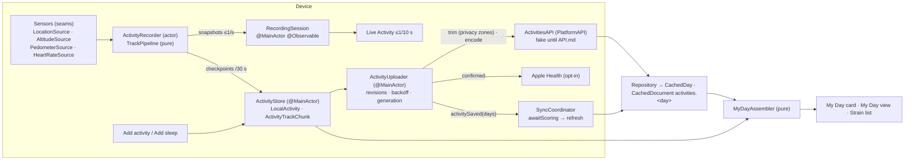
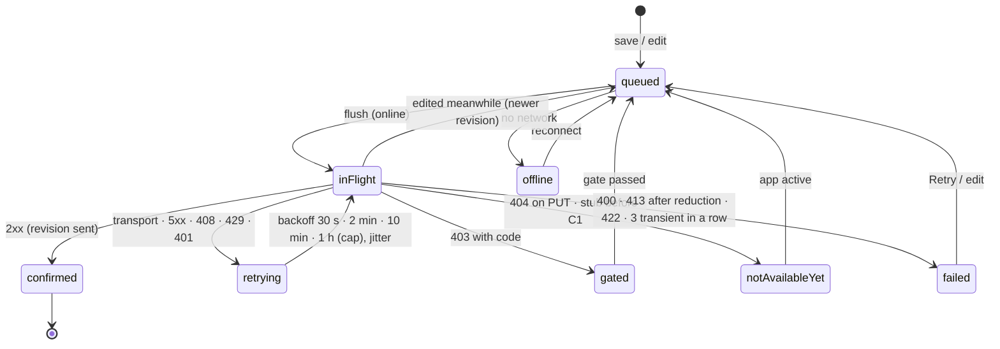
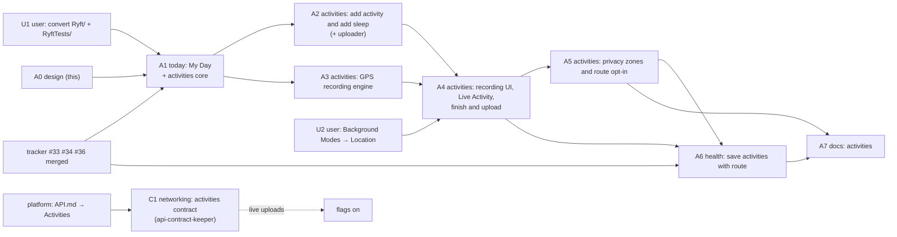

# My Day, Add activity, Start activity (GPS): design note (A0)

**Inputs**
- Brief: `brief.md` in this folder (copy of `CLAUDE_FOLLOWUP_MY_DAY_ACTIVITIES.md`).
- Platform half: `platform-brief.md` (planned contract; `API.md` → Activities isn't published, checked 2026-10-22).
- Plan: `plan.md`. UI spec D2 (`ui.md`, ui-designer) owns copy, layout and visuals; this note owns types, logic,
  isolation, storage and the ticket seams.
- In flight: tracker setup #33 (T1), #34 (T2), #36 (T3), design `docs/work/2026-10-22-tracker-setup/design.md`.
- ADRs written with this note: 0003 (track smoothing), 0004 (local-first recording), 0005 (route privacy),
  0006 (My Day as a merged read model). ADR 0002 is on the tracker branch.

Code anchors (`File.swift:N`) are from `main` at `58b696c`. Tracker-branch anchors say so.

**What this note decides**
- the data model: the sport catalogue, the wire draft, the local model, where each datum lives and for how long;
- `ActivityRecorder`: its machine, sources, pipeline, observation, isolation, checkpoints and resume;
- the upload queue and its states; Apple Health; the Live Activity, intents and control;
- My Day: placement, reads, the merged read model, editing;
- privacy; file layout (converted folders, plus a fallback); tickets, frozen interfaces, tests, risks, requests.

## 0. What the code says

1. **There is no `DateStrip`.** Strain draws its week strip inline (`StrainView.swift:62–91`, model
   `StrainViewModel.StripDay` `:20–34`); the journal has `JournalDateStrip` (`JournalViews.swift:150–178`).
   §7.3 extracts Strain's strip.
2. **`Activity` is taken.** ActivityKit's `Activity<Attributes>` is used in `RestActivity.swift:69, 76, 120, 135`; a
   module-level `struct Activity` would shadow it. The wire type is **`SportActivity`**, the same kind of rename as
   `TrainSession` for API.md's `Session` (`API_REQUESTS.md` → Train).
3. **RYFT's own workouts are already kept out of the upload.** `SyncEngine.withoutOwnWorkouts`
   (`SyncService.swift:720–730`, applied at `:688`, tested at `EnvironmentTests.swift:1778`) drops every workout
   whose `sourceBundleId` is the app's bundle ID. It filters **workouts only**. That is enough today, because RYFT
   writes no type a sync stream reads: distance and routes aren't in `HealthKitManager.quantities`
   (`HealthKitManager.swift:50–59`).
4. **The Apple Health tidy is strength-only for every own workout.** `removeOwnWorkoutsRecordedElsewhere`
   (`HealthStore.swift:286–297`) asks `recordedElsewhere` (`:299–311`), which looks for *strength* workouts from
   other sources. A RYFT run covered by a strength workout would be deleted. A6 makes the check per sport family.
5. **The store.** `TrainStore` (`TrainStore.swift:10–37`) is the account's one SwiftData container. It uses the main
   context only, and it falls back to an in-memory store when the file can't open (`:26–35`).
   - Its `ModelConfiguration` leaves `groupContainer` at `.automatic`. The app has the App Group entitlement
     (`Ryft.entitlements:16–19`), so SwiftData most likely places `Train.store` in the `group.dev.timkrebs.ryft`
     container. **Verify on a device** (A3: log the configuration's URL once in Debug).
6. **Sign-out wipes the whole store with batch deletes** (`TrainStore.swift:167–184`, called from
   `AuthService.wipeSharedLocalData` `AuthService.swift:654–671`), on any sign-out, expiry or account switch
   (`:622–647`). Train's unsent outbox goes with it today. Unconfirmed activities would too (§8.4).
7. **`StateMachine` is `@MainActor`** (`StateMachine.swift:8–15`). `TransitionTable` is a plain struct, so an
   actor can check `allows(_:_:)` without the GameplayKit engine.
8. **`DayDetail`** (`Models.swift:662–684`) has `sleep`, `workouts` (each with `source`, `sourceBundleId`, `strain`,
   `sessionId`) and `strain.sessions`. It has no activities. `SleepDetail` (`:404–420`) has no source and no origin.
9. **The contract check compiles `Models.swift` only** (`scripts/contract/run.sh:9–11`). Wire types go there.
10. **Info.plist.** `UIBackgroundModes` is fetch, processing and remote-notification (`Info.plist:75–80`).
    `NSHealthUpdateUsageDescription` ends "It writes nothing else" (`:60`), which becomes false in A6.
    `Ryft/Resources/InfoPlist.xcstrings` exists, so usage strings get German there.
11. **The Health opt-in** is `WorkoutHealthExport` (`TrainCoordinator.swift:426–535`): per account in defaults, a
    `.shared` singleton. `requestWorkoutWriteAccess` asks for workouts only (`HealthStore.swift:258–263`).
12. **Live Activity and control.** `RestActivityController` (`RestActivity.swift:62–141`), the widget UI
    (`RyftWidgets.swift:16–68`), `StartWorkoutControl` with a duplicated `OpenWorkoutIntent`. Duplicates are kept
    identical by `scripts/check-shared-types.py`.
13. **`WorkoutLauncher`** (`TrainCoordinator.swift:256–325`) makes intents wait for the tabs and an account.
14. **Strain already merges workouts with sessions** (`StrainViewModel.swift:97–112`). `ActivityStyle`
    (`StrainComponents.swift:4–44`) names HealthKit's activity strings.
15. **No read resource for activities** (`Repository.swift:700–712`).

## 1. Shape



**One owner per fact:**

| Fact | Owner |
| --- | --- |
| What the user recorded or typed, until the platform confirms it | `LocalActivity` (`ActivityStore`) |
| Strain, scoring state, merge, HR source | the platform; cached by `Repository` |
| The running recording's numbers | `ActivityRecorder` (in memory), checkpointed to `LocalActivity` |
| Upload state | derived from `LocalActivity` revisions plus the uploader's last attempt |
| My Day's list | computed by `MyDayAssembler` on read; never stored |
| Privacy zones, route default, auto-pause, voice cues | the device, per account |

## 2. Data model

### 2.1 The sport catalogue (`Ryft/Activities/Sport.swift`, A1)

`enum Sport: String, CaseIterable, Codable, Sendable` with the **API `sport` value as its raw value**. One static table
gives every property; §2 (Add) and §3 (Start) read the same table. Unknown wire values decode as `.other`.

| Sport (API) | Symbol (proposal) | GPS | `HKWorkoutActivityType` · location | Elevation | Auto-pause default · threshold | Max speed | σa | Family |
| --- | --- | --- | --- | --- | --- | --- | --- | --- |
| `running` | `figure.run` | yes | `.running` · outdoor | secondary | on · 1.0 m/s | 9 m/s | 1.5 | foot |
| `trail_running` | `figure.run` + trail badge | yes | `.running` · outdoor | **primary** | on · 0.8 | 8 | 1.5 | foot |
| `walking` | `figure.walk` | yes | `.walking` · outdoor | secondary | off · 0.4 | 4 | 1.0 | foot |
| `hiking` | `figure.hiking` | yes | `.hiking` · outdoor | **primary** | off · 0.3 | 4 | 1.0 | foot |
| `cycling` | `figure.outdoor.cycle` | yes | `.cycling` · outdoor | secondary | on · 1.5 | 25 | 3.0 | cycle |
| `mountain_biking` | `bicycle` | yes | `.cycling` · outdoor | **primary** | on · 1.2 | 22 | 3.0 | cycle |
| `gravel` | `bicycle` | yes | `.cycling` · outdoor | secondary | on · 1.5 | 22 | 3.0 | cycle |
| `indoor_running` | `figure.run` (treadmill if on iOS 17) | no: pedometer | `.running` · indoor | none | on · cadence 0 | — | — | foot |
| `indoor_cycling` | `figure.indoor.cycle` | no | `.cycling` · indoor | none | off | — | — | cycle |
| `rowing` | `figure.rower` | no (Q9) | `.rowing` | none | off | — | — | water |
| `swimming` | `figure.pool.swim` | no | `.swimming` | none | off | — | — | water |
| `strength` | `dumbbell.fill` | no; suggests Train | `.traditionalStrengthTraining` | none | off | — | — | gym |
| `hiit` | `figure.highintensity.intervaltraining` | no | `.highIntensityIntervalTraining` | none | off | — | — | gym |
| `yoga` | `figure.yoga` | no | `.yoga` | none | off | — | — | gym |
| `mobility` | `figure.flexibility` | no | `.flexibility` | none | off | — | — | gym |
| `climbing` | `figure.climbing` | no | `.climbing` | none | off | — | — | gym |
| `skiing` | `figure.skiing.downhill` | yes | `.downhillSkiing` · outdoor | secondary | off · 1.0 | 40 | 5.0 | snow |
| `ski_touring` | `figure.skiing.crosscountry` | yes | `.crossCountrySkiing` · outdoor (closest) | **primary** | off · 0.3 | 30 | 5.0 | snow |
| `football` | `figure.soccer` | no | `.soccer` | none | off | — | — | ball |
| `tennis` | `figure.tennis` | no | `.tennis` | none | off | — | — | ball |
| `padel` | `figure.tennis` | no | `.tennis` (Apple has no padel; Q9) | none | off | — | — | ball |
| `other` | `figure.mixed.cardio` | no | `.other` | none | off | — | — | other |

- **Elevation:** *primary* asks for Motion & Fitness and uses the barometer (the brief's list). *Secondary* uses the
  barometer only if Motion is already allowed, else GPS altitude. *None* shows no elevation.
- **More per entry:** `paceStyle` (`.pace` per km for foot and snow, `.speed` km/h for cycle), the HealthKit distance
  type (`distanceWalkingRunning`, `distanceCycling`, `distanceDownhillSnowSports`, `distanceSwimming`; none for the
  rest on iOS 17), and a localized name key.
- **Symbols are proposals.** ui-designer confirms each exists on iOS 17 (SF Symbols → availability).
  `SportCatalogTests` checks `UIImage(systemName:)` on CI, but CI runs a newer iOS.
- **`family`** is used for the Apple Health overlap rule (§5). The platform's merge rule ("same sport family") must
  use the same families. That is API request R10.
- **HealthKit names → sports.** `Sport(healthKitActivity:)` maps `HealthKitManager.activityName` strings where they
  correspond: `soccer` → `football`, `functional_strength` → `strength`, `crossfit` → `hiit`. `ActivityStyle` keeps the
  names that have no sport (elliptical, stairs, cooldown) and asks the catalogue first for the rest.

### 2.2 Wire draft (`Networking/Models.swift`, `// MARK: - Activities`, inserted before `// MARK: - Helpers` `:2100`)

A mirror of the **platform brief**, not of API.md yet. api-contract-keeper reconciles it when API.md publishes (C1).
No field beyond the brief; everything else is an API request (§13).

```swift
enum ActivityOrigin: String, Codable, Sendable { case manual, recorded }
enum StrainSource: String, Codable, Sendable { case heartRate = "heart_rate", perceivedEffort = "perceived_effort", none }
struct ActivitySplit: Codable, Hashable, Sendable { let index: Int; let distanceM: Double; let durationSec: Double; let ascentM: Double? }
/// API.md → Activities `Activity` (renamed: ActivityKit owns `Activity`).
struct SportActivity: Codable, Hashable, Identifiable, Sendable {
    let id: UUID                       // the app's, idempotent
    var sport: Sport; var origin: ActivityOrigin
    var start: Date; var end: Date; var movingSec: Double
    var distanceM: Double?; var ascentM: Double?; var descentM: Double?
    var perceivedEffort: Int?          // 1–10
    var notes: String?                 // ≤ 500
    var splits: [ActivitySplit]?
    var route: String?                 // encoded polyline, trimmed on the device; only with the route opt-in
    var hrSamples: [HRPoint]?          // BLE only; HRPoint {t, bpm} already mirrors this shape
    var clientUpdatedAt: Date
    // set by the platform, never sent
    var strain: Double?; var strainSource: StrainSource?; var hrSource: String?
    var mergedWith: UUID?; var scoringState: String?   // values unspecified: R2
}
struct ManualSleepPut: Codable, Sendable { let bed: Date; let wake: Date }
```

Encoding for `PUT` omits the server fields (a dedicated `encode(to:)`).

### 2.3 Local model (`Ryft/Activities/LocalActivity.swift`, A1; added to `TrainStore.schema` `TrainStore.swift:14–15`)

```swift
@Model final class LocalActivity {            // one per manual or recorded activity, until compaction
    @Attribute(.unique) var id: UUID
    var account: String                        // Supabase user id at creation (§8.4)
    var sportRaw: String; var originRaw: String
    var phaseRaw: String                       // RecordingPhase while recording; "saved" for documents
    var start: Date; var end: Date?; var movingSec: Double
    var distanceM: Double?; var ascentM: Double?; var descentM: Double?
    var perceivedEffort: Int?; var notes: String
    var recordRoute: Bool
    var splitsData: Data?                      // [ActivitySplit], wire JSON
    var pausesData: Data?                      // [DateInterval] (manual and auto), for HealthKit events and resume
    var headerData: Data?                      // RecordingHeader (§3.9) while recording / interrupted
    var localRevision: Int                     // bumped by every save or edit
    var confirmedRevision: Int                 // the newest revision the platform answered 2xx to
    var deletedAt: Date?                       // tombstone until DELETE is confirmed
    var lastAttemptData: Data?                 // UploadAttempt: at, status, code, request ID, kind; never a body
    var healthStateRaw: String?                // nil · saved · alreadySaved · recordedElsewhere · failed
    var createdAt: Date; var updatedAt: Date
}
@Model final class ActivityTrackChunk {        // append-only, one per checkpoint and kind; no relationship
    var activityID: UUID; var seq: Int; var kindRaw: String   // profile · route · heartRate
    var data: Data                             // TrackCodec, ≤ ~1 KB
    var count: Int; var first: Date; var last: Date
}
@Model final class LocalManualSleep {          // "Add sleep", until confirmed
    @Attribute(.unique) var day: String
    var account: String; var bed: Date; var wake: Date
    var localRevision: Int; var confirmedRevision: Int; var deletedAt: Date?; var lastAttemptData: Data?
}
```

- **Chunks have no relationship.** `TrainStore.wipe()` uses batch deletes, which skip cascades. Chunks are fetched
  and deleted by `activityID`.
- **The kinds split location from everything else:**
  - `profile` holds time, cumulative distance, altitude and speed: no coordinates. Charts, splits and resume use it.
  - `route` holds time, latitude, longitude, horizontal accuracy and altitude. It's written **only with the route
    opt-in**.
  - `heartRate` holds time and bpm (BLE).
- **`TrackCodec`** (`Recording/TrackCodec.swift`): a 4-byte magic with version, the kind, the count, a base time
  (Float64), then packed little-endian records. A profile record is 16 B, a route record 28 B, a heart-rate record 6 B.
  So 2 h at 1 Hz is about 115 KB of profile and 200 KB of route. Encoding runs in the recorder actor.

### 2.4 What's stored where, and for how long

| Datum | Where | Lifetime | Sign-out / deletion | Export | Uploaded |
| --- | --- | --- | --- | --- | --- |
| `LocalActivity` (no coordinates) | account store (§0.5) | confirmed + 30 days, then compaction | wiped (§8.4 for expiry) | yes, while unconfirmed | yes |
| `profile` chunks | account store | as the row | wiped | no (splits are) | no |
| `route` chunks (raw) | account store | **until the platform confirmed the trimmed route and Apple Health, if on, saved its copy** | wiped | trimmed, while unconfirmed | trimmed, opt-in |
| `heartRate` chunks | account store | until confirmed | wiped | as `hr_samples` | as `hr_samples` |
| `LocalManualSleep` | account store | until confirmed | wiped | no (the platform's day has it) | yes |
| Server copies (`SportActivity` per day) | `CachedDocument activities.<day>` | compaction with days (1 year) | wiped | from the platform | — |
| Privacy zones | `CachedDocument activities.privacyZones` | until changed | wiped | **never** (they'd reveal the place they hide) | **never** |
| Route default, auto-pause, voice cues | `UserDefaults`, keyed per account | until changed | wiped | no | no |
| Live Activity content | ActivityKit (no route, no coordinates) | ends with the recording | ended on wipe | — | — |

- **Nothing is written to App Group files.** `readiness.json` stays the only shared file. Whether the SwiftData file
  itself sits in the group container is §0.5's verification. We don't move it: moving it would orphan every existing
  store.
- **File protection** stays the default (`completeUntilFirstUserAuthentication`), so checkpoints land while the phone
  is locked. Never raise it to `.complete` for this store. Device test D4 checks it.
- **Device backups** include the store, as they do today. Raw coordinates live there only until confirmation.

### 2.5 My Day items (`Features/MyDay/MyDayAssembler.swift`, A1; ADR 0006)

```swift
struct MyDayItem: Identifiable, Equatable {
    enum Kind: Equatable { case sleep(day: String), workout(UUID), session(UUID), activity(UUID) }
    enum Strain: Equatable { case scored(Double), pending, noHeartRate, notApplicable }
    enum Source: Equatable { case ryftRecorded, ryftManual, addedByYou, tracker(name: String), train }
    let id: String; let kind: Kind
    let symbol: String; let title: String
    let start: Date; let end: Date; let distanceM: Double?
    let strain: Strain
    let sources: [Source]           // 1–2; two when merged
    let upload: UploadState?        // own activities and manual sleep only
    let editable: Bool              // manual and recorded activities, manual sleep: any day
}
enum MyDayAssembler {
    static func items(_ input: MyDayInput, catalog: TrackerCatalog, now: Date) -> [MyDayItem]   // pure
}
struct MyDayInput {
    var day: String
    var server: Server                       // what the platform said
    enum Server { case dayDetail(DayDetail?, activities: [SportActivity]); case myDay(/* R1's shape */) }
    var local: [LocalActivitySnapshot]       // value copies of unconfirmed or tombstoned rows, and their upload states
    var localSessions: [SessionSummary]      // TrainLibrary.merged(local:remote:) input, as Strain does today
    var localSleep: ManualSleepSnapshot?
}
```

**Rules, in order:**
1. **Server layer.** Sleep, workouts, sessions and activities come from `DayDetail` plus the activities read. Once the
   platform ships R1, they come from its items.
2. **Merged rows.** An activity with `mergedWith == W` hides workout `W`. Its row carries `[.ryft…, .tracker(name of
   W)]` and the activity's strain, which the platform computed from the better HR source. The client never predicts
   a merge (ADR 0006).
3. **Workouts.** A workout with a `sessionId` and that Train session are one row, as in `StrainViewModel.swift:97–112`.
4. **Local overlay.**
   - An unconfirmed `LocalActivity` replaces the server item with the same id: the user's edit wins until confirmed.
     The server's last strain stays visible, else `.pending`.
   - A tombstone hides it.
   - Local sessions not on the server yet are added.
5. **Sleep.**
   - No sleep, no `localSleep`, and T1's `nightGap` is nil: a "No sleep recorded · Add sleep" row. We don't invite a
     manual entry while the tracker's night is only late.
   - A pending manual sleep shows as "added by you".
6. **Order and names.** Sorted by start (sleep first). Tracker names come from
   `env.trackerCatalog.displayName(SourceRef(name: w.source, bundleID: w.sourceBundleId, deviceModel: nil))`, T1's
   frozen API.

**Strain state per item:**
- `strain != nil` → `.scored`;
- `strainSource == .none` → `.noHeartRate` ("No heart rate for this time");
- otherwise `.pending`;
- sleep → `.notApplicable`.

## 3. `ActivityRecorder` (A3)

### 3.1 The machine (`StateMachines/Machines.swift`, appended: `RecordingPhase`, `RecordingMachine`)


- **One table, two users.** `RecordingMachine.table()` is the edge list.
  - The actor checks `table.allows(phase, next)`, with no closures, so it works off the main actor.
  - `RecordingMachine.make()` builds the GameplayKit engine for `StateMachineTests`, which walks every pair on both
    engines like the other machines.
  - `RecordingSession` mirrors the phase for the UI. It never decides.
- **24 h cap.** At 24 h of elapsed time the recorder moves to `finishing` by itself, with a notice. The platform
  refuses longer activities.

### 3.2 Sources (`Recording/Sources.swift`; live ones in `LiveLocationSource.swift`, `LiveMotionSources.swift`, `HeartRateSensor.swift`)

```swift
struct LocationFix: Sendable, Equatable, CustomStringConvertible {
    let timestamp: Date; let latitude: Double; let longitude: Double
    let altitude: Double?; let horizontalAccuracy: Double; let verticalAccuracy: Double?
    let speed: Double?; let isStationary: Bool
    var description: String { "fix(±\(Int(horizontalAccuracy)) m)" }   // never the coordinates (§8.3)
}
enum LocationAccess: Equatable, Sendable { case notDetermined, denied, restricted, whenInUse(precise: Bool) }
protocol LocationSource: Sendable {
    func access() async -> LocationAccess
    func requestWhenInUse() async -> LocationAccess
    func requestTemporaryPrecise() async -> Bool              // purpose key "ActivityRecording"
    func fixes() -> AsyncStream<LocationFix>                   // ends when the consuming task is cancelled
    func beginBackgroundSession() async -> BackgroundLocationToken   // CLBackgroundActivitySession; invalidated on deinit
    var canRunInBackground: Bool { get }                       // Info.plist UIBackgroundModes contains "location"
}
protocol AltitudeSource: Sendable { var isAvailable: Bool { get }; func relative() -> AsyncStream<AltitudeSample> }
protocol PedometerSource: Sendable {
    var isAvailable: Bool { get }
    func updates(from: Date) -> AsyncStream<PedometerSample>              // cumulative distance, cadence
    func total(from: Date, to: Date) async throws -> PedometerSample      // resume after a kill
}
protocol HeartRateSource: Sendable {
    func sensors() -> AsyncStream<[HeartRateSensorInfo]>                  // scan for service 0x180D
    func readings(from sensor: UUID) -> AsyncStream<HeartRateReading>     // characteristic 0x2A37
}
struct ActivitySensors: Sendable {
    var location: LocationSource; var altitude: AltitudeSource; var pedometer: PedometerSource; var heartRate: HeartRateSource
    static let unavailable: ActivitySensors      // every source empty; tests and previews start here
}
```

- **`AppEnvironment` gets one parameter, `sensors: ActivitySensors = .unavailable`.** `.live` passes
  `ActivitySensors.live`, `.preview` passes a replay, `.test` passes `.unavailable` or a test's fakes. One parameter
  keeps the init change to one line next to T2's `content:`.
- **The live location source:**
  - fixes from `CLLocationUpdate.liveUpdates(.fitness)` (iOS 17);
  - authorization, `accuracyAuthorization` and `requestTemporaryFullAccuracyAuthorization` through one
    `CLLocationManager` it keeps on the main actor;
  - `CLBackgroundActivitySession` on Start, which shows the blue pill;
  - When In Use only, never Always.

  Fixes older than 10 s (cached) are dropped at the source.
- **Why `liveUpdates` and not `CLLocationManager` updates:**
  - it pauses itself while the device is stationary (`isStationary`), which is the brief's "lower GPS frequency when
    stationary" without our own accuracy toggling;
  - it's an async sequence, so it needs no delegate threading.

  If device test D2 shows dropped background updates or > 8 %/h, the seam lets A3 swap in a manager-based source
  (`activityType = .fitness`, `distanceFilter = 5`, best accuracy, `allowsBackgroundLocationUpdates`,
  `pausesLocationUpdatesAutomatically = false`) without touching the pipeline.
- **Fakes:**
  - `FixtureLocationSource(fixes:)` yields an array at once; the pipeline runs on the fixes' own timestamps.
  - `ClockedLocationSource(fixes:, clock:)` yields on a `TestClock`, for checkpoints and auto-pause in time.
  - `ReplayLocationSource(track:, speedup:)`: DEBUG and previews (§11.3).
  - `FakeAltitudeSource`, `FakePedometerSource`, `FakeHeartRateSource`.

### 3.3 The location pipeline (`Recording/TrackPipeline.swift`, `KalmanTrack.swift`, `Geodesy.swift`; ADR 0003)

`struct TrackPipeline` is a **pure value type**: `mutating func ingest(_ fix: LocationFix) -> [PipelineEvent]`, plus
`pause`, `resume`, `lap` and `finish`. The actor owns one. Unit tests drive it directly with fixture arrays, with no
actor and no clock.

| Step | Rule |
| --- | --- |
| 1 Pre-gate | Drop `horizontalAccuracy` < 0 or > 25 m. Drop timestamps not after the last accepted one, or older than 10 s. Before Start, the button activates at ≤ 20 m (or "Start anyway"). |
| 2 Speed gate | Distance to the last accepted *filtered* position, minus the two accuracies, over Δt (≥ 1 s): if it's above `sport.maxSpeed`, reject (counted as `implausible`). |
| 3 Filter | Constant-velocity Kalman per axis in a local tangent plane (WGS84 meridional and prime-vertical radii at the anchor latitude; re-anchored every 5 km). Measurement variance `max(hAcc, 3 m)²`; white-acceleration process noise `σa` from the catalogue. Innovation gate at 3.5σ: a rejected fix is counted; 3 rejections in a row re-initialise at the measurement (a real jump, a tunnel exit). Δt > 15 s resets the velocity variance. |
| 4 Distance | Sum the geodesic step between consecutive filtered positions while `recording` (not paused) and the filter's speed is ≥ 0.3 m/s, so a stationary phone accrues nothing with auto-pause off. Distance is horizontal, like every GPS watch; ascent is separate. |
| 5 Gaps | Δt > 10 s between accepted fixes: bridge with the straight line if the implied speed is ≤ `maxSpeed`, else don't (counted `gap`). A route-off resume after a kill never bridges (§3.9). |
| 6 Pace | Rolling 30 s of moving time over (t, cumulative distance): pace = Δt/Δd once Δd ≥ 20 m and ≥ 10 s of data, else none ("—"). Average pace = moving time / distance. Cycling shows speed. |
| 7 Splits | When the distance crosses k × 1000 m, interpolate the crossing time between the two filtered points. A split is `{index, distance_m: 1000, duration_sec: moving time in it, ascent_m}`. Finish adds the partial last split with its real distance. Laps are local (§13 R7). |
| 8 Auto-pause | If enabled: enter when the filter's speed is < the sport's threshold for 10 s of fix time, or `isStationary` for 5 s. Leave at ≥ 1.5 × threshold for 3 s. The filter keeps running while auto-paused. Manual pause and resume always work. |

- **Diagnostics.** `RecordingDiagnostics` holds counts only: fixes accepted, rejected per reason, gaps, longest gap,
  checkpoints and their failures, snapshots, Live Activity updates, and battery level at start and end (Debug and
  TestFlight). It's attached to Copy diagnostics for the last recording. No coordinates.

### 3.4 Elevation (`Recording/ElevationFusion.swift`)

- **Barometric (primary sports, and secondary ones with Motion already allowed):**
  - `CMAltimeter.startRelativeAltitudeUpdates` gives `relAlt`.
  - Absolute altitude = `relAlt + offset`. The offset is the median of `gpsAlt − relAlt` over 5 min of fixes with
    `verticalAccuracy` ≤ 10 m, which absorbs slow weather drift.
  - Ascent and descent accumulate on `relAlt` with a **2 m hysteresis**.
- **GPS only** (no barometer, or no Motion permission): altitude from fixes with `verticalAccuracy` ≤ 15 m, median of
  5 samples, **5 m hysteresis**.
- **None** for indoor sports and sports without GPS.
- **The prompt.** Motion & Fitness has no request API: starting the altimeter in `acquiring` triggers the prompt for
  a primary sport, before Start, after D2's pre-prompt line.

### 3.5 Indoor runs (`indoor_running`)

- `CMPedometer.startUpdates(from: start)` gives cumulative distance and cadence.
- Rolling pace comes from distance deltas. Auto-pause triggers on cadence 0 for 10 s.
- **Resume after a kill is lossless:** `queryPedometerData(from: start, to: now)` gives the total, minus the deltas
  recorded during pauses (kept in the header).
- **Finish lets the user correct the distance** ("Treadmill said …"). It's stored and sent as `distance_m`.
- **Without Motion permission:** time only, plus the distance typed at Finish.

### 3.6 Live heart rate (`Recording/HeartRateSensor.swift`, behind `activity.liveHR`; can be A3's last commit or a follow-up)

- **Core Bluetooth, standard Heart Rate service `0x180D`, measurement `0x2A37`.** It parses the uint8/uint16 flag.
  RR intervals are ignored.
- **No `CBCentralManager` exists until the user taps "Connect heart-rate sensor"** in pre-start. That tap triggers the
  Bluetooth prompt (`NSBluetoothAlwaysUsageDescription`, en + de, added with the flag).
- Readings go to `heartRate` chunks and the snapshot.
- **Without a sensor:** "Heart rate is added after your tracker syncs." No value is ever estimated (brief: never fake
  HR).
- **Screen off needs Background Modes → "Uses Bluetooth LE accessories"** (user step U3, App Review text). Until that
  step, live HR shows only while the app is in the foreground and says so.

### 3.7 Observation and throttling

```swift
actor ActivityRecorder {
    init(id: UUID, sport: Sport, options: RecordingOptions, sensors: ActivitySensors, clock: AppClock,
         restoring: RestoredRecording? = nil)
    nonisolated let snapshots: AsyncStream<RecorderSnapshot>   // .bufferingNewest(1): the UI only wants the latest
    nonisolated let events: AsyncStream<RecorderEvent>         // .unbounded: checkpoints must never be dropped
    func acquire() async                 // idle → acquiring: location (foreground), the altimeter for primary sports
    func start() async                   // acquiring → recording: begins the background session
    func pause(); func resume(); func lap()
    func stop() async                    // → finishing: final checkpoint, totals frozen
    func keepGoing()                     // finishing → paused
    func save() async -> RecordingResult // finishing → finished: sources stopped
    func discard() async                 // → discarded: sources stopped
    func setObserved(_ observed: Bool)   // snapshot cadence: 1 s observed, 10 s otherwise
}
struct RecordingOptions: Sendable { var recordRoute: Bool; var autoPause: Bool; var liveHR: Bool; var barometer: Bool; var pedometer: Bool }
struct RecorderSnapshot: Sendable, Equatable {
    let phase: RecordingPhase; let movingAnchor: Date?   // now − moving time while recording, so clocks tick on their own
    let movingSec: Double; let elapsedSec: Double; let distanceM: Double
    let currentPace: Double?; let averagePace: Double?; let speedKmh: Double?; let ascentM: Double?
    let heartRate: Int?; let gps: GPSQuality             // good ≤ 10 m, fair ≤ 25 m, weak (no fix 10 s), off
    let lastSplit: ActivitySplit?; let routeTail: [RoutePoint]   // new points since the last snapshot, only while the map shows
}
enum RecorderEvent: Sendable { case checkpoint(Checkpoint), split(ActivitySplit), phase(RecordingPhase), gps(GPSQuality) }
```

- **Snapshots are rate-limited in the actor on the injected clock:**
  - at most 1/s while a screen observes (`RecordingSession.setObserved(true)` on appear and scene active);
  - at most 1 per 10 s otherwise (screen off: only the Live Activity needs them);
  - on any phase change, at once.
- **The UI's clock** uses `movingAnchor` in a `TimelineView(.periodic(by: 1))`. It needs no snapshot per second.
- **`RecordingSession`** (`@MainActor @Observable`, `Features/Activities/RecordingSession.swift`, A4) formats values.
  It forwards actions, feeds `RecordingActivityController` (§6), and speaks voice cues on `.split`.
- **The map** is off by default (battery). While shown, it appends `routeTail` to an in-memory polyline,
  Douglas–Peucker-simplified at 2 m.

### 3.8 Concurrency and isolation

| Work | Where |
| --- | --- |
| Fix, altitude, pedometer and HR handling; the Kalman; splits; codec encoding | `ActivityRecorder` (actor), one child task per source in a task group |
| Core Location authorization, `CLBackgroundActivitySession` | `LiveLocationSource`, hopping to the main actor internally (CL wants a run-loop thread) |
| CMAltimeter / CMPedometer / CB callbacks | their own private serial queues, bridged to `AsyncStream` |
| SwiftData writes (checkpoints, documents) | `ActivityStore`, `@MainActor`, the main context (ADR 0004): one insert and save per 30 s |
| Formatting, Live Activity calls, speech | `RecordingSession`, `@MainActor` |
| Route trimming, polyline encoding, downsampling | `@concurrent static func ActivityPayload.make(…)` (§4.2) |

- **No `Task.detached`.** The recorder's source tasks are children of its `run()` task. `RecordingSession` holds the
  `run()` task and cancels it on `save` and `discard`.
- **Two streams.** Snapshots and events are separate, so a slow main actor can drop stale UI states but never a
  checkpoint.

### 3.9 Checkpoints and resume

```swift
struct Checkpoint: Sendable {
    let activityID: UUID; let seq: Int
    let header: RecordingHeader        // phase, sport, options, start, pauses, moving s, distance, ascent/descent,
                                       // splits, partial split start, last fix time, elevation offset, pedometer
                                       // baselines, diagnostics; no coordinates
    let profile: Data?; let route: Data?; let heartRate: Data?   // TrackCodec, since the previous checkpoint
}
```

- **When.** Every 30 s on `env.clock`. On every phase change and every lap. When the scene goes to the background
  (`RecordingSession` asks the actor for one).
- **How.** `ActivityStore.apply(_:) -> Bool` upserts the header and inserts the chunks in one `save()`. A failed save
  is counted and shown as "Progress isn't being saved" on the recording screen.
- **Not durable.** `ActivityStore.isDurable` is false when `TrainStore` fell back to memory (§0.5). Pre-start then
  warns that the recording can't survive the app closing.
- **On launch.** `RecordingCoordinator.restore(inBackground:)` runs in `RyftApp.init`, next to the HealthKit observers
  (`RyftApp.swift:83–85`). It looks for a `LocalActivity` whose phase is recording, paused or auto-paused.
  - **Background launch** (Core Location relaunched the app for a background session; **verify on a device**, D3):
    re-create the `CLBackgroundActivitySession` and the fix loop at once, and continue `recording` with the gap from
    the last checkpoint counted as a pause.
  - **Foreground launch** (force-quit, crash): phase `interrupted`, and the cover shows "Resume your run?" with
    Resume, Finish and Discard.
    - Finish ends the activity at the **last checkpoint's** time, not at the launch time.
    - After more than 24 h since the start, only Finish and Discard are offered.
  - **Rebuilding the state.** The pipeline is rebuilt from the header. The filter re-initialises at the first new fix.
    - With the route on, the last `route` chunk's final point bridges the gap per §3.3 step 5.
    - With the route off, no coordinate was ever stored, so nothing is bridged.
    - Indoor runs re-query the pedometer (§3.5).
- **The Live Activity** gets `staleDate = now + 90 s` on each update, so a killed app's activity reads as paused
  rather than frozen-live. On launch, `RecordingActivityController.endAll(except:)` keeps only the restored one.

### 3.10 Permissions and degraded modes

| Situation | Behaviour |
| --- | --- |
| Location not asked | Pre-prompt sheet (why, When In Use only, the blue pill) → `requestWhenInUse()`. Asked at the first Start, never at launch. |
| Location denied or restricted | Pre-start says so, with Open Settings and "Record without GPS": time; for foot sports also pedometer distance if Motion is allowed. |
| Precise Location off | `requestTemporaryPrecise()` (Info.plist `NSLocationTemporaryUsageDescriptionDictionary`, key `ActivityRecording`, en + de). Declined: as denied, with an explanation. |
| No background location in the build (`canRunInBackground == false`) | Recording works with the screen on only: `isIdleTimerDisabled` while recording, and a banner. `activities.recording` never ships in such a build: a unit test asserts `UIBackgroundModes` contains `location` once U2 is done. |
| Motion denied | GPS-only elevation; indoor run is time plus the typed distance. |
| Bluetooth denied | No live HR; the "after your tracker syncs" line. |
| Live Activities off | Recording unaffected; no Live Activity. |
| Strength session in progress | Start activity offers "Resume strength workout" instead; likewise, Start strength while recording offers the recording. One full-screen live flow at a time. |
| Store not durable | Pre-start warning (§3.9). |

### 3.11 Battery (target ≤ 8 %/h, screen off, iPhone 17)

- GPS via `liveUpdates(.fitness)` with Core Location's own stationary pause.
- In the background, no snapshots at 1 Hz (10 s cadence), no MapKit, and one SwiftData save per 30 s.
- Live Activity updates ≤ 1 per 10 s, only when a shown value changed: distance to 0.01 km, pace to 5 s.
- Barometer and pedometer are negligible. The BLE central exists only on request.
- **A lever for the profiler, not built yet:** HealthKit deliveries during a recording trigger syncs (radio
  wake-ups). If D2 shows they matter, coalesce `.healthKit` triggers to one per 15 min while `recording`.
- **Measurement (performance-profiler, D2):**
  - a 60-min outdoor run, screen off, from 100 % (`RecordingDiagnostics` battery levels);
  - Instruments Energy Log on one run;
  - Xcode Organizer energy reports after TestFlight.

## 4. Upload (A2 lands the uploader; A4 hooks recordings in)

### 4.1 `ActivityUploader` (`Ryft/Activities/ActivityUploader.swift`, `@MainActor @Observable`, sync-engineer)

The `TrainSyncService` precedent, without its `.shared`, legacy `.now` and `Task.sleep`. The queue is **the rows
themselves**: an activity needs uploading when `localRevision > confirmedRevision`, or when it has a tombstone. There
is no second op table, so state lives in one place.

```swift
enum UploadState: Equatable, Sendable {
    enum Pending: Equatable, Sendable { case queued, offline, retrying(at: Date), inFlight, notAvailableYet, gated }
    case pending(Pending)            // My Day: cloud with an arrow
    case failed(UploadAttempt)       // My Day: retry. The platform refused, or 3 transient failures in a row while online
    case confirmed                   // then the server copy decides: hollow dot (pending strain) or the strain value
}
@MainActor @Observable final class ActivityUploader {
    init(env: AppEnvironment, store: ActivityStore)
    func saved(_ id: UUID)                          // after a save or edit (the store bumped localRevision)
    func deleted(_ id: UUID)                        // tombstone; never uploaded → removed at once
    func flush(userInitiated: Bool = false) async   // in order of createdAt; one request at a time
    func retry(_ id: UUID) async
    func state(of id: UUID) -> UploadState
    func accountChanged()                           // generation += 1; the replay stops; answers for it are dropped
    private(set) var pendingCount: Int
    @ObservationIgnored var onConfirmed: (@MainActor (SportActivity, _ days: [String]) -> Void)?
}
```



- **Idempotent by client id.** `PUT /v1/activities/{id}` sends the whole document as of `sentRevision`. On 2xx,
  `confirmedRevision = sentRevision`, so an edit made during the request causes one more PUT, never a lost edit.
- **`DELETE`:** 2xx or 404 removes the row and its chunks. Otherwise the tombstone stays.
- **Never lost.** No path deletes a row before the platform confirms it, except Discard during recording, a delete of
  a never-uploaded row, and the account wipe (§8.4). `failed` is a state, not a deletion.
- **Error classes** reuse `TrainSyncService.isRetryable` (`TrainSyncService.swift:246–253`) and add `404 →
  notAvailableYet`. `401` keeps `APIClient`'s refresh-once-then-sign-out (API.md → Errors).
- **Request IDs.** The request ID of the last failure goes into `lastAttemptData`, and the row's Details show it.
- **Triggers:**
  - save, edit and delete;
  - reconnect (`RyftApp.swift:168`) and app active;
  - the `BGAppRefreshTask` handler (`ScheduledWork.swift`);
  - backgrounding, with a `beginBackgroundTask` for the request in flight;
  - after sign-in, for rows of that account.
- **Generation:** an account counter plus `TrainStore.epoch`, exactly like `TrainSyncService.Generation`.
- **On confirm**, `onConfirmed`:
  - stores the answer in the read model (`Repository.store(activity:)`);
  - deletes `route` and `heartRate` chunks once Apple Health is done or off (§2.4);
  - triggers the scoring follow-up (§4.3) and the Health save (§5).

### 4.2 Payload (`Ryft/Activities/ActivityPayload.swift`, A4; the route part in A5)

`@concurrent static func make(_ row: LocalActivitySnapshot, chunks: [ChunkSnapshot], zones: [PrivacyZone]) async -> Data`:
1. **Totals and splits** come from the row. They're always sent.
2. **Route:** only if `recordRoute` and A5 has merged. Trim by zones (§8.2), encode as a polyline (precision 5
   unless API.md says 6, R4), and join the segments (R5).
3. **`hr_samples`:** 5 s means.
4. **Size.** If the JSON exceeds 240 KiB (the platform's limit is 256 KiB), Douglas–Peucker the route at 2, 5, 10,
   then 20 m, then the HR at 15 s and 30 s, until it fits. Still too big → `failed` (413) with Details.

The final JSON encode happens inside `APIClient`'s `send` on the caller's actor, as Train's PUTs do (≤ 256 KiB, a few
ms). The expensive parts happen above, off the main actor.

### 4.3 Scoring follow-up: one pipeline

`SyncCoordinator.Trigger` gains **`.activitySaved(days: [String])`** (`SyncCoordinator.swift:70–83`):
- like `.silentPush`, it skips the HealthKit upload;
- unlike it, it runs `awaitScoring(days)`, then the refresh (`:313–356`);
- its priority is `.utility`; it coalesces with `.silentPush` the same way (`:271`).

It needs the platform to put the activity's day into `pending_days` until rescored (R3). Until then the wait ends at
its 5-minute cap and the refresh still runs. My Day shows the hollow dot meanwhile.

### 4.4 The `ActivitiesAPI` seam (`Ryft/Activities/ActivitiesAPI.swift`, A1)

```swift
protocol ActivitiesAPI {
    func putActivity(_ a: SportActivity) async throws -> SportActivity     // PUT /v1/activities/{id}
    func activities(from: Date, to: Date) async throws -> [SportActivity]  // GET /v1/activities?from&to
    func activity(id: UUID) async throws -> SportActivity                  // GET /v1/activities/{id}
    func deleteActivity(id: UUID) async throws                             // DELETE /v1/activities/{id}
    func putManualSleep(day: String, _ body: ManualSleepPut) async throws  // PUT /v1/sleep/manual/{day}
    func deleteManualSleep(day: String) async throws                       // DELETE /v1/sleep/manual/{day}
}
protocol PlatformAPI: RyftDataSource, TrainDataSource, ActivitiesAPI        // PlatformAPI.swift:6
```

- **`MockActivitiesSource`** is the in-memory fake used by demo, previews and tests (`Preview/MockActivities.swift`).
  - It stores by id; a PUT upserts and answers with `scoringState: "pending"`.
  - After `scoreDelay` (tests: 0; demo: 15 s on the clock) a GET returns a canned strain from a fixed table.
  - The demo data includes one recorded run merged with a mock tracker workout, so merged rows and their two badges
    are visible.
  - `MockPlatformAPI` forwards to it through `enter(name)`, so `failure`, `failNext` and `-RyftFault` work unchanged.
- **The live `APIClient` before C1** conforms with methods that throw `ActivitiesError.notPublished` without sending
  anything. The uploader maps that to `notAvailableYet`. The flags keep it dark.
- **C1** (api-contract-keeper, once API.md → Activities is published):
  - replaces the stub with `Networking/APIClient+Activities.swift`;
  - reconciles §2.2;
  - adds one fixture-decoding test per shape from API.md's examples;
  - adds the headings to `scripts/contract/extract.py`'s `MAP`.
  - If the platform chooses `GET /v1/my-day/{day}`, it adds `func myDay(_ day: String)`; that call is not frozen
    here.

## 5. Apple Health (A6)

- **Only with the existing opt-in.** `WorkoutHealthExport.isWriting` (`TrainCoordinator.swift:477`) gates it. Profile's
  toggle text becomes "Save workouts to Apple Health" (`ProfileView.swift:368–383`, after T2 merges).
- **New `HealthStore` requirement**, after `:148`; live after `:311`; mock after `:482`:

```swift
struct ActivityWorkout: Sendable {
    let id: UUID; let sport: Sport; let start: Date; let end: Date
    let pauses: [DateInterval]; let laps: [Date]
    let distanceM: Double?; let ascentM: Double?
    let route: [[RoutePoint]]                 // already trimmed (§8.2); empty without the route opt-in
}
/// One HKWorkout per activity: HKWorkoutBuilder (configuration from the catalogue: activity and location type),
/// .pause/.resume and .lap events, one distance sample of the catalogue's type, metadata brand "RYFT",
/// HKMetadataKeyExternalUUID = id, HKMetadataKeyElevationAscended, HKMetadataKeyIndoorWorkout; then
/// HKWorkoutRouteBuilder with the route's points as CLLocations (timestamps inside start…end) → finishRoute(with:).
/// .alreadySaved when ours with that external UUID exists; .recordedElsewhere when another source's workout of the
/// same family covers ≥ 60 % (the platform's merge rule).
func saveActivityWorkout(_ w: ActivityWorkout) async throws -> WorkoutSaveResult
```

- **Write access.** `requestWorkoutWriteAccess` asks for `workoutType` plus `HKSeriesType.workoutRoute()` and the
  catalogue's distance types.
  - Someone who already allowed workouts is asked once more at their first activity save. iOS shows only the new
    types.
  - Route or distance refused: the workout is saved without them.
- **The tidy generalises.** `recordedElsewhere(_:)` (`:299–311`) takes the own workout's family:
  - strength: strength types, ≥ 50 % (unchanged);
  - activities: same family, ≥ 60 %.

  `removeOwnWorkoutsRecordedElsewhere` (`:286–297`) passes each own workout's family (§0.4).
- **Never re-uploaded.** Workouts RYFT wrote carry the app as their source, and `SyncEngine.withoutOwnWorkouts`
  drops them (`SyncService.swift:720–730`, `:688`). A6 adds the rule to that function's comment and pins it with a
  test.
  - RYFT never writes heart rate or active energy to Health, because the sync *does* read those (samples aren't
    filtered).
  - If that ever changes, the filter learns samples first.
  - `NSHealthUpdateUsageDescription` (`Info.plist:60` + `InfoPlist.xcstrings`) says workouts, with route and
    distance if recorded, only when on.
- **When.** After the platform confirms (so a refused upload doesn't leave a Health-only activity), or at Save when
  `activities.*` runs against the stub. Once per id, never in demo mode.
  - The phone must be unlocked: HealthKit is unreadable while locked (`ProtectedData`). A save that hits a lock waits
    for `protectedDataDidBecomeAvailable`.
  - So the Live Activity has no Stop button (§6).

## 6. Live Activity, App Intents, the control (A4)

- **`RecordingAttributes: ActivityAttributes`** (`Ryft/Activities/Recording/RecordingActivity.swift` and
  `RyftWidgets/RecordingAttributes.swift`; both in `check-shared-types.py`):
  - static: `activityID: UUID`, `sport: String` (raw), `title`, `symbol`, `startedAt`;
  - `ContentState`: `phase` (recording, paused, autoPaused), `movingAnchor: Date?`, `pausedMovingSec: Double`,
    `distanceM`, `pace: Double?` / `speedKmh: Double?`, `updatedAt`.
- **The clock** is `Text(timerInterval:pauseTime:)`, so the lock screen ticks without updates.
- **`RecordingActivityController`** follows `RestActivityController`'s shape: `start`, `update` (throttled per §3.11,
  `staleDate` +90 s), `end`, `endAll(except:)`. It isn't a `.shared` in new code; `RecordingCoordinator` owns it.
- **The widget** (`RyftWidgets/RecordingLiveActivity.swift`, synchronized) shows time, distance and pace, or "Paused".
  - **Pause and Resume** are `LiveActivityIntent`s (`RecordingIntents.swift` in both targets, shared-type-checked);
    `perform` runs in the app and calls the recorder.
  - **No Stop**, because finishing needs effort, notes and Save or Discard, and Health needs an unlocked phone.
  - Tapping opens `ryft://activity/recording`.
- **One Live Activity at a time.** The rest timer's and the recording's don't coexist, because of the mutual
  exclusion in §3.10.
- **Intents** (`Features/Activities/ActivityIntents.swift`):
  - `SportChoice: AppEnum` mirrors the GPS sports and indoor running.
  - `StartActivityIntent(sport:)` is `openAppWhenRun`, `requiresAuthentication`, and **opens pre-start with the sport
    selected** (permissions, GPS lock and the Start tap stay with the user; Q8).
  - `OpenRunIntent` is the control's action, duplicated in `RyftWidgets/` like `OpenWorkoutIntent`.
  - `StartRunControl` (`RyftWidgets/StartRunControl.swift`, iOS 18, kind `dev.timkrebs.ryft.run`) is "Start run".
- **`WorkoutLauncher`'s pending start generalises** to `enum LaunchRequest { case workout(QuickStart), activity(Sport)
  }` (`TrainCoordinator.swift:256–301`), so intents wait for tabs and an account the same way.
- **Static surfaces ship with the flag.** Control Center controls and App Shortcut phrases can't be hidden by a flag.
  `StartRunControl` is added to `RyftWidgetsBundle` and the phrase to `RyftShortcuts` (`TrainCoordinator.swift:414–424`)
  **in the release that turns `activities.recording` on**. The code lands in A4 unregistered.

## 7. My Day on Today (A1)

### 7.1 Placement

- **The card** goes into `TodayView`'s body after the push prompt (`TodayView.swift:42–50`) and before the journal
  card (`:52`).
  - So it sits below the scores and their hints, and above Journal, Tonight, Train and Trends (`:61`).
  - It's shown while the first import runs too: a run can be recorded on day one.
- **Inside the card:**
  - the header "My Day" with **＋** (Add activity, Start activity, Start strength workout, Add sleep) and an expand
    control;
  - up to four rows, then "Show all";
  - **Add activity** and **Start activity** at the bottom.
- **Hidden entries.** Entries behind a flag that is off are hidden. "Start strength workout" follows `train.enabled`.
- **No change to `TodayViewModel`.** It is T1, T2 and T4's hot spot. The card has its own model,
  `screens.myDay: MyDayViewModel`, built in `ScreenModels.init` (one line next to T2's `devices`).

### 7.2 Reads

- **`MyDayViewModel.items(for:)`** reads only caches:
  - `state.cachedDayDetail(for:)`;
  - `repository.activities(day:)` (new, kind `.activities`, memoised per revision like the others);
  - `activityStore.snapshots(onDay:)`;
  - local sessions.
- **`load(day)` revalidates** through the Repository:
  - `refreshDay(day)`, which already exists and is Today's own read, so no extra request;
  - plus **`refreshActivities(day, mode:)`**:
    - `ReadKey(.activities, id: day)`;
    - `ReadResource.activities` is added to `Repository.swift:700–728`, normal priority, display name "Activities";
    - TTLs follow days: 5 min today, 24 h for a past day;
    - stored as `CachedDocument "activities.<day>"`.
  - The card runs it on `.task(id: state.lastUpdated)`. `AppState.refreshDays` (after a sync's `days_touched`) adds
    it for the touched days.
- **Once the platform decides (R1):**
  - **DayDetail extended** with activities (recommended): `.activities` leaves My Day's path. My Day is then exactly
    Today's read, already refreshed by every `days_touched`, the silent push and pull to refresh.
  - **`GET /v1/my-day/{day}`**: `ReadResource.myDay` replaces `.activities` in My Day, stored as `CachedDocument
    "myday.<day>"`, with the same TTLs.
- **Strain's "Activities" list** switches to the same assembler without the sleep row, so RYFT activities appear
  there too. This deletes `StrainViewModel.activities`' own merge (`:97–112`).

### 7.3 Day switching and editing

- **The full-screen My Day view** (a push in Today's stack) has the **`DateStrip`**:
  - Strain's week strip (`StrainView.swift:62–91`, `StrainViewModel.StripDay`) moves to `Design/DateStrip.swift`;
  - Strain and My Day use it, 7 days back.
- **The Today card is always today**, like everything else on Today. D2 may add more days to the strip.
- **Past days are read-only, with two exceptions:** manual and RYFT-recorded activities, and manual sleep, can be
  edited and deleted. On past days the ＋ menu and the bottom buttons are hidden.
  - Manual activities: every field.
  - Recorded activities: sport within the same family, perceived effort and notes. Times, distance and route came
    from the recording.
  - Delete: a confirmation, then a tombstone (§4.1).
- **Taps:**
  - sleep → the Sleep tab for that night (`DeepLinkRouter`);
  - workout → `WorkoutDetailView`;
  - session → `TrainRoute.session`;
  - activity → `ActivityDetailView`.
- **`ActivityDetailView`** (A2 builds it without a map; A4 adds the rest):
  - the map with the route;
  - splits;
  - pace (a bar per km) and elevation (area, from `profile`) charts per `ChartStyle`;
  - the HR curve and zones:
    - from `WorkoutDetail` of `mergedWith`, which exists;
    - else from `hr_samples`;
    - else from the platform once R6 exists;
  - strain and its source ("Heart rate from …", with `hrSource` verbatim until R8);
  - notes, Edit, Delete.
- **Other devices.** Charts need `profile`. For an activity recorded on another device, they're built from splits
  only (R9).

### 7.4 Add activity and Add sleep (A2)

- **`AddActivityModel`** (pure validation, shared with edit):
  - start defaults to the last hour, ending now;
  - start up to 30 days back (D2 may change it);
  - end > start; duration ≤ 24 h; end ≤ now (env.clock);
  - optional distance 0.01–1000 km; perceived effort 1–10; notes ≤ 500 characters.
- **Strength** shows "Log it in Train for sets and load", which opens the Train start sheet; saving it as a manual
  activity stays possible.
- **The sport picker** searches, with recents first (the last 5 sports per account in defaults).
- **`AddSleepModel`:**
  - wake ≤ now; bed < wake; at most 16 h; bed on or after 12:00 the day before;
  - offered only per §2.5 rule 5;
  - stored in `LocalManualSleep`, uploaded by the uploader, deletable.

## 8. Privacy (A5 for zones and the route; security-privacy-reviewer signs off A3–A6)

### 8.1 Route opt-in

- **Per activity.** The pre-start "Record route" toggle defaults to the account's setting.
- **The setting** (Profile → Activities) is **unset until the first GPS Start**. Then one explicit choice is asked
  and remembered: an opt-in that the brief's "default on" becomes after the first answer (Q3).
- **Without the route:** distance, pace, splits and elevation are computed on the device; no coordinate is written
  to disk (§2.3), sent, exported or saved to Health. The live map still works from memory.
- **Until A5 merges,** A4 uploads totals and splits only, never a route. This ordering makes it safe by construction.

### 8.2 Privacy zones (`Ryft/Activities/PrivacyZones.swift`)

```swift
struct PrivacyZone: Codable, Equatable, Sendable {
    let id: UUID; var name: String            // "Home", user's words
    var place: Coordinate                     // what the user picked; never leaves the device
    var radiusM: Double                       // 200, 300, 400 or 500
    let offset: Coordinate                    // secret, random, generated once: |offset| ≤ radius − 100 m
    var centre: Coordinate { place + offset } // the circle that trims; the place stays ≥ 100 m inside it
}
enum RouteTrimmer {
    /// Every point inside any zone's circle is dropped, wherever it is on the route (not only its ends).
    /// Returns the remaining segments in order.
    static func trim(_ route: [RoutePoint], zones: [PrivacyZone]) -> [[RoutePoint]]
}
```

- **Zones are off by default.** After the first route save, the app suggests adding one. There can be up to 5.
  - They're stored as `CachedDocument "activities.privacyZones"` (per account, wiped).
  - They're **never uploaded, never exported, and never logged**.
- **Trimming happens at send time**, in `ActivityPayload.make`, the Health save and the export. So a zone added later
  applies to everything not uploaded yet.
  - Routes already on the platform aren't changed: the platform never learns the zones. The settings screen says so.
- **The secret offset** means the circle the trimmed ends trace isn't centred on the place.
- **Segments.** Until the API takes route segments (R5), segments are joined, so a mid-route pass shows as a chord
  across the circle.

### 8.3 Logging and diagnostics

- **No coordinate in any `Logger` call**, public or private, in any signpost, diagnostics string, Report a problem
  payload or crash-adjacent string.
- **`LocationFix`, `RoutePoint`, `Coordinate` and `PrivacyZone` have redacting `description`s.** A test asserts that
  `String(describing:)` of each contains no coordinate digits.
- **`RecordingDiagnostics`** holds counts and accuracies only (§3.3).
- Copy diagnostics gets one line per recording: phase, duration, counts. Nothing else.
- code-reviewer and security-privacy-reviewer grep every PR of this brief for `latitude|longitude|coordinate` in log
  calls.

### 8.4 Sign-out, deletion, expiry

- **User sign-out.** The confirmation lists what isn't confirmed yet: "2 activities haven't reached RYFT. Signing
  out deletes them from this phone." It offers **Send first** (a flush, at most 10 s) and **Sign out anyway**. A
  recording in progress can't reach Profile (the cover is full screen).
- **Account deletion** wipes everything, as today.
- **Session expiry** (a final `401`; Q5, proposed):
  - The wipe keeps `LocalActivity`, chunks and `LocalManualSleep` rows that are unconfirmed or recording, and keeps
    a running recording going. A finished one waits ("Sign in to save").
  - These rows are bound to `account`. The next sign-in of that account uploads them; another account's sign-in
    deletes them. They're never shown signed out.
  - This needs `wipeLocalData` to know the reason (`AuthService.swift:549–565`, `:622–647`) and
    `TrainStore.wipe(keepingUnconfirmedActivitiesOf:)`.
  - If the lead declines, expiry wipes like sign-out. That is the one path that can lose a run.
- **Hooks at the wipe.** The new types aren't `.shared`, so `wipeSharedLocalData` (`AuthService.swift:654–671`)
  can't reach them directly.
  - `AuthService` gets `onWipe: (@MainActor (SignOutReason?) -> Void)?`, set by `RyftApp.init` next to
    `beforeSignOut` (`RyftApp.swift:70`). It runs inside the wipe, so the uploader stops in the sign-out itself, as
    `TrainSyncService.accountChanged()` does today.
  - It calls `ActivityUploader.accountChanged()` and `RecordingCoordinator.accountChanged(reason:)`. The latter stops
    the recorder unless parked, and ends its Live Activity.
  - `wipeSharedLocalData` itself adds `ActivityPreferences.wipe(defaults:)`, beside `WorkoutHealthExport.wipe`.

### 8.5 Manifest, texts, App Review

- **`PrivacyInfo.xcprivacy`** gains `NSPrivacyCollectedDataTypePreciseLocation`: linked, not tracking, App
  Functionality (A5).
- **Info.plist (en + de via `InfoPlist.xcstrings`):**
  - `NSLocationWhenInUseUsageDescription`, `NSLocationTemporaryUsageDescriptionDictionary` and
    `NSMotionUsageDescription` (A3);
  - `NSBluetoothAlwaysUsageDescription` (with live HR);
  - `NSHealthUpdateUsageDescription` (A6);
  - no `NSLocationAlways…`.
- **The user's steps:** the privacy policy and the App Privacy answers in App Store Connect (Location → Precise
  Location, linked, App Functionality). The policy text goes to the platform session (web-engineer).
- **App Review notes** (A7, `APP_STORE.md`):
  - background location only while an activity is recorded, When In Use, the blue indicator;
  - how to reach it (Today → My Day → Start activity → Running → Start);
  - which flags the review account has on.

## 9. File layout

### 9.1 After the conversion (U1: `Ryft/` and `RyftTests/` as synchronized folders)

```
Ryft/Activities/                      domain, no views (like Ryft/Train/)
  Sport.swift                         A1  catalogue (§2.1)
  LocalActivity.swift                 A1  @Model LocalActivity, ActivityTrackChunk, LocalManualSleep, snapshots
  ActivityStore.swift                 A1  @MainActor: documents, day queries, compaction; A3 adds checkpoint API
  ActivitiesAPI.swift                 A1  protocol, ActivitiesError, live stub
  ActivityUploader.swift              A2  §4.1
  ActivityPayload.swift               A4  §4.2 (route part A5)
  ActivityPreferences.swift           A2  route default, auto-pause per family, voice cues, recents (per account)
  PrivacyZones.swift                  A5  PrivacyZone, store, RouteTrimmer
  ActivityHealthExport.swift          A6  ActivityWorkout mapping, the save after confirm
  Recording/
    ActivityRecorder.swift            A3  actor
    TrackPipeline.swift               A3  pure pipeline, splits, auto-pause, pace
    KalmanTrack.swift  Geodesy.swift  ElevationFusion.swift  TrackCodec.swift  RecordingDiagnostics.swift   A3
    Sources.swift                     A3  protocols, value types, ActivitySensors
    LiveLocationSource.swift  LiveMotionSources.swift   A3
    HeartRateSensor.swift             A3 (last commit) or follow-up, behind activity.liveHR
    ReplaySources.swift               A3  fixture, clocked and replay sources (DEBUG/preview/tests)
    RecordingActivity.swift           A4  RecordingAttributes (app copy), RecordingActivityController
Ryft/Features/MyDay/                  A1  MyDayAssembler, MyDayViewModel, MyDayCard, MyDayView, MyDayRow
Ryft/Features/Activities/
  AddActivitySheet, AddActivityModel, AddSleepSheet, AddSleepModel, SportPicker,
  ActivityDetailView, ActivityDetailViewModel                                    A2 (detail: map and charts A4)
  PreStartView, PreStartModel, RecordingView, RecordingSession, RecordingCoordinator,
  FinishView, FinishModel, ResumeRecordingView, ActivityIntents                  A4
  ActivitySettingsView, PrivacyZoneEditor                                         A5
Ryft/Design/DateStrip.swift           A1   Ryft/Design/RouteMap.swift   A4 (SwiftUI Map + MapPolyline)
Ryft/Preview/MockActivities.swift     A1   MockActivitiesSource, demo items, a 400 m replay track literal
Ryft/Networking/Models.swift          A1   // MARK: - Activities (draft)   APIClient+Activities.swift   C1
RyftWidgets/RecordingAttributes.swift  RecordingLiveActivity.swift  RecordingIntents.swift
            OpenRunIntent.swift  StartRunControl.swift                           A4
RyftTests/Activities/                 SportCatalogTests, MyDayAssemblerTests, ActivityStoreTests (A1);
                                      AddActivityValidationTests, ActivityUploaderTests (A2);
                                      TrackPipelineTests, KalmanTrackTests, SplitsTests, AutoPauseTests,
                                      ElevationFusionTests, TrackCodecTests, ActivityRecorderTests (A3);
                                      RecordingSessionTests, ActivityPayloadTests (A4); PrivacyZoneTests (A5);
                                      ActivityHealthExportTests (A6)
RyftTests/Fixtures/Tracks/            road-5k.json, trail-switchbacks.json, stationary.json (+ .gpx), from
                                      scripts/make-tracks.py (A3)
RyftUITests/                          MyDayUITests (A1), AddActivityUITests (A2), RecordingUITests (A4)
scripts/make-tracks.py  scripts/gpx-play.sh (A3)    scripts/check-shared-types.py (+3 entries, A4)
```

### 9.2 Fallback without the conversion (bad for a feature of this size)

New files in `Ryft/` and `RyftTests/` wouldn't compile. Everything would have to go into existing files:

| Types | Existing file |
| --- | --- |
| `Sport`, wire draft | `Networking/Models.swift` (EOF of the Activities mark) |
| `LocalActivity`, chunks, manual sleep | `Train/Model/LocalSession.swift` (EOF) |
| `ActivityStore`, `ActivityUploader`, `ActivityPayload`, `ActivityPreferences` | `Train/TrainSyncService.swift` (EOF) |
| `ActivitiesAPI`, stub | `Environment/PlatformAPI.swift`; `MockActivitiesSource` in `Preview/MockTrain.swift` |
| Pipeline, Kalman, geodesy, elevation, codec, diagnostics | `Train/TrainMath.swift` |
| Recorder actor, sources, live sources, BLE, replay | `Health/HealthKitManager.swift` (EOF) |
| Recording Live Activity (app copy) | `Train/RestActivity.swift` |
| My Day model, assembler, card, view | `Features/Today/TodayViewModel.swift`, `TodayView.swift`: the tracker PRs' hot spots |
| Add, pre-start, recording, finish, detail, settings, zones | `Features/Strain/StrainComponents.swift`, `WorkoutDetailView.swift`, `Features/Train/Session/SessionView.swift`, `Features/Profile/ProfileView.swift` |
| Intents | `Features/Train/TrainCoordinator.swift` |
| Tests | `TrainMathTests.swift`, `ViewModelTests.swift`, `EnvironmentTests.swift`; fixture tracks as Swift literals (no resources), generated tracks shortened to fit |

**Why that's bad here:**
- about 6–8 k lines spread over files that other tickets and the tracker PRs edit (constant conflicts);
- several files past 2 000 lines (slow type-checking, unreviewable diffs);
- no ownership by folder, and test fixtures that can't be real files.

**If the conversion can't happen soon,** only A3's pure core (pipeline, Kalman, geodesy into `TrainMath.swift`, with
tests) should start. Everything else waits.

## 10. Tickets



| # | PR | Owner (reviewers beyond code-reviewer) | Owns alone | Needs the platform contract | In parallel |
| --- | --- | --- | --- | --- | --- |
| A1 | `today: My Day` | ios-developer; sync-engineer writes the core (`LocalActivity`, `ActivityStore`, `Repository` changes) (ui-validator) | `Activities/Sport, LocalActivity, ActivityStore, ActivitiesAPI`; `Features/MyDay/*`; `Design/DateStrip`; `Preview/MockActivities`; `MyDayUITests` | no: DayDetail exists; server activity rows show once C1 is in (R1 decides the read) | first to merge; A2 and A3 code against the frozen core with a throwaway copy |
| A2 | `activities: add activity and add sleep` | ios-developer; sync-engineer owns `ActivityUploader` (security-privacy for the sign-out copy) | `ActivityUploader`, `ActivityPreferences`; `Features/Activities/Add*`, `SportPicker`, `ActivityDetail*` | live uploads: `PUT`/`DELETE /v1/activities`, `/v1/sleep/manual` | with A3 |
| A3 | `activities: GPS recording engine` | sync-engineer (test-engineer for fixtures; performance-profiler later; security-privacy) | `Activities/Recording/*` except `RecordingActivity`; `make-tracks.py`, `gpx-play.sh`, track fixtures | no | with A2; could start before the tracker merges (only `TrainStore.swift`, `Machines.swift`, `AppEnvironment` init, Info.plist) |
| A4 | `activities: recording UI, Live Activity, finish and upload` | ios-developer (UI, Live Activity, intents) + sync-engineer (coordinator, lifecycle, payload) (ui-validator, performance-profiler, security-privacy) | `Features/Activities/PreStart*, Recording*, Finish*, ResumeRecording*, ActivityIntents`; `ActivityPayload`; `RecordingActivity`; `RyftWidgets/Recording*`, `OpenRunIntent`, `StartRunControl`; `Design/RouteMap`; `RecordingUITests` | live uploads | A5 and A6 code in parallel against `ActivityPayload.make` and `ActivityWorkout` |
| A5 | `activities: privacy zones and route opt-in` | sync-engineer (trimmer, payload, export) + ios-developer (settings, zone editor) (**security-privacy sign-off**) | `PrivacyZones`; `ActivitySettingsView`, `PrivacyZoneEditor` | no (R4 and R5 shape the route field) | with A4, A6 |
| A6 | `health: save activities with route to Apple Health` | sync-engineer (security-privacy) | `ActivityHealthExport`; the `HealthStore` additions | no | with A5 |
| A7 | `docs: activities` | ios-lead + localization-editor | `docs/ARCHITECTURE.md` (§ activities and recording; the seam table), `STATUS.md`, `CHANGELOG.md`, `APP_STORE.md`, `TESTFLIGHT_NOTES.md`, `docs/ACTIVITIES.md` (GPX playback, fixtures) | no | last |
| C1 | `networking: activities contract` (not in the brief's list; or folded into A2) | api-contract-keeper (test-engineer) | `APIClient+Activities.swift`; fixtures; `scripts/contract/extract.py` MAP | **is** the contract | whenever API.md publishes |

**File requests now.** The lead files §13 into `docs/API_REQUESTS.md` → Activities now, not in A7: the platform is
designing the contract today.

**Flags** (`Environment/Seams.swift`, `FeatureFlag`; compiled default off; demo values on in `MockPlatformAPI`'s
config, `PlatformAPI.swift:144`):

| Flag | Gates | On when |
| --- | --- | --- |
| `today.myDay` | the card, the full view, Strain's list change | A1 + ui-validator |
| `activities.manual` | Add activity, Add sleep, edit and delete | A2 + C1 + platform deployed |
| `activities.recording` | Start activity, pre-start, intents (and the control and phrase registration, §6) | A4 + A5 + U2 + device tests + privacy sign-off + C1 |
| `activity.liveHR` | Connect heart-rate sensor | after U3 and a device test |

**Frozen interfaces** (changes go through the lead):
- **A1:**
  - `Sport` (cases, raw values, table fields);
  - §2.2 `SportActivity` and friends (until C1);
  - §2.3 models;
  - `ActivityStore`'s document API: `snapshots(onDay:)`, `save(manual:)`, `update(_:_:)`, `tombstone(_:)`,
    `unconfirmed()`, `confirm(_:revision:)`, `isDurable`;
  - `ActivitiesAPI`;
  - `MyDayItem`, `MyDayInput`, `MyDayAssembler.items`;
  - `ReadResource.activities`, `Repository.activities(day:)` and `refreshActivities`;
  - `DateStrip`;
  - the four flags.
- **A2:** `UploadState`, `ActivityUploader`'s API, `SyncCoordinator.Trigger.activitySaved(days:)`,
  `ActivityPreferences`.
- **A3:**
  - §3.1 `RecordingPhase` and its table;
  - §3.2 sources and `ActivitySensors`;
  - `LocationFix`;
  - `RecordingOptions`, `RecorderSnapshot`, `RecorderEvent`, `Checkpoint`, `RecordingHeader`;
  - `ActivityRecorder`'s API;
  - `ActivityStore.begin`, `apply(_:)` and `activeRecording()`;
  - `TrackPipeline.ingest`.
- **A4:** `RecordingAttributes`, `RecordingCoordinator.restore(inBackground:)`, `ActivityPayload.make`, `LaunchRequest`.
- **A5:** `PrivacyZone`, `RouteTrimmer.trim`.
- **A6:** `ActivityWorkout`, `HealthStore.saveActivityWorkout`.

**Shared regions after the tracker merge** (re-anchor on the merged `main`; nobody reformats outside their own):

| File | Ticket | Where | Tracker overlap |
| --- | --- | --- | --- |
| `Features/Today/TodayView.swift` | A1 | one `if` between the push prompt (`:42–50`) and Journal (`:52`); previews at EOF | T1 edits `:31–32`, `:123–125`, `:143–147`, `RawNightCard`: none |
| `App/ScreenModels.swift` | A1 | `+ let myDay`, one init line | T2's `devices` line, adjacent |
| `Environment/Seams.swift` `FeatureFlag` | A1 | 4 cases + the default line | T2's `devicesSetup`, same lines: resolve at merge |
| `Environment/PlatformAPI.swift` | A1 | the protocol line `:6`; `MockPlatformAPI` conformance; demo flags `:144` | T2 changes `:144` |
| `Environment/AppEnvironment.swift` | A3 | the `sensors:` init parameter next to `content:` | T2's init |
| `Persistence/Repository.swift` | A1 | `Kind`, revision, reads, `refreshActivities`, `ReadResource` | none |
| `Train/Model/TrainStore.swift` | A1 (schema, wipe), A2 (wipe with the reason, Q5) | `:14–15`, `:167–184` | none |
| `Sync/SyncCoordinator.swift` | A2 | `Trigger` `:70–83`, `merge` `:271`, pipeline `:313` | none |
| `App/RyftApp.swift` | A2 (uploader triggers), A4 (restore, cover, scene phase) | after `:83–85`; `:168`; `:190–240`; RootView `:408` | T2 and T3 add tasks and `DebugScreen` cases: adjacent |
| `Auth/AuthService.swift` | A2 | `:654–671` hooks; A2/Q5 the reason | none |
| `Features/Profile/ProfileView.swift` | A2 (sign-out confirmation), A5 (an "Activities" row), A6 (toggle text `:368–383`) | after T2's Data section edits | T2 `:351–366`, T3: start after they merge |
| `Environment/HealthStore.swift` | A6 | protocol after `:148`, live after `:311`, mock after `:482`, `recordedElsewhere` `:299–311` | T1 and T3 (start after) |
| `Features/Train/TrainCoordinator.swift` | A4 (`LaunchRequest`), A6 (`WorkoutHealthExport` gate) | `:256–325`, `:426–535` | none |
| `Features/Strain/StrainView.swift`, `StrainViewModel.swift` | A1 | strip `:62–91`, `StripDay` `:20–34`, activities `:97–112`, `:126–154` | none |
| `Ryft/Info.plist`, `Resources/InfoPlist.xcstrings` | A3, A6 (+ live HR) | usage strings | none (U2 edits `UIBackgroundModes` in Xcode) |
| `Ryft/PrivacyInfo.xcprivacy` | A5 | one collected type | T2 edits 3 lines |
| `Localizable.xcstrings`, `TestPlans/UISmoke.xctestplan` | all | keys; `selectedTests` | all: resolve at merge, then `make lint` |

## 11. Tests

### 11.1 Unit (Swift Testing, `TestClock`, in-memory stores)

- **Catalogue.** Unique raw values; every case has a name, a symbol (`UIImage(systemName:)`), an HK type and a
  family. GPS sports have `maxSpeed` and `σa`. `Sport(healthKitActivity:)`. Unknown raw → `.other`.
- **Pipeline on fixture tracks** (§11.2):
  - distances within **±2 %** of ground truth for `road-5k` and `trail-switchbacks`;
  - `stationary` under 20 m, auto-paused within 10 s, no split;
  - gate counts: the trail's bad fixes and multipath jumps are rejected;
  - the tunnel gap is bridged;
  - splits match ground-truth crossing times ± 2 s;
  - rolling pace on a constant-speed segment ±3 %;
  - auto-pause enter and leave on the road's traffic light;
  - elevation: baro ascent within ±3 m of ground truth, GPS-only within ±10 %.
- **Kalman.** Constant velocity converges; outlier gate; re-init after 3 rejections; variable Δt.
- **Geodesy.** Against Vincenty reference values at 0°, 50° and 70° N.
- **Codec.** Round trip, version byte, truncation.
- **Recorder (actor):**
  - phase transitions refused and allowed per the table;
  - a checkpoint every 30 s on the clock and on each phase change;
  - snapshot cadence 1 s observed / 10 s not;
  - resume from a checkpoint: route on bridges, route off doesn't, indoor re-queries the pedometer;
  - background-launch auto-resume vs foreground `interrupted`; Finish ends at the last checkpoint;
  - the 24 h cap;
  - nothing on the main thread (`MainThread.assertOff` counts with fakes, as `SyncEngineTests` do).
- **`StateMachineTests`:** `RecordingMachine` on both engines.
- **Store.** Checkpoint upsert and append; `activeRecording`; tombstones; compaction (30 days; raw route at
  confirm); wipe and parking (Q5); not durable → `isDurable == false`.
- **Uploader:**
  - **idempotency:** two flushes of one revision → one PUT; an edit in flight → a second PUT; a retry after a
    timeout reuses the id;
  - **offline:** nothing sent;
  - **errors:** backoff on the clock (30 s, 2 min, …); `422` → failed and kept; `404` / stub → `notAvailableYet`;
    `403` + code → gated;
  - **confirmation:** sets `confirmedRevision` and calls `onConfirmed`;
  - **account change:** an answer for another account is dropped (generation);
  - **delete:** never uploaded → local only; uploaded → `DELETE`; 404 → gone.
- **`SyncCoordinatorTests`:** `.activitySaved` skips the upload, waits for scoring, refreshes, and coalesces with a
  push.
- **Assembler** (a table): every rule of §2.5, merged rows with two badges and the tracker display name, local
  overlay over the server copy, tombstones, the sleep rules with `nightGap`, ordering, strain states.
- **Validation:** future end, more than 24 h, end ≤ start, effort range, notes length, sleep window.
- **Payload:** totals only before A5; trimmed route after; size reduction to 240 KiB; HR to 5 s.
- **Privacy:**
  - trimming keeps no point inside any circle, mid-route included;
  - the offset keeps the place ≥ 100 m inside;
  - descriptions are redacted;
  - zones never appear in the export or payload;
  - zones apply at send time.
- **Health** (`MockHealthStore`): saved once per id; `alreadySaved`; same family ≥ 60 % → `recordedElsewhere`; the
  tidy never deletes a run for a strength workout; route refused → saved without; no save in demo mode;
  `withoutOwnWorkouts` keeps dropping RYFT-sourced workouts.
- **Info.plist** (with U2): `UIBackgroundModes` contains `location`; no `NSLocationAlways*` key.
- **Wire** (C1): one fixture test per shape from API.md; until then, from the platform brief's shapes.

### 11.2 Fixture tracks (`scripts/make-tracks.py`, stdlib, seeded; A3)

Synthetic, so they're deterministic and contain **no one's real location**:
- **Ground truth.** A known path at a public place, with its exact length and elevation profile.
- **Sampling.** 1 Hz.
- **Noise.** Gaussian noise of σ = accuracy / 2, with reported accuracy drawn per regime (open 4–8 m, urban 8–20 m,
  canopy 10–30 m).
- **Faults.** Injected outliers (accuracy 40–80 m) and multipath jumps (60 m with a falsely good 10 m accuracy).
- **Output.** `.json` (`LocationFix` arrays plus `ground_truth_m`, `ascent_m`, split times) and `.gpx` (for §11.3).

| Track | Content | Expectation |
| --- | --- | --- |
| `road-5k` | 5.000 km at 3.0 m/s, gentle curves, a 20 s traffic light, a 25 s tunnel gap, 2 outliers | distance ±2 %, 5 splits, auto-pause once |
| `trail-switchbacks` | 8.0 km, 12 hairpins of r 15 m, +400 / −400 m, canopy noise, 30 bad fixes, 3 multipath jumps, a 45 s gap | ±2 % horizontal; ascent ±3 m (baro fixture) |
| `stationary` | 10 min on a table, accuracy 5–30 m | < 20 m, auto-paused ≤ 10 s, no split |

After device test D1, one real track from a public course (not near home, ends trimmed) may be added as a
regression fixture. That's the user's call.

### 11.3 Simulator and UI tests

**`xcrun simctl location … start` runs on the host.** An XCUITest process can't call it, and timing a host script
against a running UI test is brittle. So:
- **UISmoke** (`RecordingUITests`, `AddActivityUITests`, `MyDayUITests`) launches with `-RyftLocationReplay road-400m`
  (DEBUG only, demo mode).
  - `ActivitySensors` swaps in `ReplayLocationSource`, fed by a 400 m literal from `MockActivities.swift`, at 10×
    speed.
  - The path: Start activity → Running → acquiring → Start → record (distance moves, Live Activity skipped in tests)
    → long-press Stop → Finish → Save → the My Day row is pending, then scored (the fake).
  - The permission pre-prompt path uses `XCUIDevice.shared.location` (iOS 16.4+) for one fix.
- **Real Core Location in the simulator:** `scripts/gpx-play.sh <track.gpx> [speed]` converts the GPX to waypoints
  and pipes them to `xcrun simctl location booted start --speed=<m/s> -`. It's for manual runs and an optional
  nightly job, documented in `docs/ACTIVITIES.md` (A7). The Xcode scheme's "Simulate Location" with the same GPX
  works locally too.

### 11.4 Device (the user; noted in STATUS as device-only)

| # | What |
| --- | --- |
| D1 | A real 5 km run, phone in a pocket, screen off: distance against the tracker; splits; the Live Activity; ascent on a hilly route |
| D2 | Battery: 60 min, screen off, iPhone 17, from 100 %: ≤ 8 % (performance-profiler); background updates never stall (diagnostics: longest gap) |
| D3 | Force-quit mid-run → "Resume your run?"; let iOS terminate it (memory pressure) → background relaunch resumes, or not (decides §3.9's background branch) |
| D4 | Lock the phone during a run: checkpoints keep landing (diagnostics count); Health save waits for the unlock |
| D5 | The merged row once the tracker's workout arrives; Apple Health: one workout in Fitness with route; RYFT's removed when the watch's covers it |
| D6 | Permission paths: denied, Precise off (temporary precise), Motion denied |
| D7 | `TrainStore` location (§0.5) and file protection |

## 12. Risks

| Risk | Mitigation |
| --- | --- |
| **Battery** above 8 %/h | `liveUpdates` stationary pause, background cadence (§3.11), no map off screen, measured (D2); the manager-based source and HealthKit-sync coalescing as levers |
| **Background termination** | Checkpoints every 30 s plus on background; bounded memory (chunks flushed); a background relaunch re-creates the session (D3); a foreground launch asks; Finish ends at the last checkpoint |
| **GPS in cities and forests** | Accuracy gate, speed gate, innovation gate, gap bridging, "weak GPS" indicator; fixtures for canopy and multipath; D1 against a tracker; distance is never adjusted after Finish |
| **Permission denial** | §3.10: every path has a recording mode or a clear stop; Always never asked |
| **App Review** of background location | When In Use, the blue pill, review notes with the path and flags (A7); the purpose string names the recording; no Always; ships behind `activities.recording` (the reviewer account gets it) |
| **Privacy** | ADR 0005: opt-in, on-device zones with an offset, no coordinates in logs, raw route deleted after confirmation, zones never leave the device; security-privacy sign-off before `activities.recording`; manifest and policy (user) |
| **Losing a run** | ADR 0004: nothing deleted before confirmation; the sign-out confirmation; expiry parking (Q5); not-durable warning |
| **Platform timing** | The fake, the stub, `notAvailableYet`, flags; My Day useful without the contract (DayDetail) |
| **Two sources of the same run** (RYFT + tracker) | The platform merges (R10 families); Apple Health skips or tidies the overlap; the sync never re-uploads RYFT's workouts |
| **Merge friction with tracker PRs** | Start after they merge; own folders; §10's region table; no edits to `TodayViewModel`; one-line insertions elsewhere |
| **SwiftData** migration or fallback | New entities and optional columns only (lightweight); memory fallback detected (`isDurable`) |
| **Classic groups** if U1 doesn't happen | §9.2; only A3's pure core proceeds |

## 13. API requests (the lead files them now as `docs/API_REQUESTS.md` → Activities)

| # | Request |
| --- | --- |
| R1 | **My Day read.** Prefer extending `GET /v1/days/{day}` (additive): `activities: [Activity]` (no route, no `hr_samples`), `merged_with`, and the sleep fields in R11. Today's existing read and refresh paths then carry My Day with no new resource. If `GET /v1/my-day/{day}` is chosen instead, the app needs per item: `type`, `id`, `start`, `end`, `sport` or `activity`, `title`, `distance_m`, `strain`, `scoring_state`, `sources: [{name, bundle_id?}]`, `origin`, and `merged: [{type, id}]`. |
| R2 | `scoring_state` values for activities (`pending`, `scored`, …) and when `strain_source: none` is final. |
| R3 | After `PUT /v1/activities/{id}` or `/v1/sleep/manual/{day}`: the response carries `days_touched` and `scoring.expected_within_sec` (as `POST /v1/sync`), and the day is in `GET /v1/me/sync` `pending_days` until rescored. Is the silent push sent for it? |
| R4 | Route encoding: polyline precision (5 or 6), max points, whether `route` may carry altitude. |
| R5 | Route segments: `route` as an array of polylines (privacy-zone gaps), or a documented separator. |
| R6 | `GET /v1/activities/{id}`: `hr` and `zone_min` for the window (like `WorkoutDetail`) when the platform has heart rate, so the detail screen shows the curve for unmerged activities. |
| R7 | Laps (the lap button) aren't in the contract: local and Apple Health only for now. Add `laps?` if wanted. |
| R8 | `hr_source` as `{name, bundle_id}` (or a tracker id), so the app shows the catalogue's display name. |
| R9 | A downsampled `profile?` (t, distance, altitude) for charts on other devices. Otherwise charts come from splits there. |
| R10 | The sport families of the merge rule, published, so Apple Health's overlap rule (§5) matches. |
| R11 | `SleepDetail.origin` (`manual` / `tracker`) and its source (`name`, `bundle_id`), for "added by you" and the source badge. The manual sleep's day convention (wake day?), its validation, and tracker-wins behaviour in examples. |
| R12 | `PUT` semantics: the response body (the stored `Activity`?), `200` vs `201`, conflicts by `client_updated_at`? `DELETE` idempotent (`404` = gone)? |
| R13 | `hr_samples` size: 1 Hz for 2 h is about 7 200 entries, near the 256 KiB cap. Accept 5 s means (the app's plan), or a compact `{start, interval_sec, bpm: []}`. |
| R14 | Export: `GET /v1/activities?from&to&include=route` (or the export endpoint) so "Export my data" includes routes without one GET per activity. |
| R15 | How far back a manual activity may start, and `notes` ≤ 500 counted in characters or bytes. |
| — | Naming only: API.md `Activity` is `SportActivity` in the app (ActivityKit owns `Activity`). |

## 14. User steps (Needs-you)

| # | Step | Before |
| --- | --- | --- |
| U1 | Xcode → select the `Ryft` group → **Convert to Folder**; the same for `RyftTests`. Build, run the Unit plan, commit as `chore: synchronized folders` (the pbxproj change comes from Xcode, not by hand). | A1 |
| U2 | Target Ryft → Signing & Capabilities → **Background Modes** (already present) → tick **Location updates**. This adds `location` to `UIBackgroundModes`; no entitlement changes. | A4 merges; D1–D3 |
| U3 | Background Modes → **Uses Bluetooth LE accessories**. | `activity.liveHR` on |
| U4 | Possibly Background Modes → **Audio, AirPlay, and Picture in Picture**, if D1 shows voice cues don't speak with the screen off (App Review then asks why). | voice cues on |
| U5 | Privacy policy (platform session, web-engineer); App Store Connect → App Privacy: **Location → Precise Location, linked to the user, App Functionality**. | `activities.recording` on |
| U6 | Device tests D1–D7. | flags on |
| U7 | Run the platform brief; the platform architect decides R1. | C1 |

## 15. Open questions for the lead (each with a recommendation)

1. **The extra ticket C1** (`networking: activities contract`, api-contract-keeper) vs folding it into A2.
   Recommendation: C1. It follows the contract-first rule, and A2 isn't held up by the platform.
2. **R1: extend the day detail, or a new My Day endpoint.** Recommendation: extend `GET /v1/days/{day}` (ADR 0006).
   Send it to the platform architect now.
3. **The route default.** The brief says "default on" and "opt-in". Recommendation: ask once at the first GPS Start,
   then remember the answer as the default (§8.1). security-privacy-reviewer to confirm.
4. **Privacy zones:**
   - trim everywhere on the route (not only its ends), with a secret centre offset;
   - chords until R5;
   - zones never exported;
   - no retroactive trimming of routes already uploaded.

   Recommendation: yes to all four.
5. **Session expiry parks unconfirmed activities and a running recording** (§8.4), the one exception to "sign-out
   wipes the store". Recommendation: yes. The alternative can delete a run mid-hike.
6. **Voice cues per km.** Recommendation: build them in A4 behind the setting (off by default), but don't advertise
   them until D1 shows they speak with the screen off. If they need U4, decide then.
7. **Live HR** as A3's last commit or a separate follow-up after U3. Recommendation: a follow-up PR. The brief's list
   puts it in A3, but it needs U3 and its own device test.
8. **Intents open pre-start** (sport selected) rather than starting at once. Recommendation: open pre-start;
   revisit a one-tap start for the Action Button after D1.
9. **The catalogue's judgement calls:**
   - `rowing` as no-GPS (erg), versus GPS for on-water;
   - `padel` → `.tennis` in Apple Health;
   - `ski_touring` → `.crossCountrySkiing`;
   - which sports get auto-pause by default.

   Recommendation: as in §2.1; ui-designer confirms the symbols.
10. **Strain's activity list** adopts the assembler in A1, which deletes its own merge. Recommendation: yes.
11. **The Live Activity offers Pause and Resume** (`LiveActivityIntent`) but no Stop. Recommendation: yes.
12. **Raw route retention ends at confirmation** (plus Apple Health); profiles stay 30 days. Recommendation: yes. The
    reviewer may shorten the 30 days.
