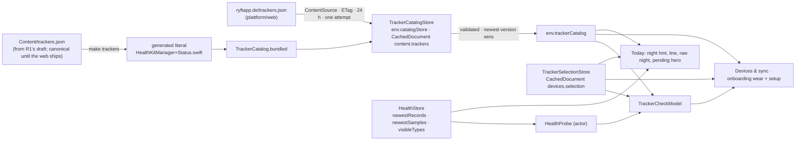
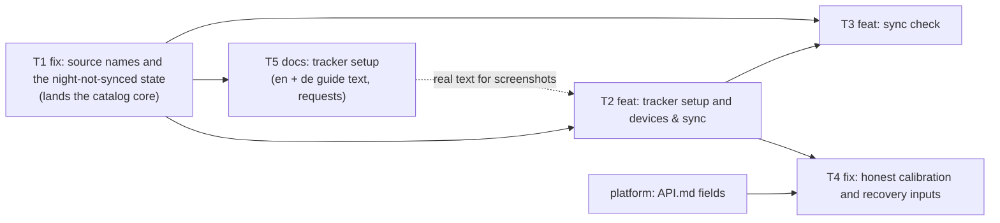

# Tracker setup, sync check and honest calibration: design note (D1)

**Inputs**
- Brief: `brief.md` in this folder (copy of `CLAUDE_FOLLOWUP_TRACKER_SETUP.md`).
- Plan: `plan.md`.
- Research R1: `trackers-research.md` and `trackers.draft.json`.
- Debugger T0: `t0.md`.
- UI spec D2: `ui.md`.
- Platform half: `../plattform/CLAUDE_FOLLOWUP_BASELINE_WITHOUT_HRV.md`.
- ADR: `docs/adr/0002-tracker-catalog-bundled-and-untrusted-remote.md`.

Code refers to `main` at `d9fc265`; every `File.swift:N` anchor is from that commit.

**What this note decides:**
- types and owners;
- logic: matching, classification, the Today rules and calibration;
- file placement and the merge seams for T1 to T5.

D2 owns copy, layout and visuals. Where this note and D2 disagree, §0.4 lists the differences and who resolves them.

## 0. What the code and the inputs say

### 0.1 The code

1. **"Scoring your latest data"** (T0 confirms).
   - **Where it comes from.** `TodayStates.line` returns `.scoring(night: false)` exactly when
     `f.phase == .awaitingScores` and the hero isn't `.pending` (`TodayViewModel.swift:662–664`).
   - **When the phase is entered.** `SyncCoordinator.swift:337`, after any foreground upload with non-empty
     `days_touched` (`:330–338`).
   - **When it ends.** When `GET /v1/me/sync` no longer lists the touched days as pending, or after a silent push, or
     after at most 300 s (`maximumScoringWait`, `:105`, `:392–425`). Then the pipeline moves to `.refreshing`.
   - **Why the tester saw it.**
     - The iPhone writes steps all day, so every app-active run (`RyftApp.swift:190–196`) touches today.
     - The hero was `.calibrating(nights: 0)`, not `.pending`.
     - So the line was true but read as being about the tracker, whose newest record was from 23:24.
     - It isn't stuck. It reappears after every foreground sync that sends something.
2. **On `main` the gauge already shows readiness.** T0 corrects §0.2 of the first draft of this note.
   - The platform writes `readiness` whenever `recovery` exists, so the tester's row is
     `{readiness: n, calibrating: true, baseline_days: 0}`.
   - **Long history** (`:804–807`): the readiness is shown, with "Baselines need heart-rate variability and resting
     heart rate from nights with your watch" (`:823`). That blames the watch.
   - **Still a counter that can't move:**
     - a short history (`prior.count < 7`, `:809–812`) shows "0 of 7" with "calibrating" captions;
     - a day without recovery (so without readiness) shows `.baselines(nights: vitals)` = 0.
3. **There is no "Data sources" screen.** `User.sources` is decoded (`Models.swift:914`, `:989–1009`) but never shown.
4. **Source names are `HKSource.name` verbatim.** "Connect" is printed in:
   - `WatchSyncHint` (`TodayViewModel.swift:571–585`, built at `:681`);
   - `RawNight.source` (`HealthStore.swift:45`, `RawNightCard` at `TodayView.swift:392`).

   The bundle ID is right next to it (`SourceFreshness.bundleID`, `HealthStore.swift:68–77`).
   - **`newestRecords(since:)`** (`:229–232`) uses heart rate per source, and sleep only when no source wrote heart
     rate at all.
   - **No device model.** `SourceFreshness` can't tell an Apple Watch from the iPhone, and the iPhone's sleep schedule
     writes in-bed sleep.
5. **Garmin is hard-coded in five places,** all assuming HRV or an outdated menu path:
   - `ProfileView.swift:363–366` (the Data caption) and `:538` (the About link);
   - `HealthPermissionView.swift:951` (`HealthAccessHint`);
   - `StatusViews.swift:658` (`SetupCard`);
   - the header comment `HealthKitManager.swift:3–6`.

   The strings that tell users where RYFT's own permission lives disagree with each other:
   - "Health → Sharing → Apps → RYFT" (`ProfileView.swift:363`, `HealthPermissionView.swift:973`);
   - "Health → your profile → Apps → RYFT" (`:951`).
6. **Read permission can't be inspected.** `HealthAccess` (`HealthStore.swift:100–103`) and `accessStatus()`
   (`HealthKitManager+Status.swift:9–20`) only know whether the prompt was answered.
   - RYFT can always read what it wrote itself (workouts, `HealthStore.swift:265–284`). A "readable" probe must exclude
     RYFT's own source.
7. **The brand guard is `.claude/hooks/pre-edit-guard.sh`, not `make lint`.** `make lint` runs strings, entitlements
   and shared types.
   - So a human edit of the catalog, or a remote copy, is unchecked. §2 adds the hook's pattern to the generator check
     and to the runtime validator.
   - Drift: the hook's message claims `Ryft/` and `RyftTests/` are synchronized folders. They are classic groups.
8. **No new files in `Ryft/` or `RyftTests/`.** §9.3 places everything.
9. **`SyncStatusLineView` can't time a line out.**
   - It redraws on a 30 s `TimelineView` (`StatusViews.swift:200`), but its `line` comes from the parent
     (`TodayView.swift:124`).
   - A time-based state needs the parent to re-evaluate `model.syncLine` on a tick.
10. **`User` and `UserPatch` have no `trackers`** (`Models.swift:890–969`, `:1020–1028`). Lead's decision: the
    selection is local until the platform accepts it (§3.4).
11. **HealthKit glue on the main actor.** Under approachable concurrency, `TodayViewModel.loadHealthFacts`
    (`:194–200`) runs `lastNight` and `newestRecords` on the caller's actor. This is pre-existing, and the work between
    awaits is tiny. The sync check's probe runs in an actor (§4.1).
12. **The demo config has no flags** (`PlatformAPI.swift:144`). A new flag needs a demo value there.

### 0.2 R1: vendor facts that change the design

- **Garmin Connect writes no HRV, no resting HR, no respiration and no SpO₂.** It writes heart rate, sleep (stages
  unverified), workouts and steps.
  - It sends only while Connect is open in the foreground, and Apple Health backfills at most two weeks.
  - The habit is "open Garmin Connect each morning". There are no Background App Refresh templates in the app: habits
    come only from the catalog (§2).
- **Oura:** no HRV, no resting HR, no SpO₂; it does write breathing rate.
- **Fitbit writes natively** through "Google Health" (`com.fitbit.FitbitMobile`), everything except HRV.
- **Samsung writes nothing.** It is the only "can't read" tracker.
- **Apple devices can't be matched by a vendor bundle ID.** Their samples are `com.apple.health.<UUID>`, so the
  matcher uses the prefix plus the device (`HKDevice.model`) (§4.3).
- **iOS path.** Apple documents only Health → Summary → your picture → Apps. No Settings path appears in code. Every
  iOS path is catalog content (`health_access`, per-tracker `setup_steps`).
- **The platform reads RHR only from resting-HR samples** (`compute.go:166`). Its planned "baselines from RHR nights"
  leaves Garmin (and Oura) at 0 unless it derives RHR from overnight heart rate. The lead filed this as
  `API_REQUESTS.md` → Tracker setup §1.
  - So nothing in the app may assume what Recovery is based on: every "Based on …" sentence is built from
    `recovery_inputs`.
  - An optional `rhr_source: tracker | derived` must decode tolerantly (§7.1).

### 0.3 T0

- **Platform cause confirmed:** `baseline_days = min(N_hrv, N_rhr)`, and `calibrating` while either is under 7.
- **"Connect"** is `HKSource.name`.
- **"Scoring your latest data"** is the local `awaitingScores` phase, not stuck. It is mislabelled next to the
  stale-tracker hint.
- **Lead's instruction for §6:** suppress it while the tracker's night is missing, keep the existing end conditions,
  and let "Taking longer than usual" replace the silent 300 s cut-off rather than add a loop.

### 0.4 D2: where this note decides differently or adds

| D2 says | This note | Why |
| --- | --- | --- |
| §3.2(b), §5.5: a generic "Settings → Health → Data Access & Devices" step | no iOS path in code; the steps come from the catalog (`health_access`, per-tracker `setup_steps`) | R1, lead |
| §3.6: `open_url` with verified schemes | App Store page only ("Open {app} in the App Store" if seen, "Get {app}" if not); no schemes, no `LSApplicationQueriesSchemes`; no `open_url` in the schema | lead |
| §3.7 C2: "Tell us you'd like this" | dropped | lead |
| §3.7 C2 lists Fitbit | Fitbit is a normal tracker; only `integration: none` (Samsung) gets C2 | R1 |
| §3.2(c): habit templates (Background App Refresh…) | habits only from the catalog | R1: wrong for Garmin |
| capability states `yes`, `partial`, `no` | adds `unverified`: shown as "Not confirmed", never ✗; in the check, "not seen yet" | R1's draft |
| §8.1 "Recovery detail / Readiness detail" | no such screens exist; the note goes on Insights' Readiness and Recovery cards (§7.4) | the code |
| §8.1 example text "Based on resting heart rate, sleep and breathing rate" | built from `recovery_inputs`; for Garmin it may be "Based on sleep" | §0.2 |

D2's placement of views (`ui.md` §9) is adopted in §9.

## 1. Shape



**One owner per fact:**

| Fact | Owner |
| --- | --- |
| Trackers, their HealthKit identity, capabilities, guides | `TrackerCatalogStore.current` (bundled, or the newest valid remote); views read `env.trackerCatalog` |
| What the user wears | `TrackerSelectionStore` (local, per account). Once API.md has `User.trackers`, the platform; the local document is then a cache plus a pending write |
| What Apple Health has right now | HealthKit, asked on demand; never persisted (the check keeps only its last codes, §4.7) |
| The night hasn't reached Apple Health | `TodayStates.nightGap(_:)`, pure |
| Scoring is slow | `TodayStates.scoringSlow(_:)`, pure |
| What Today shows about the day | `TodayPresentation.decide` (T1 leaves it alone; T4 changes row B) |

## 2. The tracker catalog

### 2.1 Schema v1: R1's draft, with these changes

`trackers.draft.json` is the starting point. T1 converts it to `Content/trackers.json`.

| R1 draft | v1 | Why |
| --- | --- | --- |
| `schema_version` | kept | — |
| `checked` (top) | kept, informational | — |
| — | **`version`** `"2026-10-22.1"` | newest-wins between the bundled copy, the cache and the remote copy (no rollback) |
| `status_values` | kept, not read (the enum is compiled) | — |
| — | **`health_access`** `{steps: {en, de}, checked}` | RYFT's own read permission, Health-app route (R1 §3); no iOS path in code |
| — | **`form`** `watch \| ring \| band \| phone \| other` | the tile glyph (D2 §2.2) |
| `setup_steps`, `habits`, `limits` (en arrays) | **`{"en": [...], "de": [...]}`** in v1, same count | strings must be complete in en + de at launch; R1 proposed this for v2 |
| `capability_notes` `{signal: "en"}` | `{signal: {"en", "de"}}` | the same |
| `app_store_id` (digits string) | kept | the app builds `https://apps.apple.com/app/id<id>`, which is storefront-neutral |
| `app_store_url` | **not read** | R1's `/us/` URL would send German users to the US store; content never supplies a navigable store URL |
| `healthkit.bundle_id_prefixes` | kept; matched with a dot boundary (§4.3) | `com.garmin.connect.mobile2` must not match |
| `healthkit.verified`, `sources[]` | kept for the web and reviewers, **not read** by the app | provenance isn't UI |
| `capabilities` value `unverified` | kept as a fourth state | honest unknowns (Suunto, Withings, Zepp, Ultrahuman, Other) |

**One shape per tracker** (R1's flat app fields, not my earlier `apps[]`). Excerpt; every value as R1 verified it:

```json
{ "schema_version": 1, "version": "2026-10-22.1", "checked": "2026-10-22",
  "health_access": { "steps": { "en": ["Open Health → Summary → your picture → Apps → RYFT.", "Tap Turn On All."],
                                "de": ["…", "…"] }, "checked": "2026-10-22" },
  "trackers": [
    { "id": "garmin", "name": "Garmin", "form": "watch", "app_name": "Garmin Connect", "integration": "vendor_app",
      "healthkit": { "bundle_ids": ["com.garmin.connect.mobile"], "bundle_id_prefixes": ["com.garmin.connect.mobile"],
                     "source_names": ["Connect"], "device_models": [] },
      "app_store_id": "583446403",
      "capabilities": { "heart_rate": "yes", "hrv": "no", "resting_hr": "no", "sleep": "yes", "sleep_stages": "unverified",
                        "respiratory_rate": "no", "spo2": "no", "workouts": "yes", "steps": "yes" },
      "capability_notes": { "hrv": { "en": "…", "de": "…" } },
      "setup_steps": { "en": ["…"], "de": ["…"] }, "habits": { "en": ["…"], "de": ["…"] }, "limits": { "en": ["…"], "de": ["…"] },
      "help_url": "https://support.garmin.com/en-US/?faq=lK5FPB9iPF5PXFkIpFlFPA", "checked": "2026-10-22" },
    { "id": "apple_watch", "integration": "apple_builtin",
      "healthkit": { "bundle_id_prefixes": ["com.apple.health."], "device_models": ["Watch"] } },
    { "id": "iphone", "integration": "apple_builtin",
      "healthkit": { "bundle_id_prefixes": ["com.apple.health."], "device_models": ["iPhone"] } },
    { "id": "samsung_galaxy_watch", "integration": "none" },
    { "id": "other", "integration": "unknown" } ] }
```

### 2.2 Model (T1; `Ryft/Health/HealthKitManager+Status.swift`, appended)

```swift
/// trackers.json, validated (§2.3). Bundled (generated literal), or the newest valid copy from ryftapp.de.
struct TrackerCatalog: Equatable, Sendable {
    let version: String
    let trackers: [Tracker]                           // picker order
    let healthAccess: Localized<[String]>             // how to let RYFT read (Health-app route)
    func tracker(_ id: String) -> Tracker?
    func match(_ source: SourceRef) -> Tracker?       // §4.3
    func displayName(_ source: SourceRef) -> String   // §5
    /// Pure and nonisolated: callers run it off the main actor.
    static func decode(_ data: Data, now: Date) throws(CatalogError) -> TrackerCatalog
    static let bundled: TrackerCatalog                // the generated literal, decoded once; a test proves it valid
}
struct Tracker: Equatable, Sendable, Identifiable {
    enum Form: String, Sendable { case watch, ring, band, phone, other }
    enum Integration: String, Sendable { case appleBuiltin = "apple_builtin", vendorApp = "vendor_app", none, unknown }
    let id: String, name: String, form: Form
    let appName: String?                              // "Garmin Connect", "Google Health"; nil for none/unknown
    let integration: Integration
    let identity: SourceIdentity                      // bundleIDs, bundlePrefixes, sourceNames, deviceModels
    let appStoreID: String?                           // digits
    let capabilities: [TrackerSignal: Capability]     // a missing key is .unverified (.no for integration none)
    let notes: [TrackerSignal: Localized<String>]
    let setup: Localized<[String]>, habits: Localized<[String]>, limits: Localized<[String]>
    let help: URL?                                    // dropped when its host isn't allowed (§2.5)
    let checked: String                               // YYYY-MM-DD
    var appStoreURL: URL? { get }                     // https://apps.apple.com/app/id<appStoreID>
}
enum TrackerSignal: String, CaseIterable, Sendable {
    case heartRate = "heart_rate", hrv, restingHR = "resting_hr", sleep, sleepStages = "sleep_stages"
    case respiratoryRate = "respiratory_rate", spo2, workouts, steps
    var stream: HealthStream? { get }                 // nil for sleepStages (a property of .sleep samples)
}
enum Capability: String, Sendable { case yes, partial, no, unverified }
struct Localized<T: Equatable & Sendable>: Equatable, Sendable { let en: T; let de: T; var current: T { get } }
/// A HealthKit source as RYFT sees it.
struct SourceRef: Hashable, Sendable {
    let name: String
    let bundleID: String?
    /// HKDevice.model of the newest sample ("Watch", "iPhone"), else the letters of
    /// HKSourceRevision.productType ("Watch7,1" → "Watch"). Apple doesn't document either for this; verify on a device.
    let deviceModel: String?
}
enum CatalogError: Error, Equatable { case tooLarge, notJSON, schema(Int), invalid(rule: String, path: String) }

extension AppEnvironment {
    /// The catalog every screen reads. T1: `.bundled`. T2 replaces the body with `catalogStore.current`.
    var trackerCatalog: TrackerCatalog { .bundled }
}
```

`Localized.current` follows the app's UI language: `Bundle.main.preferredLocalizations.first` starting with "de"
picks `de`, otherwise `en`. Catalog text never goes through `Localizable.xcstrings`; the app's own sentences around a
name ("Open \(app) in the App Store") do.

### 2.3 Validation rules

A structural error rejects the whole document. Unknown keys are ignored. Enum values are closed within a schema major.

| # | Rule |
| --- | --- |
| 1 | ≤ 256 KiB, UTF-8, a JSON object; `schema_version == 1` |
| 2 | `version` `^\d{4}-\d{2}-\d{2}\.\d{1,3}$`; dates `YYYY-MM-DD`, not after tomorrow |
| 3 | 2–40 trackers; `id` `^[a-z][a-z0-9_]{1,31}$`, unique; `iphone` and `other` present |
| 4 | `form`, `integration` and capability values in their enums; signal keys outside the enum ignored |
| 5 | Text (`name`, `app_name`, source names ≤ 40; steps, habits, limits, notes ≤ 240): §2.5's text rules. `setup_steps` ≤ 12, `habits` ≤ 8, `limits` ≤ 8. `en` and `de` both present with the same count. Arrays may be empty. |
| 6 | `bundle_ids` and `bundle_id_prefixes` `^[A-Za-z0-9-]+(\.[A-Za-z0-9-]+)*\.?$` ≤ 155; `com.apple.` only for `apple_watch` and `iphone`; one bundle ID belongs to one tracker; `device_models` `^[A-Za-z]{2,16}$` |
| 7 | `app_store_id` `^\d{1,12}$`; `help_url` per §2.5 |
| 8 | `integration: none` ⇒ every capability `no`, no identity; `integration: unknown` ⇒ no identity |

### 2.4 The bundled copy: generated, not an Xcode resource (decision; ADR 0002)

- **The canonical file is `Content/trackers.json`** at the repo root. It stays canonical until `plattform/web`
  publishes the file. From then on the web's content is canonical, and the app's copy is a snapshot refreshed before
  each release (`scripts/trackers.py --pull`, a `docs/RELEASING.md` step).
- **`scripts/trackers.py` (stdlib only):**
  - `--write` (`make trackers`) rewrites the region between `// BEGIN GENERATED trackers.json` and
    `// END GENERATED trackers.json` at EOF of `Ryft/Health/HealthKitManager+Status.swift`. The region holds
    `extension TrackerCatalog { static let bundledJSON = #"""…"""# }`, 4-space indented, inside
    `// swiftlint:disable line_length` / `enable`.
  - `--check` (in `make lint`, so CI runs it) fails when:
    - the region and the JSON differ;
    - the JSON isn't valid JSON;
    - `schema_version` isn't 1;
    - ids are duplicated;
    - an `en` / `de` pair is incomplete;
    - text contains the hook's brand pattern;
    - a tracker's `checked` is older than 180 days (a warning at 90).

  The full rule set lives once, in Swift. `DecodingTests` proves the bundled literal passes it.
- **Why not an Xcode resource.**
  - It would make T1 wait on the user.
  - A literal can't go missing from the bundle, and it works the same in previews, unit tests and demo mode.
  - Its costs are about 60 KB in the binary, a generated region in diffs, and one lint step.
- **When to revisit:** once the user converts `Ryft/` to a synchronized folder. Then the JSON becomes a resource, and
  the generator and its lint step are deleted. The validator stays.
- **First decode is off the main actor.** `TrackerCatalogStore.load()` runs after the first frame
  (`LaunchSignpost.afterFirstFrame()`) and decodes in a `@concurrent` function. Today needs names only once HealthKit
  facts are loaded (`loadHealthFacts`, after the first frame).
- **Content per ticket:**
  - **T1:** identity and capabilities for all 13 entries, verbatim from R1. Text arrays and notes are empty, and
    `health_access` steps are empty too. Empty is valid, and nothing displays them until T2, which is dark.
  - **T5:** the en + de text (localization-editor) and the regenerated region.

### 2.5 Trust rules for remote content (ADR 0002)

What a remote copy can change:
- names, steps, habits, limits and notes;
- capabilities;
- identity (subject to rule 6 in §2.3);
- the tracker list.

What it can't do:

| Threat | Rule |
| --- | --- |
| A link to anywhere | The one navigable URL is `help_url`. It must be `https`, with no user info and no port, and its host must equal or be a subdomain of the **compiled** allowlist for that tracker id: `garmin.com`, `ouraring.com`, `polar.com`, `suunto.com`, `coros.com`, `withings.com`, `amazfit.com` / `zepp.com`, `ultrahuman.com`, `google.com` (fitbit), `samsung.com`, `apple.com` (`apple_watch`, `iphone`), and `ryftapp.de` for any. Otherwise the link is dropped and the text stays. A new tracker id gets links only after a release. |
| Store or scheme tricks | Store links are built from the digits in `app_store_id`. No URL schemes, no `canOpenURL`, no `LSApplicationQueriesSchemes` (lead). |
| Markup or link injection | Plain text only: `Text(verbatim:)`, never `LocalizedStringKey`, `AttributedString(markdown:)` or HTML. The validator rejects `<`, `>`, `](`, `://`, `www.`, Unicode Cc and Cf (bidi overrides, zero-width), and the hook's brand pattern. |
| Spoofing Apple devices | `com.apple.` identity only for `apple_watch` and `iphone`; one bundle ID belongs to one tracker. |
| Size | ≤ 256 KiB, ≤ 40 trackers, field caps. |
| Rollback | The newest `version` wins against both the bundled copy and the cache. |
| Remote images | None. Glyphs come from `form` (SF Symbols). |

### 2.6 Remote copy (T2)

**Seam** (`Ryft/Environment/Seams.swift`, EOF, `// MARK: - web content (ryftapp.de)`):

```swift
/// Static website content, not the API: no auth, no cookies, no APIClient, no ReadScheduler.
protocol ContentSource: Sendable {
    func fetch(_ path: String, ifNoneMatch etag: String?, maxBytes: Int) async throws -> ContentFetch
}
enum ContentFetch: Equatable, Sendable { case notModified; case fetched(Data, etag: String?) }
/// https://ryftapp.de/<path>: ephemeral session (no URL cache, no cookies), 15 s, waitsForConnectivity off,
/// redirects only within ryftapp.de, stops reading past maxBytes; 200 → fetched, 304 → notModified, else throws.
final class WebContentSource: ContentSource { static let host = "ryftapp.de" }
final class MockContentSource: ContentSource, @unchecked Sendable { /* scripted answers, recorded requests */ }

@MainActor @Observable
final class TrackerCatalogStore {
    enum Origin: Equatable, Sendable { case bundled(String), remote(String, etag: String?, checkedAt: Date) }
    private(set) var current: TrackerCatalog = .bundled
    private(set) var origin: Origin
    private(set) var lastFailure: String?    // "invalid text.markup at trackers[3].setup_steps.de[2]", "http 503"
    func load() async                        // the cached copy, re-validated (validators may tighten); newest valid wins
    func refreshIfDue(force: Bool = false) async
    static let ttl: TimeInterval = 86_400, retryAfterFailure: TimeInterval = 3_600
    static let path = "trackers.json", maxBytes = 262_144, documentKey = "content.trackers"
}
```

**Wiring.**
- `AppEnvironment` (`AppEnvironment.swift:15–60`) gets `let content: ContentSource`. It's an init parameter
  defaulting to `MockContentSource()`, so a graph has no network unless told; `.live` passes `WebContentSource()`.
- It also gets `lazy var catalogStore = TrackerCatalogStore(env: self)`.
- T2 changes `trackerCatalog` to `catalogStore.current`.

**Cadence and caching:**
- **When.** `refreshIfDue()` runs on app active after the first frame (next to the flags, `RyftApp.swift:208–211`),
  and in `.task` of Devices & sync and of the `wear` step.
- **When not.** Never in demo mode, offline, in the background or in a BG task.
- **Due.** 24 h after the last 200 or 304, or 1 h after a failure. One request in flight. `force` is Debug →
  Developer → "Reload tracker catalog".
- **Exactly one attempt.** The next due time is the retry. ADR 0001's retry layer covers platform reads only; this is
  a once-a-day static file on another host, outside `ReadScheduler` and `RequestBudget` (ADR 0002).
- **Answers:**
  - **304:** `checkedAt` moves on.
  - **200:** validate off the main actor. If valid and the newer version, store `{etag, body, checkedAt}` as
    `CachedDocument content.trackers` and publish it.
  - **Valid but older:** keep the current copy, don't store the etag.
  - **Invalid:** keep the current copy and record `lastFailure`, without the etag.
- **Sign-out.** `Persistence.wipe()` drops the cache, and the bundled copy serves until the next due check. That is
  accepted rather than adding a second storage mechanism.
- **Diagnostics.** Copy diagnostics gets one line: `catalog remote 2026-10-22.1 etag W/"…" checked … failure -`.

### 2.7 Demo, previews and tests

- **Previews, demo and UI tests** use the compiled `TrackerCatalog.bundled` (`MockContentSource`; demo never
  fetches).
- **Unit tests** use inline JSON fixtures (`catalogJSON(trackers:)` in `DecodingTests`).
- **D2's previews need guide text.** Until T5 lands it, they use a `TrackerCatalog.previewGarmin` fixture
  (`Ryft/Preview/MockData.swift`) with R1's English text and placeholder German. It's preview-only.

## 3. The selection (T2)

### 3.1 Storage and account binding

```swift
struct TrackerSelection: Codable, Equatable, Sendable {
    let account: String
    var trackers: [String]        // catalog ids, picker order; ["iphone"] = just my iPhone
    var updatedAt: Date
    var setUp: [String] = []      // guides marked "Done"
    var later: [String] = []      // "Show me again later" (D2: row value "Set up later")
}
@MainActor @Observable
final class TrackerSelectionStore {
    init(env: AppEnvironment)
    private(set) var selection: TrackerSelection?   // nil: none chosen (skipped saves nothing, D2 §2.4)
    var trackers: [String] { selection?.trackers ?? [] }
    func set(_ ids: [String])     // de-duplicated; known ids only; "iphone" excludes the rest; "other" combines
    func markSetUp(_ id: String)
    func markLater(_ id: String)
    func accountChanged()
    static let documentKey = "devices.selection"
}
```

This mirrors how the last release bound `reads.state` to the account:
- **Where.** A `CachedDocument "devices.selection"` through `env.persistence`, for the live account only. It carries
  the account ID and is read only when that matches `env.auth.accountID`.
- **Sign-out.** `Persistence.wipe()` removes it (the `AuthService.swift:653–671` path).
- **Account change.** `onChange(of: auth.accountID)` (`RyftApp.swift:117–137`) calls
  `screens.devices.accountChanged()`.
- **Demo mode.** In memory only: `["apple_watch"]` by default, or the `-RyftSyncCheck` scenario's tracker (§4.6).
- **Owner.** `ScreenModels.devices` (`ScreenModels.swift:9–60`), passed to `TodayViewModel`, `OnboardingCoordinator`
  and `ProfileViewModel` as optional init parameters, like `push` and `onboarding` today.

### 3.2 Onboarding's own flags

Whether the onboarding steps were shown are facts like `aboutYouDone`, kept in `env.defaults` per account. They
survive sign-out:
- `onboarding.wearAsked.<account>`: the picker was answered or skipped;
- `onboarding.trackerSetupDone.<account>`: the post-Health setup screen was left.

What was picked is the selection document.

### 3.3 Flag

`FeatureFlag.devicesSetup = "devices.setup"` (`Seams.swift:108–130`), compiled default **off**.
- **What it gates:** the `wear` step, the setup screen, Devices & sync, the check, and the catalog fetch.
- **Demo:** on in the demo config (`PlatformAPI.swift:144`).
- **Rollout:** the platform adds the key (T5 request). T2 and T3 may merge dark.
- **Not gated:** T1 and T4.

### 3.4 `User.trackers`: local until the platform accepts it (lead)

- **Not before API.md has it.** No decoding, no `UserPatch` field, no PATCH until then (CLAUDE.md, mirror rule). T5
  files the request.
- **When it lands:**
  - `User.trackers: [String]?`, where `nil` means never answered;
  - `UserPatch.trackers`;
  - a fixture test.
- **`set()`** then `PATCH`es through `AppState.patchUser`.
  - A failure keeps the local value with `pendingPatch`, retried once on the next app active, and never blocks (D2 P5).
  - A `422` drops the ids the platform refuses.
- **Who wins.** A non-nil `trackers` from `GET /v1/me` is adopted when there is no local selection. A pending local
  write wins until it's accepted. From then on, the platform owns the fact.

## 4. The sync check (T3)

### 4.1 `HealthStore` extension (`HealthStore.swift`)

```swift
/// The newest record of one type from one source.
struct SourceSample: Equatable, Sendable {
    let stream: HealthStream
    let source: SourceRef
    let newest: Date                  // end date
    var hasStages: Bool? = nil        // sleep only: that source's newest night has core, deep or REM
}
protocol HealthStore: AnyObject {     // after newestRecords (:137)
    /// The newest record per type and source since `since`: an HKSourceQuery per type (as :238), then one limit-1
    /// HKSampleQuery per source sorted by end date (its HKDevice.model and sourceRevision.productType fill
    /// SourceRef.deviceModel); for sleep also that source's segments since `since` (limit 200) for stages.
    /// Types RYFT may not read come back empty, exactly like types nobody wrote.
    func newestSamples(of streams: [HealthStream], since: Date) async throws -> [SourceSample]
    /// The types RYFT sees at least one record of, from any source except RYFT, ever: proof that reading is allowed.
    /// One limit-1 query per type, no sort, predicate NOT predicateForObjects(from: .default()). Absence proves nothing.
    func visibleTypes(_ streams: [HealthStream]) async throws -> Set<HealthStream>
}
/// Off the main actor, the way SyncEngine runs page reads.
actor HealthProbe {
    init(health: HealthStore)
    func run(_ streams: [HealthStream], since: Date) async throws -> (samples: [SourceSample], visible: Set<HealthStream>)
}
```

- **Live** (after `:256`): types run concurrently in a task group; sources within a type run one after the other.
- **Mock** (after `:503`):
  - `var samples: [SourceSample]` and `var visible: Set<HealthStream>`, filtered by stream and `since`;
  - it counts `readsOnMainThread`. A test asserts 0 for a check.

T1 changes this file in a small way (§5): `SourceFreshness` gets `deviceModel`; `newestRecords` uses heart rate
**and** sleep per source; `RawNight` gets `bundleID`.

### 4.2 Signals and HealthKit types

| Signal | `HealthStream` | HealthKit type | Kind |
| --- | --- | --- | --- |
| Heart rate | `.quantity(.heartRate)` | `heartRate` | continuous |
| HRV | `.quantity(.hrvSDNN)` | `heartRateVariabilitySDNN` | nightly |
| Resting HR | `.quantity(.restingHR)` | `restingHeartRate` | nightly |
| Sleep | `.sleep` | `sleepAnalysis` | nightly |
| Sleep stages | `.sleep` (`hasStages`) | `sleepAnalysis` core, deep, REM | nightly |
| Breathing rate | `.quantity(.respiratoryRate)` | `respiratoryRate` | nightly |
| SpO₂ | `.quantity(.spo2)` | `oxygenSaturation` | nightly |
| Workouts | `.workouts` | `HKWorkoutType` | event |
| Steps | `.quantity(.steps)` | `stepCount` | continuous |

Active energy and VO₂ max are synced, not checked: the brief doesn't list them, and no RYFT feature waits on them.

### 4.3 Matching sources to trackers (`TrackerCatalog.match`, T1)

1. **By bundle ID, always when there is one.** Comparisons are case-insensitive.
   - The ID equals an entry of `bundle_ids`, or starts with an entry of `bundle_id_prefixes` at a dot boundary:
     `id == p`, or `id` starts with `p + "."`. When `p` already ends in ".", `id` starts with `p`.
   - The boundary covers `<bundle>.watchkitapp` (R1 §5) and refuses `com.garmin.connect.mobile2`.
2. **Then by device, if the tracker lists `device_models`.** `SourceRef.deviceModel` must equal one of them. That is
   how `apple_watch` (`Watch`) and `iphone` (`iPhone`) split the shared `com.apple.health.` prefix.
   - A source with that prefix but no device model (for example a `User.sources` row from the platform) matches
     neither, and keeps HealthKit's name.
   - The device model on real samples is unverified (R1 §6.10): T3's device test confirms it before the check ships.
3. **By name, only when the source has no bundle ID:** equality with `source_names` (case- and diacritic-insensitive).
   Names never override a bundle ID: they're user-editable.
4. **No match:** an unknown source, shown under Other with HealthKit's name.

### 4.4 Classification (`TrackerCheck.classify`, pure)

```swift
enum SignalCheck: Equatable, Sendable {
    case waiting, checking                     // D2 K1 (queued / running)
    case arrived(Date)                         // ok: "last 07:42", "last night"
    case notLastNight(lastSeen: Date)          // nightly signal, nothing since last night began
    case notShared                             // expected: capability no
    case notSeenYet                            // neutral: partial or unverified with nothing, or an event signal
    case missing(visible: Bool)                // unexpected: capability yes, nothing; visible = RYFT sees the type elsewhere
}
struct TrackerCheck: Equatable, Sendable {
    enum Overall: Equatable, Sendable { case checking, ok, nightMissing, needsFix, silent, cantRead, unknownTracker }
    let trackerID: String
    let app: String?                           // the name the text uses ("Garmin Connect")
    var overall: Overall
    var rows: [Row]                            // Row { signal: TrackerSignal; check: SignalCheck }
    var expected: Int, arriving: Int           // D2's "4 of 6 expected signals are arriving" (no / unverified not counted)
}
enum TrackerCheckRules {
    static let window: TimeInterval = 48 * 3_600
    static func classify(_ tracker: Tracker, samples: [SourceSample], visible: Set<HealthStream>,
                         now: Date, calendar: Calendar = .current) -> TrackerCheck
}
```

"From the tracker" means samples whose source matches this tracker. "Last night began" is
`RawNight.window(before: now)` (18:00 the evening before, `HealthStore.swift:61–64`). First match wins:

| # | Capability | From the tracker, 48 h | Anything from the tracker, 48 h | Result |
| --- | --- | --- | --- | --- |
| 1 | `integration: none` | — | — | `cantRead`, no rows (D2 C2: "RYFT can't read Galaxy Watch data on iPhone today") |
| 2 | `integration: unknown` (Other) | — | — | `unknownTracker`: rows for app sources that match no catalog tracker, `arrived` or nothing (D2 C4) |
| 3 | any | — | nothing | `silent`; rows behind "Show details" (D2 K5) |
| 4 | any | nightly: newest ≥ last night began; continuous or event: any | — | `arrived(newest)`. Data beats the catalog: a `no` with data is logged as catalog drift |
| 5 | any | nightly, only older than last night began | yes | `notLastNight(lastSeen)` |
| 6 | `no` | none | yes | `notShared` (expected; D2 K3) |
| 7 | `partial`, `unverified`; or `yes` for workouts | none | yes | `notSeenYet` (neutral; the note, e.g. "Pulse Ox must be on") |
| 8 | `yes` | none | yes | `missing(visible:)` (unexpected; D2 K4 with the fix) |

- **Sleep stages:**
  - stages present → `arrived`;
  - sleep arrived without stages: `yes` → `missing(visible: true)`, `partial` / `unverified` → `notSeenYet`, `no` →
    `notShared`.
  - Garmin is `unverified` here (R1), so the check shows the truth without calling it a fault.
- **Overall**, first match: `checking` › `cantRead` › `unknownTracker` › `silent` › any `missing` → `needsFix` › any
  `notLastNight` → `nightMissing` (the same fact as Today's night hint, §6.2) › `ok`.
- **`iphone`** is checked like any tracker: its identity is `com.apple.health.` + `iPhone`. D2 C3's single "not
  available from an iPhone" row is the view's summary of its `notShared` rows.
- **Several trackers:** a signal that arrived from another selected tracker isn't `missing` here but `notSeenYet`,
  with "from Oura instead". The platform takes one source per hour or night, so it isn't a fault.

### 4.5 What we can honestly say about permissions

| Knowable | How | Use |
| --- | --- | --- |
| RYFT may read type X | `visibleTypes` contains X (another source's record, ever) | the `missing(visible: true)` wording |
| The tracker's app writes to Apple Health | any sample from its sources in 48 h | rows 3–8 |
| The tracker writes X | an X sample from its sources in 48 h | `arrived` |
| RYFT has asked | `accessStatus() != .notAsked` | D2 K9: "RYFT hasn't asked for Health access yet" + Allow |
| No Apple Health | `.unavailable` | the screen says so |
| **Strong hint only:** RYFT probably can't read at all | nothing visible for any type, **including steps** (every iPhone writes steps unless Motion & Fitness is off) | D2 K7's "Even your iPhone's steps aren't arriving, so RYFT may not be allowed to read Health" ("may", never "is") |
| **Not knowable** | RYFT's read access to X is off; the vendor app's write access is off; the vendor app is installed | never claimed |

- **The two `missing` wordings:**
  - **`visible: true`:** "RYFT can read <signal>, but none came from Garmin Connect in the last 2 days." Then the
    tracker's setup steps (the vendor app's toggle first).
  - **`visible: false`:** "RYFT doesn't see any <signal> in Apple Health. Either RYFT isn't allowed to read it, or
    Garmin Connect isn't writing it." Then both places: the catalog's `health_access` steps and the tracker's setup
    steps.
- **D2 K7's instruction** is the catalog's `health_access` steps (Health → Summary → your picture → Apps → RYFT), not
  the Settings path in `ui.md` §5.5.
- **The button** is `HealthLinks.open` (`HealthPermissionView.swift:987–997`).

### 4.6 Garmin-like mock and demo scenarios (`Ryft/Preview/MockData.swift`, EOF)

**`MockHealthStore.garminLike(now:nightSynced:silent:sleepOff:)`** follows R1's facts:
- **Garmin Connect** (`com.garmin.connect.mobile`, name "Connect"):
  - heart rate 20 min ago;
  - sleep ending 06:48, without stages (unverified);
  - steps 1 h ago;
  - a workout yesterday 18:10;
  - no HRV, no resting HR, no breathing rate, no SpO₂.
- **The iPhone** (`com.apple.health.3F0A…`, "Tim's iPhone", device `iPhone`): steps 10 min ago and an in-bed sleep
  sample. The iPhone's sleep exercises "the iPhone isn't the night".
- **`visible`** = what those sources wrote.
- **Variants:**
  - `nightSynced: false` → Garmin's newest is yesterday 23:24;
  - `silent` → nothing from Garmin;
  - `sleepOff` → no sleep from Garmin, an unexpected `missing(visible: true)` because the iPhone's in-bed sleep is
    visible.

**`SyncCheckScenario`:** `garmin`, `garminNightMissing`, `garminSilent`, `garminSleepOff`, `appleWatch`,
`nothingReadable` (empty `visible`: the strong-hint case).
- **Launch argument:** `-RyftSyncCheck <name>`, Debug and demo only.
- **What it sets:** the demo selection, plus the store that `TrackerCheckModel.make(env:devices:)` uses instead of
  `env.health`. That's one place choosing demo or live.
- **Debug screen:** `DebugScreen.syncCheck` (`RyftApp.swift:464–509`).

**`RyftUITests/SyncCheckUITests.swift`** (new, a synchronized folder; added to UISmoke):
- HRV and resting HR "Not shared by Garmin Connect" on `garmin`;
- the silent text on `garminSilent`;
- the sleep fix on `garminSleepOff`;
- the strong hint on `nothingReadable`.

### 4.7 When it runs, and what it keeps

- **Entry points:**
  - the "Check sync" button on the post-Health setup screen (D2 §3.5; the result inline);
  - Profile → Devices & sync → Check sync (a pushed screen; it runs on appearance).
- **No background work.** Only the user starts it, in the foreground, never in the background.
- **A locked phone** (`errorDatabaseInaccessible`) gives "Unlock your iPhone to check".
- **"Check again"** is disabled while a check runs.
- **What it keeps.** `CachedDocument "devices.check"`: `{account, at, results: [trackerID: [signal: code]]}`.
  - Codes: `arrived`, `not_last_night`, `not_shared`, `not_seen`, `missing_visible`, `missing_unknown`, `silent`.
  - No times, no source names.
  - Devices & sync's "Last checked …" and its row statuses (D2 §4.2) read it.
  - Wiped on sign-out.

## 5. Friendly source names (T1)

**One function**, `TrackerCatalog.displayName(_ source: SourceRef) -> String`:
- a matched `vendor_app` tracker → `app_name` ("Garmin Connect", "Google Health");
- a matched `apple_builtin` tracker → HealthKit's device name ("Tim's Apple Watch"), which is more precise;
- anything else → HealthKit's name.

| Where | Today | After |
| --- | --- | --- |
| Stale-source and night hint | HealthKit name (`TodayViewModel.swift:681`) | display name, with the tracker's `appStoreURL` (T1) |
| Raw night card | `RawNight.source` (`HealthStore.swift:45`) | `RawNight.bundleID` added (first segment's `sourceBundleId`); `TodayContent.rawNightSource` maps it (T1) |
| Data sources | none | Devices & sync → "Seen in Apple Health" from `User.sources` with display names (T2; D2 §4.2) |
| Sync details | no source names | unchanged. Diagnostics never carry source names: they hold the user's name ("Tim's Apple Watch"). |

**How Today gets the names:**
- `TodayViewModel.facts` resolves the sources present (freshness and last night) into
  `TodaySyncFacts.sourceApps: [SourceRef: SourceApp]`, with `struct SourceApp { name; kind (app | appleDevice |
  unknown); appStoreURL }`.
- `TodayStates` stays pure, and tests set the map directly.
- `SourceFreshness` gains `deviceModel` (`:68–77`, filled at `:252` from the newest sample) and `ref: SourceRef`.

## 6. Today states (T1)

### 6.1 Facts added to `TodaySyncFacts` (`TodayViewModel.swift:380–413`)

```swift
var sourceApps: [SourceRef: SourceApp] = [:]   // §5
/// When scoring began: the current wait's start (SyncService.scoringWaitStart) while .awaitingScores; after the wait
/// gave up, the same start while the platform's latest pending_days still holds days; else nil.
var scoringSince: Date?
```

- **`SyncService`** records `private(set) var scoringWaitStart: Date?` with `env.clock.now()` when the machine enters
  `.awaitingScores` (`SyncService.swift:89`). It keeps the value after the phase ends.
- **The facts builder** sets `scoringSince` to it only while `phase == .awaitingScores`, or while
  `state.syncStatus.pendingDays` is non-empty. That is the platform's latest word, refreshed by the next
  `GET /v1/me/sync`: app active's onboarding check, a pull, the next sync. No new poll loop.
- **`newestRecords(since:)`** returns, per source, the newer of heart rate and sleep (`HealthStore.swift:229–232`).

### 6.2 The night hasn't reached Apple Health: `TodayStates.nightGap(_:calendar:) -> NightGap?`

`struct NightGap: Equatable { let name: String; let kind: SourceApp.Kind; let storeURL: URL?; let newest: Date }`

It is non-nil when all of these hold:
1. `f.syncs`, `f.online` (D2 §6.5: offline it's noise), `!isImporting(f)`, `!f.waitingForUnlock`;
2. local time in `[NightCheck.from 08:00, NightCheck.until 15:00)`;
3. **candidate sources** exist: freshness entries other than the iPhone (device model `iPhone`), so vendor apps and
   the Apple Watch. With T2's selection, only sources matching the selected trackers;
4. **no night evidence** after today 04:00 (`NightCheck.cutoff`):
   - no candidate has a record after the cutoff;
   - the server's `SyncStatus.latest["sleep"]` isn't after it either;
5. **the night isn't scored:** today isn't `standing != .unscored` with a readiness;
6. **the platform isn't scoring a night it has:** the hero isn't `.pending` with `waitingForSleep == false`. This is
   D2's exclusivity: once a night is uploaded, T1 ends and T2 shows.

The gap names the candidate with the newest record. The `kind` picks D2's sentence (§6.2 there):
- **app:** "Open Garmin Connect in the App Store", because the source has been seen;
- **Apple device:** the Watch sentence, no button;
- **unknown:** with the flag on, a Check sync button.

The constants follow the brief's example; the Bedtime & wake wake time is open question 4.

### 6.3 Slow scoring: `TodayStates.scoringSlow(_:) -> Bool`

```swift
guard let since = f.scoringSince else { return false }
let expected = Double(f.status?.expectedWithinSec ?? f.expectedScoringSec ?? SyncCoordinator.defaultExpectedScoring)
return f.now.timeIntervalSince(since) > max(60, 3 * expected)
```

- **The floor.** The 60 s floor keeps a tiny estimate from flipping the line within one poll. By `3 × expected` the
  coordinator has asked at least twice (`SyncCoordinator.swift:398–418`).
- **No new loop.** The 300 s cut-off stays. After it, the line no longer falls silently to "Up to date" while the
  platform still says pending: it stays "Taking longer than usual" until a later status read says otherwise.

### 6.4 The line (`TodayStates.line`, `:652–671`): branches added, none moved

```swift
if let gate = f.gate { return .actionNeeded(gate) }
if !f.online { return .offline }
if f.waitingForUnlock { return .waitingForUnlock }
/* activity → .reading / .uploading (unchanged) */
let night: Bool = /* hero is .pending (unchanged) */
let gap = nightGap(f)                                                        // NEW
if f.phase == .awaitingScores, gap == nil {                                  // CHANGED: no scoring line beside a gap
    return scoringSlow(f) ? .scoringSlow : .scoring(night: night)            // NEW: ends
}
if f.phase == .refreshing || f.isLoading { return .updating }
if let card { return .issue(card, signedOut: signedOut) }
if let since = staleSince { return .stale(since: since) }
if f.syncFailed { return .paused }
if case .pending(let p) = hero(f), !p.waitingForSleep {
    return scoringSlow(f) ? .scoringSlow : .scoring(night: true)             // NEW: ends
}
if gap == nil, scoringSlow(f) { return .scoringSlow }                        // NEW: replaces the silent cut-off
return .upToDate(f.lastUpdated, demo: f.isDemo)
```

- **While a gap holds,** the line shows whatever is true besides scoring. That is D2's state 9 "Up to date · …", or 4
  / 6 / 7 / 8. The hint card carries the night. No new `SyncLine` case for it.
- **One new case,** `SyncLine.scoringSlow`: "Taking longer than usual · Details", symbol `clock`, not `isActive`, so no
  pulse. Its tap is the default `resolveLine()` → Sync details (`:203–210`).
- **Sync details** gets a "Scoring" row ("Waiting since 10:21 · usually 20 s"; `ProfileView.swift:581–598`,
  `ProfileViewModel.swift:319–348`) and one Copy diagnostics line.
- **Re-evaluation.** `TodayView` wraps the line (`:123–125`) in `TimelineView(.periodic(from: .now, by: 15))` while it
  is `.scoring` or `.scoringSlow`.
- **Unchanged:** `RefreshPolicy` (read failures aren't scoring), the order of shipped branches,
  `TodayPresentation.decide` and the widget. Every `TodayStatesTests` case stays green; only new facts reach the new
  branches.

### 6.5 Hint card and pending hero

- **The hint.** `TodayStates.watchHint` (`:675–682`) returns `WatchSyncHint(kind: .night(NightGap))` while `nightGap`
  holds, else today's `.quiet` rule with the display name. Never both.
  - `WatchSyncHintCard` (`TodayView.swift:435–444`) uses D2's `InlineMessage.action` (`StatusViews.swift:28–145`) for
    the store button, and drops it while the error card shows.
  - The caption is "Last data from Garmin Connect: Wed 23:24".
- **Row C, waiting for sleep, with a gap.** `TodayContent.pendingDetail` names the app ("Open Garmin Connect to sync
  it to Apple Health").
- **Row C, pending, with `scoringSlow`.** `pendingTitle` is "Taking longer than usual", `pendingDetail` is "Your data
  is safe. RYFT will keep trying.", and `pendingIsStatic` stops the breathing (D2 §6.4).
- `TodayView.swift:143–147` passes these. `decide` is untouched.

### 6.6 Scenarios

`TodayScenario` (`:836–900`) gains `nightGap` and `scoringSlow`:
- `nightGap`: `f.now` = today 09:12, Garmin's newest yesterday 23:24, `waiting_for_sleep`;
- `scoringSlow`: `.awaitingScores`, start = now − 10 min, expected 20 s.

`TodayStatesUITests` gets one test each.

## 7. Calibration honesty (T4)

### 7.1 Decoding (`Models.swift`, once API.md has the fields)

```swift
/// What Recovery was computed from (DailyScore.recovery_inputs). Closed enum; unknown values are dropped.
enum RecoveryInput: String, Codable, CaseIterable, Sendable { case hrv, rhr, sleep, resp }   // after :142–150
/// Where the row's resting HR came from, if API.md adds it: tracker samples or derived from overnight HR.
enum RHRSource: String, Codable, Sendable { case tracker, derived }
// DailyScore (:152–306)
var hrvBaselineDays: Int?            // nil: no HRV source in the window, or an older row
var recoveryInputs: [RecoveryInput]? // nil: not sent; [] when sent empty
var rhrSource: RHRSource?            // nil: not sent, or a value this build doesn't know
```

- **Decoding:**
  - `hrvBaselineDays` uses `decodeLenientInt`.
  - `recoveryInputs` uses `decodeIfPresent([String].self)` and then `compactMap(RecoveryInput.init)`. The shipped
    `decodeLenientList` (`:1389–1395`) can't tell absent from empty.
  - `rhrSource` uses `try?` around `decodeIfPresent`, so an unknown value is nil and never a decoding error.
- **Storage.** All three go into `CodingKeys` (`:248–253`) and into the memberwise init with nil defaults.
- **Tests.** A fixture test from API.md's example, plus `RepositoryStorageTests` round-trip.

### 7.2 Which model scored the row

`newModel = today.recoveryInputs != nil`. Required signals:
- **legacy:** `{hrv, rhr}`;
- **new:** `{rhr}`, plus `hrv` when `today.hrvBaselineDays != nil`.

From `prior.suffix(30)` (`TodayViewModel.swift:771`), T4 replaces `vitals` with:

```swift
struct BaselineNights: Equatable, Sendable { var rhr: Int; var hrv: Int; var hrvSource: Bool }
var done: Bool { newModel ? rhr >= 7 && (!hrvSource || hrv >= 7) : min(rhr, hrv) >= 7 }   // row D's test
```

A derived RHR arrives as ordinary `rhr` values, so the counts need no special case.

### 7.3 Never a counter that can't move (D2 R2)

**When a required signal S is blocked:**
- **Through the catalog:** every selected tracker's capability for S is `no`, and none of today and the last 2 scored
  days has S. That's Garmin for HRV and for resting HR (R1), and Oura for both.
- **Without a selection:** at least 3 scored days, and none of today and the last 2 has S.

Arrival always wins, so a derived RHR unblocks at once.

**Row B** (`:801–812`, long and short history alike):

| Case | Gauge | Note |
| --- | --- | --- |
| No required signal blocked | `.baselines(nights:)`: new model, `baselineDays` while < 7, else `hrvBaselineDays`; legacy as today | `nil`, or `.needsVitals` over a long history, with text no longer saying "your watch" |
| Blocked, with a readiness (the usual case, T0) | today's readiness | `.blocked(CalibrationBlocker)` |
| Blocked, no readiness (no recovery: possible for Garmin if the platform neither derives RHR nor computes recovery without it) | `.baselines(nights:)` in D2's blocked mode: no count, "—", caption "Needs resting heart rate" | `.blocked(…)` with D2's Check sync link |

```swift
enum CalibrationSignal: String, Sendable { case hrv, restingHR }
struct CalibrationBlocker: Equatable, Sendable {
    let signals: [CalibrationSignal]     // plural-aware text: "Needs HRV and resting heart rate"
    let app: String?                     // a selected tracker's app whose catalog says `no`; nil: no source seen
}
// TodayScoreFacts (:689–701), default empty, so the widget's builder (Repository.publishWidget) needs no change:
var notShared: [CalibrationSignal: String] = [:]
```

- **No new `Gauge` or `TodayHero` case.** `ReadinessSnapshot.make` and the widget are unchanged: `.baselines` still
  maps to `calibrating`, the platform's own word.
- **`BaselineGauge`** (`MetricGauge.swift:202–270`) gets D2's blocked mode, driven by the note.

### 7.4 "Based on …": built from `recovery_inputs`, never fixed

```swift
/// From the latest day with recovery_inputs; nil before the platform sends them, or when hrv is in.
struct RecoveryBasis: Equatable, Sendable {
    let inputs: [RecoveryInput]           // localized list (ListFormatStyle): "sleep", "resting heart rate and sleep", …
    let rhrDerived: Bool                  // rhrSource == .derived: "resting heart rate (from your overnight heart rate)"
    let hrvReason: HRVReason              // .notShared(app) (catalog `no`), .noneIn14Days, .notLastNight
    var text: String { get }
}
```

- **The text depends on the inputs.** For Garmin before any RHR derivation it may read "Based on sleep. Garmin Connect
  doesn't share HRV or resting heart rate with Apple Health." It never says the brief's sentence unless those are the
  inputs.
- **Placement.** There are no Recovery or Readiness detail screens (D2 §8.1 assumed them).
  - The note goes under Insights' **Readiness** and **Recovery** trend cards: `TrendCard` (`InsightsView.swift:94–134`)
    gains `footnote`. D2's link opens the tracker's card in a sheet.
  - The Recovery tile (`TodayView.swift:200–204`) opens Insights focused on Recovery.

### 7.5 Forward-compatible before the platform

- §7.2–7.3 run on today's fields (`newModel == false`). §7.1's fields are optional and decode tolerantly.
- So T4 can merge as soon as API.md publishes the fields, whether or not the platform has deployed.
- The blocker part needs no new fields (open question 9).

## 8. Onboarding and Devices & sync (T2, per D2)

**The `wear` step** (D2 §2; `HealthPermissionView.swift`):
- **Wiring:**
  - `Step` (`:26–31`) gets `.wear` after `.aboutYou`, with `isGate` false and `canDefer` true.
  - `Facts` (`:40–56`) gets `wearAsked` and `devicesSetup`.
  - `missing` (`:61–70`) appends `.wear` when `f.userKnown && f.devicesSetup && !f.wearAsked`.
  - `later(.wear)` marks it asked and saves nothing.
  - The other places that switch over `Step`: `canDefer` (`:197–202`), `OnboardingStepView` (`:474–485`),
    `TodayViewModel.actionNeeded` (`TodayViewModel.swift:227–237`, which must stay exhaustive) and `DebugScreen`.
- **Continue** saves the selection; with T4's follow-up it also PATCHes.

**The post-Health setup screen** (D2 §3.5):
- **Where.** A RootView case after the Health intro: `case .signedIn where onboarding.showsTrackerSetup:
  TrackerSetupStepView(…)`, after `needsHealthIntro` (`RyftApp.swift:388–390`).
- **`showsTrackerSetup`** holds when:
  - the flag is on;
  - this is the account's first run;
  - the selection has a tracker needing setup (anything but Apple Watch alone, or just my iPhone alone);
  - `trackerSetupDone` is unset.
- **Done or Show me again later** set `trackerSetupDone` and go to the tabs.
- **The first sync isn't held up.** Bootstrap starts it once `healthIntroDone` is set (`RyftApp.swift:255–280`).
  `HealthOnboardingMachine` is untouched.
- **T3 wires the inline Check sync** into this screen.

**Profile → Devices & sync** (D2 §4): a pushed screen.
- **Sections:**
  1. Your trackers: the rows open the card, Edit opens the picker sheet;
  2. Check sync;
  3. Seen in Apple Health: `User.sources`, the missing "Data sources";
  4. Apple Health access;
  5. Sync details: a link.
- **Data section** (`ProfileView.swift:351–442`), with the flag on:
  - its first row becomes "Devices & sync";
  - the Garmin caption (`:363–366`) goes;
  - Sync now, Full re-sync and the Sync details link stay.
- **About:** the Garmin link (`:538`) goes.
- **`HealthAccessHint`** (`HealthPermissionView.swift:940–965`) and **`SetupCard`** (`StatusViews.swift:645–676`) lose
  the Garmin path. They name the selection's app, or no vendor, and point to the catalog's steps.

**The features line** (`RyftFeatures.line(for capabilities:)`, pure, in code). It mirrors the platform's model:
- **Strain** needs heart rate.
- **Sleep** needs sleep; stages are a detail.
- **Recovery and Readiness** need sleep and resting HR. Resting HR comes from `resting_hr`, or from `heart_rate` only
  when `RyftFeatures.restingHRFromHeartRate` is true. That constant is false until API.md documents derived RHR, and T4
  (or whoever lands that contract) flips it.
- **What Recovery uses:** the available ones among HRV, resting HR, sleep and breathing rate.

So Garmin's line today says Recovery and Readiness need resting heart rate, which Garmin Connect doesn't share. It
won't say "Recovery from resting heart rate and sleep" (D2's example), which would be false (open question 10).

## 9. Tickets

### 9.1 Order, dependencies, frozen interfaces



- **Everything starts now from `d9fc265`, each ticket in its own worktree.**
  - **T1 merges first.** It lands the catalog core: §2.2 types, decode and rules, matching, `displayName`,
    `bundled`, `Content/trackers.json` (identity and capabilities from R1), `scripts/trackers.py`, the Makefile, and
    `AppEnvironment.trackerCatalog`.
  - T2, T3 and T4 code against the frozen signatures below, with a throwaway local copy until T1 merges, then rebase.
- **T5** is ready any time after T1:
  - the en + de text of the catalog (R1's English, translated by the localization-editor) and the regenerated region;
  - `docs/API_REQUESTS.md` → Tracker setup, extending the lead's entries (§1 RHR, §2 `User.trackers`,
    §3 the web file):
    - in §3: schema v1 as §2.1 of this note, `Cache-Control: max-age=3600`, ≤ 256 KiB, the trust rules for the web's
      own validation;
    - in §2: the ids are the catalog's (`iphone`, not `iphone_only`);
    - a new §4: the `devices.setup` flag;
    - a new §5: document the schema on the platform side, and mention the selection in the privacy policy.
  - TestFlight notes and `CHANGELOG.md`;
  - the comment in `HealthKitManager.swift:1–6`.

  `docs/ARCHITECTURE.md` §11 and `docs/STATUS.md` (with T0's Incidents entry) close the release after T3 and T4.
- **T3 needs T2's selection, `TrackerSetupStepView` and `DevicesAndSyncView`.** It wires its button into both after
  T2 merges.
- **T4 needs the platform's API.md fields,** plus T2's tracker card for the Insights link.

**Frozen interfaces:**
- **T1:** §2.2 (all); `SourceRef`; `SourceFreshness.deviceModel`; `RawNight.bundleID`; `TodaySyncFacts.sourceApps`
  and `scoringSince`; `NightGap`; `SyncLine.scoringSlow`; `InlineMessage.action`.
- **T2:** `TrackerSelectionStore` (§3.1); `ScreenModels.devices`; `FeatureFlag.devicesSetup`;
  `TrackerSetupCard(tracker:)`; `DevicesAndSyncView`; `TrackerSetupStepView`; `env.catalogStore`.
- **T3:** `SourceSample`; `HealthStore.newestSamples` and `visibleTypes`; `HealthProbe`; `TrackerCheckRules.classify`;
  `TrackerCheckView(model:)`; `MockHealthStore.garminLike`.

### 9.2 Files each ticket owns alone

- **T1:**
  - `Ryft/Health/HealthKitManager+Status.swift` (appended; the generated region);
  - `Content/trackers.json`;
  - `scripts/trackers.py`;
  - `Makefile`;
  - `Ryft/Sync/SyncService.swift` (`:89`).
- **T2:**
  - `Ryft/Environment/AppEnvironment.swift`;
  - `Ryft/Environment/Seams.swift` (`FeatureFlag` `:108–130`; EOF);
  - `Ryft/App/ScreenModels.swift`;
  - `Ryft/Environment/PlatformAPI.swift:144`;
  - `Ryft/Design/Card.swift` (`SelectableTile`, `CapabilityRow`, before the preview at `:79`);
  - `RyftUITests/DevicesUITests.swift` (new).
- **T3:**
  - `Ryft/Preview/MockData.swift` (EOF; T2's `previewGarmin` fixture goes before it, at the `MockData` enum's end);
  - `RyftUITests/SyncCheckUITests.swift` (new).
- **T4:**
  - `Ryft/Networking/Models.swift`;
  - `Ryft/Design/MetricGauge.swift` (`:202–270`, `GaugeNote`);
  - `Ryft/Features/Insights/InsightsView.swift` and `InsightsViewModel.swift`.
- **T5:**
  - the text fields of `Content/trackers.json` and the regenerated region (after T1);
  - `docs/API_REQUESTS.md`, `CHANGELOG.md`, `docs/TESTFLIGHT_NOTES.md`;
  - `Ryft/Health/HealthKitManager.swift:1–6`.

### 9.3 Regions in shared files (anchors at `d9fc265`; nobody reformats outside their own)

| File | T1 | T2 | T3 | T4 |
| --- | --- | --- | --- | --- |
| `HealthStore.swift` | `:39–65` `RawNight`; `:67–77` `SourceFreshness`; `:219–227`; `:229–256` | — | protocol after `:137`; `SourceSample` after `:77` (below T1's edit); live after `:256`; `HealthProbe` before `MainThread` (`:521`); mock after `:503` | — |
| `TodayViewModel.swift` | `:137–163` `facts`; `:380–413` fields; `:486–568` `SyncLine` (+`.scoringSlow`); `:570–585` `WatchSyncHint`; `:649–683` `line` / `watchHint`, with `nightGap` and `scoringSlow` added after `:683`; `TodayContent` +`pendingTitle`, `pendingDetail`, `pendingIsStatic`, `rawNightSource` (after `:372`); `:836–900` scenarios | `:37–46` init (+`devices`); one line in `facts` (selection filters candidates); `:227–237` `.wear` | — | `:685–834`; `TodayContent` `:279–332` |
| `TodayView.swift` | `:31–32`; `:123–125`; `:143–147`; `:392–433` `RawNightCard` source; `:435–444` hint card; previews after `:636` | — | — | `:148–166` blocked gauge; `:200–204`; previews after `:604` |
| `StatusViews.swift` | `InlineMessage` `:28–145` (+`action`); status-line previews `:708–785` (+5b) | `SetupCard` `:645–676` (no Garmin), `SetupStep` `:677–695` promoted to `NumberedStep`, `TrackerSetupCard` inserted after `:676` | `CheckRow` inserted after `DayMarker` (before `:645`), with its preview right after it | — |
| `ProfileView.swift` | `:581–598` Engine "Scoring" row | `:351–366` Data; `:538`; EOF `// MARK: - devices & sync` (`DevicesAndSyncView`, previews); `LinkRow` `:1128` promoted | `// MARK: - check sync` inserted before `:1313` (`TrackerCheckView`, previews); one row in `DevicesAndSyncView` (after T2) | — |
| `ProfileViewModel.swift` | `:319–348`; `diagnostics` +1 line after `:432` | `init` `:21–38`; EOF `// MARK: - devices & sync` (`TrackerSelectionStore`, `DevicesViewModel`, `RyftFeatures`); `diagnostics` +1 line after `:440` | `// MARK: - check sync` inserted before `:672` (`TrackerCheckModel`, `TrackerCheckRules`); `FeedbackPayload` `:752` and `:826–853` (`trackers`, `sync_check`); `diagnostics` +1 line before `:441` | — |
| `HealthPermissionView.swift` | `:951` (generic text) | `:26–70`; `:121–127`; `:197–216`; `:322–335`; `:474–485`; `TrackerPickerView` and `TrackerSetupStepView` after `:769`; previews after `:814`; `:940–965` | one line in `TrackerSetupStepView` (after T2) | — |
| `RyftApp.swift` | — | `:117–137`; `:159–162` (`catalogStore.load()`); `:208–211` (`refreshIfDue`); RootView `:380–391` (`showsTrackerSetup`); `DebugScreen` (+`wear`, `trackerSetup`, `devices`) | `DebugScreen` (+`syncCheck`) | — |
| `Localizable.xcstrings` | keys | keys | keys | keys |
| `TestPlans/UISmoke.xctestplan` | — | +`DevicesUITests` | +`SyncCheckUITests` | — |

**Merge rules:**
- `Localizable.xcstrings` and `UISmoke` conflicts are resolved at merge, then `make lint`.
- `DebugScreen` gets adjacent case lines from T2 and T3: keep both.
- `diagnostics` gets one line each from T1–T3 at the named positions.

### 9.4 Tests (classic `RyftTests/`: existing files, distinct places)

- **T1:**
  - `DecodingTests.swift` (EOF), catalog cases:
    - the bundled copy passes;
    - each rule rejects with its `rule` / `path`;
    - unknown keys are ignored;
    - `app_store_url` is ignored;
    - matching: exact ID, prefix with the dot boundary and `.watchkitapp`, `com.apple.health.` with `Watch` vs
      `iPhone`, no device model → no match, name only without a bundle ID, case-insensitive;
    - `displayName`;
    - `Localized.current`.
  - `ViewModelTests.swift`, a suite inserted after `TodayStatesTests` (after `:490`):
    - `nightGap` as a table: window edges, offline, iPhone in-bed sleep ignored, the Watch as a candidate,
      `latest.sleep`, scored today, pending night;
    - `scoringSlow` (floor, ×3, during the wait, after the cut-off with pending days, cleared by an empty
      `pending_days`);
    - `line` ordering: never "Scoring your latest data" beside a gap; all shipped rows unchanged;
    - the hint kinds.
  - `SyncDetailsTests` (`:862`): the scoring row.
  - `RawHealthTests` (`EnvironmentTests.swift:795–830`): HR or sleep per source, `deviceModel`.
  - `TodayStatesUITests`: two tests.
  - `make lint`: `trackers.py --check`.
- **T2:**
  - `EnvironmentTests.swift` EOF:
    - the store: 200 / 304 / invalid / older / oversize / offline / demo / due and failure backoff, ETag sent, no etag
      stored after invalid, newest wins, the cache re-validated;
    - `WebContentSource` same-host redirects (`URLProtocol` stub);
    - the selection: persistence, account mismatch, wipe on sign-out, `iphone` exclusivity, unknown ids dropped.
  - `OnboardingDecisionTests` and `OnboardingCoordinatorTests` (`ViewModelTests.swift:1414`, `:1452`), in place:
    `.wear` rows, flag off, `showsTrackerSetup`.
  - `RyftFeatures`, as a table (R1's 13 matrices).
  - `DevicesUITests`.
- **T3:**
  - `EnvironmentTests.swift`, a suite inserted after `RawHealthTests` (after `:830`):
    - the §4.4 table with the `garminLike` variants;
    - several trackers;
    - `other`;
    - the `missing` wordings;
    - the strong hint;
    - probe off the main thread;
    - RYFT's own workouts never visible.
  - `ReportProblemTests` (`:900`): the new keys carry ids and codes only.
  - `SyncCheckUITests`.
- **T4:**
  - `MirrorDecodingTests.swift` EOF: the API.md fixture, an unknown input, absent vs empty, an unknown `rhr_source`.
  - `TodayPresentationTests` (`ViewModelTests.swift:496–858`), in place plus appended inside:
    - legacy vs new model;
    - blocked with and without a readiness;
    - row D under the new rule;
    - Garmin's history (no HRV, no RHR) never showing a count;
    - a derived RHR unblocking.
  - `RecoveryBasis` texts en and de, including sleep-only.

## 10. Risks

- **HealthKit cost and the main thread.**
  - The check is about 9 source queries + 9 × (≤ 5 sources) limit-1 queries + a stages query per sleep source + 9
    visible-type queries, all small. It runs in `HealthProbe`, foreground only.
  - T1 doubles Today's source queries (heart rate and sleep). They're still a handful, after the first frame.
  - `loadHealthFacts`' main-actor glue is pre-existing (§0.1.11). Follow-up: route it through `HealthProbe`.
- **Background.**
  - No probe, catalog fetch or hint runs in the background.
  - Background delivery and the observed types (`HealthKitManager.swift:187`) are unchanged.
  - A locked phone gives no hint and no check.
- **Device matching is unverified** (R1 §6.10). `HKDevice.model` and `productType` on Apple samples need a device
  test before T3 ships. If they fail, `apple_watch` / `iphone` don't match, the check falls back to Other's behaviour,
  and nothing claims a fault.
- **A wrong night hint.**
  - The user didn't wear the tracker, or slept past 08:00.
  - Mitigations: the copy is hedged; the window ends at 15:00; any night evidence (including `latest.sleep`) cancels
    the hint; it's hidden offline.
  - It is a hint, never a gate.
- **Garmin's two-week backfill.** New Garmin users bring at most 14 days into Apple Health, so their first weeks
  cross row B's short-history path. §7.3's blocker covers it ("0 of 7" can't appear for a blocked signal).
- **The platform model is unsettled.** Whether RHR is derived decides Garmin's calibration and features line.
  - The app takes every "Based on …" from `recovery_inputs`.
  - The features line follows `RyftFeatures.restingHRFromHeartRate`.
  - The TestFlight build that turns `devices.setup` on must follow the platform deploy (a release-checklist gate).
- **Catalog drift.**
  - Every card shows its `checked` date; lint warns at 90 days and fails at 180.
  - Data beats the catalog in the check.
  - The remote copy fixes text without a release.
- **Remote content.** A compromised or careless web deploy is limited to plain text in fixed slots, allowlisted help
  links, the newest version, and caps. A bad file costs a fallback, never a broken screen.
- **Privacy.**
  - "What you wear" is personal data, not health data by itself. It stays per account on the phone, is wiped on
    sign-out, and goes to the platform only after the contract (the privacy policy should list it).
  - Report a problem's allow-list (`ProfileViewModel.swift:752`) gains `trackers` (ids) and `sync_check` (codes),
    only with "Include diagnostics" on, and listed in "What's included".
  - Never sent: source names, bundle IDs, times of day.
- **Brand.**
  - Vendor names appear only as data sources: no logos, no ranking.
  - The denylisted brand isn't in the picker. Its app may appear under Other by HealthKit's own name, which is factual.
  - The pattern is enforced by the hook, `trackers.py --check` and the runtime validator.
- **Merge friction:** xcstrings, UISmoke, `DebugScreen`, diagnostics lines. §2.2 is frozen; changes go through the
  lead.

## 11. Open questions for the lead (each with a recommendation)

1. **Generated literal vs Xcode resource.** Recommendation: the generator (§2.4, ADR 0002).
   - Also ask the user to convert `Ryft/` and `RyftTests/` to synchronized folders.
   - If that's done before T1 starts, use a JSON resource, drop the generator, and give new types new files.
2. **T2 and T3 dark behind `devices.setup`** until T5's text and the platform deploy are in. Recommendation: yes.
3. **Diagnostics keys `trackers` (ids) and `sync_check` (codes).** Recommendation: yes, after security-privacy review.
4. **Night window:** fixed 04:00 / 08:00 / 15:00, or the Bedtime & wake planned wake time. Recommendation: fixed now.
5. **Slow-scoring floor of 60 s** on top of `3 × expected_within_sec`. Recommendation: yes.
6. **The "Based on …" note on Insights' Readiness and Recovery cards,** since no detail screens exist.
   Recommendation: yes; D2 updates §8.1 and its preview 15.
7. **The setup screen after Health access is a RootView case,** not a sheet, and not a new `HealthOnboardingMachine`
   state. Recommendation: yes; no state-machine churn.
8. **T5 carries content** (the JSON text and its generated region) and merges whenever its translations are reviewed
   after T1. Recommendation: one PR (title could be `content: tracker guides`).
9. **Land T4's blocker logic before the platform.** It needs no new fields and removes today's "0 of 7" for HRV-less
   users. Recommendation: T4 as two commits; the first may merge early on its own.
10. **The features line for HRV-less, RHR-less trackers (Garmin, Oura)** until the platform decides on derived RHR:
    "needs resting heart rate, which Garmin Connect doesn't share" (true under the planned model). Recommendation: yes;
    flip `RyftFeatures.restingHRFromHeartRate` with the contract.
11. **Drift to correct:** the hook text (classic groups) and "brand guard in `make lint`" (it's the hook).
12. **The just-my-iPhone id.** `API_REQUESTS.md` → Tracker setup §2 says `iphone_only`; R1's catalog and this note say
    `iphone`. The id is stored in `User.trackers` and never renamed. Recommendation: `iphone` everywhere; T5 fixes §2
    before the platform builds its closed set.
