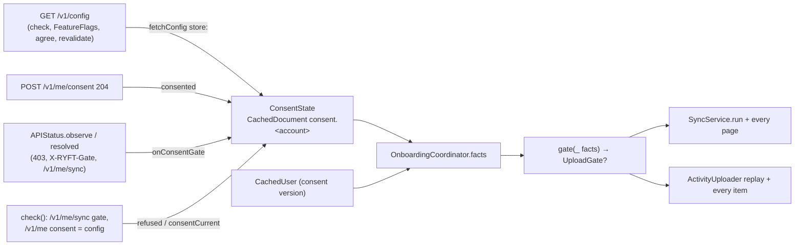

# P2: consent gates know the policy in force (design note)

PR `sync: consent gates know the policy in force`, stacked on A2 (#54, `2e0a070`). The rules are in ADR 0008.
Line numbers are from `2e0a070`.

## 1. Problem

1. **HealthKit's `syncGate` fails open.**
   - `missing()` counts a consent to *any* version while `/v1/config` hasn't answered in the process
     (`HealthPermissionView.swift:72`).
   - That is every background launch (no scene, so no `check()`), a check that fails or times out, and a policy bump
     mid-session.
   - Each such process sends a page (≈2 MB target, 32 MiB maximum) that the platform refuses with
     `403 consent_required`.
   - Nothing is persisted, so the next process sends one again.
2. **The uploader's `uploadGate` fails closed, but:**
   - it trusts a cached config of any age;
   - it reads SwiftData on every call (`pending()` asks twice per row, on every My Day render);
   - it isn't observable;
   - it forces a check on every reconnect.
3. **The constraints:**
   - The platform is the truth for consent.
   - The phone owns only what it last heard and when.
   - Background processes run nothing view-driven (`.onChange`, `.task`).
   - No new dependency, and no new user-facing copy unless something can't be said with what exists.

## 2. Options

| | Where the policy and the refusal live | For | Against |
| --- | --- | --- | --- |
| A | `OnboardingCoordinator` (today), patched | Least movement | A UI coordinator owns data safety. Its account binding is driven by RootView's `.onChange`. The session `config` stays a second copy beside the cache |
| B | `FlagStore` (it owns `/v1/config`'s cache) | One persisted copy | Flags defer for UI stability, but the policy must not. Its binding is view-driven too. Tests use `StaticFlags`, so the gates would behave differently under test. A refusal isn't a flag |
| **C** | **`ConsentState`, a small type on the environment** | One owner, one persisted record per account, in every graph (live, preview, test). Nothing in it is view-driven | A new type, and every config read has to go through one door |

**Choice: C.** Everything the data gates need from this phone (the last policy answer and the platform's last
refusal) has one owner that a background process and a unit test both build the same way. The decision itself stays a
pure function next to `missing()`, so there is one rule, table-tested.

**Rejected:** a pre-flight `GET /v1/me/sync` in each background process. It costs a request per wake (dozens a day)
to save one refused page per rare event.

## 3. Design



### 3.1 `ConsentState` (`Ryft/Environment/ConsentState.swift`, new)

`@MainActor @Observable`. It is `lazy var consent` on `AppEnvironment`, like `uploader`.

- **Record.** One per account, as `CachedDocument` `consent.<account>`, through `env.persistence`.
  - Fields: `policyVersion`, `policyURL`, `answeredAt` (this phone's clock when the answer arrived), `ttl` (the
    answer's `ttl_sec`; 6 h when it's missing or 0) and `refusedAt`.
  - Written only by `ConsentState`, and only when something changed.
- **Fresh** means `0 ≤ now − answeredAt < ttl`, with `env.clock.now()`.
  - Both ends are on the phone's clock, so the server's clock never enters. `FlagStore` uses `evaluated_at` for flags,
    and that's fine for flags.
  - A clock set back (negative age) counts as stale.
- **The bound is the answer's `ttl_sec` (6 h today), not shorter and not longer.**
  - It is what API.md says an answer is good for.
  - The persisted refusal (below) already caps a bump the phone hasn't seen at one page. A shorter bound would only add
    config requests in the background. A longer one lets a phone that was offline for days spend that page instead of
    none.
  - **"Consented to X at T" doesn't change the bound.** A `204` on `POST /v1/me/consent` proves X was in force at T
    (the platform answers `422` otherwise), so it's recorded as a policy answer at T with the same ttl. It doesn't last
    longer, because the risk the ttl covers (a later bump) doesn't depend on when the user agreed.
- **Memo.**
  - The record is decoded once per `AccountBinding` (account, demo, `accountChanges`) into `@ObservationIgnored`
    storage.
  - An observed `revision` bumps on every write, and reads touch it (the Repository pattern). So a read in a view body
    never mutates observed state, a new answer re-renders and releases the gates, and the store is read once per account.
- **Wipe.**
  - `TrainStore.wipe` deletes every `CachedDocument` in every wipe:
    - user sign-out;
    - session expiry (parking keeps activity rows only);
    - account deletion, foreground or background;
    - another account signing in.
  - Every wipe comes with an `accountChanges` bump, so the memo reloads and finds nothing.
  - No new line in `wipeSharedLocalData`.
- **Demo mode** reads and writes nothing. The gates are open in demo, which never uploads to the platform. Switching
  demo off changes the binding, so the account's record is read again.

**Writers.** All run on the main actor, for the current binding. An answer from a flight started under another
binding is dropped. A refusal is written only on a change.

| What happened | Seen in | Call |
| --- | --- | --- |
| A `/v1/config` answer | `fetchConfig`'s `store:` (inside the flight, so it lands even when the caller timed out) | `received(_:at:binding:)` |
| `POST /v1/me/consent` → `204` for X | `agree()` | `consented(to: X, at:)`: X answered now, and the refusal is cleared |
| `consent_required` from the platform: a `403` on any request, `X-RYFT-Gate`, or the pipeline's `/v1/me/sync` | `APIStatus.observe` (current epoch only), then `onConsentGate(true)` | `refused(at:)` |
| The check's `/v1/me/sync` says `consent_required` | `check()` | `refused(at:)` |
| The platform no longer names the gate | `APIStatus.resolved(.consentRequired)` (`check()` with `gate: null`, `agree()`), then `onConsentGate(false)` | `consentCurrent()` |
| The check's `/v1/me` consent equals the same check's config version, and its `/v1/me/sync` didn't say `consent_required` | `check()` | `consentCurrent()` |

- **Nothing local is recorded as a refusal.** The engine's own stop between pages never reaches `APIStatus`, which
  only sees real responses.
- **In-app withdrawal needs no write.** It already persists `consent: nil` in `CachedUser`, and the forced check that
  follows records the platform's gate.

**One door for `/v1/config`.** `fetchConfig(userInitiated:)` runs `reads.run(ReadKey(.config), store: …)` and is the
only way the app asks for the config:
- `check()`;
- `FeatureFlags`' fetch closure (it still applies to `FlagStore` itself; `FlagStore` is unchanged);
- `agree()`;
- the `422` handler;
- `revalidate()`.

`OnboardingCoordinator.config` is deleted:
- `policyVersion`, `policyPage` and `earlierConsent` read the record's latest version and URL, whatever their age;
- `agree()` uses a fresh version, or fetches one.

### 3.2 One gate, one rule

`syncGate` is deleted. `sync.gate` and `uploader.gate` both read `OnboardingCoordinator.uploadGate`, which is the pure
`gate(facts)`. `Facts` gains three things:
- `demo` and `inviteBlocked`;
- `policyFresh`;
- `reported` now includes `.consentRequired` while a refusal is stored.

`policyVersion` becomes the latest known version, whatever its age.

    gate(f) = demo → open · inviteBlocked → invite · !userKnown → consent · missing(f) ∋ .consent → consent
              · !policyFresh → policyUnknown · open

- **Staleness can only hold.**
  - A stale version that differs from the consent still means "consent outdated", which is the user's action.
  - A stale version that matches the consent is `policyUnknown`.
  - Only a fresh one opens.
- `missing()` (the UI) is unchanged. It asks for consent on a known mismatch or a refusal, never just because the
  policy is unknown.
- `UploadGate` moves from `ActivityUploader.swift` to `ConsentState.swift`.
- `SyncService.gate`, `pausedFor`, the engine's per-page gate and `Result.pausedFor` carry `UploadGate?`. Today maps
  only `.gate(code)` to a step.

### 3.3 Revalidation, reconnect, release

- **Revalidate before holding.**
  - `SyncService.run()` checks connectivity first.
  - Then, if the gate says `policyUnknown`, it awaits `consent.revalidate()` and asks the gate again.
  - The uploader's replay does the same at its start.
  - `revalidate()` is a no-op when the policy is fresh. Otherwise it makes one `fetchConfig`, joined with any config
    read in flight. After a failure it sends nothing for `OnboardingCoordinator.recheckInterval` (60 s) and rethrows the
    last error.
  - The sync's run throws it, so a failure shows (§5). The uploader holds with `try?`.
- **Reconnect.**
  - `refreshPolicyIfUnknown()` and its line in RyftApp's reconnect handler are deleted.
  - `run(.reconnect)` and the uploader's own connectivity handler revalidate when they need to, within the 60 s limit.
    So a flapping connection makes at most one config request a minute and no forced check.
- **Release edge.**
  - RootView's `.onChange(of: uploadGate)` forwards to `ScreenModels.gateChanged(to:)`, so it is testable.
  - When the gate becomes nil, the uploader flushes (as today), and a sync whose last run was held
    (`sync.pausedFor != nil`) runs again (`.appActive`).
  - In the background there is no view. Each run asks and revalidates at its own start, and BGAppRefresh flushes the
    uploader after its sync.
- **Mid-run.** The per-page and per-item checks apply the same rule.
  - Knowledge that expires mid-run stops the run before the next page, without committing it.
  - In the foreground, `FeatureFlags.run` refreshes at the ttl, and the release edge resumes the sync.
  - In the background, the backlog goes to the backfill task.
- **Cost.** `pending()` reads the gate once per row. The read is an in-memory record plus `CachedUser` (memoised per
  revision).

## 4. Truth table

The same result for HealthKit sync and activity uploads.

| # | Demo | Invite blocked | User known | Refused (stored, reported, or server gate) | Consent C | Policy V | Gate |
| --- | --- | --- | --- | --- | --- | --- | --- |
| 1 | on | – | – | – | – | – | open |
| 2 | off | yes | – | – | – | – | `invite` |
| 3 | off | no | no | – | – | – | `consent` (account not known) |
| 4 | off | no | yes | yes | – | – | `consent` |
| 5 | off | no | yes | no | nil | – | `consent` |
| 6 | off | no | yes | no | X | X, fresh | **open** |
| 7 | off | no | yes | no | X | ≠ X, any age | `consent` |
| 8 | off | no | yes | no | X | X stale, or none | `policyUnknown`: revalidate if online, else hold |

| Scenario | What decides | Result |
| --- | --- | --- |
| First launch after sign-in | Row 3 until `check()` answers (≤ 10 s; bootstrap awaits it). Then user, consent and a fresh V come from the same check | Rows 6 or 7. The release edge flushes the uploader |
| Check times out; `/v1/me` answered, config didn't | Row 8 | The run's `revalidate()` joins the config read still in flight |
| Session expiry, any process | The wipe takes the record, `CachedUser` and the anchors; signed out | Nothing runs. Activity rows are parked (ADR 0004) |
| Re-login after an expiry | As a first launch; no refusal survives the wipe | The full backfill goes through the same gate; unparked rows wait for it |
| Background wake, fresh record | Row 6 | Pages go. A refusal moves this and every later process to row 4: at most one page |
| Background wake, stale record | Row 8 | Online: one `GET /v1/config` on the background session, then 6 or 7. Offline: held; nothing is read |
| Offline | `run()` returns before the gate | The Offline line, no reads. Rows show `.pending(.offline)` |
| Policy bump mid-session | Row 6 on the old version | The next TTL refresh or check moves it to row 7 with no page. A page sent before that is refused once (row 4) |
| Consent withdrawn on another device | The cached consent is stale truth; row 6 | At most one refused page, then row 4 until a foreground check finds the gate gone, or the user agrees here |
| Withdrawn in this app | `consent: nil` persisted at once | Row 5 |
| Consent given elsewhere while refused | Row 4 | Held in the background until this phone's next foreground check (`gate: null`). Where push is on, the platform's `SYNC_STALE` nudges the user |

## 5. What users see

- **Policy unknown in the foreground: nothing new.**
  - At launch, bootstrap waits for the check that brings the config.
  - After more than 6 h away, the run revalidates first (joined with the activation's own config reads).
  - Offline, "Offline" already wins.
  - The residual case is online with `/v1/config` failing past its retries. The run fails with the read's error, so
    the existing "paused" line and the message under the cards show it, with Details and the request ID. No new string.
- **A stored refusal** shows the consent gate as a `403` does today ("Action needed" on Today, the sheet over the tabs),
  but from launch on, also offline. That's honest: the platform did refuse. "Not now" works as before.
- **Activity rows:** unchanged. Unknown and offline says "upload when you're online"; unknown and online says "once your
  account is ready".
- **A background wake that skips its upload is silent.** No local notification.

## 6. Background cost

- **Anchors never advance on a hold.**
  - The gate is asked (after revalidation) before the first HealthKit read in `SyncService.run()`.
  - It is asked again before each page's upload.
  - An anchor and its deletions are committed only after the page was accepted.
  - A hold mid-run drops the page that was read ahead, uncommitted.
- **BGAppRefresh still reschedules.**
  - `scheduleRefresh()` is the handler's first line (`ScheduledWork.swift:31`), and every move to the background
    reschedules as well.
  - The task completes with success when it was held, and with failure when the revalidation failed online.
- **HealthKit delivery keeps its contract.**
  - The completion runs once the upload step ends, in every outcome (`SyncCoordinator` `uploadDone()` in a `defer`).
  - The revalidation sits inside that step: one GET of about 1 KB, normally under a second, and at most the background
    session's 20 s / 25 s.
- **Network:** at most one `GET /v1/config` per ttl (6 h) per phone when it succeeds, and at most one a minute while it
  fails. No `/v1/me` or `/v1/me/sync` is added.

## 7. Types and signatures

```swift
enum UploadGate: Equatable, Sendable { case gate(APIErrorCode), policyUnknown }      // moved

@MainActor @Observable final class ConsentState {
    init(env: AppEnvironment)
    var latestPolicyVersion: String? { get }          // any age: the consent step's text, earlierConsent
    var policyURL: String? { get }
    var isRefused: Bool { get }
    func isPolicyFresh(at now: Date) -> Bool
    func received(_ config: RemoteConfig, at: Date, binding: AccountBinding)
    func consented(to version: String, at: Date)
    func refused(at: Date)
    func consentCurrent()
    func fetchConfig(userInitiated: Bool) async throws -> RemoteConfig?
    func revalidate() async throws
}

// OnboardingCoordinator: Facts + demo, inviteBlocked, policyFresh
nonisolated static func gate(_ f: Facts) -> UploadGate?
var uploadGate: UploadGate? { get }                   // deleted: syncGate, config, policyVersionInForce,
                                                      // refreshPolicyIfUnknown()
// SyncService / SyncEngine
var gate: (@MainActor () -> UploadGate?)?;  private(set) var pausedFor: UploadGate?
// APIStatus
@ObservationIgnored var onConsentGate: (@MainActor (_ refused: Bool) -> Void)?
// ScreenModels (wires sync.gate, uploader.gate, onConsentGate, FeatureFlags' fetch)
func gateChanged(to gate: UploadGate?)
```

## 8. Steps (commits in this PR)

1. `ConsentState`: the record, memo, writers, `fetchConfig` and `revalidate`, with their tests (§9 T2).
2. Route every config read through `fetchConfig`. Delete `OnboardingCoordinator.config`.
3. Build `Facts` from `ConsentState`. Add `gate(_:)`, make `uploadGate` the only gate, and delete `syncGate`,
   `policyVersionInForce` and `refreshPolicyIfUnknown`.
4. `UploadGate` through `SyncService` and `SyncEngine`, with revalidation in `run()`. The uploader revalidates at replay
   start and reads the gate once in `pending()`.
5. The writers: the `APIStatus` hook, `check()` and `agree()`.
6. RyftApp: the release edge through `ScreenModels.gateChanged(to:)`, and the reconnect line goes.
7. Docs: ARCHITECTURE §4 (the gate bullet) and §10, and ADR 0008 accepted.

**Migration.** There is no data migration.
- The first launch of this build finds no record, which reads as stale. Online, the first run revalidates with one GET.
  Offline, it holds.
- No refusal is stored, so the first refusal after the update costs one page, as it does today.
- `FlagStore`'s cached config keeps its version inside its blob, unread.

## 9. Tests and the mutants they must kill

| Test | Pins | Mutant it must kill |
| --- | --- | --- |
| T1 `OnboardingDecisionTests.gate` (pure table) | Rows 1–8, one case each, plus stale-and-different → `consent` | A stale or no record opening the gate; the refusal not in `reported`; demo checked after invite; an unknown account opening; consent nil plus unknown answering `policyUnknown` |
| T2 `ConsentStateTests` (`env.test`, `TestClock`, in-memory store) | Fresh at `ttl − 1 s`, stale at `ttl` and with a clock set back, 6 h for `ttl_sec: 0` | `<=` at the boundary; `abs(age)`; ignoring `ttl_sec` |
| | A second `ConsentState` on the same store sees the answer and the refusal ("next process") | The refusal kept in memory only |
| | Each `Wipe` (user, expiry with parking, deletion, account switch) empties the record for a new instance and for the same one | A memo not keyed by `accountChanges` (A → expiry → A reads the pre-wipe memo) |
| | Demo writes nothing; switching demo off reads the account's record | A demo answer recorded for the account |
| | An answer from a flight under A lands after B signs in, and is dropped; an older answer doesn't replace a newer one | No binding check; last-write-wins |
| | 100 reads, 1 store fetch (a counting `Persistence`) | The memo removed |
| | `withObservationTracking` on `uploadGate` fires on `received` and on `consentCurrent()` | `revision` made `@ObservationIgnored` |
| | `revalidate()`: after a failure, 1 config request within 60 s and 2 after 61 s; concurrent with `check()`, 1 request | No rate limit; not joined |
| T3 writers (`OnboardingCoordinatorTests`, `APIClientStatusTests`) | `observe(.consentRequired)` enforced or warn → refused; `resolved` → cleared | Recording enforced refusals only |
| | `check()`: status `consent_required` → refused; `null` → cleared; `invite_required` → unchanged; status failed with the consent equal to the config version → cleared | Clearing on `invite_required`, or on any answered check |
| | `agree()` → cleared, fresh for 6 h with no further config request | The 204 not counted as an answer |
| | A stored refusal at an offline launch → `pendingGate == .consent`, Today `actionNeeded` | The refusal not fed to `missing()` |
| T4 sync (`SyncEngineTests`, `SyncCoordinatorTests`; `MockHealthStore` counts reads and commits) | Stale and offline: 0 reads, 0 commits, 0 `sync`. Stale and online: 1 `config`, then pages. Config failing: the run throws its error (request ID in Details), 0 reads | Revalidating after the first read; swallowing the error |
| | A refusal stored, then two "processes" (a new `SyncService` and `ConsentState` on the same stores): 0 `sync` calls | — |
| | `403 consent_required` on page 2: its anchor isn't committed, the refusal is recorded, `pausedFor == .gate(.consentRequired)` | Committing before the gate |
| | A local hold mid-run writes no refusal | The refusal written from `Result.pausedFor` |
| | `.healthKit` held for each reason: `afterUpload` runs exactly once | The completion skipped on a hold |
| T5 uploader | `pending()` calls the gate once per row; unknown offline → `.offline`, online → `.gated`; the replay revalidates once | A second gate read |
| T6 reconnect | 5 reconnects within 60 s with config failing: 1 `config`, 0 `me` | `refreshPolicyIfUnknown` kept |
| T7 `ScreenModels.gateChanged` | Gate to nil: one flush, and one sync run only if the last run was held | Rerunning on every release (an extra HealthKit pass at each launch) |

BGAppRefresh's reschedule isn't behind a seam (`BGTaskScheduler.shared`). The order in the handler is the pin, and the
reviewer checks it.

## 10. Risks

- **A stale record and days offline upload nothing.** Accepted:
  - offline, nothing could go anyway;
  - anchors and rows wait;
  - the first run online revalidates and sends everything.
  The real exposure is "online, `/v1/config` broken while `/v1/sync` works": uploads stop, visibly (§5). It's the same
  service, so this is unlikely.
- **One refused page per phone per event remains:** a bump inside the ttl, or a withdrawal elsewhere. R24 would remove
  the bump case.
- **Release vs Debug.** The rule is the same. Debug flag overrides and `-RyftFlags` don't touch the policy. Demo mode
  (the simulator's default, every UI test) opens the gates and writes nothing, so only unit tests exercise them. Note
  in STATUS that a device check is needed: a background wake with a stale record, offline, then online.
- **Before the first unlock after a reboot** the store may read as empty. The user is then unknown too, so the gates
  are closed (row 3), and HealthKit is locked anyway. If the memo stays empty after the unlock in the same process, the
  cost is one page.
- **Not covered here:**
  - `invite_required` isn't persisted. A background process behind an enforced invite gate still sends one page. That
    needs an account that consented and then lost access.
  - Train's outbox and the training import don't ask any consent gate (ADR 0008, open question).

## 11. Platform

Nothing here needs the platform: the design works with today's contract. R23 (activity and manual-sleep writes refused
for an outdated consent) is still open and still matters, because the platform's refusal is what limits the one page.
**R24** is proposed for `docs/API_REQUESTS.md`, and is not blocking:

> **R24 — Announce a privacy-policy bump before it applies.** (P2, 2026-10-26)
> - **Why.** A new `privacy_policy_version` applies to `POST /v1/sync` at once. A phone that read `/v1/config` up to
>   `ttl_sec` earlier still sends one page under the old consent before `403 consent_required` stops it.
> - **(1) Announce the next version.** Please consider `privacy_policy_next_version` and
>   `privacy_policy_effective_at` in `GET /v1/config` (null when nothing is scheduled), published at least `ttl_sec`
>   ahead. The app would ask for consent ahead and hold uploads from `effective_at`, so no page is ever sent under an
>   outdated consent.
> - **(2) Tell the other phones about a withdrawal.** When an account's consent is withdrawn, please send the silent
>   refresh push with the gate (e.g. `"gate": "consent_required"`), so the account's other phones hold without sending
>   a page.
