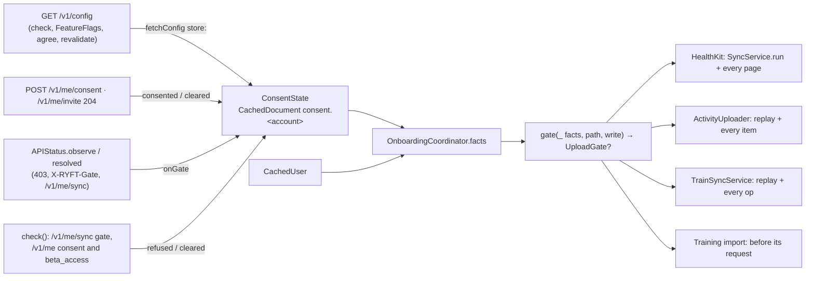

# P2: consent gates know the policy in force (design note)

PR `sync: consent gates know the policy in force`, stacked on A2 (#54, `2e0a070`). The rules are in ADR 0008.
Line numbers are from `2e0a070`.

**Amended after the privacy review and the lead's decisions (2026-10-26):**
- **Demo.** Demo opens a path only against the mock, for ops bound to demo. HealthKit sync holds, and
  `SyncService.run()` refuses in demo.
- **Train.** Train ops are bound to their account (demo counts as one), so demo stays open for Train as today.
- **Invite.** Only an enforced `invite_required` is persisted and holds. `consent_required` holds in any mode.
- **DELETEs** go out without a current consent (Art. 17).
- **The record.** A read of it that fails before the first unlock is never cached, and the age limit is capped at 24 h.
- **Training logs** are health data.
- **Platform.** R25 and R26 are new.

## 1. Problem

1. **HealthKit's `syncGate` fails open.**
   - `missing()` counts a consent to *any* version while `/v1/config` hasn't answered in the process
     (`HealthPermissionView.swift:72`).
   - That is every background launch (no scene, so no `check()`), a check that fails or times out, and a policy bump
     mid-session.
   - Each such process sends a page (≈2 MB target, 32 MiB maximum) that the platform refuses with
     `403 consent_required`.
   - Nothing is persisted, so the next process sends one again.
2. **The uploader's `uploadGate` fails closed, but:**
   - it trusts a cached config of any age;
   - it reads SwiftData on every call (`pending()` asks twice per row, on every My Day render);
   - it isn't observable;
   - it forces a check on every reconnect.
3. **The privacy review found four more holes:**
   - `syncNow` / `fullResync` reach the live client in demo mode (S1).
   - An enforced invite gate isn't remembered.
   - Training logs go up with no gate at all.
   - Train's outbox picks its client per call, so an op can cross between demo and the account.
4. **The constraints:**
   - The platform is the truth for consent.
   - The phone owns only what it last heard and when.
   - Background processes run nothing view-driven (`.onChange`, `.task`).
   - No new dependency, and no new user-facing copy unless something can't be said with what exists.

## 2. Options

| | Where the policy and the refusals live | For | Against |
| --- | --- | --- | --- |
| A | `OnboardingCoordinator` (today), patched | Least movement | A UI coordinator owns data safety. Its account binding is driven by RootView's `.onChange`. The session `config` stays a second copy beside the cache |
| B | `FlagStore` (it owns `/v1/config`'s cache) | One persisted copy | Flags defer for UI stability, but the policy must not. Its binding is view-driven too. Tests use `StaticFlags`, so the gates would behave differently under test. A refusal isn't a flag |
| **C** | **`ConsentState`, a small type on the environment** | One owner, one persisted record per account, in every graph (live, preview, test). Nothing in it is view-driven | A new type, and every config read has to go through one door |

**Choice: C.** Everything the data gates need from this phone (the last policy answer and the platform's last
refusals) has one owner that a background process and a unit test both build the same way. The decision itself stays
a pure function next to `missing()`, so there is one rule, table-tested.

**Rejected:** a pre-flight `GET /v1/me/sync` in each background process. It costs a request per wake (dozens a day)
to save one refused page per rare event.

## 3. Design



### 3.1 `ConsentState` (`Ryft/Environment/ConsentState.swift`, new)

`@MainActor @Observable`. It is `lazy var consent` on `AppEnvironment`, like `uploader`.

- **Record.** One per account, as `CachedDocument` `consent.<account>`, through `env.persistence`.
  - Fields:
    - `policyVersion`, `policyURL`;
    - `answeredAt` (this phone's clock when the answer arrived);
    - `ttl`;
    - `refusals: [APIErrorCode: Date]`, which holds `consent_required` (any mode) and an enforced `invite_required`.
  - Written only by `ConsentState`, and only when something changed.
- **Fresh** means `0 ≤ now − answeredAt < ttl`, with `env.clock.now()`.
  - Both ends are on the phone's clock, so the server's clock never enters. `FlagStore` uses `evaluated_at` for flags,
    and that's fine for flags.
  - A clock set back (negative age) counts as stale.
- **The age limit is `min(ttl_sec, 24 h)`, 6 h when `ttl_sec` is missing or 0. That's 6 h today.**
  - It is what API.md says an answer is good for.
  - The 24 h cap keeps a `ttl_sec` raised for flag load from stretching how long the policy is trusted.
  - The persisted refusal already caps a bump the phone hasn't seen at one page. A shorter limit would only add config
    requests in the background. A longer one lets a phone that was offline for days spend that page instead of none.
  - **"Consented to X at T" doesn't change the limit.** A `204` on `POST /v1/me/consent` proves X was in force at T
    (the platform answers `422` otherwise), so it's recorded as a policy answer at T with the same limit. It doesn't
    last longer, because the risk the limit covers (a later bump) doesn't depend on when the user agreed.
- **Memo.**
  - The record is decoded once per `AccountBinding` (account, demo, `accountChanges`) into `@ObservationIgnored`
    storage.
  - An observed `revision` bumps on every write, and reads touch it (the Repository pattern). So a read in a view body
    never mutates observed state, a new answer re-renders and releases the gates, and the store is read once per account.
- **Before the first unlock.**
  - While protected data is unavailable, a read of the record isn't cached. Availability comes through a closure the
    tests set; live it is `isProtectedDataAvailable`.
  - Meanwhile `Facts.recordReadable` is false, and the gate holds every write. `revalidate()` doesn't run then, because
    nothing could be stored.
  - On `protectedDataDidBecomeAvailable`, one observer (like `BackgroundWork.resumeOnUnlock`) drops the memo and bumps
    `revision`.
- **Wipe.**
  - `TrainStore.wipe` deletes every `CachedDocument` in every wipe:
    - user sign-out;
    - session expiry (parking keeps activity rows only);
    - account deletion, foreground or background;
    - another account signing in.
  - Every wipe comes with an `accountChanges` bump, so the memo reloads and finds nothing.
  - No new line in `wipeSharedLocalData`.
- **Demo mode** reads and writes nothing. Switching demo off changes the binding, so the account's record is read again.

**Writers.** All run on the main actor, for the current binding. An answer from a flight started under another
binding is dropped. A refusal is written only on a change.

| What happened | Seen in | Call |
| --- | --- | --- |
| A `/v1/config` answer | `fetchConfig`'s `store:` (inside the flight, so it lands even when the caller timed out) | `received(_:at:binding:)` |
| `POST /v1/me/consent` → `204` for X | `agree()` | `consented(to: X, at:)`: X answered now, and the consent refusal is cleared |
| `consent_required` from the platform, in any mode: a `403` on any request (a DELETE's too), `X-RYFT-Gate`, or the pipeline's `/v1/me/sync` `gate` | `APIStatus.observe` (current epoch only), then `onGate(.consentRequired, true)` | `refused(.consentRequired, at:)` |
| An **enforced** `invite_required`: a `403` | `APIStatus.observe(enforced: true)`, then `onGate(.inviteRequired, true)` | `refused(.inviteRequired, at:)` |
| The check's `/v1/me/sync` says `consent_required` | `check()` | `refused(.consentRequired, at:)` |
| The platform no longer names a gate | `APIStatus.resolved(code)`: `check()` with `gate: null` (both codes) or `consent_required` (invite; the beta gate is checked first), `agree()`, `redeemInvite()` 204. Then `onGate(code, false)` | `cleared(code)` |
| The check's own answers show it passed: `/v1/me` consent equals the same check's config version (consent), or `beta_access: true` (invite). Either way only if its `/v1/me/sync` didn't name that gate | `check()` | `cleared(code)` |

- **Warn-mode `invite_required` is never recorded and never holds.** It is a product nudge, not a legal basis.
  - `X-RYFT-Gate: invite_required` and a `/v1/me/sync` `gate` of `invite_required` reach `APIStatus.gates`, so the
    deferrable invite step still shows.
  - `/v1/me/sync` can't tell warn from enforced, so that answer is never recorded as an invite refusal.
- **Warn-mode `consent_required` is recorded and holds, on purpose.** The app fails closed on consent even where the
  platform would serve.
- **Nothing local is recorded as a refusal.** The engine's own stop between pages never reaches `APIStatus`, which
  only sees real responses.
- **In-app withdrawal needs no write.** It already persists `consent: nil` in `CachedUser`, and the forced check that
  follows records the platform's gate.

**One door for `/v1/config`.** `fetchConfig(userInitiated:)` runs `reads.run(ReadKey(.config), store: …)` and is the
only way the app asks for the config:
- `check()`;
- `FeatureFlags`' fetch closure (it still applies to `FlagStore` itself; `FlagStore` is unchanged);
- `agree()`;
- the `422` handler;
- `revalidate()`.

`OnboardingCoordinator.config` is deleted:
- `policyVersion`, `policyPage` and `earlierConsent` read the record's latest version and URL, whatever their age;
- `agree()` uses a fresh version, or fetches one.

### 3.2 One gate, one rule, per path and per write

`syncGate` is deleted. Every upload asks `OnboardingCoordinator.uploadGate(for: path, write:)`, which is the pure
`gate(facts, path, write)`. The paths are `UploadPath`:
- `.healthKit`;
- `.activities`;
- `.train` (the outbox);
- `.trainImport`.

`UploadWrite` is either `.data` or `.erasure`:
- `.data` writes carry health data: sync pages, activity and night `PUT`s, Train session `PUT`s and completions (with
  body weight), and the import.
- `.erasure` is every `DELETE`.

`Facts` gains these:
- `demo`, `inviteBlocked` (this process's enforced 403, or the stored invite refusal), `policyFresh` and
  `recordReadable`;
- `reported` now includes the stored consent refusal.

`policyVersion` becomes the latest known version, whatever its age.

    gate(f, path, write) = demo → (path == .healthKit ? demo : open)
                           · !recordReadable → policyUnknown
                           · inviteBlocked → invite
                           · write == .erasure → open
                           · !userKnown → consent
                           · missing(f) ∋ .consent → consent
                           · !policyFresh → policyUnknown
                           · open

- **Demo, and binding.** An op never crosses between demo and the account.
  - **HealthKit sync** always uses the live client, so in demo it gets `demo` (a new `UploadGate` case that holds
    silently).
  - **`SyncService.run()` refuses in demo** before anything else and returns `[]`. That covers `syncNow`, `fullResync`
    and `resendRecent`, which skipped `LiveSyncSteps`' demo check (S1). `fullResync()` and `resendRecent()` change no
    anchors or engine state in demo. Today `resetForFullResync()` resets the real HealthKit anchors first.
  - **The activity uploader** already binds every request to its account or demo (`ActivityUploader.Generation`).
  - **Train's outbox** gets the same binding.
    - `PendingTrainOp` has no account at `2e0a070` (`TrainCache.swift:61`). P2 adds one: the account, or demo as its
      own account. sync-engineer checks the branch.
    - At flush an op goes only through its own binding's client: a demo op through the mock, an account op through
      the live API. Ops of another binding wait and are never sent through the wrong client.
    - Ops queued before this build have no binding. They count as the signed-in account's and wait while demo is on,
      which is what happens today minus the crossing.
  - **The import** binds its batch the same way when its upload is built (I5).
  - With binding, demo stays open for activities, Train and the import against the mock, as today.
  - Holding demo ops instead would flush them to the live account once demo is off, which is worse.
- **DELETEs go out without a current consent.** Erasure is in the user's interest (Art. 17), and a `DELETE` carries no
  health data.
  - Only demo, an unreadable record and an enforced invite gate hold it. The platform refuses every route but
    onboarding's behind that gate.
  - If the platform answers a `DELETE` with `consent_required`, that is recorded as a refusal (holding data writes),
    and the delete stays queued.
  - It is tried again on the outbox's next trigger, as a gated item is today. It has no body, so it carries no health
    data. R25 asks the platform to accept such deletes.
- **Staleness can only hold.**
  - A stale version that differs from the consent still means "consent outdated", which is the user's action.
  - A stale version that matches the consent is `policyUnknown`.
  - Only a fresh one opens.
- **The UI.** `missing()` is unchanged. It asks for consent or the invite on a known mismatch or a signal, never just
  because the policy is unknown.
- **Types.** `UploadGate` moves from `ActivityUploader.swift` to `ConsentState.swift`.
  - `SyncService.gate`, `pausedFor`, the engine's per-page gate and `Result.pausedFor` carry `UploadGate?`.
  - Today maps only `.gate(code)` to a step.
- **Training logs are health data** (Art. 9): body weight, effort, notes, and their use for strain and recovery.
  - `TrainSyncService` gets a `gate` closure like the uploader's: closed by default, wired in `ScreenModels`.
  - It is asked at replay start (with revalidation) and before each op, with `.erasure` for `delete` and `.data` for
    `put` and `complete`.
  - Held ops stay queued and in order, as they already do after a `403` with a code (`TrainSyncService.swift:249`).
  - A `delete` may pass held ops. When it passes a held `put` or `complete` of its own session, those are dropped:
    sent later, they would bring the session back. sync-engineer checks whether the outbox's coalescing already does
    this.
  - The import's upload (`POST /v1/train/import`, I5) asks `uploadGate(for: .trainImport, write: .data)` before its
    first request and holds the batch.
  - Reads stay ungated. So do `TrainLibrary`'s direct writes (custom exercises, plans, enrolment), which carry no
    session, body or effort data.

### 3.3 Revalidation, reconnect, release

- **Revalidate before holding.**
  - `SyncService.run()` checks demo and connectivity first.
  - Then, if the data gate says `policyUnknown` and the record is readable, it awaits `consent.revalidate()` and asks
    the gate again.
  - The uploader's replay and Train's replay do the same at their start when they hold data writes. Erasures don't
    wait for it.
  - `revalidate()` is a no-op when the policy is fresh. Otherwise it makes one `fetchConfig`, joined with any config
    read in flight. After a failure it sends nothing for `OnboardingCoordinator.recheckInterval` (60 s) and rethrows the
    last error.
  - The sync's run throws it, so a failure shows (§5). The two outboxes hold their data writes with `try?`.
- **Reconnect.**
  - `refreshPolicyIfUnknown()` and its line in RyftApp's reconnect handler are deleted.
  - `run(.reconnect)` and the outboxes' own connectivity handlers revalidate when they need to, within the 60 s limit.
    So a flapping connection makes at most one config request a minute and no forced check.
- **Release edge.**
  - RootView forwards each path's data gate to `ScreenModels.gateChanged(_:to:)`, so it is testable.
  - When a gate becomes nil, its outbox flushes: the activity uploader (as today) and Train's outbox. A sync whose last
    run was held (`sync.pausedFor != nil`) runs again (`.appActive`).
  - In the background there is no view. Each run asks and revalidates at its own start, and BGAppRefresh flushes the
    activity uploader after its sync.
- **Mid-run.** The per-page, per-item and per-op checks apply the same rule.
  - Knowledge that expires mid-run stops the run before the next page, without committing it.
  - In the foreground, `FeatureFlags.run` refreshes at the ttl, and the release edge resumes the sync.
  - In the background, the backlog goes to the backfill task.
- **Cost.** `pending()` reads the gate once per row. The read is an in-memory record plus `CachedUser` (memoised per
  revision).

## 4. Truth table

**Data writes.** Every path, except where row 1 says otherwise.

| # | Demo | Record readable | Invite enforced (now or stored) | User known | Consent refused (stored, reported, server gate) | Consent C | Policy V | Gate |
| --- | --- | --- | --- | --- | --- | --- | --- | --- |
| 1 | on | – | – | – | – | – | – | `.healthKit`: `demo` (holds). Every other path: open, against the mock, for demo-bound ops only |
| 2 | off | no | – | – | – | – | – | `policyUnknown`, no revalidation |
| 3 | off | yes | yes | – | – | – | – | `invite` |
| 4 | off | yes | no | no | – | – | – | `consent` (account not known) |
| 5 | off | yes | no | yes | yes | – | – | `consent` |
| 6 | off | yes | no | yes | no | nil | – | `consent` |
| 7 | off | yes | no | yes | no | X | X, fresh | **open** |
| 8 | off | yes | no | yes | no | X | ≠ X, any age | `consent` |
| 9 | off | yes | no | yes | no | X | X stale, or none | `policyUnknown`: revalidate if online, else hold |

**Erasures (DELETE):** rows 1–3 as above, and **open** in every other case: no account, no consent, a refusal, or an
unknown policy.

| Scenario | What decides | Result |
| --- | --- | --- |
| First launch after sign-in | Row 4 until `check()` answers (≤ 10 s; bootstrap awaits it). Then user, consent and a fresh V come from the same check | Rows 7 or 8. The release edge flushes both outboxes |
| Check times out; `/v1/me` answered, config didn't | Row 9 | The run's `revalidate()` joins the config read still in flight |
| Session expiry, any process | The wipe takes the record, `CachedUser` and the anchors; signed out | Nothing runs. Activity rows are parked (ADR 0004) |
| Re-login after an expiry | As a first launch; no refusal survives the wipe | The full backfill goes through the same gate; unparked rows wait for it |
| Background wake, fresh record | Row 7 | Pages go. A refusal moves this and every later process to row 5: at most one page |
| Background wake, stale record | Row 9 | Online: one `GET /v1/config` on the background session, then 7 or 8. Offline: held; nothing is read |
| Background wake before the first unlock | Row 2 | Held; HealthKit is locked as well. The unlock reloads the record |
| Offline | `run()` returns before the gate | The Offline line, no reads. Rows show `.pending(.offline)` |
| Policy bump mid-session | Row 7 on the old version | The next ttl refresh or check moves it to row 8 with no page. A page sent before that is refused once (row 5) |
| Consent withdrawn on another device | The cached consent is stale truth; row 7 | At most one refused page, then row 5 until a foreground check finds the gate gone, or the user agrees here |
| Withdrawn in this app, then deletes an activity | Row 6 for data; the erasure is open | Data writes hold; the `DELETE` goes. If the platform refuses it, it stays queued and is tried again on the next trigger |
| Consent given elsewhere while refused | Row 5 | Held in the background until this phone's next foreground check (`gate: null`). Where push is on, the platform's `SYNC_STALE` nudges the user |
| Invite gate in warn mode, no code redeemed | Not recorded, not held | Uploads go. The invite step shows and can be put off |
| Invite gate enforced | A `403 invite_required`, stored: row 3 | Everything holds, deletes too, until a code is redeemed or the check finds the gate gone |
| Demo data on | Row 1 | HealthKit sync refuses, including `syncNow` and `fullResync`. Activities and Train go to the mock, demo-bound ops only; the account's queued ops wait for demo off |

## 5. What users see

- **Policy unknown in the foreground: nothing new.**
  - At launch, bootstrap waits for the check that brings the config.
  - After more than 6 h away, the run revalidates first (joined with the activation's own config reads).
  - Offline, "Offline" already wins.
  - The residual case is online with `/v1/config` failing past its retries. The run fails with the read's error, so
    the existing "paused" line and the message under the cards show it, with Details and the request ID. No new string.
- **A stored refusal** shows its gate as a `403` does today ("Action needed" on Today, the sheet over the tabs), but
  from launch on, also offline. That's honest: the platform did refuse. "Not now" works as before.
- **Deletes** take effect on the platform even without consent. A deleted row leaves My Day at once, as today.
- **Activity rows:** unchanged. Unknown and offline says "upload when you're online"; unknown and online says "once your
  account is ready".
- **Train:** held sessions stay in the outbox's pending count, as they do offline. Demo Train works against the mock,
  as today.
- **A background wake that skips its upload is silent.** No local notification.

## 6. Background cost

- **Anchors never advance on a hold.**
  - The gate is asked (after revalidation) before the first HealthKit read in `SyncService.run()`.
  - It is asked again before each page's upload.
  - An anchor and its deletions are committed only after the page was accepted.
  - A hold mid-run drops the page that was read ahead, uncommitted.
- **BGAppRefresh still reschedules.**
  - `scheduleRefresh()` is the handler's first line (`ScheduledWork.swift:31`), and every move to the background
    reschedules as well.
  - The task completes with success when it was held, and with failure when the revalidation failed online.
- **HealthKit delivery keeps its contract.**
  - The completion runs once the upload step ends, in every outcome (`SyncCoordinator` `uploadDone()` in a `defer`).
  - The revalidation sits inside that step: one GET of about 1 KB, normally under a second, and at most the background
    session's 20 s / 25 s.
- **Network:**
  - at most one `GET /v1/config` per age limit (6 h) per phone when it succeeds, and at most one a minute while it
    fails;
  - no `/v1/me` or `/v1/me/sync` is added;
  - a `DELETE` the platform refuses for consent repeats once per outbox trigger, without a body.

## 7. Types and signatures

```swift
enum UploadGate: Equatable, Sendable { case gate(APIErrorCode), policyUnknown, demo }   // moved; `demo` new
enum UploadPath: Sendable { case healthKit, activities, train, trainImport }
enum UploadWrite: Sendable { case data, erasure }

@MainActor @Observable final class ConsentState {
    init(env: AppEnvironment)
    var latestPolicyVersion: String? { get }          // any age: the consent step's text, earlierConsent
    var policyURL: String? { get }
    var refusals: Set<APIErrorCode> { get }           // consent (any mode), invite (enforced only)
    var isRecordReadable: Bool { get }
    func isPolicyFresh(at now: Date) -> Bool
    func received(_ config: RemoteConfig, at: Date, binding: AccountBinding)
    func consented(to version: String, at: Date)
    func refused(_ code: APIErrorCode, at: Date)
    func cleared(_ code: APIErrorCode)
    func fetchConfig(userInitiated: Bool) async throws -> RemoteConfig?
    func revalidate() async throws
    @ObservationIgnored var isProtectedDataAvailable: @MainActor () -> Bool   // seam
}

// OnboardingCoordinator: Facts + demo, inviteBlocked, policyFresh, recordReadable
nonisolated static func gate(_ f: Facts, path: UploadPath, write: UploadWrite) -> UploadGate?
func uploadGate(for path: UploadPath, write: UploadWrite = .data) -> UploadGate?
                                                      // deleted: syncGate, config, policyVersionInForce,
                                                      // refreshPolicyIfUnknown()
// SyncService / SyncEngine
var gate: (@MainActor () -> UploadGate?)?;  private(set) var pausedFor: UploadGate?
// ActivityUploader / TrainSyncService (closed until ScreenModels wires them)
@ObservationIgnored var gate: @MainActor (UploadWrite) -> UploadGate? = { _ in .gate(.consentRequired) }
// PendingTrainOp: + account (the account ID, or demo's); optional for ops queued before this build
// APIStatus: consent in any mode; invite only when enforced
@ObservationIgnored var onGate: (@MainActor (APIErrorCode, _ refused: Bool) -> Void)?
// ScreenModels (wires the three gates, onGate, FeatureFlags' fetch)
func gateChanged(_ path: UploadPath, to gate: UploadGate?)
```

## 8. Steps (commits in this PR)

1. `ConsentState`: the record (consent, enforced invite), memo, the unlock reload, writers, `fetchConfig` and
   `revalidate`, with their tests (§9 T2).
2. Route every config read through `fetchConfig`. Delete `OnboardingCoordinator.config`.
3. Build `Facts` from `ConsentState`. Add `gate(_:path:write:)` and make `uploadGate(for:write:)` the only gate. Delete
   `syncGate`, `policyVersionInForce` and `refreshPolicyIfUnknown`.
4. `UploadGate` through `SyncService` and `SyncEngine`:
   - the demo refusal in `run()`, with `fullResync` / `resendRecent` inert in demo;
   - revalidation in `run()`.
   The activity uploader asks per item with its write kind, revalidates at replay start for data, and reads the gate
   once in `pending()`.
5. Train: bind `PendingTrainOp` to its account or demo (unless the branch already has it), send each op only through
   its binding's client, and add the outbox gate (replay start and per op, with the write kind).
6. The writers: the `APIStatus` hook, `check()`, `agree()` and `redeemInvite()`.
7. RyftApp: the release edge through `ScreenModels.gateChanged(_:to:)`, and the reconnect line goes.
8. Docs:
   - ARCHITECTURE §4 (the gate bullet) and §10, plus a line in Train's section;
   - ADR 0008 accepted;
   - R25 and R26 in `API_REQUESTS.md`.

**Migration.** There is no data migration beyond the new optional `PendingTrainOp.account` (a lightweight SwiftData
change).
- The first launch of this build finds no record, which reads as stale. Online, the first run revalidates with one GET.
  Offline, it holds.
- No refusal is stored, so the first refusal after the update costs one page, as it does today.
- `FlagStore`'s cached config keeps its version inside its blob, unread.
- Train ops queued before this build count as the signed-in account's.

## 9. Tests and the mutants they must kill

| Test | Pins | Mutant it must kill |
| --- | --- | --- |
| T1 `OnboardingDecisionTests.gate` (pure table) | Data rows 1–9, one case each, row 1 for every path, and stale-and-different → `consent`. Erasure: rows 1–3 hold; open with no account, no consent, a refusal, or an unknown policy | Demo opening HealthKit; demo holding activities or Train; an unreadable record treated as "no refusal"; a stale or no record opening data; an erasure held by consent or the policy; an erasure open behind an enforced invite; demo checked after invite; an unknown account opening data; consent nil plus unknown answering `policyUnknown` |
| T2 `ConsentStateTests` (`env.test`, `TestClock`, in-memory store) | Fresh at `limit − 1 s`, stale at the limit and with a clock set back; 6 h for `ttl_sec: 0`; stale at 24 h for `ttl_sec` of 7 days | `<=` at the boundary; `abs(age)`; ignoring `ttl_sec`; no 24 h cap |
| | A second `ConsentState` on the same store sees the answer and both refusals ("next process") | A refusal kept in memory only |
| | With protected data unavailable, the read isn't cached; the unlock notification reloads it | Caching the failed read |
| | Invite: stored from an enforced `403` only; not from `X-RYFT-Gate` or `/v1/me/sync`. Cleared by `redeemInvite` 204, by status `consent_required` or `null`, and by `beta_access: true` | Storing warn-mode invite; invite cleared on any check |
| | Consent: stored from a `403`, from `X-RYFT-Gate` and from `/v1/me/sync` | Recording enforced consent refusals only |
| | Each `Wipe` (user, expiry with parking, deletion, account switch) empties the record for a new instance and for the same one | A memo not keyed by `accountChanges` (A → expiry → A reads the pre-wipe memo) |
| | Demo writes nothing; switching demo off reads the account's record | A demo answer recorded for the account |
| | An answer from a flight under A lands after B signs in, and is dropped; an older answer doesn't replace a newer one | No binding check; last-write-wins |
| | 100 reads, 1 store fetch (a counting `Persistence`) | The memo removed |
| | `withObservationTracking` on `uploadGate(for:)` fires on `received` and on `cleared` | `revision` made `@ObservationIgnored` |
| | `revalidate()`: after a failure, 1 config request within 60 s and 2 after 61 s; concurrent with `check()`, 1 request | No rate limit; not joined |
| T3 writers (`OnboardingCoordinatorTests`, `APIClientStatusTests`) | `check()`: status `consent_required` → consent refused and invite cleared; `null` → both cleared; `invite_required` → nothing recorded; status failed with the consent equal to the config version → consent cleared | Clearing consent on `invite_required`, or on any answered check |
| | `agree()` → cleared, fresh for 6 h with no further config request | The 204 not counted as an answer |
| | A stored refusal at an offline launch → `pendingGate` is that step, Today `actionNeeded` | The refusal not fed to `missing()` |
| T4 sync (`SyncEngineTests`, `SyncCoordinatorTests`; `MockHealthStore` counts reads and commits) | Stale and offline: 0 reads, 0 commits, 0 `sync`. Stale and online: 1 `config`, then pages. Config failing: the run throws its error (request ID in Details), 0 reads | Revalidating after the first read; swallowing the error |
| | **Demo:** a full re-sync makes 0 `sync` calls and leaves the anchors and engine state untouched; so do `syncNow` and `resendRecent` | `run()` without the demo guard; `fullResync` resetting anchors in demo |
| | A refusal stored, then two "processes" (a new `SyncService` and `ConsentState` on the same stores): 0 `sync` calls | — |
| | `403 consent_required` on page 2: its anchor isn't committed, the refusal is recorded, `pausedFor == .gate(.consentRequired)` | Committing before the gate |
| | A local hold mid-run writes no refusal | The refusal written from `Result.pausedFor` |
| | `.healthKit` held for each reason: `afterUpload` runs exactly once | The completion skipped on a hold |
| T5 activity uploader | `pending()` calls the gate once per row; unknown offline → `.offline`, online → `.gated`; the replay revalidates once | A second gate read |
| | Consent refused: a tombstone's `DELETE` goes and edits' `PUT`s don't. A `DELETE` answered `consent_required` → refusal recorded, tombstone kept, sent again on the next trigger | Erasures held by consent; the tombstone dropped on a refusal |
| T6 reconnect | 5 reconnects within 60 s with config failing: 1 `config`, 0 `me` | `refreshPolicyIfUnknown` kept |
| T7 `ScreenModels.gateChanged` | Gate to nil: one flush per outbox, and one sync run only if the last run was held | Rerunning on every release (an extra HealthKit pass at each launch) |
| T8 Train outbox (`TrainSyncServiceTests`) | Data gate closed: 0 `putSession` / `completeSession`, ops kept in order; a `delete` op goes. Library and session reads still go. Release flushes in order. A refusal between two ops stops the next data op. A session's `delete` drops its own held `put` and `complete` | The replay ignoring the gate; the gate asked at replay start only; reads gated; deletes held by consent; a held `put` sent after its session's `delete` |
| | **Binding:** a demo-bound op is sent only through the mock, an account op only through the live client. With demo on, the account's ops wait. With demo off, demo's ops are never sent live | The client picked per call; an unbound op sent while demo is on |

BGAppRefresh's reschedule isn't behind a seam (`BGTaskScheduler.shared`). The order in the handler is the pin, and the
reviewer checks it.

## 10. Risks

- **A stale record and days offline upload nothing.** Accepted:
  - offline, nothing could go anyway;
  - anchors and queues wait;
  - the first run online revalidates and sends everything.
  The real exposure is "online, `/v1/config` broken while `/v1/sync` works": uploads stop, visibly (§5). It's the same
  service, so this is unlikely.
- **One refused page per phone per event remains:** a bump inside the age limit, or a withdrawal elsewhere. R24 would
  remove the bump case. R26 asks that such a page is never stored.
- **Deletes refused for consent repeat.**
  - Until R25 lands, a `DELETE` the platform refuses for consent is sent again on every outbox trigger: app active,
    reconnect, a save. It has no body.
  - If the platform keeps refusing, the row stays a tombstone on the phone, and its platform copy stays until consent
    or R25.
- **Unbound Train ops from before this build** count as the account's. One queued while demo was on, before the
  update, goes live once demo is off. That's today's behaviour, and it can't be told apart afterwards.
- **Release vs Debug.** The rule is the same. Debug flag overrides and `-RyftFlags` don't touch the policy.
  - Demo mode (the simulator's default, every UI test) holds HealthKit sync and opens the rest against the mock, so
    the account paths are exercised only by unit tests.
  - STATUS needs device checks: a background wake with a stale record, offline, then online; one before the first
    unlock after a reboot; and a delete after an in-app withdrawal.
- **Follow-up outside P2: a smaller first page in background runs.** Today a refusal can cost a full page (up to
  20,000 records). A background process could send `SyncEngine.minimumPageSize` records first and size up only after
  that page was accepted, so a refusal costs a probe.

## 11. Platform

The design works with today's contract. These are open, for `docs/API_REQUESTS.md`:
- **R23** (open): activity and manual-sleep writes refused for an outdated consent. It still matters, because the
  platform's refusal is what limits the one page.
- **R24**: optional.
- **R25** and **R26**: needed for the Train rule, deletes and the refused page.

> **R24 — Announce a privacy-policy bump before it applies.** (P2, 2026-10-26; not blocking)
> - **Why.** A new `privacy_policy_version` applies to `POST /v1/sync` at once. A phone that read `/v1/config` up to
>   `ttl_sec` earlier still sends one page under the old consent before `403 consent_required` stops it.
> - **(1) Announce the next version.** Please consider `privacy_policy_next_version` and
>   `privacy_policy_effective_at` in `GET /v1/config` (null when nothing is scheduled), published at least `ttl_sec`
>   ahead. The app would ask for consent ahead and hold uploads from `effective_at`.
> - **(2) Tell the other phones about a withdrawal.** When an account's consent is withdrawn, please send the silent
>   refresh push with the gate (e.g. `"gate": "consent_required"`), so the account's other phones hold without sending
>   a page.

> **R25 — Consent on Train writes; deletes without consent; training data received without it.** (P2, 2026-10-26)
> - **Why.** The app treats training logs as health data (Art. 9): body weight, effort, notes, and their use in strain
>   and recovery scoring. It holds `PUT /v1/sessions/{id}`, `POST /v1/sessions/{id}/complete` and
>   `POST /v1/train/import` until the account has consented to the policy in force.
> - **(1) Refuse writes without consent.** Please answer these with `403 consent_required` for a missing or outdated
>   consent, as `POST /v1/sync` does.
> - **(2) Accept deletes without consent.** The app sends `DELETE` on `/v1/sessions/{id}`, `/v1/activities/{id}` and
>   `/v1/sleep/manual/{day}` without a current consent, because erasure is in the user's interest (Art. 17). Please
>   accept them regardless of consent. Today the app records a `consent_required` answer to a `DELETE` as a refusal and
>   keeps the delete queued.
> - **(3) Check the data already received.** Please check whether training data was stored for accounts without a
>   consent at the time, and say what happens to it.

> **R26 — A refused body is never stored, and consent is checked before the body is read.** (P2, 2026-10-26)
> - For every write that can answer `403 consent_required` or `invite_required` (`POST /v1/sync`, activities, manual
>   sleep, Train, the import), please confirm two things:
>   - the gate is decided from the token before the body is read or parsed;
>   - a refused body is neither stored nor logged.
> - Then a refused page leaves no trace beyond the access-log line.
