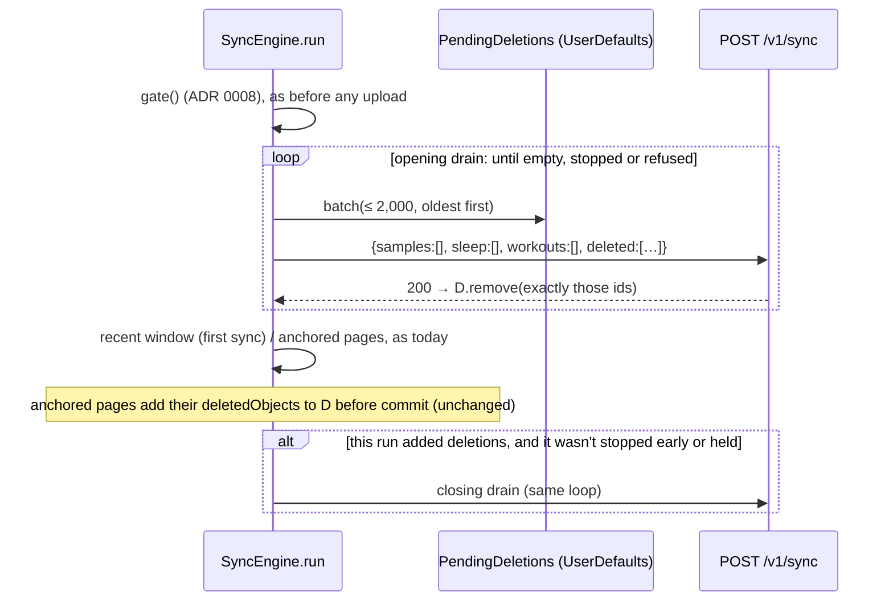

# Data quality: architecture note (ticket A)

Author: ios-architect, 2026-10-31, from `origin/main` 69ca9ad (app) and plattform `origin/main` 7f0f8db.
Inputs: `brief.md`, `plan.md`, `d3b-audit.md` (ticket C), `design.md` (ticket B, read only), the platform brief
`../plattform/CLAUDE_FOLLOWUP_DATA_QUALITY.md` (Q1, Q3, Q5), `../plattform/docs/API.md`. ADR drafted with this note:
`docs/adr/0011-sync-request-additions-behind-remote-flags.md`.

Sections: §D1 deletions and HealthKit ids (gated), §D4 source detection, §D3b one owner for "this day is being scored".

---

## §D1 · Deletions and HealthKit ids (gated on the changelog "Deletions and HealthKit ids")

### D1.0 Problem and constraints

- Garmin Connect rewrites workouts (and sometimes sleep) under new HealthKit UUIDs and deletes the old ones. The app
  already collects `deletedObjects` (`PendingDeletions`, `Sync/SyncService.swift`, at most 2,000 per stream, kept per
  account in `UserDefaults`). It has nowhere to send them. Samples and sleep segments go up without their UUID.
- The platform will add `Sample.id`, `SleepSegment.id`, `SyncRequest.deleted: [{kind, id}]`,
  `SyncResponse.deleted` and `ignored.deleted.unknown_id` (brief Q1). Nothing is in `API.md` yet. So nothing below is
  built or mirrored before the changelog entry exists (plan, lead decision 1). The Swift names come from `API.md`'s
  Swift mirror on that day. The names used here are placeholders.
- Keep the sync design: anchored reads, page, upload, then commit the anchor. Uploads stay off the main actor
  (`SyncEngine` is an actor; encoding is `@concurrent`). Every upload passes the consent gate (ADR 0008).

### D1.1 The platform's decoder rejects unknown request fields (the key finding)

`POST /v1/sync` decodes strictly. A `deleted` key or an `id` on a sample sent to today's platform makes the **whole
page fail with `400`**:

| Where | What |
| --- | --- |
| `backend/cmd/ingest/main.go:170-172` | the sync handler decodes with `httpx.ReadJSONStripNUL` and answers errors with `httpx.WriteDecodeError` |
| `backend/internal/httpx/httpx.go:139-143` | `ReadJSONStripNUL` calls `dec.DisallowUnknownFields()`. In `encoding/json` this applies to nested structs too, so it covers `samples[].id` |
| `backend/internal/httpx/httpx.go:156-167` | `WriteDecodeError`: anything other than oversize, NUL or raw JSON is `400 "bad json: …"` (here `json: unknown field "deleted"`) |
| `backend/internal/model/model.go:61-78`, `:129-137` | `Sample`, `SleepSegment` and `SyncRequest` have no `id` and no `deleted` |
| `docs/API.md:55` | Conventions: "Request bodies reject unknown fields (`400`)" |

On the app side, a `400` on a page isn't retried. `SyncCoordinator.uploadWithBackoff` retries only transport errors and
5xx, and the anchor stays uncommitted. **Every sync would fail on the same page, forever.** The mock platform can't
catch this: `MockPlatformAPI.sync` decodes with Swift's lenient decoder, which ignores unknown keys. So the
capability gate isn't a nicety. It is what stands between this feature and a sync outage.

### D1.2 Capability gate: options and choice

| Option | For | Against |
| --- | --- | --- |
| **A. Remote flag `sync.deletions` in `GET /v1/config`** (precedent: `sync.gzip`, `Seams.swift:121-123`, `API_REQUESTS.md` → Sync and performance §1) | The platform flips it when its **deploy** is live. In plattform, `API.md` merges before the image deploy (separate `deploy: images` PRs), so the changelog date isn't the deploy date. It can be turned off on a rollback without an app release. Rollout by allow-list or percentage, so testers first on a write path over user data. The app's code can ship dark in any release after the changelog. Flags are cached per account, so background runs see the same answer (`ARCHITECTURE.md` §8). | The platform adds one flag row and one line in `API.md`. Until the first `/v1/config` answer, the compiled default (off) applies, so the old shape is sent. That is safe. |
| B. Compiled gate, flipped by the PR that mirrors the changelog | No platform work. | Couples the feature to App Store and TestFlight latency. A build already out there can't be turned off when the platform rolls back. A TestFlight build pointed at an environment that isn't deployed yet breaks its sync. "Changelog merged" isn't "deployed" (above). |
| C. Probe: send the new shape, fall back on `400` | No flag at all. | Every page of every sync costs a `400` plus a resend against an old platform, and it pollutes the platform's error rate and `400` logs. It also hides a real `400`. |
| D. A version or capabilities field in `/v1/config` | A general mechanism. | Invents a field. That is a contract decision for the platform, and it is more than this needs. |

**Choice: A, plus B's discipline, plus a narrow fallback.**
- The code lands only after the changelog entry. It sends the new shape only while `sync.deletions` is on.
- While it is on, a `400` to a request that carries the new fields gets that request sent once more in the old shape,
  and the old shape is used for the rest of the run, exactly as `sync.gzip`'s `gzipRefused` works
  (`SyncService.swift`, `SyncEngine.send`).
- One flag covers both halves (record ids and `deleted`): they are one changelog entry and one ingest deploy.
- This becomes the rule for every future request-side addition to `POST /v1/sync`: ADR 0011.

**What the platform must provide:**
1. The flag key `sync.deletions` (default off), turned on per environment only after the ingest deploy that takes the
   fields is live there.
2. Ingest accepts the fields **whatever the flag says**. Unlike `train.import`, the flag is only the app's signal. A
   phone with a stale cached "on" must not be refused.
3. The days a deletion touched in `days_touched` and `scoring.queued_days`, so the app's scoring wait and refresh cover
   them.
4. On a natural-key duplicate where the stored row has no `hk_id`, set it (`… DO UPDATE SET hk_id = EXCLUDED.hk_id
   WHERE hk_id IS NULL`). Otherwise every sample stored before D1 can never be deleted by id, even when the app re-sends
   it with its id (Sync last 3 days again, a full re-sync).

**The line to add under `docs/API_REQUESTS.md` → Sync and performance §2** (the same form as §1's "How the app learns
it"):

> - **How the app learns it:** the flag `sync.deletions` in `GET /v1/config` (an open key; the app's compiled default
>   is off). Please add it, off, and turn it on in an environment only once the ingest deploy that takes `deleted` and
>   the record `id`s is live there. Ingest should take the fields whatever the flag says (the flag only tells the app
>   when to send them). While it's on, the app sends `Sample.id`, `SleepSegment.id` and `SyncRequest.deleted`. On a
>   `400` to a request that carries them, it sends that request once more without them and uses the old shape for the
>   rest of that sync. Please also: list the flag in API.md → `GET /v1/config` → Shipped with; include the days a
>   deletion touched in `days_touched` / `scoring.queued_days`; and fill `hk_id` on a stored row that has none when a
>   record with an `id` matches it on the natural key, so rows stored before ids existed become deletable.

### D1.3 The drain

**Where.** In `SyncEngine` (the actor). This is a drain step inside `run`, not a new type or layer. `SyncService.run`
reads `env.flags.isOn(.syncDeletions)` once into `SyncEngine.Context` (a new `Bool` beside `gzip`). The engine never
reads flags.

**When and in what order.**



1. **Opening drain**, at the start of every run that passes the gate. It comes after `gate()` and the policy read,
   and before the recent window and the anchored pages. A rewritten workout's old id is then gone before any page of
   this run goes up.
2. **Deletion requests carry no records.** Each is a `SyncRequest` with three empty arrays and `deleted` filled. The
   brief describes piggy-backing deletions on the first page. Separate requests are chosen instead:
   - The page's `413` halving stays about records.
   - "Removed after the `200`" is about exactly one request.
   - A refused deletion can never cost a page of data.
   - "A run with deletions and no new data still syncs" holds by construction.

   The cost is one small request per run, and only while deletions are pending: 2,000 ids are about 110 KB of JSON
   before gzip.
3. **Batches of ≤ 2,000, oldest first.** Each stream's list is already in insertion order, so oldest first. Streams
   are taken in `HealthStore.streams` order. Each `200` removes its ids, so the whole store drains in at most
   `streams × limitPerStream / 2,000` requests: 10 at today's bounds. That needs no per-run cap. Between batches the
   drain checks `Task.checkCancellation()`, `stopRequested` (going to the background) and `gate()`.
4. **Closing drain.** Anchored pages keep adding deletions before their commit, as today
   (`deletionsAreKeptBeforeTheAnchorMoves`). When this run added any, the same loop runs once more after the pages. A
   Garmin rewrite then leaves the platform in the same run. It doesn't wait for the next delivery, which can be hours
   away. It is skipped when the run stopped early, was held at a gate, or found HealthKit locked. The next run's
   opening drain takes them.
5. **Kind mapping** from the store's key (`HealthStream.anchorID`): `"sleep"` is `sleep`, `"workouts"` is `workout`,
   and a `SampleType` raw value is `sample`. A key no stream knows (a type removed in a later build) is dropped with a
   log line.
6. **Removal only after a `200`.** `PendingDeletions.remove(_ ids:)` removes exactly the ids that request carried, as a
   set difference, not a prefix. Ids added meanwhile survive. `state.pendingDeletions` is updated from the result.
   `ignored.deleted.unknown_id` (already gone, or uploaded before ids existed) is a success: the ids are removed, and
   the count is logged and kept in `SyncEngineState` for Sync details.
7. **Days.** A deletion response's `days_touched` join `touched` like a page's (`touched.formUnion`), so the
   coordinator waits for scoring and refreshes the days. Platform ask 3 covers this.

**Answers that aren't `200`:**

| Answer to a deletion request | What the engine does | Ids |
| --- | --- | --- |
| `400` (a capability mismatch: a stale flag, a platform rollback) | sets `newShapeRefused` for the run: no more deletion requests, and pages go up without ids. Logs it once (`notice`, request ID, no ids) | kept |
| `413` (practically impossible at about 110 KB) | halves the batch, down to 100, and tries again; at the minimum it stops the drain for this run and logs it | kept |
| `422` (the platform validated and refused this batch) | drops **this batch**, logs it with the request ID, and goes on with the next. Kept, a poison batch would sit at the head of the queue (oldest first) and block every later deletion. Losing these few is the pre-D1 status quo, and the platform's same-source fold (Q2) is the safety net | batch dropped |
| `403` with a `code` (consent or invite) | the same as a page: `error.gate` ends the run as `pausedFor`, nothing is committed (ADR 0008) | kept |
| `401` | `APIClient`'s refresh-once, then the sign-out path, as for pages | kept, wiped with the account |
| `429`, `503`, other 5xx, transport | `APIClient` has already honoured `Retry-After`. The drain stops for this run, and the pages go on (they fail the normal way if the platform is really down) | kept |
| cancellation | rethrown | kept |

**A page with ids that answers `400`** while the flag is on: send that page once more with the ids stripped, and set
`newShapeRefused` for the rest of the run. A second `400` is a real error and fails the run as today. This is the
brief's "send the page once more without them". It matches `send(_:gzip:)`'s fallback and composes with it: gzip is
decided first, then the shape.

**"Never block a sync on deletions"** holds: no row above fails the run, except a gate, a final `401` and
cancellation, and those would have failed the run anyway.

### D1.4 Ids on `Sample` and `SleepSegment`

- **Wire mirror** (api-contract-keeper, on the changelog day, names from `API.md`): `var id: UUID? = nil` on `Sample`
  and `SleepSegment`; `var deleted: [DeletedRecord]? = nil` on `SyncRequest`; `SyncResponse.deleted` and
  `ignored.deleted` decoded if present. Synthesized `Encodable` uses `encodeIfPresent`, so `nil` leaves the key out.
  Include a fixture test from `API.md`'s example.
- **Page builder** (`Health/HealthKitManager.swift`): `quantityPage` maps `id: s.uuid`, and `sleepPage` maps
  `id: s.uuid`. Workouts already carry `w.uuid`. `lastNight` and Check sync build `SleepSegment`s that are never
  uploaded, so they stay without an id. Move the two record mappers into `static func`s, as `map(workout:)` already is.
  A unit test can then build an `HKQuantitySample` or `HKCategorySample` without a store and check
  `mapped.id == sample.uuid`.
- **Health doesn't know about the platform.** The mapper always fills the id. When `Context.sendsHealthKitIDs` is off
  (flag off, or `newShapeRefused`), `SyncEngine` strips the ids from the delta before building the `SyncRequest`. That
  happens in the `@concurrent` encode step (one copy of up to 20,000 structs, never on the main actor).
  `Self.withoutOwnWorkouts` already sits at that point. No `HealthStore` signature changes.

### D1.5 The comment on re-creation, and an orphan window it must not hide

Put this comment above `drain(.recent(since:), …)` in `SyncEngine.run`:

```swift
// Deleted copies can't come back (D1). Every read here returns only what Apple Health holds at that moment: the first
// sync's `recentDays` window, the anchored backfill, "Sync last 3 days again" and a full re-sync. HealthKit never
// reuses a UUID, so an id queued in `PendingDeletions`, or already sent in `deleted`, can't reappear in a later page.
// The recent window starts without an anchor, so it reports no `deletedObjects`. Its anchors are never committed.
// Not covered: a record the recent window uploaded and Apple Health deleted before this account's first anchored
// read. That read starts without an anchor too, so HealthKit never reports the deletion, and the copy stays on the
// platform. The platform's same-source fold catches it for workouts.
// Another phone on the same account may still upload a copy its own Health store holds until iCloud removes it. That
// phone's anchored read then reports the deletion, so the platform converges.
```

The brief says the recent path is "safe". It is safe against **re-creation**, but it has the **orphan window** named
in the comment above. A record uploaded by the first sync's recent window and deleted before the first anchored
backfill read is never reported. The backfill often runs minutes or hours later (`BGProcessingTask`).
- For workouts, Q2's same-source fold covers it.
- For sleep, a rewritten night would leave duplicate segments from one source, and that inflates sleep.

Follow-up, not in T4: keep each stream's last recent-window anchor until that stream's first anchored page commits.
Then run one date-bounded anchored query from it, only to collect `deletedObjects`. That is one extra query per stream,
once per account.

### D1.6 Tests (test-engineer; new file `RyftTests/SyncDeletionsTests.swift` unless noted)

Mock platform (`Environment/PlatformAPI.swift`, `MockPlatformAPI`):
- `refusesNewSyncFields`: answers `400 "bad json: json: unknown field …"` to a body with `deleted` or a record `id`, as
  the strict decoder does.
- A minimal record table: workouts upserted by `id`; samples and sleep by natural key plus `id`; deletions applied by
  kind and id, with unknown ones counted.
- A scripted answer per request, for `413`, `422` and `503` on deletion requests.

| Test | Proves |
| --- | --- |
| `recordsCarryTheirHealthKitUUID` (static mappers on hand-built `HKQuantitySample` / `HKCategorySample`) | ids on records |
| `withTheFlagOffTheBodyHasNoDeletedKeyAndNoRecordIDs` (byte-level: the encoded JSON has no `"deleted"` and no `"id"` inside `samples` / `sleep`) | the regression guard for the strict decoder |
| `theDrainGoesFirstOldestFirstInBatchesOfTwoThousand` (2,500 sleep + 100 workout ids pending, then a page) | order, cap, before the pages |
| `idsLeaveTheStoreOnlyAfterTheirRequestAnsweredOK` (`503`, then `200`; ids added meanwhile survive) | removal after `200` |
| `unknownIDsCountAsDone` | `unknown_id` is fine |
| `aRunWithDeletionsAndNoNewDataStillSyncs` | an empty-records request goes out |
| `aGarminRewriteLeavesOneWorkout` (run 1 inserts A; run 2's page inserts B with `deleted: [A]`; the closing drain) | one workout on the mock platform, in the same run |
| `aRefusedShapeFallsBackForTheRestOfTheRun` (`refusesNewSyncFields`) | drain skipped, the page re-sent without ids, the run succeeds, ids kept |
| `aPoisonBatchIsDroppedAndTheNextOneGoes` (`422`) | no head-of-line block |
| `anOversizedDeletionBatchIsHalved` (`413`) | halving, ids kept at the minimum |
| `deletionsWaitBehindTheConsentGate` (in `ConsentGateTests.swift`) | ADR 0008 holds for deletions |
| `aBackgroundStopSkipsTheClosingDrain` (in `EnvironmentTests.swift`, beside the existing deletion tests) | `stopRequested` |
| `deletionDaysJoinTheTouchedDays` (in `SyncCoordinatorTests.swift` through `LiveSyncSteps`, or at engine level) | the wait and refresh cover deleted days |

Reviewers: security-privacy-reviewer for the write path; performance-profiler for the extra request and the strip.

---

## §D4 · Source detection

### D4.0 What exists already, and what is new

Check sync already does most of this, and D4 reuses it. It doesn't add a parallel stack:
- `HealthStore.newestSamples(of:since:)` runs one `HKSourceQuery` per type, then each source's newest record, its
  device model and (for sleep) whether it has stages. It skips RYFT's own records (`Environment/HealthStore.swift`).
- `HealthProbe` (an actor) runs it off the main actor, with signposts.
- `MockHealthStore.samples` and `SyncCheckScenario` (`garminLike`, `appleWatchLike`; `Preview/MockData.swift`)
  script it for demo, previews and the simulator.
- `TrackerCheckRules.seen` maps sources to catalog trackers.
- `TrackerCatalog.match` and `displayName` name the sources.

New in D4: a 7-day window, counts, the result type the Sources screen and the wizard consume, the precedence of the
platform's numbers, and the pre-selection.

### D4.1 Queries: options and choice

| Option | Cost at screen open | Gives |
| --- | --- | --- |
| **a. `HKSourceQuery` per type + the newest record per source** (the existing `newestSamples` with `since = now − 7 d`) | 8 source queries (`TrackerCheckRules.streams`), concurrent per type, then one limit-1 query per (type, source) in sequence (sleep: 200). Upper bound with S sources per type: 8 + 8S queries and 7S + 200S objects. With S = 6: 56 queries, about 1,250 small objects | presence, last seen, device, stages |
| b. Exact counts by fetching every record of 7 days | an Apple Watch writes thousands of heart-rate and active-energy samples a day: roughly 50,000–100,000 objects, seconds and tens of MB | exact counts |
| c. `HKStatisticsCollectionQuery` with `.separateBySource`, daily | 6 quantity queries, computed in `healthd`; sleep and workouts need sample queries anyway | days with data per source; no record counts (`HKStatistics` has none) |
| **d. Bookkeeping in the anchored reads** (the brief's suggestion) | none at screen open: a counter increment per record at commit, inside `SyncEngine` | records per (source, type, day) that RYFT read and the platform accepted |

**Choice: (a) for presence, plus (d) for counts.** No new HealthKit query type.
- (a) is what Health holds now, and it is the truth for "detected" (chips, warning A, the pre-selection).
- (d) answers the design's "5,312 samples" for free, and it is the same fact `samples_7d` will report from the other
  side: what reached RYFT.
- (b) is too heavy for a screen open, and (c) can't give the number the design shows.

**The tally (d), precisely** (sync-engineer, `Sync/SyncService.swift`):
- `SyncEngineState.sourceTally: [sourceKey: [anchorID: [day: Int]]]`. `sourceKey` is `sourceBundleId`, else
  `"name:" + source`, as in `SourceFreshness.newestPerSource`. It also keeps `tallySince: Date?`.
- It is counted when an anchored page **commits**. A page re-read after a `413` or a crash is then never counted twice.
  The recent window and "Sync last 3 days again" don't count, because the backfill re-sends their records.
- It is pruned to the last 8 local days on every save, and reset with the anchors (`resetAnchors`, a full re-sync). The
  re-read then fills it again.
- **It covers the window** once `tallySince ≤ now − 7 d`, or once a backfill that started from no anchors has finished
  with the tally on. Until then the count is `nil`: an account that synced before this build gets no number for its
  first week, rather than a low one.
- Known limit: deleted records stay counted (their source and day are unknown). After D1 these are few.

### D4.2 Where it runs, and isolation

- `HealthProbe` gets a second entry point, `sources(since:) async throws -> SourceDetection`. It calls `run(...)` (the
  existing reads, `visibleTypes` included for the "maybe denied" state) and then the pure builder below. Same actor,
  same signposts (a `"sources"` interval). There is no new actor.
- `SourceDetection.build(samples:visible:tally:received:catalog:now:)` is `nonisolated static` and pure. It is tested
  like `TrackerCheckRules`. File: `Ryft/Health/SourceDetection.swift` (a new file in a synchronized folder; no project
  edit).
- The screen's model (`SourcesModel`, `@MainActor @Observable`, ios-developer) holds a phase and the last result, like
  `TrackerCheckModel`: `idle`, `running`, `done`, `notAsked`, `unavailable`, `locked`, `failed`. The tally is read from
  `SyncService.engineState` (already on the main actor). `User.sources` is read from `AppState.user`.
- **When it runs:** on the screen's appearance and on pull to refresh, in the foreground only. Never at launch, in the
  background or from a BG task, as design.md §10 says for Check sync. Results are never persisted.
- **Cost bound:** (a)'s bound above; the target is under 300 ms typical and under 1 s p95 on a device. The
  performance-profiler measures it from the `sources` signpost. Nothing touches the main actor but the result
  assignment (`MainThread.assertOff` inside, as in `newestSamples`).

### D4.3 The seam for demo, previews and the simulator

- **No new protocol.** `HealthStore` is the seam, and its `newestSamples` / `visibleTypes` are already scripted by
  `MockHealthStore`.
- **One place picks the store.** Extract `TrackerCheckModel.make`'s choice into a shared function, for example
  `HealthProbe.store(env:trackers:)`:
  - demo mode: the `SyncCheckScenario` store (`garminLike` by default when Garmin is picked, else `appleWatchLike`);
  - otherwise: `env.health`.

  Both models call it, so the Sources screen never reads this phone's Health in demo.
- `MockHealthStore` needs nothing new for detection. The tally comes from `SyncEngineState`, which tests set
  directly. Demo shows the scenario's sources without counts, or with fixed counts from `MockData` if the design wants
  them; that is a design call.
- **The simulator test can't seed a Garmin source into real HealthKit.** HealthKit attributes every sample an app saves
  to that app, and RYFT drops its own source anyway. The plan's "seeded HealthKit data" must therefore be:
  - the scripted `MockHealthStore.garminLike` (HR and sleep, no HRV), in unit tests;
  - in the simulator, a UI test in demo mode with `-RyftSyncCheck garmin`.

### D4.4 The result type the UI consumes

```swift
struct SourceDetection: Equatable, Sendable {
    let window: DateInterval                // the last 7 days
    let at: Date
    let sources: [DetectedSource]           // newest first; RYFT's own excluded
    let visible: Set<HealthStream>          // `visible.isEmpty` → "maybe RYFT can't read" (design.md D4.4 state 5)
    /// Catalog trackers seen, picker order; the iPhone only when nothing else; never "Other" (pre-selection).
    var trackerIDs: [String]
    /// Picked trackers with nothing in the window (warning A); picked trackers writing HR but not HRV (note B).
    func silent(among picked: [Tracker]) -> [Tracker]
    func withoutHRV(among picked: [Tracker]) -> [Tracker]
}

struct DetectedSource: Identifiable, Equatable, Sendable {
    let ref: SourceRef                      // name, bundle id, device model
    let displayName: String                 // TrackerCatalog.displayName(ref)
    let trackerID: String?                  // TrackerCatalog.match(ref)?.id → the glyph (Tracker.form)
    let signals: [TrackerSignal: Date]      // newest per signal in the window; sleepStages when a night has stages
    let lastSeen: Date
    let count: Count?                       // nil: nothing that covers the window
    let received: Received                  // what the platform says it has from this source

    enum Count: Equatable, Sendable { case phone(Int) /* the tally */ /* , platform(Int) once samples_7d exists */ }
    enum Received: Equatable, Sendable {
        case unknown                        // no `GET /v1/me` yet, or offline
        case kinds(Set<SourceKind>, lastSeen: Date)   // User.sources (30 days)
        case none                           // User.sources lists other sources but not this one
    }
}
```

- Chips use `TrackerSignal` (the catalog's vocabulary), so note B compares directly with `tracker.capabilities[.hrv]`.
- `trackerIDs` reuses `TrackerCheckRules.seen`, which gains a `since:` parameter in place of its 48 h constant. One
  function then maps sources to trackers for both screens.
- Matching to `User.sources` is by `bundle_id` (Apple devices have one per device, `com.apple.health.<uuid>`), and by
  name only when either side has no bundle id.

### D4.5 How `User.sources[].samples_7d` takes over later (seam only, no field)

- Today `UserSource` is `name`, `bundle_id`, `kinds`, `last_seen` (`model.go:100`, `Models.swift:1014`). Nothing is
  added before `API.md` has `samples_7d`.
- **One function changes when it lands:** `SourceDetection.build`'s count rule. Today the count is the phone's tally
  when it covers the window, else `nil`. Then it becomes the platform's `samples_7d` total when the source has one,
  else the tally, else `nil`. `Count` gains its `platform` case at that point, and not before. The UI shows a number
  either way. The design's footer says which window it is.
- **The mismatch note (design.md note C)** compares HealthKit's presence (`signals`) with what the platform received.
  The design ties it to `samples_7d`. Note for the lead: the existing contract can already support a weaker,
  false-negative-only version of it. If Health has HRV from Oura in the last 7 days and that source's `kinds` (30
  days) lack `hrv`, RYFT has certainly not received any. `Received.kinds` carries what's needed. Whether to show C
  before `samples_7d` is the design's call (open question 4).

### D4.6 The wizard's pre-selection

**Constraint.** "What do you wear?" (`OnboardingCoordinator.Step.wear`) comes before Apple Health access on the first
run (`missing(_:)`, `HealthPermissionView.swift:87`; RootView routes `flowStep`, then `needsHealthIntro`, then
`showsTrackerSetup`, `RyftApp.swift:486-493`). At a true first run there is nothing to read. design.md D4.5 reaches the
same conclusion.

**Where the detected set enters.**
- `OnboardingCoordinator.detected: [String]?`: catalog tracker ids. `nil` means not run or not known; `[]` means
  nothing found. It lives in memory and is never persisted. Nothing is saved on detection alone: Confirm calls
  `answerWear`, as today.
- `OnboardingCoordinator.detectTrackers() async`. It runs only when `health.accessStatus() == .asked` and not in demo.
  It **never requests authorization**. It calls `HealthProbe(...).sources(since: now − 7 d)` and stores `trackerIDs`.
  Errors, a locked phone or `.notAsked` leave `nil`. It is called from:
  1. `TrackerPickerView.task`: on a re-install or a second account (Health is already granted), and from Profile →
     Devices & sync → Edit (`TrackerPickerSheet`);
  2. `HealthOnboardingViewModel` when it enters `.firstSync`, so the tracker setup step can offer what wasn't picked
     (design.md row 36).
- `TrackerPickerView` seeds its `@State picked` from `detected` **once, and only while the user hasn't touched a
  tile**. A selection never changes under a finger. The design's "detected, not confirmed" tile state is view state
  over that seed.
- **Nothing found, not authorised or failed:** the step is exactly today's (free choice, Continue disabled until a
  pick). No message about detection, because there is nothing honest to say yet. The Sources screen has the states for
  that.
- **`showsTrackerSetup` is unchanged.** The "RYFT also found Oura. Add it?" offer appears only inside a setup step that
  is shown anyway, so no screen pops in after the tabs appeared. A user who skipped "What do you wear?" and has a
  detected Garmin meets it in Devices & sync → Sources and in Today's provenance line. Open question 3 covers routing
  them to the setup step instead.

### D4.7 Per-metric pinning (M6b)

There is no code and no model field. The seam is the row: `DetectedSource.signals` is per metric, so a later "Use for"
disclosure can read it (design.md D4.6).

### D4.8 Tests

| Where | Test |
| --- | --- |
| `RyftTests/SourceDetectionTests.swift` (new, pure) | `aGarminLikeSourceWithHeartRateAndSleepButNoHRVGetsTheNoHRVNote`; `aPickedTrackerSilentForSevenDaysIsListed`; `theIPhoneOnlyWhenNothingElse`; `ryftsOwnSourceIsNeverDetected`; `namesComeFromTheCatalog`; `countIsNilUntilTheTallyCoversTheWindow`; `receivedMatchesByBundleIDThenName` |
| `RyftTests/EnvironmentTests.swift` (the engine suite) | `theTallyCountsAtCommitOnlyAnchoredOnlyAndResetsWithTheAnchors`; `aRereadPageIsNotCountedTwice` (`413`) |
| `RyftTests/ViewModelTests.swift` | `sourcesRunOffTheMainActor` (`MockHealthStore.readsOnMainThread == 0`); `demoNeverReadsThisPhonesHealth`; `notAskedShowsAllowAccessAndReadsNothing` |
| `RyftTests/ViewModelTests.swift` (onboarding) | `theWearStepPreselectsWhatIsDetectedWhenAccessWasGranted`; `notAskedPreselectsNothingAndNeverPrompts` (`authorizationRequests == 0`); `aTouchedSelectionIsNeverOverwritten` |
| `RyftUITests` (UISmoke, demo, `-RyftSyncCheck garmin`) | the Sources screen shows the Garmin row with the no-HRV note |

---

## §D3b · One owner for "this day is being scored"

The audit (`d3b-audit.md`) is right about the paths and the gaps:
- G1: between the upload and the first poll, the hero shows the pre-upload state.
- G2: a foreground run that sent nothing never waits for days the platform still scores.
- G3: a silent push lands the row but leaves a stale `pending` behind.

Its three fixes are each correct locally. They would put the same fact in three places, though:
- G3 **rewrites `AppState.syncStatus`**, so the platform's last answer would be partly fabricated;
- G1 adds `SyncService.awaitingDays`;
- `TodayStates` and the widget (`Repository.swift:515`) each merge them.

### The invariant

> From the moment the platform **accepts a write that touches day d**, the app treats d as being scored, on every path,
> foreground or background, on Today and in the widget alike. A write here is an accepted sync page whose
> `days_touched` holds d, an accepted deletion, or a `daysChanged` (activity, night, training import). It stays that
> way until the platform's word arrives: a **silent push naming d**, or a **`GET /v1/me/sync` requested after the
> write** that doesn't list d. Once the platform has said d is scored, **no answer requested before that word** makes d
> pending again. A day that has a readiness keeps showing its score while it is rescored (row A; D2's provisional state
> covers the half night).

"Requested after" compares two phone-clock times, never the phone's clock with the server's. The platform caches
`GET /v1/me/sync` for 10 s per user (audit, G3). So "after" means requested at least that long after the local word.
The platform should confirm that value or invalidate the cache on ingest and on scoring (open question 6).

### Where it belongs: `SyncService`, written only by the coordinator's steps

- **The fact is client sync state.** It is "I wrote d at t and haven't heard since", and the push's "the platform said
  d is scored at t". It isn't the server's answer, so it doesn't belong in `AppState.syncStatus`. That stays the raw
  last answer, with one owner: the read.
- **`SyncService` already owns the neighbouring facts** (`scoringWaitStart`, `statusReadAt`, `receive(_:)`). It is
  `@MainActor @Observable`, so Today and the widget's publisher observe it without new plumbing.
- **The coordinator is the only place that sees every write path, the push included.** It records through
  `SyncSteps`, so the coordinator's tests pin it on `FakeSteps` and `TestClock`.
- **The Today view model keeps no per-path logic.**

### The shape

- **`SyncService.scoringLedger: [day: (word: .pending | .scored, at: Date)]`.** It is in memory only. It is cleared by
  `accountChanged()` and by a sign-out wipe. A relaunch starts from the platform's word and G2's poll.
- **Two new steps**, recorded via `LiveSyncSteps`:
  - **`SyncSteps.awaiting(_ days:)`** is called by the pipeline right after an upload or a `daysChanged` that touched
    days, **in the background too**. This is the audit's G1, plus background runs: the foreground return then already
    shows "Scoring your night…".
  - **`SyncSteps.scored(_ days:)`** is called for a silent push, both where it ends a wait (`run`, `:162`) and in its own
    pipeline (`:344`), before the refresh (G3).
- **`receive(status, requestedAt:)`** drops a ledger entry once a status read requested at least the cache time after
  the entry has answered. The answer is then the platform's word, whatever it says. `ReadScheduler` knows when a flight
  started, and it passes that time through the `store:` closure.
- **One pure function**, `ScoringWord.state(day:status:ledger:row:)` (in `Sync/`), replaces the bodies of
  `TodayStates.todayState` (`TodayViewModel.swift:859`) and the expression at `Repository.swift:515`. A newer ledger
  entry wins over the status; otherwise it is the status if it is about d, else the row. `LiveSyncSteps` hands the same
  ledger entry for today to `Repository` when it records it, so the widget can't disagree.
- **G2 stays where the audit put it**, in the coordinator's `touched.isEmpty` branch (`SyncCoordinator.swift:376`).
  That branch decides *when to ask*, not *what is true*: in the foreground and outside demo, ask the status, and when
  it lists days, wait for and refresh them as a `daysChanged` does. Also keep `scoringWaitStart` when `receive` set it
  first (the audit's note).

### Files: one writer, sync-engineer

- `Ryft/Sync/SyncCoordinator.swift`:
  - `SyncSteps` gets `awaiting(_:)` and `scored(_:)`;
  - the pipeline calls them;
  - the G2 branch;
  - `LiveSyncSteps` implements them and passes `requestedAt`.
- `Ryft/Sync/SyncService.swift`: `scoringLedger`, `receive(_:requestedAt:)`, `ScoringWord`, and `entered` keeping a
  first-sighting start.
- `Ryft/Persistence/Repository.swift` (`ReadScheduler`, where `store:` is called): it hands the flight's start time to `store:`.
  Check this before assigning. If the scheduler can't expose it, `LiveSyncSteps` takes the time it asked, which is
  slightly later and therefore safe.
- `Ryft/Features/Today/TodayViewModel.swift`: `todayState` calls `ScoringWord.state`, one line. It is also T1's file,
  so plan lead decision 2 applies: T2 merges after T1.
- `Ryft/Persistence/Repository.swift` again: `widgetFacts` calls the same function.
- Tests: the audit's `TodayPendingPathTests` (`RyftTests/ViewModelTests.swift`) and its five coordinator tests
  (`RyftTests/SyncCoordinatorTests.swift`, `FakeSteps` records `awaiting` and `scored`). Add
  `aStatusRequestedBeforeThePushCannotMakeTheDayPendingAgain` and `theLedgerIsEmptyAfterAnAccountChange`.

---

## What could go wrong

- **A flag on before the deploy** (operator error): the first page `400`s, the fallback re-sends it in the old shape,
  and one `notice` is logged per run. Sync keeps working, but deletions wait. Copy diagnostics should show
  `newShapeRefused` so support can see it.
- **A flag cached "on" after a rollback:** the same, until the next `/v1/config` (≤ 6 h).
- **Sleep orphans in the first-sync window** (D1.5): the follow-up anchor sweep closes it.
- **`more` versus deleted objects.** `HKAnchoredObjectQuery`'s limit may count deleted objects too (Apple's
  documentation says "samples and deleted objects"; verify on a device). If it does, a page full of deletions reads as
  the stream's last page (`more: addedSamples.count >= limit`), and the rest waits for the next run. Nothing is lost.
  The fix is `added + deleted >= limit` in the three page functions.
- **The tally undercounts after an update**, until it covers the window. That is why the count is `nil` until then,
  never low.
- **Ledger versus server cache:** if the platform's status cache is longer than assumed, a pull right after a push can
  briefly show "scoring" again. It is bounded by the next poll, and open question 6 removes it.
