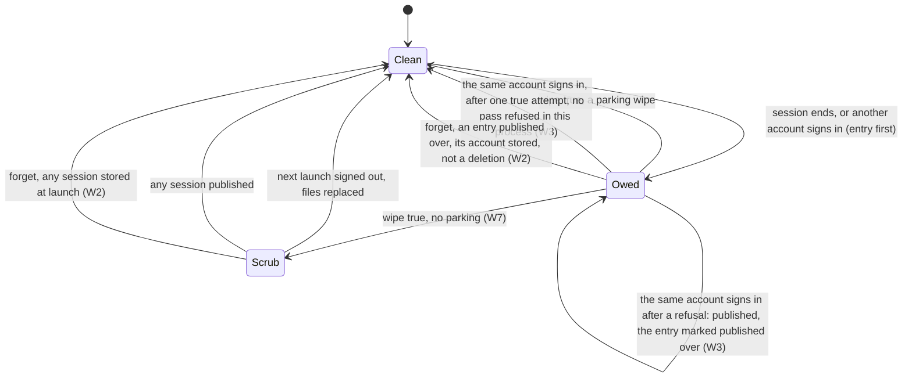

# Sign-out wipe recovery: what happens when a wipe fails or the app dies during one

**Status:** decided; W1 to W3 built. U1 to U3 are answered in §8; U4 and U5 stay open.

Follow-up to #93 (`train: a sign-out deletes session rows one by one`). Designed against `fix/train-wipe-objects`, head
`a669d5b`, not `main`. Values are synthetic. Line numbers are that commit's.

**Sources.** "Proved" means a probe in one of the two security-privacy reviews of #93 (Review 1 on `4ba42a7`, Review 2 on
`cbb6351`), on the iOS 27 simulator. "Read" means from the code. "Assumed" means nobody has checked it. Nothing here has
run on iOS 17 or a device.

## 1. Goal

A wipe that fails or is killed finishes by itself, before any account's data shows, and it can't take a later account's
work. Four outcomes:

1. Account B never sees or uploads a row of account A.
2. A wipe that was started always ends, at the latest on the next launch.
3. A session expiry's parked rows survive recovery, and their 30-day limit never restarts.
4. What the app and the policy say about deletion is true, including the failure cases.

Not a goal: moving the wipe off the main actor, or scoping every read model by account.

## 2. Facts that shape the design

- **The read models have no owner.** `purge(notBelongingTo:)` covers only activities, nights and chunks. `LocalSession`
  and the `Cached*` tables have no account column, so a session published over a failed wipe reads A's rows (Read).
- **A failed wipe poisons the context.** Object deletes stay pending, and the next `save()` by anyone lands them or fails
  with them (Proved). In-process retries are unreliable, and B's rows can sit in the same transaction.
- **A wipe isn't atomic.** Batch deletes commit at once, and object deletes land in the final save. A kill in between
  leaves caches gone and sessions intact (Proved).
- **The SDK drops the Keychain session before `apply(nil)` runs** (`AuthService.swift:601-603`). After a kill, `apply` sees
  no session and does nothing (Read).
- **UserDefaults is the wrong place for a crash marker.** The tracker catalog's guard says so
  (`TrackerCatalogStore.mark`, `Seams.swift:578`).
- **`auth.lastUserID` has readers that assume it's the signed-in user:** the HealthKit anchor keys and the export choice
  (`HealthKitManager.swift:81`, `TrainCoordinator.swift:479`).
- **A live store's bytes outlast the wipe.** Deleted values stay in `Train.store-wal`, and `secure_delete` is FAST, not
  full (Proved). Persistent history is never pruned, and it holds row counts and timestamps but no values (Proved).
- **SwiftData copies an app-container store into an empty group container when it opens** (`OrphanedStoreCleanup`). A
  naive file delete can bring an old store back.

## 3. Options

| | A. Retry the object wipe at launch | B. Scope every table by account | **C. Write-ahead debt, gate, replace the files (chosen)** |
|---|---|---|---|
| Kill | Resumes | Rows stay, hidden | Resumes |
| A permanent refusal (iOS 17 batch delete, full disk, trigger) | Fails on every launch | Hidden, never deleted | File delete doesn't depend on the delete that failed |
| Main thread at launch | Seconds, watchdog risk | None | Milliseconds |
| WAL, free pages, history | Stay | Stay | Gone |
| Parked rows | Kept | Kept | Kept: this path keeps the object wipe |
| Cost | Small | A migration of 12 tables, every read and write touched, no versioned schema | Small: one file, one launch step, one guard in `apply` |

C needs the object wipe only for an expiry, which A alone would already do. B is rejected: its cost is highest, and hidden
rows are still undeleted.

## 4. States and transitions

### Types

```swift
/// `AuthService.Wipe` becomes Codable, and gains `since` and `storeOnly`.
struct OwedWipe: Codable, Equatable {
    var wipe: AuthService.Wipe    // reason, account, `since`; `Wipe.parking` stays the one derivation
    var since: Date { wipe.since } // the first begin; stamped as `parkedAt`, starts the 30-day bound
    var deviceStepsDone = false   // set after the first pass, so a retry runs only the store step
    var scrubOnly = false         // the wipe succeeded; only file residue is left (W7)
    var endsOwnSession = true     // this build never publishes the entry's account over it (W2)
}

@MainActor final class WipeLedger {
    init(file: URL?)              // Application Support/account-wipe.json; tests pass a temp folder; nil is memory only
    var entry: OwedWipe? { get }  // memory first: a full disk can't lose it during this run
    func begin(_ wipe: AuthService.Wipe, at: Date)   // merges, see below
    func update(_ change: (inout OwedWipe) -> Void)
    func clear()
    var forStoreStep: OwedWipe?   // what this launch's `AuthService` resolved, memory only (W2)
}
```

- **Writes:** atomic, `.completeFileProtectionUntilFirstUserAuthentication`, the same class as the Keychain session.
- **`since` lives in `Wipe`** (W1), so `OwedWipe.since` reads it, a retry runs `entry.wipe` as it stands, and I4 needs no
  second copy. W1 also stores `storeOnly`, because W1 builds write the file W2 reads. Nothing sets it before W2.
- **Reading the format:** a missing `storeOnly`, `deviceStepsDone`, `scrubOnly` or `endsOwnSession` reads as false. `since`
  is required. A missing `endsOwnSession` is how a W1 build's entry is told apart (W2).
- **Merging `begin`:** the earliest `since` stays. Anything that doesn't park the same account narrows the entry to no
  parking: a different account, a nil reason, or the same account's `.user` or deletion. A deletion's reason always
  replaces the entry's, for W5's notice. It never widens back. The entry keeps its first account, and a wipe already asked
  for runs as asked: only the date comes from the entry, and only when the entry parks the same account.
- **An entry that can't be read:** no action, and the file stays. Before the first unlock the store is in memory anyway.
  `entry` reads the file again while memory is empty, so it's found after the unlock.
- **Seam:** the file URL is enough. No protocol, because nothing else implements it. `AuthService.shared` is the only
  service with a real file: nil is the default, so previews and tests can't reach the live one.
- **Debug API-key mode** keeps its own unledgered wipe.

### Invariants

- **I1.** While an entry that isn't `scrubOnly` exists, no new session is published, except the entry's own account signing
  in again, which ends the entry. The leaving session stays published only until its own `apply(nil)`, inside the same
  sign-out.
- **I2.** The entry is written before the first destructive step and before the SDK drops the session. Three things remove
  it:
  - A wipe that returned true, once the replace left no files and an interrupted sign-out's `client.signOut()` has run,
    in a process with no refused pass. After a refusal only a later launch's pass can (W3).
  - `.forget` at launch: an entry an account was published over, with that account's session stored, unless it's a
    deletion, or a scrub with any session. No wipe runs. The first is a W1 build's entry, or a return after a refused pass
    (W3): that account's rows are its own.

  A stored session restored at launch isn't a sign-in. Unless `.forget` applies, the entry survives it.
- **I3.** `auth.lastUserID` means only "whose data the store holds". The debt lives only in the ledger.
- **I4.** A retry parks with `at: since`.
- **I5.** Nothing writes to the widget while a debt exists.



### At launch

The store step runs in `static let TrainStore.shared`, before the container opens, so every route to the store passes it.
`AuthService.init` runs first, resolves the entry, and leaves it in `forStoreStep`, the only thing the store step reads.
`AppEnvironment.live` passes `auth: .shared` ahead of `TrainStore.shared` (Read). If that order ever flips, `forStoreStep`
is nil, so the launch falls back to the object wipe and the gate, and the next launch converges.

| Entry | Stored session | Before the store opens | After |
|---|---|---|---|
| none | any | nothing | as today |
| owed, no parking | none | replace files | run the wipe, clear, signed out |
| owed, no parking | another account | replace files | run the wipe, clear, publish it |
| published over (`endsOwnSession` false, or missing in a W1 build's), not a deletion | the entry's account | nothing | clear, publish it: the rows may be live work (W2, W3) |
| owed, no parking | the entry's account | replace files | sign-out was interrupted: run the wipe, `client.signOut()`, clear, signed out |
| owed, parking, within 30 days | none | nothing | object wipe after the first frame, `at: since` |
| owed, parking, within 30 days | the entry's account | nothing | same, and `client.signOut()`; not published |
| owed, parking | another account | narrowed, replace files | run the wipe, clear, publish it |
| owed, parking, past `since + 30 days` | any | narrowed, replace files | as the matching no-parking row |
| `scrubOnly` | none | replace files | clear |
| `scrubOnly` | any | nothing | clear |

- **Replace files** means removing `Train.store`, `-wal`, `-shm` and `.Train_SUPPORT` at the configuration's URL, then
  the app-container orphan through `OrphanedStoreCleanup.run`, reusing its names and `decide`.
- **The wipe always runs after a replace.** If SwiftData copied an orphan back, the object wipe still catches it, and the
  entry clears only on true. A file the replace couldn't remove counts as false whatever the store answers, so the entry
  stays and the next launch replaces again (W2).
- **If the wipe still fails,** the gate below applies.
- **The retry** also runs from the nightly compaction beside `deleteExpiredParked`, so a background-only run can reach it.
  Not after a pass refused in that process: a true answer there proves nothing, and the next sign-in would be published
  over what it left (W3).

### At sign-in (`apply`, the one chokepoint)

| Entry and owner | Action |
|---|---|
| No entry, and `lastUserID` is nil or this account | publish |
| An interrupted sign-out's `client.signOut()` is running | **hold**, with no attempt: the entry stands until the call returns (W3) |
| The entry's own account, in a late `.initialSession` | **hold**: that's an interrupted sign-out the launch couldn't read, and the next launch's table ends it |
| The entry's own account signs in | one attempt with the entry's parking, then publish either way: the rows are its own. A true attempt in a process with no refused pass ends the debt. Otherwise the entry stands, marked published over (`endsOwnSession` false), so the next launch doesn't take this account's live work: stored, it's `.forget`; not stored, its row as usual |
| A pass was refused in this process, and anything else | **hold**, with no attempt, until the next launch |
| Anything else: another account in the entry or `lastUserID`, or an entry that isn't a return | `begin`, wipe with no parking. True: clear and publish. False: **hold** |

An entry naming this account is a return only if `lastUserID` is nil or this account, the entry isn't a deletion's, and it
has `endsOwnSession`. So a debt with no owner left still holds: `publish` reads the entry, not only the id.

**Once a pass has been refused in a process, nothing in that process ends that debt.** A refused save leaves an inserted row
in the context, a batch delete doesn't see it, and the next pass's save answers true and writes it. Only a later launch's
fresh context or replace is proof. So a later true answer is read as false in `settled`, the one place a pass ends an entry:
for SDK events, later sign-ins, the first frame and the compaction alike. That's what "Close RYFT and open it again" asks for.

**Hold** means B's publish is skipped: `publish` throws before `session`, `accountChanges` and the hooks change for B, and the
phase becomes `signedOut`. If A is still published (a deep link signing B in over A), A's session ends first, hooks
included, so a wiped account never stays on screen. `accountID` is then nil, so sync, uploads, flags and reads stay idle
(Read). The SDK keeps B's session in the Keychain, so
the next launch publishes B without another login. Welcome shows the reason through `errorMessage`. No new phase or
screen. After a refused pass the next launch publishes B. A hold with no refused pass, in the two cases above that make no
attempt, ends with B's next SDK event once the debt is gone. The message goes when the debt ends with nobody stored.

## 5. Decisions

The labels need a note: **`docs/STATUS.md` has no S-numbers.** They come from the two reviews, and each review has its own
S1 to S4. The brief's S1 is STATUS's first bullet, which is Review 2's S2. Rather than guess, both sets are covered below.

| Item | Decision | Reason | Ticket |
|---|---|---|---|
| **S1, two owners** (STATUS bullet 1, R2-S2) | Split it. `lastUserID` is the owner, the ledger is the debt. One entry, not a list | I1 means a second account can't accrue a debt while one is open, so a list has nothing to hold | W1, W3 |
| **R2-S1**, the kept key destroys B's work | Fixed by I1 | B has no rows while a debt exists, so a recovery can't take any | W3 |
| **R2-S3**, wipes on every launch | Fixed by the file replace, plus `deviceStepsDone` | A permanent refusal ends on the next launch, and retries stop repeating the anchor reset and the 90-day backfill. This also removes STATUS's iOS 17 loop | W2 |
| **R2-S4**, the notice claims too much | `wipeLeaving` returns the result. On false, Welcome says what's still on the iPhone, for deletion and for a user sign-out. A resumed deletion shows its notice again from the entry | The server half is true, the device half wasn't, and the notice lived only in memory | W5 |
| **R1-S2**, kill mid-wipe | Fixed by I2. A resume reruns every step | Each step is idempotent (Read) | W1, W2 |
| **R1-S3**, log text | Done at `save()`. Other `localizedDescription` sites **deferred** to a separate cleanup | Not a wipe matter, and none was analysed | none |
| **R1-S4**, never-saved rows | See that row below | | W6 |
| **Launch-time marker** | A file in Application Support, written ahead. **Deliberately no inference** from "`lastUserID` set, no session" | A Keychain miss before the first unlock looks identical and would wipe a signed-in user. The price is a window of milliseconds on an SDK-driven expiry, where the data stays until another account's sign-in wipes it | W1, W2 |
| **Sign-in over a failed wipe** | Hold: no session is published until the wipe returns true | Failing closed is the only option that needs no account column. iOS has no supported relaunch, and `TrainStore.container` is a `let` that the whole graph holds | W3 |
| **No-parking chunks outside 30 days** | A retry parks with `at: since`, and past `since + 30 days` the entry narrows to a replace | That bounds rows that carry no `parkedAt`. Exposure today is nil: `Ryft/` constructs no `ActivityTrackChunk` (Read) | W1, W2 |
| **`CachedDay` republished** | `Repository.publishWidget` removes the file instead of writing while a debt exists. `ReadinessSnapshot.clear()` moves ahead of the store wipe | The path is `forgetActivityState` → `tonightBedtime = nil` → `publishWidget` → `widgetFacts` reads the row the wipe left (Read). `session` is still A during `onWipe`, so `isSignedIn` can't guard it, and the ledger can | W4 |
| **Live Activity** | `signOut` awaits an `endNow()` before the SDK call. At launch, `endAll(except:)` keeps nothing unless the app has an account and no debt | `end()` is a main-actor `Task`, so moving it ahead of a synchronous wipe changes nothing. The SDK-driven expiry stays synchronous and relies on launch. If the app is never reopened, ActivityKit ends it (assumed, 8 to 12 h) | W4 |
| **Never-saved rows before A3b** | Before the final save, delete `context.insertedModelsArray` rows of wiped types, keeping what parking keeps. Must merge before A3b | Today's only route is an earlier failed save (Read). Proved on 4 tables, so the batch-only list is wider than activities. It becomes sensitive when A3b adds chunks | W6 |
| **WAL and history** | After a no-parking wipe, the entry stays as `scrubOnly`, and the next signed-out launch replaces the files | A replace is the only step that removes WAL, free pages and history together, and it reuses W2. An in-process A→B switch and an expiry keep this residue (§7) | W7 |
| **Backups** | Excluded (§8, U2): `Train.store` and the ledger leave device backups in W7 | `readiness.json` is excluded "never in a device backup" (`Repository.swift:808`), but `CachedDay` holds the same scores in a store that the activities design §2.4 says is backed up. No wipe reaches an existing backup | W8 |
| **Policy wording** | See §8 | The current text says "at once" and "then deleted" | W8 |
| **Remote flag** | None | Recovery runs before `/v1/config` and while signed out, and a privacy fix shouldn't be switchable off | |

"Deleted" then means, in order:

| Moment | State |
|---|---|
| Wipe returned true | Unreachable through the app, values still in the WAL |
| Next signed-out launch | Files gone. Per-file keys go with them (assumed, Apple's platform documentation) |
| Backups taken earlier | Unchanged, until the user replaces them |

## 6. Tickets

Each is one PR on a branch from `main`, after #93 merges. **W2 and W3 must ship in the same build:** W2 alone leaves B
published over a failure, and W3 alone promises a reopen that can't help. W1 to W3, W6 and W7 get a
security-privacy-reviewer pass. Tests extend `StoreOnDisk` and `WipingAuth`, whose `relaunch` is the kill. `refuseDeletes`
is the failure.

| # | Title | Owner | Depends on |
|---|---|---|---|
| W1 | `auth: a wipe is written down before it starts` | sync-engineer | #93 |
| W2 | `train: an owed wipe finishes before the store opens` | sync-engineer | W1 |
| W3 | `auth: no session over an owed wipe` | sync-engineer | W2 |
| W4 | `today: nothing of a leaving account on the lock screen`, delivered notifications, push registration | ios-developer | W1 |
| W5 | `auth: the notice says what's left on this iPhone` | ios-developer, localization-editor | W1 |
| W6 | `train: a wipe takes rows never saved` | sync-engineer | #93 |
| W7 | `train: a sign-out replaces the store's files` | sync-engineer | W2 |
| W8 | `docs: ADR 0016, architecture, status` | ios-architect | W3, U1, U2 |
| W9 | `auth: a deletion is written down before the DELETE` | not assigned | W1 |
| W10 | `auth: a held Sign in with Apple keeps its authorization code` | not assigned | W3 |

**W1.** `WipeLedger`, `OwedWipe`, a Codable `Wipe`, `begin` in `signOut` before `client.signOut()` and in `apply` before each
wipe. `TrainStore.wipe(_: Wipe)` is the one call and passes `wipe.since`. W1 kept the kept-id code, and the entry's own
account signing in ended the entry with no wipe, except a session restored at launch. W3 replaced both.
- The mock client sees an entry on disk with reason and account when `signOut()` is called, for all three endings.
- True clears the entry. False keeps it, surviving a new `WipeLedger` on the same file.
- Merge: the earliest `since` stays, another account removes parking, and nothing widens it back.
- An unwritable file keeps the entry in memory for the run.
- A retry stamps `parkedAt == since`, and an already parked row keeps its older date.

**W2.** `StoreReset.run(entry:store:orphans:now:)`, pure on a folder like `OrphanedStoreCleanup.run`, called from
`TrainStore.shared`. The launch table in `AuthService.init`. Setting `Wipe.storeOnly`. After a resume, `.task` calls
`screens.bedtime.accountChanged()`, because a kill leaves A's reminders and alarms scheduled and nil → nil fires no
`onChange`.

W2 must also handle what W1 builds leave. A kill between `begin` and the SDK's Keychain delete publishes the account again
and keeps the entry, so that account can work over an entry for weeks, and its rows are then live, not interrupted. The
launch table's "the entry's account" rows read as a fresh interruption and would sign it out and replace the files. Resolve
this before the first W2 build: a deletion's entry must still resume, and a stale `.user` or expiry entry must not take
live work. Until then such an entry dates a later parking of the same account early (§7).

**Resolved: a key in the file, not an age.** W2 builds write `endsOwnSession: true` in every entry. A W1 build never did. An
entry with its own account's session stored then reads as follows:

| Written by | Reason | Path |
|---|---|---|
| W2 or later | any | Interrupted sign-out, the launch table as written |
| W1 | deletion | The same. The account is gone on the server, so nothing under the session can be live work |
| W1 | `.user`, expiry, or nil | Clear the entry, publish the account, wipe nothing |

Why this and not an age: no build publishes an account over an entry and leaves the key set, so with the key the entry can
only be a kill inside the sign-out, however old it is. Without it the account may have worked on for weeks. An age limit would guess
both ways, and it would have to trust the clock. The price is one case: a `.user` sign-out killed in a W1 build's window and
first reopened in a W2 build isn't finished, and the user is still signed in, as that W1 build would have left them. No data
is lost, and the sign-out is one tap.

The key says nothing about another account. An entry with no own session takes its row as usual, whoever wrote it. With the
hold no live work can sit under it. A W2 build alone could publish B over A's entry, and the next launch would then replace
B's rows, which is why W2 doesn't ship without W3 (§6). W3 reads a key from a W2 build as a W3 one for the same reason.

**Found building W2.**
- **A wipe inside `AuthService.init` crashed the app.** It runs inside `AppEnvironment.live`'s `swift_once`, and
  `TrainSyncService.accountChanged()` read `owner()`, which reads `AppEnvironment.live`. Proved on the iOS 27 simulator with
  a planted entry: the process died at launch and the entry stayed, so every launch would crash. `main`'s launch wipe for a
  kept id has the same route. `accountChanged()` now counts on the next step, as `init` does.
- **The store step reads `forStoreStep`, not the file.** A file read would let a store opened first replace live work, on a
  stale entry or a scrub with a session.
- **`client.signOut()` runs before the first SDK event is read,** and the phase leaves `restoring` at once, so no event can
  publish the session that's ending. The entry stays until that call has run, so a kill between the wipe and the call ends
  the session at the next launch. A repeat runs only the store step.
- **A replace that left files keeps the entry.** `StoreReset.Outcome.leftFiles` covers the store and the app-container copy,
  and a doubt in `OrphanedStoreCleanup.decide` isn't a failure. It reaches `AuthService` through the ledger, because a scrub
  has no wipe to answer false. A guard that refuses a URL logs an error and keeps its text fixed: no path.
- **The store step includes what shows or holds its rows:** `ReadinessSnapshot.clear()`, `TrainSyncService.accountChanged()`
  and `TrainLibrary.wipe()` stay on a retry. The widget clear can't be a device step: after a refused first pass, `onWipe`
  writes the file again from the `CachedDay` that survived, with `session` still A. A device step is everything else.
- **`deviceStepsDone` counts for the entry's own account.** A wipe of another account still runs its device steps. The flag
  is the source, and `Wipe.storeOnly` is set from it on each pass.
- **The first-frame task does more than the ticket says.** `finishOwedWipe(train:bedtime:)` also calls
  `trainCoordinator.accountChanged()`: an expiry wipes logged sessions, and the coordinator would keep a deleted row, which
  is fatal to read. `.task` and the compaction both call this one method, and the compaction now waits for it.
- **`finishOwedWipe` runs once per process, and never over a session, published or stored.** A launch before the first unlock
  reads neither the entry nor the session, and both can appear in the same process. That session goes through the launch
  table at the next launch. An interrupted sign-out's session, being ended, is the one exception.
- **W3's held session fits that guard.** `session` is nil and B is stored, so the retry stays out of the way: `publish`
  retries on B's next event, the next launch runs the table, and a retry here couldn't publish B anyway.
- **A resume in a launch with no scene** (a HealthKit delivery that then ends) doesn't reach `.task` or the compaction. A's
  reminders and alarms then go at the next foreground or background refresh, through `planTonight` (§7).

Tests:
- An entry of each reason with a stored session of its own account, written by a W1 build and aged, takes the path chosen
  above, and a deletion's rows go.
- With an entry and all 18 tables full, a relaunch leaves every table at 0 and no entry, for each ending.
- With `refuseDeletes` still in the file, the relaunch still ends clean: the replace beats the trigger.
- No entry: the store's bytes are unchanged. An undecodable entry: no replace, and the file stays.
- Parking: no replace, the parked row and its chunk survive, and `parkedAt == since`. At `since + 30 days + 1 s` a replace
  runs. A clock behind `since` doesn't expire it.
- With an app-container copy present, neither store holds a row after the relaunch.
- With `wipeLocalData` always false over three launches, the device steps ran once.
- A resume after a successful replace does no object deletes (`ModelContext.didSave` is empty).
- Bedtime: after a resume, the mock notifier has no pending reminder of A.

**W3.** The hold, in `AuthService.publish`, which throws so `logIn`, `signUp` and `handle` report failure. The same-account
rule, which replaces W1's clear with no attempt. The interrupted sign-out was built in W2. The kept-id branch and the `wiped`
guard are gone. `aRefusedWipeAtSignInIsTriedAgainAtTheNextLaunch` is rewritten.

The same-account rule must not trust the entry's account alone. Neither route is new with W1:
- **Rows of another account.** A's wipe fails, B is published, B's sign-out dies after `begin`, and A signs in: the entry
  still names A, and A would read B's rows. With the hold only a build before it can leave that, so the rule asks for
  `endsOwnSession`, and for `lastUserID` to be nil or A.
- **A deleted account.** A's `accountDeleted(background: true)` wipe fails, and A signs in while the removal runs: a
  deletion's entry isn't a return.

**Found building W3.**
- **The launch path holds too.** A resume that failed used to go on to `apply(stored)`, try once more and publish. It now
  holds, and a refused pass keeps every later route in the process from trying again. `currentSession` returns an expired
  session too, so an expired B goes the same way, and its refresh event finds the hold. If the launch made no pass, because
  the entry is parked, B's first event makes the one attempt.
- **A late `.initialSession` is the only way a stored session reaches `publish` while restoring.** The launch couldn't read
  the session or the entry, and the event brings both. An entry of that account means an interrupted sign-out, so it's
  held, and the next launch's table ends it. It isn't published and it isn't a return.
- **During an interrupted sign-out's SDK call nobody is published, the entry's own account included.** The entry stands
  until the call returns whatever a wipe answers, and a true wipe has already taken `lastUserID`, so only the ledger shows
  the debt. A kill would resume the entry over the session. The call may also drop that session, so it isn't tried either.
- **The message is derived, not set.** Every auth screen clears `errorMessage` as it appears, and at launch the hold starts
  before Welcome does. `errorMessage` reads a call's failure, or else the hold.
- **A failed wipe no longer writes `lastUserID` back.** The debt is the ledger's (I3). So a debt can stand with no id: a
  deletion's wipe, refused, after the same session's expiry wipe had succeeded. If the ledger can't be written either, a
  sign-out's id stays where it was, which covers every case but that one.
- **`AccountScope` follows `session`.** `publish` writes it each time, so anchors, the workout's account and the outbox never
  read another account's id while one is published. API key mode (Debug) has no id.
- **Nothing runs under a held account.** `accessToken()` throws `signedOut` without a published session, however many tokens
  the SDK has, so a nil-owner op of A's that `belongs` to a nil owner stays queued, and B can't bind a surviving row of A.
  Sign in with Apple's authorization code isn't sent either. It lasts five minutes, so if the hold outlives that, B's
  deletion can't revoke the Apple grant. That's already how a `422` behaves.
- **A held B's parked narrowing stays, as a stated exception to Goal 3.** B's attempt narrows A's parked entry, and A coming
  back afterwards then gets a no-parking attempt. The next launch with B stored would narrow it anyway, and the approved
  policy says another account signing in removes them. `aSignInOverAParkedDebtNarrowsIt` pins it.
- **A return after a refusal stands as `endsOwnSession` false.** That's exactly what the key already meant: an account was
  published over this entry, so its rows may be live. The next launch forgets it if the account is stored, and takes its
  row if it isn't. The account signing out or expiring sets the key back, because that entry is its own end again.
- **A held recovery link is remembered by account.** `recoveryRequestedRecently` can't serve a later launch: the request
  alone doesn't say a link was opened, so a normal log-in within the hour would be asked for a new password at the next launch,
  and a `type=recovery` link doesn't set it. `handle` writes the account before `publish`, and the publish of that account
  asks, whenever it is. The hour doesn't apply: the link was already checked.
- **The scrub clear in `clearTheWay` is W7's to review.** It ends a `scrubOnly` entry at any publish, without going through
  `settled` and whatever the process has refused. Nothing sets `scrubOnly` yet. W7 must decide what a scrub owed in a
  process with a refused pass means, and whether files the scrub left should keep it.

Tests:
- B over a refused wipe: `accountID == nil`, `accountChanges` unchanged, no hook ran, `logIn` is false, the message shows,
  and `client.currentSession` is still B. The same for `signUp`, `handle` and Sign in with Apple.
- Then a relaunch: B is published, every table is at 0, and `lastUserID` is B.
- B over a published A with a refused wipe: `accountID == nil`, and A's hooks ran.
- Review 2's sequence (A fails, B fails, relaunch healthy, B signs in) leaves no row of A.
- A refresh event while held publishes nothing and attempts nothing after a refused pass, however healthy the store looks,
  until the next launch.
- A true pass after a refusal, with an inserted row that survived it, leaves the entry standing.
- Same account: one attempt, published either way, and no wipe on the next launch. No entry after a true attempt in a process
  with no refused pass. Otherwise it stands as published over, and that next launch ends it.
- Entry A with stored A: not published, and `client.signOut()` ran once.
- While signed in, `AccountScope.current` always equals `accountID`.
- The launch: a resume that failed holds with one attempt, a kept id with no entry holds, a late `.initialSession` of the
  entry's account holds, and another account's clears the debt first.
- B or A signing in during an interrupted sign-out's SDK call: held, with entry A kept and no id left.
- A's wipe fails, B is held and leaves, A signs in and works, relaunch: no entry, no replace, and A's work is there.
- Both routes of the same-account rule, each with the wipe true and false.

**W4.** The guard in `publishWidget`, the reorder in `wipeSharedLocalData`, `endNow()`, and a pure
`keptLiveActivity(active:hasAccount:owed:)`. Removing delivered notifications. A hold over a published A leaving A's push
registration: `beforeSignOut` doesn't run there.
- A refused `CachedDay`, then `tonightBedtime = nil`: `readiness.json` is absent.
- The `readiness.json` file is removed before the store step (a refused store still leaves it absent).
- `endNow()` ran before `client.signOut()`.
- `keptLiveActivity` is table-tested, and demo data keeps its activity.
- By hand on a device: kill during a sign-out with a workout live, reopen, the lock screen shows nothing.

**W5.** `wipeLeaving` returns Bool. A variant per ending with a failed wipe, and the notice restored on a resume.
- Each of `.user`, `.accountDeleted(background: true)` and `(false)` with a refused wipe shows its variant, and with a
  healthy wipe shows today's text.
- A kill during a deletion's wipe shows the deletion notice after the relaunch.

**W6.** One step before the final save.
- For every `WipedTable` and both parkings, a row inserted and not saved is at 0 in the file afterwards.
- Unsaved parked rows still survive (`aSessionExpiryKeepsParkedRowsWithTheirUnsavedChanges` stays green).

**W7.** `scrubOnly` after a no-parking success.
- A synthetic marker string is in `-wal` before the relaunch (the control), and in no file under the store's folder after.
- A→B in one process: no replace, and B's rows survive a relaunch.
- An expiry never sets `scrubOnly`.
- History holds no rows of A after a replace.

**W8.** ADR 0016, `docs/ARCHITECTURE.md` (`:208`), STATUS. A brief to platform-lead through head-architect for the policy
text, since the app never edits `../plattform`.
- ADR accepted, and the policy version named in STATUS.

**W9.** A durable deletion marker before the DELETE. A kill during an account deletion leaves no entry today, because the
first `begin` follows the server call, so the deletion later reads as an expiry.

**W10.** A held Sign in with Apple loses its authorization code, which lasts five minutes and is sent only after a publish,
so the grant can't be revoked later.

## 7. Risks

- **The replace is the only code that deletes a live store.** Only a real `begin` can arm it, it never runs on an unreadable
  entry, and with parking it runs only past the limit. Mutation-test the guard.
- **A wrong "same account" reading** signs a user out. That's an annoyance and it fails safe.
- **Stuck on Welcome.** If a file can't be removed, the entry stays even when the object wipe succeeds (W2), so B stays held.
  That includes a support folder the orphan cleanup can't remove. The message says to reopen, which won't help here;
  deleting the app should (assumed). No path to it was found, so no extra screen. Decided to stay as recorded, and it goes
  to the user.
- **A returning account works on a poisoned context.** The same-account rule publishes A either way. If its attempt was
  refused, the store's context keeps the pending deletes, so its saves keep failing until the refusal ends, when the deletes
  land, or until the next launch. Today's behaviour for any refused wipe (§2), and a held B is spared it.
- **A return's debt spans its session.** In a process with a refused pass the entry stands while A works. If A's session
  then expires there, the entry stays a no-parking one (parking never widens), so the next launch's replace takes rows that
  expiry parked. It takes a refusal, a return and an expiry in one process.
- **A W1 build's entry over a held account.** A held on its own W1 entry and stored at the next launch takes the W2 table's
  `.forget`, so it's published without a wipe. It takes a W1 entry, a retry at launch that left files, and a sign-in, and the
  last tagged build predates W1. Accepted.
- **`ModelConfiguration.url` before opening, and the replace itself, are unverified on iOS 17.** STATUS's iOS 17 run stays
  a release gate.
- **Residue that stays:** an in-process A→B switch leaves A's values in the WAL and free pages of B's store, and A's row
  counts in history. An expiry keeps them until the account returns or the parked rows expire. Reachable only with file
  access. Accepted, and said in the policy text.
- **The main thread still blocks during a wipe:** 3.4 s for 44,500 rows in Debug, and an expiry's retry does too. A kill
  during it is now safe, but a progress line can't render meanwhile. Measure on a device (performance-profiler). Moving it
  off the main actor is its own design.
- **A debt that survives a launch dates a later parking early, in W1 builds.** W1 keeps an entry when a stored session is
  restored, or a deletion killed before the Keychain delete would be forgotten. A later expiry of that account then parks at
  the entry's `since`. W2 resolves the entry at the first launch, so it stops there: `aStaleEntryDoesntDateTheNextParking`.
- **A build installed over a W2 build, going back to W1,** would publish an account over an entry that has the key. Back on
  W2 that reads as an interrupted sign-out, and live work goes. Assumed rare: it takes a kill in a window of milliseconds on
  a build that was then reinstalled backwards. Accepted.
- **A resume in a launch that never gets a scene** runs the wipe but not the reminders' teardown (W2). They go at the next
  foreground or background refresh, through `planTonight`, and they hold no health values. Accepted by the lead.
- **Review 1's N1:** `wipe` hit a SwiftData fatal error under an artificial limit. It's now a kill with an entry on disk, so
  a launch replace recovers it. Not reproduced at a realistic limit.
- **An upgrade from a #93 build** with key A and B signed in wipes once more, taking B's unsent work, as #93 would. This only
  matters if #93 reaches testers before W3. If that wipe is refused, B is held.

## 8. What needs the user

**Decided by the user on 2026-11-05.** The questions below stay as asked, for the record.

- **U1:** the policy wording is confirmed, including the 30-day limit exception (item 2). Item 4 drops its last sentence, about backups, because of U2.
- **U1 item 5:** one new policy version, released with the build that ships this wipe recovery, bundling any other pending policy lines. So there is one re-consent prompt.
- **U2:** `Train.store` is excluded from device backups, and the ledger with it. W7 takes this. It reverses the activities design §2.4.
- **U3:** the hold and the copy are approved as written.
- **U4, U5:** not decisions. They are runs on the user's hardware and stay open.

**U1. Privacy policy.** Wording is yours as controller, and I'm not giving legal advice. The current version,
`2026-10-26`, says of an unsent import that it "is kept on your iPhone for up to 30 days and then deleted; signing out or
deleting your account removes it at once" (§3, same in `TESTFLIGHT_NOTES.md:139`). §6 covers only the servers, and nothing
describes data on the iPhone or parked activities. Please confirm each:

1. **"At once" no longer holds without exception.** Proposed: "signing out or deleting your account removes it from your
   iPhone, normally at once; if RYFT can't finish or is closed, it finishes the next time you open RYFT."
2. **The 30-day limit exception.** Limits on the iPhone run only while RYFT runs. Proposed: "These limits are applied by the
   app. If you don't open RYFT, the data stays on your iPhone until RYFT next runs or you delete the app." Deleting the app
   removing the App Group container is assumed, and is a device check before this ships.
3. **Parked activities, before `activities.manual` turns on.** Proposed for §6: "If your session ends without you signing
   out, activities and sleep entries not yet sent stay on your iPhone for up to 30 days so you can sign in and send them.
   Another account signing in removes them."
4. **Residue.** Proposed: "Deleted data can remain in unused parts of the app's storage until RYFT next starts while signed
   out, or when you switch accounts without closing RYFT, until that space is reused. It's not visible in the app. Device
   backups you made earlier keep their copy until you replace them." The last sentence depends on U2.
5. **Version.** §11 means a new version asks everyone to consent again, and uploads hold until they do (ADR 0008). Ship it
   alone, or with the next planned policy change? Items 1 and 2 are inaccurate today in the failure case only.

German follows once the English is confirmed.

**U2. Should `Train.store` stay in device backups?** Excluding it, on the group's `Application Support` folder, is about one
line, and it makes "never in a device backup" true for scores. The cost is that unsent workouts and parked activities don't
survive a restore to a new iPhone, and it reverses the activities design §2.4. I recommend excluding it. If you agree, W7 takes it, the
ledger is excluded too, and sentence 4 drops its backup clause. Whether App Group containers are backed up at all is
assumed, and is a device check.

**U3. The held sign-in's copy and behaviour.** B is told: "RYFT couldn't finish removing the previous account from this
iPhone. Close RYFT and open it again to continue." Is a held login acceptable, given the alternative is B seeing A's data?

**U4. The iOS 17 run.** No such runtime is on this Mac. `TrainStoreWipeTests` must run once on iOS 17 before the next
External build, with or without this work.

**U5. Device checks:** kill during a sign-out with a workout live, a real full disk, and a backup restore after a sign-out.

## 9. Draft ADR

```markdown
# 0016 — An account wipe is a debt written down first, and no session is published over it

- Status: proposed (2026-11-05)
- Deciders: ios-lead, on ios-architect's proposal
- Applies to: `WipeLedger`, `AuthService.apply`, `TrainStore.shared`, `StoreReset`

## Context

The read models and logged sessions have no account column, so one store holds one account's data, and the wipe is what
separates accounts. A wipe can be refused or killed, it isn't atomic, and the SDK drops the session before it starts. #93
made it report failure, but the only record was the last user's id, which also means "whose data this is" to the HealthKit
anchors. One id can't say both, and a retry at launch took the next account's unsent work.

## Decision

1. **A wipe is recorded before it starts.** A file, written atomically before the first destructive step and before the SDK
   drops the session. It's removed when a wipe returned true, when its own account signs in (decision 3), or at a launch
   that finds a W1 build's entry over that account's live session, unless it's a deletion, or a scrub with any session.
   Not UserDefaults: it may not reach the disk before a crash.
2. **`auth.lastUserID` only says whose data the store holds.** The debt lives only in the ledger.
3. **No session is published over a debt,** except the entry's own account returning, which ends it after one attempt. A
   sign-in held this way changes no account state, and the SDK keeps its session for the next launch.
4. **Recovery replaces the store's files before the container opens,** then runs the wipe. A session expiry keeps the
   object wipe, because its parked rows are the only copy of unsent work, until `since + 30 days`.
5. **The first attempt's time is the parking time,** so a retry never restarts the limit.
6. **Nothing infers a debt** from a missing session. A Keychain miss before the first unlock looks the same.
7. **A no-parking wipe leaves a scrub:** the next launch signed out replaces the files.
8. **No remote flag.** Recovery runs before `/v1/config` and while signed out.

## Consequences

**Good:**
- A permanent refusal ends on the next launch, on any iOS version.
- A launch recovery costs milliseconds.
- WAL, free pages and history go with the files.
- A later account's work can't be taken by a retry.

**Costs:**
- A rare sign-in is held until the app is reopened.
- A second piece of launch-critical state to keep in step with `TrainStore.shared`.
- The only code that deletes a live store: it must stay behind the ledger.
- An in-process account switch, and an expiry, keep file residue.

**Rules:**
- A new table needs no change here, but it must stay wipeable by `WipedTable`.
- Anything writing a lock-screen surface checks the ledger.
- An account column on the read models would make decision 3 removable; it's not planned.
```
