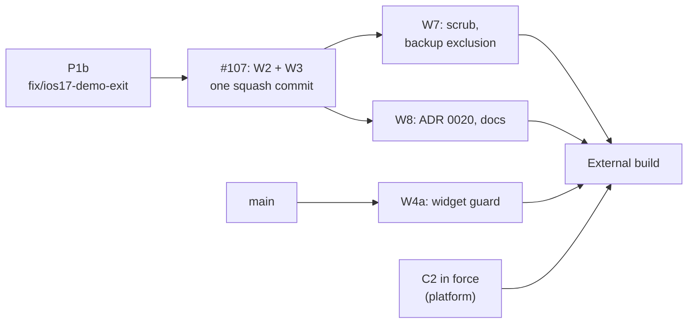

# Wipe recovery, re-baselined on today's `main` (W0)

**Status:** proposed. ios-architect, 2026-11-18. Base: `origin/main` 9af6049 (P1, #116). Branch heads: #106
`feat/wipe-resume-at-launch` 5ec2226 (W2, 2 commits), #107 `feat/wipe-hold-at-sign-in` 6f15941 (W3, 8 commits on top of
#106's 2). P1b design: `docs/work/2026-11-18-ios17-demo-exit/design.md` and ADR 0019, 72750f4 on `fix/ios17-demo-exit`.

**Sources.** "Read" means read in the code at 9af6049 or at the branch heads. "Merged" means a trial merge with
`git merge-tree --write-tree origin/main <branch>`. Nothing here was built or run. P1b's code isn't written yet, so its
conflicts are predicted from its design. Values are synthetic.

**In short.**
- W1 is merged (#103). W2 is #106, W3 is #107, and #107 already carries #106. W4 to W10 aren't started, except one part of W4
  that W2 built.
- Only two files conflict textually, for both branches: `RyftApp.swift` and `ScheduledWork.swift`, both about the
  compaction task that P1 changed. Neither branch needs a design change because of P1. The wipe already advances
  `StoreEpoch` on `main`, and every pass runs `onWipe`, so the Repository is invalidated and the writer is retired. The
  file replace runs before any writer or batch can exist.
- P1b lands first. It removes the iOS 17 state that makes every in-process wipe after the demo return false, and that
  W3 would turn into a held sign-in.
- W2 and W3 go into one squash commit: #107 carries both, and #106 is closed as included.
- Besides W2 and W3, External testers need W4a (the widget guard) and W7 (the scrub and the backup exclusion). Without
  W7, the policy wording the user approved isn't true. The four C2 sentences are in §4.

## 1. W1 to W10: where each stands

| # | Ticket | State | Evidence |
|---|---|---|---|
| W1 | `auth: a wipe is written down before it starts` | **Merged** | #103, 66f27cd: `Ryft/Auth/WipeLedger.swift`, `ledger.begin` in `AuthService.signOut`, `TrainStore.wipe(_: Wipe)` (`TrainStore.swift:228`) |
| W2 | `train: an owed wipe finishes before the store opens` | **In #106** (and in #107's branch) | 927be85, 5ec2226: `Ryft/Persistence/StoreReset.swift` (new, with `WipeResume`), `TrainStore.shared = TrainStore(opening:ledger:orphans:now:)`, `AuthService.resumeOwedWipe`/`finishOwedWipe`, `RyftTests/StoreResetTests.swift`, `review-w2.md` |
| W3 | `auth: no session over an owed wipe` | **In #107** | 8f4c12d … 6f15941: `AuthService.publish`/`clearTheWay`/`hold`, `passRefused`, `OwedWipe.endsOwnSession`/`publishedOver`, one string key, `RyftTests/SignInHoldTests.swift`, `review-w3.md` |
| W4 | lock screen: widget, Live Activity, notifications, push registration | **Not started**, one part done | W2 moved `ReadinessSnapshot.clear()` into the store step (`AuthService.storeStep`, `clear(_ file:)`). On `main` and both branches there's no `publishWidget` guard, `endNow`, `keptLiveActivity` or `removeAllDeliveredNotifications` (grep) |
| W5 | the notice says what's left | **Not started** | `wipeLeaving` still returns nothing (`AuthService.swift:778` on `main`, `:904` on #107) |
| W6 | a wipe takes rows never saved | **Not started** | No `insertedModelsArray` in `Ryft/` (grep) |
| W7 | scrub after a no-parking wipe, `Train.store` out of backups | **Not started** | Nothing sets `scrubOnly = true`. Only `readiness.json` sets `isExcludedFromBackup` (`Repository.swift:973`). `StoreReset` and `WipeResume.scrub` can already *run* a scrub |
| W8 | ADR, architecture, status, policy brief | **Not started** | No wipe ADR exists. The draft in `design.md` §9 is numbered 0016, which Nocturne took (#112), and 0019 is P1b's, so it becomes **0020**. STATUS "Sign-out wipe" still says "not built, waits on the user's answers" |
| W9 | a deletion is written down before the DELETE | **Not started** (added by `review-w2.md`) | — |
| W10 | a held Sign in with Apple keeps its authorization code | **Not started** (added by `review-w3.md`) | — |

## 2. #106 and #107 against `main`

### 2.1 Textual conflicts (merged)

Both branches conflict in the same two files. #107 inherits them from #106's first commit, so they're resolved once.

| File | Hunk | Resolution |
|---|---|---|
| `Ryft/Sync/ScheduledWork.swift` | `register(…)`'s signature and the compaction registration. W2 made `compact` async and inlined `await compact(); task.setTaskCompleted(success: true)`. P1 also made it async, added `settled:` and moved the body into `runCompaction(_:compact:settled:)` with an expiry handler | **Take `main`'s side whole.** W2's change is already in it |
| `Ryft/App/RyftApp.swift` | The `compact:` closure. `main` passes `settled:` and calls `await repository.compact()` (now async, returns a count). W2 captures `state` and calls `state.repository.compact()` without `await`, then `finishOwedWipe` | **Keep `main`'s `settled:` and `await repository.compact()`, then add W2's `await …finishOwedWipe(train:bedtime:)`, before `activities.deleteExpiredParked()`.** Capture the instances (`state.env.auth`, `screens.bedtime`), not `AuthService.shared` |

These auto-merge but need a read before pushing:

- `TrainStore.swift`: the init chain. `epoch` is a `StoreEpoch` on `main`. W2 doesn't touch it.
- `TrainSyncService.swift`: W2 defers `refreshCount()` in `accountChanged()`, and `main` changed `generation` to
  `store.epoch.current`.
- `Repository.swift`: `ReadinessSnapshot.clear(_:)`.
- `RyftTests/TrainStoreWipeTests.swift`: `main`'s `.current` and its iOS 17 `withKnownIssue` stay.
- `Localizable.xcstrings`: one key.
- `CHANGELOG.md`.

`AuthService.swift`, `WipeLedger.swift`, `StoreReset.swift` and `WelcomeView.swift` don't conflict. `main` didn't touch
the first three. #107 doesn't touch the fourth.

**How to bring them up without force-pushing:**
- Merge `origin/main` into `feat/wipe-hold-at-sign-in`. Its branch holds #106's two commits and nothing was squash-merged
  under it, so a merge is safe here, and it needs no force-push (CLAUDE.md).
- Then close #106 as included in #107, and retitle #107 to
  `auth: an owed wipe finishes before the store opens, and no session is published over it`.
- One squash commit is the only structural guarantee that W2 never reaches a nightly without W3 (§4.1).

### 2.2 Semantic questions

**a. Does the file replace race the drain's writer or a queued batch? No.**
- `StoreReset.run` runs inside `TrainStore.shared`'s initializer, before the first `ModelContainer` exists.
- The drain gets a container only through `Repository.submit` → `store.container` (`Repository.swift:513-517`). The
  Repository is built in `AppState(env: .live)`, after `AppEnvironment.live` has finished, and that includes
  `TrainStore.shared` (`AppEnvironment.swift:83-95`, `RyftApp.swift:57`).
- The widget extension and the notification service don't use SwiftData (P1b F6).
- So no writer, no batch and no second coordinator can hold the file during the replace. The `StoreEpoch` is created
  with the store, after the replace, at its first value. There's nothing to advance.

Rule: **the replace only runs before the container opens.** Nothing may call it on a live `TrainStore`, and that
includes P1b's `reopen()`, whose retired containers keep the old files open for the life of the process (§3.2).

**b. Must the retry advance `StoreEpoch` or go through `Repository.reset()`? It advances already, and
`invalidate()` is what's needed, not `reset()`.**

*The object wipe.* Every pass reaches `TrainStore.wipe(parkingActivitiesOf:at:)`, whose first step is
`epoch.advance()` (`TrainStore.swift:249`). The passes are:
- the launch's `.wipeNow` in `AuthService.init`;
- `finishOwedWipe` after the first frame;
- the compaction;
- `clearTheWay` at a sign-in.

The epoch makes a batch queued before the wipe drop, and a save in progress finish first, so the wipe then deletes
what it saved.

*The read side.* Every pass goes through `perform` → `onWipe` → `AppState.wiped` → `forgetActivityState` →
`repository.invalidate()` (`AppState.swift:376`, `:412`). That drops the read contexts, the memo and the user written
through, and calls `drain.retireWiped()` (`Repository.swift:875-883`).

`Repository.reset()` adds only the demo store's release. A debt is never the demo store's, so the retry doesn't need it.

The one pass without `onWipe` is the `.wipeNow` inside `AuthService.init`: `bindAccountHooks` hasn't run yet. That's
correct only as long as no Repository exists before `AuthService.init`. **Pin the launch order.** In Debug,
`TrainStore.init(opening:)` asserts that `AuthService` resolved the ledger first. That catches a flip in UISmoke. Today
nothing tests it (#106 "Not verified").

Rule for W6 later: its deletes of `context.insertedModelsArray` go after `epoch.advance()` and before the final save.

**c. Does the held sign-in interact with `AppState.reset()`? Yes, when an account was published, and that's
intended.**
- *B held over a published A* (a link signing B in over A). In this order:
  1. `hold()` → `replaceSession(nil)` → `onAccountWillChange(A, nil, nil)`;
  2. `accountID` goes from A to nil;
  3. `RyftApp`'s `.onChange(of: auth.accountID)` (`RyftApp.swift:169-200`) runs `trainCoordinator.accountChanged()` and
     `state.accountChanged(from: A)` → `reset()`.

  `reset()` runs `env.reads.reset()` and P1's `repository.reset()`, then the rest of the account change. That's the
  full sign-out path for A, which is what the design asks for: "A's session ends first, hooks included".
- *B held with nobody published* (the usual case): no account change, so no `reset()`. The refused pass's `onWipe`
  still ran `invalidate()`. `accountID` stays nil, so reads, sync, uploads and consent stay idle (`ConsentState` and the
  read pipeline guard on `accountID`).
- P1b's `demoEnded()` → `reset()` while a sign-in is held changes nothing in the ledger. The hold, `passRefused` and
  the message stay.

**d. Does P1's "a refused batch drops its writer" change W2's failure handling? No, but it changes three facts the
design leans on.**

W2 and W3 decide a debt from the main-context wipe and `storeStepLeftFiles` only. A refused read-model batch never
counts, and it shouldn't: the batch wrote nothing, and its writer can't keep A's rows alive past the wipe, because the
wipe retires it.

What changes:
1. **Design §2's "the next `save()` by anyone lands them or fails with them" now holds only for main-context writers:**
   Train, documents, activities and the consent record. Read-model writes have their own context, so B's (or anyone's)
   no longer fail because of A's pending deletes, and they can't land them either. W8 updates §2.
2. **W6 loses one route.** Read-model rows are no longer inserted on the main context (except `seed`, which saves at
   once), so a batch delete can't miss one of them. W6 stays for `CachedExercise`, `CachedPlan`, `PendingTrainOp`,
   `ImportMapping`, the main context's `CachedDocument`s and the activity tables. W3's `passRefused` rule still holds
   for the same tables.
3. **iOS 17 after the demo, without P1b:**
   - the account's container is the older one, and the main context keeps the demo's refused inserts (P1b §3.2), so
     the wipe's final save is refused, and every in-process wipe returns false;
   - under W3, a different account's sign-in in that process is held until a relaunch;
   - W2 then replaces the files at the next launch.

   That fails closed and converges, but it puts "Close RYFT and open it again" on the normal path for "try the demo,
   then sign in" on iOS 17. P1b's reopen removes it (§3).

**e. Other things the rebase must handle (Read).**

1. **The first-frame wipe now runs during the launch sequence (ADR 0017).** `LaunchPolicy` plays signed out too. A
   parking resume (`.wipeAfterFirstFrame`, an expiry within 30 days) runs the object wipe on main right after
   `LaunchSignpost.afterFirstFrame()`. That's 3.4 s for 44,500 rows in Debug (STATUS), so the entrance stalls. It's
   rare and doesn't block startup. Accepted, with one check on a device (performance-profiler) and a line in §7 of
   the design.
2. **P2's widget order.** P1's design §5.6 has P2 clear the snapshot *after* `advance()`, with the file write inside
   `ifCurrent`. W2's `storeStep` clears it *before* the store wipe. That's right today, because the publish is
   synchronous on main. Once P2 queues the publish, a publish that starts between that clear and `advance()` can write
   A's snapshot after it. **P2 must clear again after `TrainStore.wipe`.** W4a's guard (§6) covers the debt case.
3. **`didSave` carries no deleted identifiers on iOS 17** (`main`'s `TrainStoreWipeTests.swift:398`).
   `StoreResetTests.aResumeAfterAReplaceDeletesNoObjects` expects 0 deletes, so it passes vacuously on iOS 17, and its
   control `aStoreOpenedFirstReplacesNothing` fails there. Both need an observable that doesn't depend on the OS, for
   example the rows a fresh `ModelContext` counts before the pass, and a per-OS expectation for the notification.
4. **`CHANGELOG.md` Unreleased:** the #93 line "If this iPhone can't delete your training data when you sign out,
   RYFT tries again when another account signs in" (`:119`) describes the kept-id behaviour that W3 removed. Replace
   it with W3's line, not next to it.
5. **Welcome changed under W3** (#115). `ViewThatFits` builds both children, and `.onAppear` clears `errorMessage`.
   W3's message is derived (`signInHeld`), so it survives that, and it shows through `AuthErrorMessage()`
   (`WelcomeView.swift:100`). No preview shows the held state, which CLAUDE.md requires. Add
   `#Preview("Welcome · sign-in held")` in dark, plus AX3 with the parked notice, so the scroll child is checked.
   Nocturne PR 6 part A restyles Welcome next. It must keep the derived message and the parked notice, and leave room
   for W5's variants.
6. **The design's W3 test list says "`make lint`: strings in en and de".** RYFT has been English only since #105, so
   drop "de" from the criteria. The `ryft-app-conventions` skill still says "English and German": that's drift
   against CLAUDE.md, reported below.

### 2.3 What each branch must change, file by file

**#106's commits (W2), sync-engineer:**

| File | Change |
|---|---|
| `Ryft/Sync/ScheduledWork.swift` | `main`'s version whole (§2.1) |
| `Ryft/App/RyftApp.swift` | The compaction closure as in §2.1. Keep `.task`'s `finishOwedWipe(train:bedtime:)` after `afterFirstFrame()`. After P1b: keep its launch sweep, and keep `discardPending` on the switch-off |
| `Ryft/Train/Model/TrainStore.swift` | `init(opening:…)` funnels into `init(configuration:)`, the one place P1b stores `configuration`. A Debug assertion that the ledger was resolved (§2.2 b). After P1b: `container` is `private(set) var`, and `reopen()` never calls `StoreReset` |
| `Ryft/Train/TrainSyncService.swift` | Keep the deferred `refreshCount()` in `accountChanged()`. After P1b: if P1b factors "stop the replay" into a helper that `accountChanged()` calls, that helper must not read `owner()` or `AppEnvironment.live` synchronously. It runs inside `AppEnvironment.live`'s `swift_once` at a launch wipe, the crash #106 fixed |
| `Ryft/Auth/AuthService.swift`, `WipeLedger.swift`, `Persistence/StoreReset.swift`, `Activities/ActivityStore.swift` | No change for P1. Expose `owesWipe` (an entry that isn't `scrubOnly`) for W4a |
| `Ryft/Persistence/Repository.swift` | Only `ReadinessSnapshot.clear(_:)`, auto-merged |
| `RyftTests/StoreResetTests.swift` | The `didSave` pair (§2.2 e3). One test: a batch submitted for the account's store, then `finishOwedWipe` → `receipt.dropped`, no row of it in the file, and the writer's epoch moved (`writerEpochs()`) |
| `RyftTests/TrainStoreWipeTests.swift` | Keep `main`'s two `withKnownIssue`s |
| `docs/work/2026-11-05-wipe-recovery/design.md` | The status line, §2's save fact (§2.2 d1), §7's launch-sequence risk |

**#107's commits (W3), ios-developer, with localization-editor for the key:**

| File | Change |
|---|---|
| `Ryft/Auth/AuthService.swift` | None for P1 |
| `Ryft/Features/Auth/WelcomeView.swift` | The held-state previews (§2.2 e5). No layout change |
| `Ryft/Preview/PreviewAuth.swift` | A preview auth with `signInHeld` set, if the preview needs one |
| `Ryft/Resources/Localizable.xcstrings` | The one key as is, merged by key, never re-serialised, English only |
| `CHANGELOG.md` | Replace the #93 line (§2.2 e4) |
| `RyftTests/SignInHoldTests.swift` | One test: a hold over a published A runs `AppState.reset()` once, and a batch queued for A before the hold is dropped |

## 3. Order with P1b

### 3.1 P1b lands first

1. **It removes the main source of in-process wipe refusals on iOS 17** (§2.2 d3). With it, "try the demo, then sign
   in" over a previous account wipes on the reopened container and publishes. Without it, the same steps hold.
2. **No code dependency either way.** W2 and W3 don't call anything P1b adds. If P1b slips (T0.7 inconclusive), W2 and
   W3 can land alone, with the iOS 17 hold accepted and written in STATUS. If T0.7 fails and P1b takes R3 (a relaunch
   note), only the copy needs coordinating: Welcome could then carry two "close and reopen" lines.
3. **The plan merges the data-safety set together** (B4, B5, B3), so the order costs no extra nightly.

So nobody waits:
- bring #107 up to 9af6049 now (§2.1), and run its suites;
- merge `main` again once P1b is in. The predicted conflicts are only in `TrainStore.swift`, `TrainSyncService.swift`,
  `RyftApp.swift`, the string catalog and `CHANGELOG.md`.

### 3.2 Touch points

| Touch point | P1b does | W2 and W3 do | Who must respect what |
|---|---|---|---|
| `TrainStore.shared` and its init | `container` becomes `private(set) var`, a stored `configuration`, `retired` containers kept for the process, `reopen()` (iOS 17) | `static let shared = TrainStore(opening:ledger:orphans:now:)`: the replace before the first open | W2 keeps `init(configuration:)` as the one funnel, so `reopen()` reopens the URL the replace cleaned. `reopen()` never replaces files. No in-process replace while `retired` is non-empty: two coordinators on removed files |
| `StoreReset` | — | The only code that deletes a live store's files, before open | A later `reopen()` from the in-memory fallback (STATUS: "reopening the durable store on unlock", P1b §13) **must resolve the ledger first**. At that launch the store step never ran against the file, because the ledger was unreadable before the first unlock. Until then, P1b's `guard isDurable, !lostItsFile` keeps it out. That guard gets a mutant |
| `StoreEpoch` | `reopen()` advances it. The same `StoreID` keeps a new container. The writer is keyed by container too | Every wipe advances it first | Independent increments. Tests assert `+1` around one operation only. Neither caches a container or context in a property (P1b F4); W2 and W3 read `TrainStore.shared` per call |
| `AppState.reset()` | `demoEnded()` = reopen, then `reset()` | A hold over a published A reaches `reset()` through `accountID` | No shared edit. Both rely on `reset()` being idempotent |
| `AuthService` | Not edited | W2 and W3 | P1b §13 leaves "a sign-out wipe with Demo data on, on iOS 17" out of scope. Under W2 and W3 that's a debt: replaced at the next launch, or object-wiped when parking. ADR 0020 says so |
| Demo over a debt | Train in the demo reads `TrainStore.shared` (P1b §3.2, §3.3) | The hold protects sessions, not the demo | `review-w2.md` open item 3. With Demo data on at a refused sign-out, the demo's Train screens show the leaving account's sessions. P1b's D3 would close it. Until then it's a decision (§7, W11) |
| `TrainSyncService` | `defaults:` init parameter, demo list, discard, `storeReopened()` | `accountChanged()` defers `refreshCount()` | Nothing reachable from `TrainStore.wipe` or `accountChanged()` reads `AppEnvironment.live` synchronously |
| `RyftApp.init` | The launch sweep (`TrainCoordinator.shared` → `TrainStore.shared`), `discardPending` on switch-off, `ScreenModels(train:)` | `.task` and compaction call `finishOwedWipe` | The sweep stays after `env = AppEnvironment.live`, which is the first stored property after the delegate adaptor. The Debug assertion pins it. Sweep and resume are independent: the sweep deletes only listed ids |
| The drain | Writer keyed by `writer.modelContainer === target.container` | — | None |
| Strings, CHANGELOG, `ARCHITECTURE.md` §3, ADR numbers | 5 keys, 2 lines, §3 "Accounts and demo", ADR 0019 | 1 key, 1 line (replaces #93's), ADR 0020 (W8) | Merged by key. W8's ARCHITECTURE edit follows P1b's |

**Cheap asks of P1b while it's being built:**
- keep `init(configuration:)` as the single funnel;
- don't make `TrainSyncService.accountChanged()` read `owner()`;
- no `.shared` reads in `reopen()`.

## 4. Release coupling

### 4.1 One build

- **Every merge to `main` reaches the next Internal nightly**, so W2 and W3 have to be one commit (§2.1). If the lead
  keeps two PRs, no nightly may run between their merges (`review-w2.md`: "No TestFlight build from `main` until W3 is
  merged").
- **W4a, W7 and W8 can follow in later nightlies.** C2 isn't in force for Internal testers yet.
- **C2 goes into force with the External build** that carries W2, W3, W4a and W7. That's U1 item 5, and also the GCP
  plan's runbook step 15, "before any tester".
- **Not earlier:** the C2 text would be false for builds before it. Not later: testers would consent to the old text.

### 4.2 The sentences C2 must carry

These are as the user decided on 2026-11-05: U1 items 1 to 4, item 4 without its last sentence. The placement is a
suggestion against the structure of `2026-10-26`. The wording is the user's as controller. This is not legal advice.

1. **§3, the end of the sentence on an unsent import** (replacing "signing out or deleting your account removes it at
   once."):

   > signing out or deleting your account removes it from your iPhone, normally at once; if RYFT can't finish or is
   > closed, it finishes the next time you open RYFT.

2. **§6, a new bullet on the iPhone:**

   > If your session ends without you signing out, activities and sleep entries not yet sent stay on your iPhone for up
   > to 30 days so you can sign in and send them. Another account signing in removes them.

3. **§6, right after it,** so "these limits" covers this one and §3's:

   > These limits are applied by the app. If you don't open RYFT, the data stays on your iPhone until RYFT next runs or
   > you delete the app.

4. **§6, after that:**

   > Deleted data can remain in unused parts of the app's storage until RYFT next starts while signed out, or when you
   > switch accounts without closing RYFT, until that space is reused. It's not visible in the app.

**What in the build makes each one true:**

| # | What makes it true | If it's missing |
|---|---|---|
| 1 | W2 (resume at the next start) and W3 (no sign-in over it) | False in the failure case |
| 2 | True today. That deleting the app removes the App Group container is assumed (U5) | — |
| 3 | Parking (since #93's base), W2's 30-day limit, `since` | — |
| 4 | **W7's scrub**, for "until RYFT next starts while signed out". **W7's backup exclusion**, because the backup sentence was dropped | First clause false. Silent on a backup copy that still exists |

**Open review items that would change the wording.** They were raised on 2026-11-06, after the decision, and they're
unanswered. The user picks, keeps, or rewords:

| Item | Source | Proposed if the user wants it covered |
|---|---|---|
| "Open" means the next start, not a return to a running app | `review-w2.md` 4 | Items 1 and 3: "the next time RYFT starts", "until RYFT next starts" (item 4 already says "starts") |
| After an expiry with a lasting refusal, all of the account's data stays up to 30 days, not only the parked rows | `review-w2.md` 2 | Add to sentence 2: "If RYFT can't remove the rest of that account's data then, it stays for up to the same 30 days." |
| A kill during a deletion (the DELETE retries 503s for about 90 s) reads later as an expiry | `review-w2.md` 1, W9 | None if W9 ships. Otherwise: "If RYFT is closed while it deletes your account, activities and sleep entries not yet sent can stay on your iPhone for up to 30 days." |
| A full disk can lose the debt. Files that can't go keep a sign-in held | `review-w3.md` 1, 2 | Leave as a residual risk, or add to item 1: "…or, if your iPhone is out of storage, when another account signs in or you delete the app." |
| Backups made by builds before W7 still hold `Train.store` | U2's consequence | The dropped sentence, scoped: "Device backups made before [version] keep their copy until you replace them." |

## 5. What U4's result would change

Prior evidence: P1's iOS 17.0 run included `TrainStoreWipeTests` among 58 suites. It found 2 known issues, and neither
was a refused delete (`docs/work/2026-11-17-persistence-off-main/review.md:46`, `didSave` without deleted IDs). That
was `main`'s wipe, before W2 and W3. U4 on 17.0 and 18.0 confirms it. The branch suites need their own run (B5e).

| U4 shows | Consequence | Change |
|---|---|---|
| Green on 17.0 and 18.0 | None for the design. 17.1 to 17.6 stay unmeasured | STATUS records it. B5e still runs the rebased suites |
| A table's batch delete **always throws** on 17.0 | Every object wipe returns false there. No parking: the next launch's replace converges, but every in-process account switch holds the next sign-in until a relaunch. Expiry: no replace for 30 days, so that table's rows stay up to 30 days (the second open item in §4.2 becomes the normal iOS 17 case). The final save still lands, so the context isn't poisoned, and a returning account loses nothing | That table moves from `batchDelete` to `deleteEach`, as #93 did for `LocalSet`, in the W2 PR, with a main-thread time measured for its size. The 17.0 expectation goes into `TrainStoreWipeTests`. Before External |
| The wipe's **final save is refused** on 17.0 with a single container | Every wipe is false on 17.0, and a returning account works on a poisoned context, so its saves fail and a kill loses Train work | Doesn't ship as is. The options are an in-process fresh context through P1b's `reopen()` after a refused pass (W12), or minimum iOS 18 (P1b's R4). The user decides |
| `ModelConfiguration.url` before opening is wrong on 17.0 (B5e) | The replace "succeeds" with 0 files, and the object wipe has to do it all. If that's refused too, the sign-in stays held at every launch | Resolve the path from `FileManager.containerURL(forSecurityApplicationGroupIdentifier:)` and assert it equals the configuration's in Debug |
| A **trap** inside the wipe on 17.0 (like 9ecc6cd's rollback) | Every launch with an entry dies: the replace ran, the wipe trapped, and the entry stayed | Stop. A launch counter in the ledger that skips the object wipe after one trapped attempt; design it then |

## 6. Tickets for the beta

Before External testers:

| # | Ticket | Owner | Files | After | Acceptance criteria | Reviews |
|---|---|---|---|---|---|---|
| B5a | Bring #107 (W2 + W3) up to `main` | sync-engineer | §2.3 W2 table | P1b merged (the first merge can start now on 9af6049) | `main` merged in, no force-push. `git diff --stat origin/main..HEAD` shows only the wipe's files. Strict build with 0 warnings, Unit and UISmoke green on 27.2, `make lint`. The Debug launch-order assertion holds in UISmoke. The planted-entry run (4 rows, as in #106's body) is repeated on the new head, and its table goes in the PR body. The two new tests of §2.3 pass | security-privacy-reviewer on the delta against the earlier heads (the compaction resolution, the P1 and P1b interplay); code-reviewer |
| B5b | W3's follow-ups on the same branch | ios-developer, localization-editor | §2.3 W3 table | B5a | Previews "Welcome · sign-in held" (dark) and AX3 with the parked notice, captured and compared with the board. The CHANGELOG line replaced. The catalog diff is one key, `sync-strings --check` empty. The `AppState.reset()` test passes. #106 closed, #107 retitled | code-reviewer; ui-validator on the previews |
| B5c | W4a: no widget while a debt exists | sync-engineer (one writer for `Repository.swift`, where P2 follows) | `Repository.swift` (`publishWidget` guard via `env.auth.owesWipe`), `AuthService.swift` (`owesWipe`), tests in `AccountScopeTests.swift` | W1 (branch from `main`) | A refused `CachedDay` delete, then `tonightBedtime = nil`: `readiness.json` is absent. A `todayStatus` change while owed: absent. After the debt ends: published again. A scrub doesn't block. No `.shared` in `Repository` | security-privacy-reviewer (the lock screen); code-reviewer |
| B5d | W7: scrub, and `Train.store` and the ledger out of backups | sync-engineer | `AuthService.swift` (`settled` sets `scrubOnly` after a true no-parking pass), `WipeLedger.swift` (exclusion after every write: an atomic write replaces the file and drops the attribute), `TrainStore.swift` (exclusion on the group's `Library/Application Support` at every launch, after the store step), tests | B5a | The design's four W7 criteria: the WAL marker before and none after, A→B in one process without a replace, an expiry never scrubs, history clean. The resource values read back `isExcludedFromBackup == true` on a temporary folder. `review-w3.md`'s question answered and pinned: a scrub can't be set in a process with a refused pass | security-privacy-reviewer; code-reviewer |
| B5e | The OS runs | test-engineer | — | B5b, again after B5d | On fresh 17.0 and 18.0 simulators with `-parallel-testing-enabled NO`: `StoreResetTests` (all three suites), `SignInHoldTests`, `WipeLedgerTests`, `TrainStoreWipeTests`, `AccountScopeTests`, `ReadModelWipeRaceTests`, `ReadModelDrainTests`, `ConsentGateTests`, and P1b's `TrainStoreReopenTests`. Nothing fails except per-OS expectations that are written down. The live configuration's URL test passes on 17.0. Results go to STATUS | — |
| B5f | W8: ADR 0020, docs, the C2 brief | ios-architect | `docs/adr/0020-…` (design §9, renumbered; "Applies to" and decisions 1 and 3 per `review-w3.md`), pointers in ADR 0018 (`StoreReset` is the pre-open exception to its ownership table) and ADR 0019 (`reopen()` never replaces files), `ARCHITECTURE.md` §3 (`AccountScope` follows `session`), `STATUS.md` "Sign-out wipe", the design's status, the brief to head-architect with §4.2 | B5d | ADR accepted by the lead. STATUS names C2's version once the platform dates it. The brief lists the sentences and the open items | — |
| B5g | U5 on a device | the user (test-engineer's checklist) | — | B5d on TestFlight | Kill during a sign-out with a workout live: nothing on the lock screen after reopening. A real full disk. A backup restore after a sign-out holds no `Train.store`. Deleting the app removes the App Group container | — |

Only if the user decides it (§7):

| # | Ticket | Owner | Note |
|---|---|---|---|
| W9 | A pending-deletion marker before the DELETE | sync-engineer (a short design first) | A plain `begin` is wrong: on a 503 nothing was deleted, and a kill must not then sign the user out. The marker classifies the session's end as a deletion and keeps the notice. It isn't a debt that holds sign-ins |
| W11 | No demo over a debt | sync-engineer, ios-developer | For example, `RyftApp.content` shows Welcome while `owesWipe`, whatever Demo data says, or a wipe that leaves an entry turns Demo data off through P1b's exit |

Can wait:
- **W4b** (Live Activity `endNow`, `keptLiveActivity`, delivered notifications, push registration during a hold):
  W2's `finishOwedWipe` → `train.accountChanged()` already ends the activity at the next launch.
- **W5** (the notice): after Nocturne PR 6 part A restyles Welcome, before the App Store 1.0.
- **W6:** before A3b.
- **W10:** before the App Store 1.0.
- **W12** (an in-process release through `reopen()`): only if U4 needs it.

## 7. Open questions

- **Lead:** one squash PR for W2 + W3 (close #106 into #107), or two PRs with no nightly between them?
- **Lead:** W4a and W7 required for the External build, as proposed here?
- **User:** "the next time you open RYFT" or "the next time RYFT starts" (`review-w2.md` 4)?
- **User:** widen sentence 2 for a lasting refusal after an expiry, or accept it (`review-w2.md` 2)?
- **User:** build W9 before External, or accept the killed-deletion case, with or without a sentence (`review-w2.md` 1)?
- **User:** a full disk losing the debt, and files that never go: residual risk, or a sentence (`review-w3.md` 1, 2)?
- **User:** say that backups from builds before W7 keep a copy, or stay silent (U2)?
- **User:** demo over a debt (W11): fix before External, or accept it as rare (`review-w2.md` 3)?
- **Head-architect:** C2's effective date is the day the External build is released, not before. Can the platform's
  runbook step 15 hold that?
- **Lead:** P2 must clear the widget again after `TrainStore.wipe` (§2.2 e2). Add it to P2's brief?
