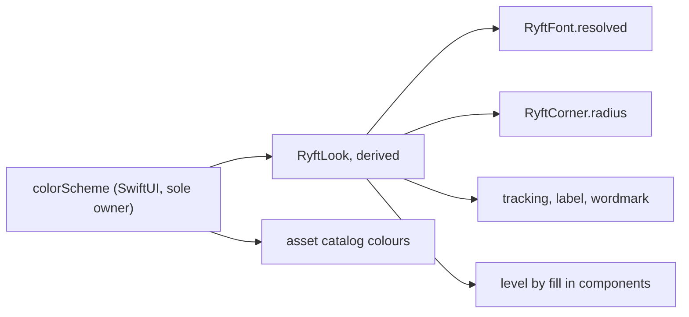

# The Alpine redesign reaches light mode only: architecture note

Ticket: `CLAUDE_FOLLOWUP_ALPINE_LIGHT.md`. T1 to T5 land on `main`; T0 and T6 to T11 land on PR #100, branch
`design/alpine-light-palette`.
Reads with: `plan.md` in this folder, which holds the decisions and wins any conflict; `design.md` (ui-designer: what light looks like);
ADR 0015. This note says how values switch by appearance. It changes no Swift.

**The user's decision overrides the brief:** light only, switched by appearance. Inter, radius 0, square buttons, tracking and
level by fill apply in light. Dark stays exactly as it is: Satoshi, the current radii, hue-coded bands. The brief's line "both
appearances get the same rule" doesn't hold for now. He accepts that fonts and corners flip with the system appearance, and that
views carry both styles until the dark pass.

## 1. Summary

| Question | Recommendation |
| --- | --- |
| How a value depends on appearance | One derived value, `RyftLook(colorScheme)`. Fonts: `.font(.ryft(.x))` stays as written and resolves through a new `RyftFont` token and a `View.font(_:)` overload. About 700 of 711 font lines don't change; the compiler names the 6 sites that do, and 3 declarations change type. Corners: a `RyftCorner` token and modifiers, 56 lines now plus the literals from `design.md` 4.3. |
| Website | `tokens.mjs` keeps working unchanged if the lines it reads hold the Alpine value and dark's value sits in code it doesn't read. Tested with a private copy of the script. One exception: it cannot read a negative wordmark tracking. Any changed value still needs one `npm run tokens` commit on the platform side. |
| Fonts | Commit Inter (two `.otf` files and the licence). Satoshi stays fetched. CI needs no new step. No Xcode step: `Ryft/` is a synchronized folder. |
| Layout | A flip re-lays out text and changes nothing else. No `if look` above stateful views, nothing keyed on appearance. |
| Dark proof | `make dark-diff`: the same hosted shots on the base and on the ticket's branch, compared pixel by pixel, plus pin tests on every PR. |

What was run: the app target and `build-for-testing` of a throwaway copy with the font and corner seams applied (section 3.5),
`tokens.mjs` against candidate source forms (section 4.3), a macOS pixel comparison of the modifier forms (section 3.6), and a parse
of the font files (section 6). The prototype is deleted; none of it is in the repo. Nothing ran on a simulator or a device.

## 2. Constraints

- The server is the truth for scores; this pass touches none of that. Models stay unaware of appearance.
- One owner per piece of state. `colorScheme` is SwiftUI's; a second stored copy is not acceptable.
- The website reads three Swift files with regexes, and its CI fails on any change in the output (section 4).
- `Ryft/Design` has no scheme checks today, but the asset catalog already resolves colours through `\.colorScheme`.
- Subtrees are forced dark inside a light app: `WelcomeView:27`, `AuthComponents:62`, `PlatformConfig:78`.
- `SchemePair` draws dark and light in one process. So do the shot suites. The rule that every view has previews in both
  appearances depends on it.
- The default appearance is dark (`Settings.swift:99`). Light users chose it, and `.system` users can flip at any moment.
- Dependencies: none new. `project.pbxproj` and entitlements are not hand-edited.
- **Every change is gated by look** (`plan.md`). A token swap, string or symbol that would reach dark stays in dark as it is today. Strings
  that only light shows get new keys, and dark keeps the old key.

## 3. Question 1: making a value appearance-dependent

### 3.1 Call sites

Counted in `Ryft/`, excluding comments and `Typography.swift` and `Theme.swift` themselves.

| What | Lines | Files | Enclosing types |
| --- | --- | --- | --- |
| `.ryft(...)` and `.ryftNumber(...)` | 711 | 94 and 18 | 204 |
| `ryftLabelStyle` | 53 | 37 | 43 |
| `Metrics.cardRadius` / `tileRadius` | 56 (10 + 46) | 33 | 41 |
| `RoundedRectangle` with another radius | 40 | | |
| `Capsule()` | 62 | 29 | |
| `.tracking(...)` | 7, plus 2 in widgets | 5 | |

The 56 corner lines have four forms: 38 `.background(style, in: shape)`, 11 `.overlay(shape.strokeBorder(...))`, 3
`.contentShape(shape)`, 4 bare shapes in a builder. Only 11 of the 56 are in `Design/`, so helpers alone can't carry the change.

### 3.2 Options

| Option | Lines to edit | Added to views | Honours forced dark and `SchemePair` | Verdict |
| --- | --- | --- | --- | --- |
| A. `@Environment(\.colorScheme)` in each type, pass the look | 767 | up to 213 properties | yes | Rejected: the diff is the design |
| B. New modifier names (`.ryftFont(.x)`, corner modifiers) | 767, mechanical | none | yes | Works, and 711 lines of churn buy nothing over D |
| C. Resolve only in existing helpers (`Card`, `MetricTile`, `TealButtonStyle`, `ryftLabelStyle`) | few | none | yes | Reaches the labels and 11 of 56 corners. Not fonts. Use it where it applies, not as the mechanism |
| D. A token type plus an overload of `View.font(_:)` and corner modifiers | **6 font sites**, 56 corner lines | none | yes | **Chosen** |
| E. A global `@Observable` read inside `Font.ryft` and a computed `cardRadius` | 0 | none | **no** | Rejected, see below |

**Why not E.** It is the only option with zero edits, and Observation would even re-render the right bodies. But it holds appearance
in a second place, it would be `.shared` state in new code, and it answers one question for a whole process: Welcome would be Inter
on dark colours in a light app, `SchemePair` and the shot suites would draw both halves in one look, and the dark proof in section 7
would test nothing. `tokens.mjs` also throws if `cardRadius` becomes computed (F1 in section 4.3).

**Why not a `Shape` or `Font` that resolves itself.** `.background(_:in:)` and `.clipShape` take a shape as a value, outside the
view graph, so a `Shape` can't be relied on to read the environment. `Font` has no appearance hook on iOS 17.
`ShapeStyle.resolve(in:)` can read the environment, but that gives colour, not geometry.

### 3.3 The choice



Colours and look read the same key, so a subtree can't get Alpine shapes on dark colours or the reverse. Forced-dark screens and
`SchemePair` are right with no extra code.

**`RyftLook`** (new, `Shared/RyftLook.swift`):

```swift
/// Which design system a subtree draws. Derived, never stored: `colorScheme` owns it. Deleted with the dark pass.
enum RyftLook {
    case alpine, classic
    init(_ scheme: ColorScheme) { self = scheme == .light ? .alpine : .classic }
}
```

It lives in `Shared/` because the gauge and the widget do (section 3.7), and `Shared/` can't see `Ryft/Design`. `Shared/` is a synchronized
folder of both targets (ADR 0010), so the new file needs no Xcode step, and it meets the folder's rules: SwiftUI only, no strings, no fonts, no
`Theme`.

No new environment key and no `AppEnvironment` seam: the look is a pure function of a value SwiftUI already provides, and tests set
`.environment(\.colorScheme, ...)`. No remote flag either: the palette is already in the asset catalog and can't be flagged, so the
whole pass ships when it is done (ADR 0015 says the same).

**Fonts** (in `Typography.swift`, because `size` and `weight` are `fileprivate` there and the regexes need them there):

```swift
struct RyftFont {
    static func ryft(_ style: RyftTextStyle) -> RyftFont
    static func ryftNumber(size: CGFloat, weight: Font.Weight = .medium) -> RyftFont
    func monospacedDigit() -> RyftFont
    func monospaced() -> RyftFont
    func weight(_ weight: Font.Weight) -> RyftFont
    /// A site's own tracking in points, replacing the style's. In the token because an outer `.tracking` loses to the modifier's.
    func tracking(_ points: CGFloat) -> RyftFont
    /// For the few places that need a `Font` value: `Text` concatenation, chart axis labels.
    func resolved(_ look: RyftLook) -> Font
}

extension View {
    /// Resolves against the subtree's appearance. Not SwiftUI's `font(_:)`: the argument is a `RyftFont`.
    func font(_ font: RyftFont) -> some View { modifier(RyftFontModifier(font: font)) }
}
```

`Font.ryft` and `Font.ryftNumber` are **removed**. That is what makes the choice safe: `.font(.ryft(.body))` still compiles because
`.ryft` is now found on `RyftFont`, and any site that needed a real `Font` stops compiling. The compiler is the list. It also means the
dark pass can delete the seam with no call-site diff.

**Tracking.** A style's tracking is applied inside `RyftFontModifier`, for tokens that have any: `display`, `numberLarge`, `title` and
`ryftNumber` (`design.md` 4.1). Two rules follow from section 3.6:

- The branch is on the token, never on the look: `if font.isTracked { content.font(f).tracking(t) } else { content.font(f) }`. A site's
  branch never changes at runtime, so a flip doesn't change view identity. Classic gets `t == 0`, which rendered identically.
- An inner `.tracking` beats an outer one, even at 0. Two sites put a `.tracking` after a `ryftNumber` token, so T2 moves both into the token
  with `RyftFont.tracking(_:)`, or it zeroes dark's value:
  - `MetricGauge:159-161`: `.font(.ryftNumber(size: 9, weight: .medium).tracking(1.4))`.
  - `RyftHeader:26-27`, the wordmark: `.font(.ryftNumber(size: size, weight: .medium).tracking(size * 0.32))`. `tokens.mjs` still reads it (F13).

  **The compiler catches neither; the dark diff does.** The other `.tracking` sites are safe. `Typography:114`, `ExercisePage:442` and `:505` follow
  `.ryft(.label)`, which has no tracking of its own. `WelcomeView:123` and `RyftHeader:41` follow `ryftLabelStyle` and are dead today (section 3.4).
- Do not use `.textCase(nil)` in a shared modifier: it clears an inherited uppercase. If a style ever needs caps, use
  `.transformEnvironment(\.textCase)`, which rendered as a no-op in classic.

**Corners** (`RyftCorner` values in `Theme.swift`, modifiers in `Ryft/Design/RyftCorners.swift`):

```swift
enum RyftCorner { case card, tile, literal(CGFloat), capsule }

extension View {
    func background<S: ShapeStyle>(_ style: S, in corner: RyftCorner) -> some View
    func clipShape(_ corner: RyftCorner) -> some View
    func contentShape(_ corner: RyftCorner) -> some View
    func ryftBorder<S: ShapeStyle>(_ style: S, _ corner: RyftCorner, lineWidth: CGFloat) -> some View
    /// The card: `Theme.surface` plus, in Alpine, the 1 pt ink edge.
    func ryftSurface(_ corner: RyftCorner) -> some View
}
```

- `.background(Theme.surface, in: RoundedRectangle(cornerRadius: Theme.Metrics.tileRadius, style: .continuous))` becomes
  `.background(Theme.surface, in: .tile)`. A regex rewrote 41 of the 56 in the prototype and they compiled.
- `RyftCornerShape: InsettableShape` delegates `path(in:)` to the real `RoundedRectangle` or `Capsule`, so classic is the same path. It
  rendered identically in a fill, a `strokeBorder` and a capsule. Its type never changes on a flip, so identity holds.
- `.literal(12)` is 12 in classic and, from T7, 0 in Alpine. `.capsule` is a capsule in classic and, from T7, a rectangle in Alpine. Until T7 Alpine
  returns the classic shape, so T3 and T4 change nothing visible. The instruments that stay
  round (`design.md` 4.3: gauges, the mark, dots, a progress ring) keep their `Circle` and are not touched.
- The Alpine edge in `ryftSurface` is an overlay at opacity 0 in classic, not an `if`, so identity holds.

### 3.4 What can't read the environment, and what each does

| Thing | Why | Lines | Decision |
| --- | --- | --- | --- |
| `AxisValueLabel().font(_:)` | Swift Charts `AxisContent`, not a `View`; takes a `Font` | `ChartStyle:93`, `BedtimeStrip:44` | `ChartStyle.xAxis(_, format:, centered:, look:)` with **no default**; 4 callers read the scheme. `AxisValueLabel { Text(...) }` closures are views and compile as they are |
| `Text + Text` and `-> Text` | The overload returns `some View` | `MetricGauge:254`, `OrbitGauge:276-277` | Local `@Environment(\.colorScheme)`, `.font(token.resolved(look))` |
| Mixed `Font` ternary | Two types | `StatusViews:558` | `.font(x.resolved(look))` on both, or an `if` on a leaf `Text` |
| Static and default `Font` values | Evaluated without a view | `ChartStyle.axisFont`, `ChartStyle:294`, `DeltaLabel:14` | Their type becomes `RyftFont`. Callers don't change |
| `UIFont` measuring | Outside a view | `HealthPermissionView:971` `widestWord` | Takes a `RyftLook`. It decides one or two columns, so it must measure the font on screen. `RyftFonts.postScriptName(for:_:)` takes the look. One view call and 4 test lines |
| Shapes as values | Section 3.2 | 56 plus literals | `RyftCorner` modifiers |
| Tab bar, `UIKit` appearance proxies | Global, set once; colours can be trait-aware, fonts can't | `RyftApp:406-419` | Colours stay in the trait-aware `UIColor { traits in }`; the light value of `inactive` can change there. **No fonts in proxies**, so no bold selected label (`plan.md`) |
| Tab symbols | All five are `.fill` today (`RyftApp:566-578`); `design.md` 4.3 wants outline for unselected in light | | A look branch on a value, in T7, below this table. Dark stays `.fill` |
| System chrome: nav titles, alerts, menus, `Toggle`, `Picker`, `DatePicker` | Drawn by the system | | Stay the system font in both looks. Accepted |
| Widgets, Live Activity | Separate target, no `Theme`, system faces, no Satoshi. Could read the scheme, but Inter there needs a target membership | `RyftWidgets/` | **Unchanged.** System fonts stay. The monochrome colours and the shared gauge reach them through the copied colour sets and `Shared/` |
| `Shared/` | `check-shared-types.py`: no fonts, no strings. It can't see `Ryft/Design` | | Rule unchanged. `RyftLook` and the hatch move there; `OrbitGaugeDrawing` gets the look as a parameter (section 3.7) |
| `NotificationRing` | Runs in the notification service extension, fixed dark palette, system font, a picture | | Unchanged: it is a dark image in every appearance |
| `ImageRenderer` | **Tests only**; 7 test files, no production use. Its default environment is light | | Every render states its scheme, or it tests Alpine by accident |

The tab symbols, in the view that owns `tabView`, with `@Environment(\.colorScheme)` added. Each `.tabItem` calls this:

```swift
private func tabLabel(_ title: LocalizedStringKey, _ symbol: String, _ tab: AppTab) -> some View {
    let outline = RyftLook(scheme) == .alpine && state.selectedTab != tab
    return Label(title, systemImage: outline ? symbol : "\(symbol).fill")
        .environment(\.symbolVariants, outline ? .none : .fill)
}
```

`symbolVariants` is there because a tab bar can apply `.fill` to a plain name. Classic gets today's name. This type-checks, but how a tab bar treats it
is **not verified**: T7 checks it on both tab bars, before and from iOS 26, and if a bar ignores it, unselected stays filled and colour carries
selection, which `design.md` must then allow.

`UIHostingController`-based measuring in `FocusedPolishHostedTests:63,91` has the same trap as `ImageRenderer`: it sets no scheme, so
from the type ticket on it would measure Inter next to a dark window. Set `.environment(\.colorScheme, .dark)` there.

Two dead modifiers: `WelcomeView:123 .tracking(3)` and `RyftHeader:41 .tracking(4)` sit outside `ryftLabelStyle`, whose inner
`.tracking(2)` wins, so they have no effect today. Leave them alone. "Fixing" them would move dark, and `design.md` 4.2's remark
about the lock-up's `.tracking(4)` describes a value that isn't being applied.

### 3.5 Proof of the call-site count

A throwaway copy got `RyftFont`, the overload, and `RyftCorner` with `background(_:in:)` and `contentShape(_:)`. `Font.ryft` was removed.
Result of `xcodebuild`, full compile, iOS Simulator SDK:

- App target, first pass: errors at exactly the 6 sites above (`BedtimeStrip` reported as two "reasonable time" errors at 15 and 17,
  caused by line 44). Every other font line compiled untouched.
- After fixing those: the app target compiled, with 41 corner lines rewritten. No type-checker timeouts remained.
- `build-for-testing`: one error, `OrbitGaugeTodayTests:430` (`Font.ryftNumber`).
- The widget target is unaffected.

### 3.6 Does a modifier move dark?

`.font()` on `Text` returned `Text`; the overload returns a view, so what follows it is now a view modifier. Rendered with real Satoshi
through `ImageRenderer` at 3x on macOS, not iOS. This is evidence, not the proof; section 7 is.

| Compared with `Text(s).font(F)...` | Result |
| --- | --- |
| Plain; `relativeTo: .body`; then `.monospacedDigit()`, `.tracking(2)`, `.bold()`, `.fontWeight(.semibold)`, `.textCase(.uppercase)`, `.lineLimit(1).minimumScaleFactor(0.5)` | byte-identical |
| `.tracking(0)` inside the modifier | byte-identical |
| `.tracking(0)` inside, `.tracking(1.4)` outside | **differs: the outer value is lost** |
| `.textCase(nil)` under an outer `.textCase(.uppercase)` | **differs: the uppercase is lost** |
| `transformEnvironment(\.textCase)` that does nothing | byte-identical |
| `RyftCornerShape` against `RoundedRectangle` (fill, `strokeBorder`) and `Capsule` | byte-identical |
| The wordmark and the gauge title: outer `.tracking` against tracking inside the modifier at the same value | byte-identical |
| `RyftTrack` (section 3.7) against the plain `Color`, in dark | byte-identical |

### 3.7 Level by fill

Not a token: "outlined" is a stroke, so a `ShapeStyle` can't express it. Three pieces:

- `BandLevel` (`high`, `moderate`, `low`, `none`): a pure function of the score, in `Shared/`, with `OrbitGaugePalette.highFrom` and
  `moderateFrom` as its one owner of the thresholds. `Theme.band(forScore:)` stays as dark's colour.
- A hatch `Shape`, `Shared/RyftHatch.swift`: geometry only, no environment. In `Shared/` because the gauge's "past the band" draws it in the app and in
  the widget (`design.md` 2.2).
- Components pick by `RyftLook` at the leaf (`ScoreRing`, `MetricGauge`, `ZoneBar`, `InsightCard`). `OrbitGaugeDrawing` keeps its rule that it draws from
  its inputs, so it takes `look: RyftLook` with **no default** alongside `palette`. `WidgetOrbitGauge:31` already has the scheme; `OrbitGauge:232` adds it.
  A forgotten caller is a compile error, not a hue in dark or a hatch in the widget.

Production reads of `Theme.band` are 2 (`TodayView`, `MetricSpec`), `Theme.zones` 2, `Theme.color(for:)` 6. `Theme.warning` is 33 lines in 22
files and `Theme.alert` 22 in 13: each needs the audit `design.md` 2.4 and 5 ask for, because in light they stop being hues.

**The row rule** (`design.md` 4.4): a new colour set `Rule`, `Theme.rule`. Light is ink at 0.20; its dark entry is a copy of `Separator`'s dark entry, so a
site moving from `separator` to `rule` doesn't move dark and needs no environment. That covers the dividers, the gridlines, and the four progress tracks
`design.md` names, which are on `separator` today: `StepRule:14`, `ImportProgressBar:19`, `BehaviorsSection:49`, `ImportFileSlot:36`. It adds `--rule` to the
web's tokens (section 4.4).

**Tracks on `surfaceRaised` go through the look.** `Rule`'s dark entry isn't `SurfaceRaised`'s, so a plain swap would move dark. `plan.md` D2 moves tracks to
the rule in light, so T7 adds a style that resolves by look:

```swift
/// A bar's empty scale: the rule in Alpine, `surfaceRaised` in classic. No `@Environment` at the site.
struct RyftTrack: ShapeStyle {
    func resolve(in environment: EnvironmentValues) -> Color {
        RyftLook(environment.colorScheme) == .alpine ? Theme.rule : Theme.surfaceRaised
    }
}
```

`Theme.track` returns it. It type-checks against the iOS 17 SDK in `.fill` and `.background(_:in:)`, and rendered identically to the plain colour in dark.
Sites: `RangeBar:62` and `ZoneBar:38`, the bars with an empty scale that `design.md` doesn't keep. The orbit, `MetricGauge`, stage-bar and `ScoreRing` tracks keep
`surfaceRaised` in both looks (`design.md` 4.4); `ScoreRing` isn't named there, but it is a ring like the gauge, so ui-designer should confirm.

### 3.8 The hero

"Engineered for peak." appears on Profile → About in light only, owned by T6 (`plan.md`). It has **no dark style**. `ProfileView.about` adds `HeroStatement()` above
`BrandLockup`. The branch is inside that leaf (`Ryft/Design/`): its body is `if RyftLook(scheme) == .alpine { ... }`, with no `else` and no classic values. Its `#Preview`
keeps the project's rule of dark and light: dark is empty, because that is what dark shows, and About in `make dark-diff` proves the empty view moved nothing. It uses
a new string key with `design.md` 8's German draft, so `make lint` stays green; T10 settles the wording. `BrandLockup` is not touched, so Welcome and dark's About don't move. Onboarding and the screenshots
keep theirs until the dark pass.

## 4. Question 2: the website

### 4.1 What is true on the platform side today

- **The site has not moved.** Platform #142 and #143 are open. `main` there still carries teal, Satoshi and 18 px.
- Merge order from #142's description: app #100 first. Until then #142's `web-checks` checks out the app at `ref:
  design/alpine-light-palette`, so **`tokens:check` on #142 and #143 reads #100's branch**, and any push there that changes a read value
  turns them red.
- Platform `main` checks against app `main`. **T1 to T5 land there and change no value `tokens.mjs` reads,** and each of their forms parses, so nothing
  goes red on the platform side until #100 merges.
- After #100 merges, platform `main` fails `tokens:check` until #142 lands. That was already true of the colours.
- `web/alpine` doesn't use `--card-radius`, `--tile-radius` or `--tracking-wordmark` anywhere. `--tracking-label` and `--type-*-weight` are
  read only by `/styleguide`. `--type-*` sizes, the paddings and `--hairline` are in real use. The readers are identical on `main` and
  `web/alpine`; only `renderCss` differs.

So the web's *pages* need nothing from this pass. The Alpine values make the generated tokens truthful and `/styleguide` right: with
only 400 and 700 faces and `font-synthesis: none`, its weight 500 samples fall back.

### 4.2 Answer

**Possible with no change to the script, with one exception and one precondition.**

- Rule: **what `tokens.mjs` reads holds the Alpine value. Dark's value lives in code it doesn't read.** The dark pass then deletes the
  classic code and the web never drifts again.
- Exception: a negative wordmark tracking can't be expressed (section 4.5).
- Precondition: "no web change" means no change to the script or CSS. A changed value changes the generated files, so one
  `npm run tokens` commit is unavoidable. No source form avoids that, short of leaving the literals at dark's values. That variant works
  too and needs nothing from platform, but it leaves the tokens stating 18 px for a square site and the dark pass has to change them later.

### 4.3 The regexes, each checked

A private copy of `tokens.mjs`, with `RYFT_APP_DIR` pointing at a scratch tree, was run against each form. Lines are of the file in
`../plattform/web/scripts/`.

| Line | Reader | Constraint |
| --- | --- | --- |
| 136 | `between(theme, 'enum Metrics {', '}')` | The block ends at the **first** `}`, comments included. No computed property or brace inside it |
| 138 | `/static let (\w+): CGFloat = ([\d.]+)/g` | Not anchored, so `fileprivate static let` matches. **Every** match becomes a token |
| 140-149 | Required keys | `card-radius`, `tile-radius`, `card-padding`, `screen-padding`, `section-spacing`, `hairline` must all be there, or it throws |
| 154, 156 | `between(theme, 'enum Motion {', 'static func')`, `Animation\.easeOut` | Untouched by this pass |
| 167-173 | `between(typography, 'fileprivate var size: CGFloat {', '}\n    }')`, `case ...: return ([\d.]+)` | Keep `size` as it is |
| 177-184 | `between(typography, 'fileprivate var weight: Font.Weight {', '}\n    }')`, `case ...: return \.(\w+)` | Exact signature. Other names are ignored |
| 187 | `/func ryftLabelStyle[\s\S]*?\.tracking\(([\d.]+)\)/` | The first literal `.tracking(n)` **after** `func ryftLabelStyle`, anywhere in the file |
| 188 | `/struct Wordmark[\s\S]*?\.tracking\(size \* ([\d.]+)\)/` | First `.tracking(size * n)` after `struct Wordmark`. **`[\d.]+` has no minus** |
| 189 | throw | Either of the two not found fails the whole script |
| 76-99 | `readColors` | Every `*.colorset` becomes a token and a swatch |

| # | Source form | Result |
| --- | --- | --- |
| F1 | `static func cardRadius(_:) -> CGFloat { ... }` in `Metrics` | **Throws** "has no card-radius" |
| F2 | `static let cardRadiusDark: CGFloat = 18` in `Metrics` | Works, but adds `--card-radius-dark` to the web |
| F3 | `fileprivate static let cardRadius: CGFloat = 0`, same for tile, classic values outside the block | **Works**, output `0px` and nothing else |
| F4 | `.tracking(alpine ? 0.88 : 2)` | **Throws** |
| F5 | `.tracking(look.labelTracking)` | **Throws** |
| F6 | A modifier **after** `func ryftLabelStyle`, with `.tracking(0.88)` in its first branch and `.tracking(2)` in its second | **Works**, `--tracking-label: 0.08em` |
| F7 | The same with the modifier **above** the func | **Throws** |
| F8 | Only `.tracking(size * -0.04)`, the brief's form | **Throws** |
| F9 | `.tracking(size * (alpine ? -0.04 : 0.32))` | **Throws** |
| F10 | `.tracking(-size * 0.04)` | **Throws** |
| F11 | Both, as two branches: `.tracking(size * -0.04)` then `.tracking(size * 0.32)` | **Works**: the negative one is skipped, the output is unchanged at `0.32em`. Superseded by F14, which needs no view branch |
| F12 | `weight` holds Alpine, new `classicWeight` below it | **Works**: seven weight lines change, nothing else |
| F13 | T2's wordmark: `.font(.ryftNumber(size: size, weight: .medium).tracking(size * 0.32))` | **Works**: output unchanged |
| F14 | T6's wordmark: `number.tracking(size * -0.04)` then `number.tracking(size * 0.32)` in a ternary of tokens | **Works**: output unchanged at `0.32em` |

### 4.4 Source forms

`Theme.swift`. `fileprivate` is the point: every stray use outside the file is now a compile error, so a missed site can't turn square
in dark.

```swift
// tokens.mjs reads this block for the website: `static let name: CGFloat = number`, up to the first closing brace.
// Keep it flat. Every entry becomes a token. These are the Alpine values; classic's are in `RyftCorner`.
enum Metrics {
    fileprivate static let cardRadius: CGFloat = 0
    fileprivate static let tileRadius: CGFloat = 0
    static let cardPadding: CGFloat = 18
    static let screenPadding: CGFloat = 20
    static let sectionSpacing: CGFloat = 24
    static let hairline: CGFloat = 1
}
```

`RyftCorner.radius(_:)` follows in the same file: `.alpine` reads `Metrics`, `.classic` holds 18 and 16.

`Typography.swift`: `size` unchanged, `weight` holds Alpine (`design.md` 4.1), and `fileprivate var classicWeight` is today's table,
below it. The label modifier comes **after** the function:

```swift
extension View {
    func ryftLabelStyle(_ color: Color = Theme.textSecondary) -> some View {
        modifier(RyftLabelStyle(color: color))
    }
}

private struct RyftLabelStyle: ViewModifier {
    let color: Color
    @Environment(\.colorScheme) private var scheme

    func body(content: Content) -> some View {
        let label = content.font(.ryft(.label)).textCase(.uppercase).foregroundStyle(color)
        // tokens.mjs reads the first literal below, in em of the label size: 0.88 / 11 = 0.08.
        if RyftLook(scheme) == .alpine {
            label.tracking(0.88)
        } else {
            label.tracking(2)
        }
    }
}
```

This `if` is on the look, against the rule in section 5, but only because a regex needs two literals. It is safe on stateless content. 51 sites
label a `Text`; `SplitsTable:73` and `ExerciseCard:662` label a row of them. T6 confirms none holds state.

`RyftHeader.swift`. T2 has the F13 form; T6 makes it this. The tracking is in the token (section 3.3), so the `Text` is one view in both looks:

```swift
struct Wordmark: View {
    var size: CGFloat = 17
    @Environment(\.colorScheme) private var scheme

    var body: some View {
        let number = RyftFont.ryftNumber(size: size, weight: .medium)
        // tokens.mjs reads the first of these it can parse; it can't parse a minus yet (see architecture.md).
        Text(verbatim: "RYFT")
            .font(RyftLook(scheme) == .alpine ? number.tracking(size * -0.04) : number.tracking(size * 0.32))
    }
}
```

**Generated output after these forms** (F3, F6, F12, F14 together): `--card-radius` and `--tile-radius` 0, `--tracking-label` 0.08em, seven
`--type-*-weight` lines, and `--rule` if the colour set lands. `--tracking-wordmark` stays 0.32em.

**A guard on this side.** App CI doesn't run `tokens.mjs`, so F4, F5, F7, F8, F9 and F10 would pass here and fail in another repo. Add
`scripts/check-web-tokens.py` to `make lint`: the required `Metrics` keys, one match each of the label and wordmark regexes, and that
the `Metrics` block has no brace. About 30 lines, with a pointer to `tokens.mjs`.

### 4.5 What platform needs to do

Nothing here is edited from this repo. For platform-lead:

1. **Required, once:** after the last push to `design/alpine-light-palette` that touches these lines, run `npm run tokens` on
   `web/english-light-inter` and commit `tokens.css`, `tokens.json` (and `swatches.css` if `Rule` lands). Rebase `web/alpine` on it.
2. **Optional now, required before the dark pass:** `tokens.mjs:188`, change `([\d.]+)` to `(-?[\d.]+)`. With that, the first match is
   `-0.04` and needs no app change. Until then the web reads dark's 0.32, which nothing on `web/alpine` uses. The dark pass deletes the
   `0.32` branch, and then the script throws unless this has landed.
3. Keep the temporary `ref` on the app branch until #100 merges, as #142 says.

## 5. Question 4: layout

### 5.1 What differs

From the font files, in em. Widths are summed default advances without kerning.

| Metric | Satoshi | Inter | Effect in light |
| --- | --- | --- | --- |
| Line box (ascent + descent + gap) | 1.350 | **1.210** | Text-hugging rows are about 10 % shorter: body 16 goes from 21.6 to 19.4 pt per line, title 26 from 35.1 to 31.5 |
| Ascent | 1.010 | 0.969 | The baseline sits higher in the box |
| x-height | 0.484 (Medium 0.489) | **0.546** | Reads about 13 % larger at the same size |
| Cap height | 0.716 (Medium 0.723) | 0.728 | About the same |
| "Readiness", Regular on Regular | 4.45 | 4.87 | +9 % |
| "Training beenden", Regular on Regular | 7.69 | 8.30 | +8 % |
| "Start workout", Bold on Medium | 6.08 | 6.66 | +10 % |
| "102.5", Bold on Medium, proportional | 2.50 | 2.69 | +8 % |
| `SCHLAFLEISTUNG` as a label at 11 pt, with tracking | 121.5 pt | 110.5 pt | -9 %: Regular and 0.88 pt against Medium and 2 pt |

So in light, text is shorter and wider. Both families have `tnum`, so `.monospacedDigit()` keeps working.

### 5.2 What must hold

1. **A flip changes drawing and layout, nothing else.** No model reads the appearance. Nothing is keyed on it: there is no
   `.onChange(of: scheme)` or `.task(id: scheme)` today, and the only `.id(scheme)` is the Apple button at `AuthComponents:270`, inside a
   forced-dark screen. Add that grep to review.
2. **State survives.** No `if look` above a stateful view: focus, scroll position, the open sheet, the keypad, the page, and the rest timer
   all live through a flip. Branch only on a leaf (`Text`, a mark) or use a value (radius, opacity, tracking). `RyftFontModifier` and
   `RyftCornerShape` don't branch on the look at all.
3. **A session in progress is untouched.** `.system` users can flip mid-set: Control Center, sunset. iOS also draws both appearances for
   its app-switcher snapshots when an app goes to the background (known behaviour; confirm on a device), so a flip can happen with no
   user action, during a workout. So:
   - The three `onGeometryChange` sites in Train (`FocusedSessionView:77`, `ExercisePage:96`, `SessionView:119`) must recompute, not latch.
   - Recording, rest timers, Live Activity and sync don't observe it.
   - A flip is unanimated: no `withAnimation` around it, and `.animation(_, value:)` stays scoped to its value.
4. **Dark's layout constants stay Satoshi-tuned.** `SetTableColumns`, `numeralSize` and slot widths don't change for dark. If Inter needs
   more room, the Alpine value goes into that one table, keyed by `RyftLook`, after a render shows the overflow. Not in views, and not by
   assumption.
5. **Neither look relies on the other's room.** Fixed-height rows stay fixed by frames. Hit areas stay at least 44 pt although the text is
   shorter. Where a row was only as tall as Satoshi's line box, check it against 44.
6. **Dynamic Type works the same way in both.** `relativeTo:` is unchanged, `fixedSize` numbers stay fixed, so both looks scale identically.
   To AX3: no truncated number, no clipped ring, German caps don't break mid-word. Tracking is in points and doesn't scale, as dark's `2`
   doesn't today. At AX3 a tracked title loosens slightly; `ui-validator` checks it, and `@ScaledMetric` is the fix if it shows.
7. **Tuned tables in light get re-measured:** "102.5" at numeral 30 is about 86 pt in Satoshi (Focused `design.md` 5.1) and about 93 pt
   proportionally in Inter Bold, against a 100 pt field at 320 and AX3. The 40 pt overflow of the chip row at 320 grows by about 8 %.
   `HealthPermissionView.widestWord` and the session's "Finish" fit tests measure the font on screen, so they follow.
8. **A flip that changes height must not jump.** Nothing stores a scroll offset; anchors and pages carry the position.

**Test:** one hosted test on `HostedWindow`: start a mid-session screen, set `overrideUserInterfaceStyle` to the other style and back, and
assert the same page, the same focused field, the same rest deadline, and no element outside the window, at 320 and AX3.

## 6. Question 3: fonts

**Recommendation: commit Inter. Satoshi stays fetched.**

| Option | For | Against |
| --- | --- | --- |
| **Commit** | OFL allows it, the web did it (web D20). A clone and CI need no network for it. The hash is pinned by git. Pixel proofs don't depend on a download | 1.24 MB in the repo |
| Fetch with `fetch-fonts.sh` | One mechanism | Adds a second network dependency to every CI job and to Xcode Cloud, for no licence reason. The reason Satoshi is fetched (ITF FFL section 02, in `.gitignore`) doesn't apply |

Committed is the decision. `fetch-fonts.sh` is untouched and keeps fetching Satoshi only.

Steps, all in the repo:

- From `Inter-4.1.zip`: `extras/otf/Inter-Regular.otf` and `extras/otf/Inter-Bold.otf` into `Ryft/Resources/Fonts/`. Verified:
  PostScript names `Inter-Regular` and `Inter-Bold`, SHA-256 starting `9fc6261e` and `d4f2b9e1`. 610 and 632 KB. TTF would save 400 KB, but
  OTF is the outline format Satoshi ships in.
- The zip's `LICENSE.txt` (SHA-256 starts `262481e8`, the web's `OFL.txt`) as `Ryft/Resources/Fonts/Inter-OFL.txt`. The name avoids a
  collision: resources land flat in the bundle. No Reserved Font Name in its copyright line.
- `.gitignore`, after line 13: `!Ryft/Resources/Fonts/Inter-*.otf`. Lines 12 and 13 stay for Satoshi. `Inter-OFL.txt` isn't ignored.
- `Ryft/Info.plist` `UIAppFonts`: add the two names. Not a pbxproj or entitlements file, so an agent may edit it.
- `LicensesView.entries`: add "Inter typeface", SIL Open Font License 1.1, The Inter Project Authors. The web's `licenses.mjs` says the app
  lists its own typeface. README "Fonts": both families. `Typography.swift` header comment.

**Xcode: nothing.** `Ryft/` is a synchronized folder and its exceptions are only `Info.plist` and `.gitkeep`, so the files join the app target.
Inter in the widget would need a target membership in Xcode. This note doesn't ask for it.

**CI:**

- `make fonts` stays as it is, in `.github/actions/setup` and `ci_scripts/ci_post_clone.sh`, because dark needs Satoshi.
- `make archive`: extend the existing check to the Inter files.
- New unit test: `UIFont(name:)` is non-nil for all five faces. Today a missing font falls back silently to SF Pro Rounded, and a fallback on
  both sides of a pixel diff proves nothing.
- `RyftFonts.isAvailable` caches by name, so Inter's names just add entries. Alpine's fallback uses `design: .default`, not `.rounded`.

**Dark pass:** delete `Satoshi-*`, its plist rows, `scripts/fetch-fonts.sh`, the Makefile check, the setup and post-clone steps, `.gitignore` 10-13,
and the Licences row (`plan.md` D5).

## 7. Question 5: proving dark didn't move

**Layer 1, every PR, seconds: pin tests.** `ClassicLookTests` starts small and grows, because a test can only name what exists. Each ticket adds its own pins:

| Ticket | Adds |
| --- | --- |
| T1 | Only today's API: `Theme.Metrics.cardRadius == 18`, `tileRadius == 16`; `RyftFonts.postScriptName(for:)` for each weight; the three Satoshi faces register. Label `2` and wordmark `0.32` are pinned by `check-web-tokens.py`, which reads them from source |
| T2 | Each `RyftTextStyle` and a `ryftNumber` token in `.classic` resolve to today's `Font`; tracked tokens are `0`; `MetricGauge`'s 1.4 and the wordmark's token |
| T3 | `RyftCorner` in `.classic`: card 18, tile 16. Replaces T1's `Theme.Metrics` pins, which stop compiling when the radii become `fileprivate` |
| T4 | `.literal` is itself, `.capsule` a capsule, in `.classic` |
| T5 | All five faces register |
| T6 | The classic label and wordmark literals, now that `check-web-tokens.py` reads the Alpine label value |
| T7 | `RyftTrack` in `.classic` is `surfaceRaised`; `Rule`'s dark entry equals `Separator`'s; classic tab symbols are `.fill` |

**Layer 2, every ticket: `make dark-diff`.** The real proof.

- **Suite:** `RyftTests/DarkBaselineShotsTests.swift`, built on the hosted window of `FocusedSessionShotsTests` (`drawHierarchy`, because
  `ImageRenderer` can't draw a `TabView` or a `ScrollView`, and the debugger's notes record its edge noise under load). It uses views only,
  no `RyftFont`, so the one file compiles on both sides. `TEST_RUNNER_DARK_SHOTS_DIR` writes PNGs; without it the suite does nothing, as the
  other shot suites do. `TEST_RUNNER_DARK_SHOTS_SCHEMES` picks the appearances, default `dark`.
- **Script:** `scripts/dark-diff.sh BASE`:
  1. Add a git worktree at `BASE` (default: the merge base with `origin/main`, so on `main`'s PRs and on #100 alike the diff is against `main`, and #100's
     tickets add up rather than each hiding the last) and copy in the suite, the Satoshi files and config.
  2. Create one throwaway simulator, as `ui-shots.sh` does, deleted on exit. Set its language with `simctl spawn ... defaults write -g`, the
     way that script does, never on the Mac.
  3. Run the suite on `BASE` and on `HEAD`, not parallel, same device type, same Xcode.
  4. Compare with `scripts/pixel-diff.swift`, compiled by a Makefile target (delegated sessions get `swiftc` refused, `make` works),
     CoreGraphics only: per image, the number of differing pixels, the largest channel delta, the bounding box, and a diff PNG.
- **Gate: 0 differing pixels.** Run `BASE` against `BASE` once in T1 to measure the floor. If the floor isn't 0, find the source (a clock, a
  mock date, an animation) and fix the harness rather than add a threshold. A size difference fails outright.
- **Reduce Motion on,** so the gauges are at their end state. Fixed mock data and `TestClock`-style dates.
- **One expected difference:** the Licences list gains the Inter row (section 6). It is allow-listed by name, for T5 only: once T5 is on `main`, the row is in `BASE`.
- **T2 to T5 also run it in light:** `make dark-diff SCHEMES=dark,light`, which the script passes to the suite. Alpine equals classic until T6, so light must be at 0 as
  well, with the same Licences row in T5. This proves `plan.md`'s "light looks as it does on `main` today" for T1 to T5. From T6 on it runs in dark only.

Screens, in dark, each at 390 pt English default, 390 pt German default, and 390 pt English AX3. The first group also at 320 pt.

| Group | Screens |
| --- | --- |
| Train, session | List layout mid-session; Focused mid-session, rest running, rest sheet, keypad, all done |
| Tabs | Today scored, pending, calibrating; Sleep; Strain; Insights; My Day; Train home |
| Details | Workout detail (charts), Exercise history, Sleep planner, Activity detail |
| Profile | Profile, About (no hero), Account (destructive button), Notifications, Licences |
| Onboarding | About you, What do you wear, Health permission |
| Components | `DebugComponentCatalog` at L and AX3: every `Design/` component, so one screen covers `MetricGauge:161`, the wordmark and most of the tracking traps |
| Forced dark, **in a light window** | Welcome, Create account, Log in, Check inbox, misconfigured build. This is the only way a global mistake shows: the app is light, the subtree must stay classic |

About 25 screens and 80 PNGs. Run it by hand on each ticket, not on every PR: `make dark-diff`, and paste the summary into the commit. Delete it
with the dark pass.

**Layer 3: the existing suites stay dark-default.** `HostedWindow.run` defaults to `dark: true`, the `UISmoke` plan unchanged, and the
hosted accessibility tests keep running.

## 8. Question 6: tickets, in order

`plan.md` sets where each ticket lands. T1 to T5 change nothing visible, apart from the Licences row, so each is a PR to `main`; #100's CI is red on purpose and could
hide a failure in a refactor. T0 and T6 to T11 go on #100, which merges only as a whole, with the user's go, so light never ships half done.

Every ticket from T1 on ends with `make dark-diff` at 0, `make lint`, and the Unit plan with no new failures. Dark unchanged is the acceptance test of each.

- **On `main` (T1 to T5):** CI is green and must stay green. No pin is red there: the palette and its failing pins are on #100.
- **On #100 (T0, T6 to T11):** six pins stay red until T8 and T9, as they are now. They are the only allowed failures.

| # | Ticket | Lands on | Light changes? | Size | Owner |
| --- | --- | --- | --- | --- | --- |
| T1 | Proof first: `DarkBaselineShotsTests`, `dark-diff.sh`, `pixel-diff.swift`, `ClassicLookTests` with T1's pins, `check-web-tokens.py`. Measure the floor. ADR 0017 | `main` | No | Medium | test-engineer |
| T2 | `Shared/RyftLook.swift`, `RyftFont`, the overload; `Font.ryft` removed; the 6 sites, 3 type changes, `MetricGauge:159-161` and `RyftHeader:26-27` into the token, `OrbitGaugeTodayTests:430`, hosted tests get a scheme. Alpine table equals classic. Its pins | `main` | No | About 150 lines | ios-developer |
| T3 | `RyftCorner`, `RyftCornerShape`, modifiers; the 56 lines; `Metrics.*Radius` becomes `fileprivate`. Values stay 18 and 16 in both looks. Its pins | `main` | No | About 200 lines | ios-developer |
| T4 | The literal `RoundedRectangle` and `Capsule` sites `design.md` 4.3 lists move to `.literal` and `.capsule`. Thin bars it leaves out are not touched. Its pins | `main` | No | About 90 lines | ios-developer |
| T5 | Inter: files, `.gitignore`, `Info.plist`, Licences row, README, face test | `main` | Licences row, in both | Small | ios-developer |
| T0 | Lint green: `make mark-svg`, and the widget's 7 colour sets `check-shared-types.py` reports (`design.md` 0.1 row 8). Confirm the dark SVG didn't change | #100 | Widget colours and light icon | Small | ios-developer |
| T6 | Light type: Inter table, `weight` and `classicWeight`, label form, wordmark F14, display tracking, `widestWord`. The hero on About, light only (section 3.8) | #100 | **Yes** | Medium | ios-developer |
| T7 | Light shape: radius literals to 0, `ryftSurface` with its edge, square buttons, `Rule` colour set and the 39 dividers, gridlines and `separator` tracks; `RyftTrack` and `Theme.track` at `RangeBar:62` and `ZoneBar:38`, so dark keeps `surfaceRaised`; tab bar's `inactive`, and outline symbols for unselected tabs by look (section 3.4), so dark stays `.fill` | #100 | **Yes** | Large, one concern | ios-developer |
| T8 | Level by fill: `BandLevel`, `Shared/RyftHatch.swift`, `BandMark`, `look` on `OrbitGaugeDrawing`, gauge with the widget, zones, severity, destructive style, polarity arrows (`design.md` 2.4, `plan.md` D4). Re-pin the gauge tests | #100 | **Yes** | Large; split gauge from the rest if it passes 400 lines | ios-developer, test-engineer |
| T9 | Focused in light: `FocusedRowInk`, warm-up mark, session re-measure, flip test (section 5.2) | #100 | **Yes** | Medium | ios-developer |
| T10 | Strings, en and de. A string that would reach dark gets a new key for light; dark keeps the old key | #100 | **Yes** | Small | localization-editor |
| T11 | Validate (brief section 5, plus greyscale), screenshots, CHANGELOG, ADR 0015 section 4 ticked, `docs/ARCHITECTURE.md`, stale notes from section 9, the request in section 4.5 | #100 | No code | Small | ui-validator, ios-lead |

**How #100 picks up T1 to T5.** After T5 merges, merge `origin/main` into `design/alpine-light-palette`: a merge commit, no rebase and no force-push, as the branch already does. T6 starts
only after that (`plan.md`). Conflicts should be few, because #100 changes colour sets, the SVG and docs, and T1 to T5 change Swift, scripts and `Info.plist`. Then run `make dark-diff` once on #100: 0 proves the
palette commit and the merge moved nothing. If #100 merges `main` again later, the merge base moves with it and the diff stays #100's own.

**ADR 0017 stands alone.** It lands with T1, on `main`, where neither 0015 (#100's) nor 0016 is on the branch, so it must not link them; a dead link would ship on `main`. It describes the
palette decision in words. T11 can add the link on #100, where 0015 exists.

Why this order: T1 makes the rest checkable. T2 to T5 are pure moves, so all review effort for dark lands where nothing visible should
change, and light changes start only when dark is locked down.

The values `tokens.mjs` reads change in T6 and T7. Don't ask platform to regenerate until the last push of T11, or do it twice. Pushing T6 turns
#142's `web-checks` red, which is expected and needs saying in the PR.

If the platform regeneration has to wait, leave the literals in T6 and T7 at dark's values and move them to Alpine in a last commit (section 4.2).

## 9. Question 7: what goes stale

`design.md` sections 0.1, 3 and 5 hold the replacement decisions and most numbers; both notes used the same maths. This is the checklist of what
has to be re-measured or rewritten, by file. "Now" is computed from the colour sets on #100's branch, WCAG luminance, gamma sRGB compositing.
Nothing here was rendered.

| Where | Claim | Now | Action |
| --- | --- | --- | --- |
| `FocusedRowInk.swift:7-8` | Grey on the tint is 4.51:1, no margin | `textSecondary` 5.75, `textTertiary` **4.49** | The light branch for a value can go (`design.md` 5). Keep the dash out of tertiary on the tint: 4.49 fails |
| `FocusedRowInk.swift:14` | Outline 4.7:1 | 4.76 on white | Number only |
| `FocusedRowInk.swift:3-5` | `textSecondary` on the tint and `surfaceRaised` on the background fall short; refers to `FocusedRowInkTests` | The first no longer falls short. The tests are in `FocusedPolishTests` | Rewrite the comment |
| `ExerciseCard.swift:238` | `surfaceRaised` 1.01:1 on the tint, `surface` 1.28:1 | 1.05 and 1.25 | Number; the white field gains the 1 pt edge in T9 |
| `ExerciseCard.swift:233` `numberColor`, warm-up | `Theme.warning` as text | 3.45 on white, 2.75 on the tint: fails | `textSecondary` in light (`design.md` 3). `theWarmUpMark` is re-pinned, dark's half unchanged |
| Focused `design.md` 2.2 | `#DAD9D4` on `#E8E7E3`, 1.1:1; "6:1 or better on the tile" | 1.19; **5.85** | Note at the top |
| Focused `design.md` 2.3 | Chip: capsule, `surface` fill, 1 pt `separator`; disabled about 4.9:1 | Rectangle in light; white on white, so the edge is the chip; `separator` is 21:1, no longer quiet; disabled 4.76 | Note |
| Focused `design.md` 2.8 | Active 9:1 and better; done 4.9:1; check on accent 5.9:1 | 17.62 on the track; 6.20; 21.00 | Replace the light column |
| Focused `design.md` 5.1, lines 423-428; `review.md:150` | 4.51, 4.72, 13.7, 1.13, W 4.61 and 5.18 | 5.75, 4.76, 16.75, 1.38 (the edge still needs its outline), W 3.45 | Note |
| Focused `design.md` 5.1 Dynamic Type table | Measured with Satoshi | Inter is 8 to 10 % wider (section 5.1) | Re-measure in T9 at 320 and AX3 |
| `docs/work/2026-10-29-orbit-gauge/design.md`, tables at 109, 194, 280 | Light columns for the hue palette | History | Add a pointer; don't rewrite |
| ADR 0015, Consequences | Secondary 5.9:1 | 6.20 | Correct it in T11 |
| `Theme.swift` comments | "Teal", "green to yellow to red", "darker light-mode teal" | True of dark only | Reword in T6 |

Tests:

| Test | State | Action |
| --- | --- | --- |
| `OrbitGaugeBandTests.theColourPastTheBandIsAlert...`, `OrbitGaugeBandRenderTests.midGlide...` | Red | Texture flag and ink coverage (`design.md` 3) |
| `OrbitGaugeContrastTests.arcsAndDotsReachThreeToOne...` | Red: `warning` is 2.90 on the track | Dashed ink |
| `OrbitGaugeBandTests.theRailsOpacityIsPinned...` | Red. The brief files it under `OrbitGaugeContrastTests` | `design.md` 3 |
| `OrbitGaugeContrastTests.pendingOpacityIsPinned...` | Red, because of the **Strain arc** at 0.6: 5.74 against `< 3`. Not for the brief's reason: black at 0.55 x 0.6 is 2.30:1, still below 3:1, and that path isn't what the test sums | Rewrite the test and its name |
| `FocusedPolishTests.theWarmUpMark` | Red | Above |
| `FocusedPolishTests` light contrast tests | Pass; their comments quote old numbers | Update comments |
| `OrbitGaugeTodayTests.inTheApp` (the centre slot) | Compile error in T2; then it measures one font only | Run in both looks. The slot holds "100" at 0.6 and "71"; Inter Bold digits are wider. **Measure before T6** |
| `FocusedPolishHostedTests` fit tests | Pass, silently on Inter from T6 | Set the scheme (T2), add light cases in T9 |
| `EnvironmentTests:3191-3194` (`fitsTwoColumns`) | The signature changes | Both looks |
| Orbit shot and render tests with a default environment | Default is light | State the scheme |

## 10. What could go wrong

| Risk | Mitigation |
| --- | --- |
| A `.font` chain renders differently as a view modifier than on `Text` on iOS (tested on macOS only) | `make dark-diff` at T2. If a chain differs, keep that site's modifier in the token |
| A site adds `.tracking` after a tracked token and loses it silently | Two known sites, both moved in T2. Dark diff. Review line in `docs/ARCHITECTURE.md` |
| A new view uses `RoundedRectangle(cornerRadius: 16)` by hand and stays round in light | `Metrics.*Radius` is `fileprivate`, so a hand-written literal is the only way; review. Add a grep to `check-web-tokens.py` only if it recurs |
| The `if` in the label modifier resets state in a wrapped view | 51 sites are a `Text`, 2 a row of them, none seen holding state. T6 confirms |
| `tokens.mjs` changes while this runs | Reader code was identical on `main` and `web/alpine` as of 2026-11-05. `check-web-tokens.py` carries a pointer |
| Layout differs between looks, and a screen is tested in one | Shots in both. Flip test. Dark constants stay put |
| Compile time grows with two `font` overloads | No timeouts in the prototype once its errors were fixed. Compare build times in T2 |
| Fontshare is down | Existing behaviour: `set -eu`, the job fails loudly. Only Satoshi is exposed |
| Most users never see this pass (default dark, forced-dark Welcome) | Accepted: `plan.md` D1 |
| A tab bar ignores `symbolVariants`, so unselected tabs stay filled in light | Not verified. T7 checks both bars. Colour still carries selection |
| A refactor fails on `main` while #100 is red | That is why T1 to T5 land on `main` |
| `Shared/RyftLook.swift` joins the widget target before the widget uses it | An unused enum. The widget's build covers it from T2 |


## 11. What the user needs to decide or do

- **Nothing in Xcode** for this pass.
- **Forward section 4.5 to platform-lead** when T11's last push is done; `../plattform` is not edited from this repo.
- **The Licences row in dark** is the one deliberate dark change: the font ships in every appearance, so the entry can't be light only.
- `design.md` D1 to D5 are decided, see `plan.md`. D6 is answered here: the tracking forms parse, except the negative wordmark. D5 is planned in
  section 6.
- **Decided for `design.md` 4.3:** a bold selected tab label can't be light only, so it is dropped.
- **ADR 0017** ("Two looks until the dark pass") goes in with T1.
