# Nocturne PR 3: the launch sequence (T3.0 design note)

- Status: implemented in T3.3 (2026-11-16), with the lead's decisions L9–L12 (§13). For T3.4 (test-engineer).
- **As built, where the code differs from this note** (code review, `review.md` PR 3):
  - §5.4/§10: the frame is `LaunchFrame(t:palette:side:)` (design.md P3-4), not `LaunchFrame(progress:variant:)` and
    `.final`. `LaunchSequence.frameProgress(at:)` returns 1 for the reduced variant; `contentOpacity(at:)` drives the fades.
  - §6.2: a row between "open workout" and "reduced": `.recentlyUsed` when the app went to the background less than
    600 s ago (`LaunchContext.secondsSinceLastBackground`, key `launch.lastBackgroundAt`). `-RyftLaunchSequence play`
    overrides it, so harnessed runs stay deterministic; a negative interval counts as not recent.
  - §7.4: `.skipped(.lateActivation)` also moves VoiceOver focus to the root, because the armed overlay was the only
    (modal) element.
  - §7.5: the `.launch` coordinate space's origin is offset from the overlay's by the safe area; PR 4's rect
    interpolation converts, and its test covers the conversion.
  - §5: the timeline starts at the overlay's first drawn frame (`Event.firstFrame`), or 1 s after `.active` if no frame
    arrives (`Timing.firstFrameWindow`); `playing`, the cover, taps and the cold-start window still start at `.active`, and
    so does the `launch-sequence` interval. Frames before the first frame draw t = 0 (review row 18).
  - §8: the overlay is `launch.sequence`, `.isModal`, with a named "Skip" action; XCUITest sees it as a button and lists
    its hidden children, so "children hidden" is checked at unit level, not in a UI test.
- Lasting decisions: [ADR 0017](../../adr/0017-launch-sequence-is-a-root-overlay-that-never-gates-startup.md).
- Inputs: `brief.md` §5 and §3 (last line); `plan.md` PR 3 (Launch board, L1, L2, criteria 2–5).
- The visuals belong to T3.1 (`design.md` "PR 3"): the keyframes, curves, colours and layout. This note gives them a
  home (`LaunchFrame`, `LaunchStage`) and owns everything else: lifecycle, states, play rules, hand-off, seams, budget.

## 1. Problem

§5 adds a 5.2 s animation to the cold-start path. It has to:
- play once, on a cold start into the foreground (L2);
- never hold up startup, and skip on a tap (L1);
- hand off to Today, where the gauge entrance starts (§3, criterion 2);
- end on the exact static mark (criterion 3);
- add no main-thread work before the first frame and drop no frames (criterion 5).

Today nothing sits between the system launch screen (`UILaunchScreen`, colour `Graphite`) and `RootView`.

## 2. Constraints

| Source | Constraint |
|---|---|
| L1 | Auth restore, sync and Today's data run while it plays. A tap anywhere skips to the hand-off. |
| L2 | It plays only on a cold start into the foreground. It never plays on a background launch, a return from the background, in UI tests, in screenshot runs or with `-RyftScreen`. Demo mode plays it. |
| §5 | 5.2 s, geometry from `RyftMarkGeometry`. After it, the mark moves into the header and `OrbitGaugeEntrance` starts. Reduce Motion gets a static mark and wordmark, then a cross-fade. |
| Crit. 2 | The gauge keeps its VoiceOver sentence and its entrance, which starts at the hand-off. |
| Crit. 4 | A unit test covers the state machine, and a UI test proves that UI tests skip it. |
| Crit. 5 | No new main-thread work before the first frame. No dropped frames on an iPhone 17 Pro simulator. |
| Repo | iOS 17+, SwiftUI, no new dependencies. Time goes through `AppClock`. UI models are thin and `@MainActor`. |

## 3. Options

### 3.1 Where it lives

| | A. Overlay over `RootView` in the `WindowGroup` (**chosen**) | B. A root state (`RootView` shows the launch instead of its content) | C. Its own `UIWindow` above the app |
|---|---|---|---|
| Startup and lifecycle hooks | Unchanged. `RootView` and Today are built beneath it, and the hooks fire as today: `screenAppeared` barrier, `WorkoutLauncher.tabsAppeared`, `reachedTabs`, Today's tasks. | Delayed by up to 5.2 s, because content is only built after the launch. That breaks L1 in spirit, and quick starts wait. | Unchanged. |
| Hand-off cost | Today's first frame is paid while the sequence plays. The hand-off is one opacity change. | Today's first build lands on the hand-off frame, so the hitch risk is at the worst moment. | Same as A. |
| Sheets and alerts at launch | They present above the overlay, so the sequence yields to them (§7.4). | They are not built until the end. | It covers our own sheets. System alerts still go above it. |
| Complexity | One container view and one model. | Small, but every hook needs a second path. | UIKit window, hosting controller, VoiceOver across windows. |

### 3.2 How frames are driven

| | `TimelineView(.animation)` + pure `frame(at:)` (**chosen**) | `withAnimation` / `KeyframeAnimator` on an animatable progress | Core Animation layers |
|---|---|---|---|
| Testable at any moment | Yes, `frame(at:)` is pure. | Only the end state. | No. |
| Skipping mid-flight | Read `progress(at:)`. | You have to read the presentation value. | Layer surgery. |
| Main-thread cost per frame | One `Canvas` and two `Text`s. | The same (SwiftUI animates on main). | None, but it needs a second geometry, and §5's moving dots don't fit `strokeEnd`. |
| Precedent | `OrbitGauge`'s entrance clock. | None. | None. |

### 3.3 State machine engine

| | Pure value: stored facts, phase derived from a date (**chosen**) | `StateMachine` / `TransitionTable` (`StateMachines/`) |
|---|---|---|
| Phases change with time (end of the timeline, end of the fade) | `phase(at:)` answers directly. | Something has to call `enter(_:)` on a timer, so the stored state lags the clock and the phase lives in two places. |
| Tests | An event table plus dates. | Edge walks, plus a fake timer. |

## 4. Where it lives

```
WindowGroup
└─ LaunchHost(model: launch) { RootView() }    new, App/LaunchHost.swift; RyftApp's modifier chain stays on it
   ├─ RootView()                               unchanged inside
   │    .environment(\.launchCoversRoot, model.coversRoot)
   │    .environment(\.launchInterrupt, …)
   │    .accessibilityHidden(model.coversRoot)
   └─ .overlay { if model.isOnScreen { LaunchOverlay(model:) } }   ignores safe areas; coordinate space "launch"
```

- **Owner.** `RyftApp` holds `@State private var launch: LaunchSequenceModel`, built in `init`. App-level state lives as
  long as the process, so a re-created scene reads the same, already terminal, model.
- **The system launch screen.** `UILaunchScreen` shows `Graphite`. ADR 0016 gives `Graphite` and `Background` one
  universal value each, both `#0A0C0B`. In `armed` the overlay draws only `Theme.background`, so the first frame matches
  the launch screen pixel for pixel.
  - The launch screen has no mark. §5 starts from an empty screen, with the tracks fading in, so there is no mark
    position to match.
  - The status bar stays (dark scheme, light content) from the launch screen through to the root, so nothing jumps.
  - `LaunchScreenTests` pins that the two colours are equal (§10).
- **The auth gate and onboarding.** The sequence plays over whatever `RootView` shows, and `RootView` changes beneath it
  as today:

  | Root under the overlay at cold start | Plays? | Hand-off |
  |---|---|---|
  | `SplashView` (restoring), then the tabs | yes | cross-fade into the root at that moment (Today in practice: the Keychain read takes about 0.1 s) |
  | `WelcomeView` (signed out, including the first launch after install) | yes, as the first impression | cross-fade |
  | Onboarding, Health intro, tracker setup | yes | cross-fade |
  | `SplashView` still holding a first run at 5.2 s (rare) | yes | cross-fade into the 64 pt splash mark (open question 5) |
  | `MisconfiguredBuildView` (Release, broken build) | yes | cross-fade |
  | `DebugScreen` (`-RyftScreen`) | never: launch arguments skip it (§6) | none |

- **Sheets, covers and alerts at launch.** UIKit presents them above the hosting controller, so above the overlay. The
  sequence therefore yields to them (§7.4) and never plays underneath one.

## 5. State machine

### 5.1 Phases

| Phase | Covers the root | Overlay | Clock | Overlay draws |
|---|---|---|---|---|
| `armed` | yes | on screen | not started | `Theme.background` only (the launch screen) |
| `playing` | yes | on screen, takes every tap | running | `LaunchStage(frame: frame(at:))` |
| `handingOff` | no | on screen, no hit-testing, hidden from VoiceOver | running | the same frame × (1 − `handOff(at:)`) |
| `done` | no | removed | none | nothing |
| `skipped` | no | removed; it drew at most the `armed` fill | none | nothing |

`idle` in the brief is `armed`. A skip decision starts in `skipped`. `done` and `skipped` are terminal and ignore every
event.

```mermaid
stateDiagram-v2
    [*] --> skipped: decide = skip(reason)
    [*] --> armed: decide = play(full | reduced)
    armed --> playing: first .active, ≤ 5 s after init
    armed --> skipped: .background · purpose launch · presentation · late .active
    playing --> handingOff: timeline over (fade 0.4 s; reduced 0.25 s)
    playing --> handingOff: tap · presentation · .inactive (fade 0.25 s)
    playing --> done: .background
    handingOff --> done: fade over · .background
```



### 5.2 Events (from × event; "—" = ignored)

| Event | `armed` | `playing` | `handingOff` |
|---|---|---|---|
| `.scene(.active)`, first time | → `playing`, `startedAt = now`. If `now − createdAt > 5 s`, → `skipped(.lateActivation)` instead (§6.1). | — | — |
| `.scene(.inactive)` | — (a cold launch passes through it) | → `handingOff`, quick, ending `.systemUI` | — |
| `.scene(.background)` | → `skipped(.backgrounded)` | → `done`, ending `.backgrounded` | → `done` |
| `.tap` (or VoiceOver activate) | — | → `handingOff`, quick, ending `.tapped` | — (taps reach the root) |
| `.interrupted(r)` | → `skipped(r)` | → `handingOff`, quick, ending `.interrupted(r)` | — |
| time `startedAt + duration` | | → `handingOff`, natural, ending `.finished` | |
| time `handOffAt + fade` | | | → `done` |

### 5.3 Timing (`LaunchSequence.Timing`; T3.1 may tune the values, the API stays)

| | Full | Reduced |
|---|---|---|
| `playing` | 5.2 s (§5) | 1.0 s: the final frame fades in over 0.25 s, then holds |
| Hand-off at the end | 0.4 s (`Theme.Motion.standard`'s duration) | 0.25 s (`Theme.Motion.quick`'s duration) |
| Hand-off after a tap or interruption | 0.25 s | 0.25 s |
| Root interactive | at hand-off start | at hand-off start |
| `coldStartWindow` | 5 s | 5 s |

`progress(at:)` = `clamp((date − startedAt) / duration, 0, 1)`, and 0 before the start. It keeps running through the
hand-off, so a tap never freezes a frame mid-motion.

### 5.4 Types

```swift
// Ryft/App/LaunchSequence.swift: pure (Foundation; SwiftUI only for ScenePhase).
enum LaunchSkip: String, Sendable {
    case backgroundLaunch, harness, workoutActive, lateActivation, backgrounded, purposeLaunch, presentation
}
enum LaunchInterruption: String, Sendable { case purposeLaunch, presentation }
enum LaunchDecision: Equatable, Sendable { case play(LaunchSequence.Variant), skip(LaunchSkip) }

struct LaunchContext: Equatable, Sendable {
    enum Override: String, Sendable { case play, skip }      // -RyftLaunchSequence play|skip
    var launchedInBackground: Bool
    var hasLaunchArguments: Bool                             // ProcessInfo.arguments.count > 1
    var override: Override?
    var reduceMotion: Bool, lowPower: Bool, voiceOver: Bool
    var workoutActive: Bool
    /// The only reader of process state. RyftApp.init passes the two values it already read.
    @MainActor static func current(launchedInBackground: Bool, workoutActive: Bool) -> LaunchContext
}
enum LaunchPolicy { static func decide(_ context: LaunchContext) -> LaunchDecision }

struct LaunchSequence: Equatable, Sendable {
    enum Variant: Sendable { case full, reduced }
    enum Phase: String, CaseIterable, Sendable { case armed, playing, handingOff, done, skipped }
    enum Event: Equatable, Sendable { case scene(ScenePhase), tap, interrupted(LaunchInterruption) }
    enum Ending: Equatable, Sendable {
        case finished, tapped, systemUI, backgrounded, interrupted(LaunchInterruption), skipped(LaunchSkip)
    }
    init(decision: LaunchDecision, createdAt: Date)
    mutating func send(_ event: Event, at date: Date)
    func phase(at date: Date) -> Phase
    func progress(at date: Date) -> Double        // 0...1 of the variant's timeline
    func handOff(at date: Date) -> Double         // 0 until the hand-off, then 0...1 over its fade (eased)
    func covers(at date: Date) -> Bool            // armed or playing
    func ending(at date: Date) -> Ending?         // nil while armed or playing
    func nextChange(after date: Date) -> Date?    // when phase(at:) next changes by itself; nil if only events can
    func frame(at date: Date) -> LaunchFrame      // LaunchFrame(progress: progress(at:), variant:)
}

// Ryft/App/LaunchSequenceModel.swift
@MainActor @Observable final class LaunchSequenceModel {
    private(set) var sequence: LaunchSequence
    /// sequence.phase(at: clock.now()), refreshed on each event and at each `nextChange`. Nothing else sets it.
    private(set) var phase: LaunchSequence.Phase
    var coversRoot: Bool { phase == .armed || phase == .playing }
    var isOnScreen: Bool { coversRoot || phase == .handingOff }
    var isAnimating: Bool { phase == .playing || phase == .handingOff }
    init(decision: LaunchDecision, clock: AppClock, signposts: Bool = true)
    func send(_ event: LaunchSequence.Event)
}
/// UIKit's way in (QuickActionSceneDelegate). Set by RyftApp.init; a no-op in the unit-test host.
@MainActor enum LaunchInterruptions { static var post: (LaunchInterruption) -> Void = { _ in } }
extension UIScene.ConnectionOptions {
    var carriesPurpose: Bool {
        !urlContexts.isEmpty || !userActivities.isEmpty || handoffUserActivityType != nil
            || shortcutItem != nil || notificationResponse != nil
    }
}
extension EnvironmentValues {
    @Entry var launchCoversRoot = false
    @Entry var launchInterrupt = LaunchInterruptAction()   // struct with callAsFunction; @Entry refuses a bare closure
}

// Ryft/Design/LaunchFrame.swift and LaunchStage.swift: the visuals, from T3.1.
struct LaunchFrame: Equatable {                  // per part: arc start/end, dot angle, colour mix (0 metric → 1
    init(progress: Double, variant: LaunchSequence.Variant = .full)   //   textPrimary), track opacity, wordmark tracking
    static let final: LaunchFrame                //   and opacity, tagline opacity. final == the static mark.
}
struct LaunchStage: View { init(frame: LaunchFrame, markRect: CGRect? = nil) }   // nil: 184 pt, 40 pt above the middle
```

### 5.5 The driver: smooth, and idle once finished

- **`armed`.** `LaunchOverlay` is a plain `Theme.background`, with no `TimelineView`, `Canvas` or `Text`.
- **`playing` and `handingOff`.** `TimelineView(.animation(paused: !model.isAnimating)) { ctx in
  LaunchStage(frame: model.sequence.frame(at: ctx.date)).opacity(1 − model.sequence.handOff(at: ctx.date)) }`.
  - Nothing writes state per frame.
  - `LaunchStage` draws the tracks, arcs, dots and inner ring in one `Canvas`, plus the wordmark and tagline `Text`s.
- **Phase changes come from the model, not from frames.**
  - After each event the model asks `nextChange(after: now)` and sleeps on `AppClock` until then.
  - There is one task at a time; a new event cancels and replaces it.
  - At `done` or `skipped` no task is left, so `TestClock.pendingSleeps == 0`.
- **Clocks.** `context.date` and `SystemClock.now()` are both wall-clock `Date`, so the stamped start and the frames
  share a time base, as in `OrbitGauge`.
- **After the end.** The overlay leaves the hierarchy, so no timeline, task or observation remains. `RootView` stops
  depending on the model once `coversRoot` has settled to `false`.

## 6. When it plays (L2)

### 6.1 Cold start, in this app's terms

> A **cold start into the foreground**: `RyftApp.init` ran in this process with
> `UIApplication.shared.applicationState != .background`, and the scene's first `.active` arrives at most 5 s
> (`coldStartWindow`) after `init`. Every later `.active` in the process is a return, including after scene
> re-creation.

- `init` runs inside `UIApplicationMain`, because it already reads `UIApplication.shared`. A prewarmed process
  therefore has not reached it before the real launch.
- The 5 s window catches a background launch that `applicationState` did not report: the scene is activated hours later
  and gets `skipped(.lateActivation)`.

### 6.2 Decision table

`LaunchPolicy.decide` checks the rows from top to bottom. The rows below the line are events after `init`.

| # | Case | Signal | When read | Outcome |
|---|---|---|---|---|
| 1 | Forced skip | `-RyftLaunchSequence skip` | init | `skip(.harness)` |
| 2 | Background launch (HealthKit delivery, `BGAppRefreshTask`, backfill, silent push) | `applicationState == .background`. It is read once into `launchedInBackground` and used by both the coordinator and the context. | init | `skip(.backgroundLaunch)`; no overlay is ever built |
| 3 | UI tests, screenshot runs, `-RyftScreen`, `-RyftTab`, `-RyftScenario`, any launch argument | `ProcessInfo.processInfo.arguments.count > 1` and no `-RyftLaunchSequence play` | init | `skip(.harness)` |
| 4 | A workout is open (killed mid-workout, reopened) | `TrainCoordinator.shared.active != nil` (already read in `init`) | init | `skip(.workoutActive)` |
| 5 | Reduce Motion, Low Power Mode or VoiceOver | `UIAccessibility.isReduceMotionEnabled`, `ProcessInfo.isLowPowerModeEnabled`, `UIAccessibility.isVoiceOverRunning` | init | `play(.reduced)` |
| 6 | Otherwise, demo mode included | none (`Settings.demoMode` is not an input) | init | `play(.full)` |
| | | | | |
| 7 | Deep link, universal link, notification tap, quick action or Handoff at cold start | `connectionOptions.carriesPurpose` in `QuickActionSceneDelegate.scene(_:willConnectTo:options:)` → `LaunchInterruptions.post(.purposeLaunch)` | before the first `.active` | `armed` → `skipped(.purposeLaunch)` |
| 8 | A root sheet or cover (gate sheet, account hint, live workout from an App Intent or control, import) | `RootView.presentsSomething`, through `.onChange(of:initial: true)` → `launchInterrupt(.presentation)` | any time | `skipped` or quick hand-off |
| 9 | System UI over the app (Health or permission alert, Control Center, app switcher) | `.scene(.inactive)` while `playing` | event | quick hand-off |
| 10 | Backgrounded before or while playing | `.scene(.background)` | event | `skipped(.backgrounded)` / `done` |
| 11 | First `.active` late | `now − createdAt > 5 s` | first `.active` | `skipped(.lateActivation)` |
| 12 | Return from the background, scene re-creation, a second scene | The model is process-scoped and already terminal | — | never again |

The unit-test host never runs `RyftApp` (`AppLauncher.isUnitTestHost`), so there is no launch there.

### 6.3 Launch arguments

| Argument | Effect | Who passes it |
|---|---|---|
| any argument | skip (row 3) | every UI test (`launchDemo` and the per-class arrays), `scripts/screenshots.sh`, `-RyftScreen` |
| `-RyftLaunchSequence play` | plays despite other arguments (every other row of 6.2 still applies) | performance-profiler, the tap UI test, the designer |
| `-RyftLaunchSequence skip` | skip | performance-profiler's "without" runs, so both variants pass the same number of arguments |

- **No per-test flag is needed.** The UI tests have no single base (`UITestSupport.launchDemo` is used by some classes,
  and others build their own arrays). A forgotten flag would cost a swallowed first tap and a flaky test.
- **Every UI test launch and screenshot run already passes arguments.** `UITestSupport.swift` gets a doc line saying so.
- **The rule compiles in every configuration.** No real launch from the Home Screen, App Store or TestFlight carries
  arguments.
- **Xcode runs.** The shared scheme passes none, so a plain Cmd-R plays the sequence (open question 8).

## 7. Skip and hand-off (L1)

### 7.1 What runs while it plays

Nothing awaits the sequence, and the sequence awaits nothing. Under the overlay, exactly as today:
- `init` work;
- `bootstrap()` (onboarding check, HealthKit, `coordinator.run(.appActive)`);
- the scene's `.active` tasks;
- `LaunchSignpost.screenAppeared` and the `afterFirstFrame()` barrier, with flags, push, Train, bedtime, uploads and the
  catalog behind it;
- Today's `.task`s (health facts, slow-scoring check, journal);
- `WorkoutLauncher.tabsAppeared`.

The only change beneath is that Today's gauge is built without its entrance while it is covered (7.3).

### 7.2 PR 3's hand-off, in order (natural end)

1. At `startedAt + 5.2 s` the model's deadline fires: `phase = .handingOff` and `coversRoot = false`.
2. In the same update the root is un-hidden for VoiceOver and hit-testable, and the overlay stops taking taps. The
   Today gauge's consumer sees "seen, `.active`", rebuilds the gauge, and the new instance plays `OrbitGaugeEntrance`
   (0.85 s; under Reduce Motion, its 0.25 s fade).
3. Signpost event `launch-handoff`. On the next run-loop turn, `AccessibilityNotification.ScreenChanged` is posted (§8).
4. The overlay fades out over 0.4 s; the mark fades in place and does not move in PR 3.
5. At `+0.4 s`: `phase = .done`. The overlay is removed and the `launch-sequence` interval ends with "finished".

A tap at any point while playing does the same from step 1, with a 0.25 s fade.

### 7.3 Seam: the gauge entrance starts at the hand-off (criterion 2)

**Covered by the launch counts as unseen, like the background.** This changes only `TodayView.swift`; `OrbitGauge` and
`OrbitGaugeEntrance` are untouched, and `TodayGaugeEntrance.decide` is unchanged.

| Where | Change |
|---|---|
| `TodayView` | `@Environment(\.launchCoversRoot) var launchCovers`. `gaugeEntrance(_:)` passes `flag: model.assemblesGauge && !launchCovers`, so a covered gauge is built `.none`: static, with no hidden 0.85 s timeline during the launch's busiest frames. |
| `GaugeEntranceConsumer` | `seenPhase = launchCovers ? .background : scenePhase` goes into `apply`, plus `.onChange(of: launchCovers) { apply(.phaseChanged, phase: seenPhase) }`. |
| Result | Covered: `appeared` in "`.background`" → `playedUnseen`, and no placeholder is seen. Uncovered: `phaseChanged` with `playedUnseen` → rebuild → the new instance latches `.assemble` → it appears `.active` → consumed once. Skipped launches never cover, so the behaviour is today's. |

### 7.4 Yielding to what wants attention

| Source | Signal | While `armed` | While `playing` | VoiceOver post |
|---|---|---|---|---|
| Purpose launch | row 7 | `skipped` | — (only arrives at connect) | yes |
| Root presentation | row 8 | `skipped` | quick hand-off | no (the sheet takes focus) |
| System UI | row 9 | — | quick hand-off | no |
| Background | row 10 | `skipped` | `done` at once | no |

`RootView.presentsSomething` reads:

```swift
/// Everything RootView presents. A new root sheet or cover joins this list (ADR 0017).
private var presentsSomething: Bool {
    onboarding.accountHint != nil || train.live != nil || auth.needsNewPassword || onboarding.sheetStep != nil
        || screens.importer.flow != nil || screens.importer.showsUnavailable
}
```

### 7.5 The seam PR 4 uses for the matched move

**What PR 3 builds now, and uses:**
- `LaunchHost` names the coordinate space `"launch"`, and the overlay ignores safe areas.
- `LaunchStage(frame:markRect:)` draws the mark into one rect.
- `handOff(at:)` is the one progress a move interpolates with.

**What PR 4 adds** (none of it exists in PR 3):

```swift
enum LaunchHandOffRole: Hashable, Sendable { case mark, wordmark }
extension View {
    /// Today's header: reports this view's frame in the "launch" space (onGeometryChange) while the launch is on screen,
    /// and keeps the view at opacity 0 until the model is done (the overlay draws it there; identical pixels).
    func launchHandOffTarget(_ role: LaunchHandOffRole) -> some View
}
// LaunchSequenceModel: private(set) var targets: [LaunchHandOffRole: CGRect]; func register(_:_:)
// LaunchFrame: static func rect(from: CGRect, to: CGRect, handOff: Double) -> CGRect   // pure, tested
```

**Rules for PR 4:**
- **When it moves.** The mark moves only when all of these hold:
  - a `.mark` target is registered;
  - the variant is `.full`;
  - `progress(at: handOffAt) ≥ 0.86`, so the mark stands.

  In every other case (skip mid-way, Reduce Motion, no Today) it keeps PR 3's cross-fade.
- **What fades.** The overlay's background and texts fade, and the mark travels to the target rect over the hand-off.
- **When the gauge starts.** If the gauge entrance should wait for the move to land, PR 4 splits `launchCoversRoot` in
  two: `coversRoot` for hit-testing and VoiceOver, ending at hand-off start, and `revealsRoot` for the gauge, ending at
  `done`.

### 7.6 When the root isn't Today

There is no registered target (only Today's header registers one in PR 4), so it is a cross-fade. That covers Welcome,
onboarding, the Health intro, tracker setup, the splash, another tab, and the misconfigured screen. The gauge entrance
plays when Today first appears, as today.

## 8. Accessibility

| Need | Decision |
|---|---|
| Status "Loading RYFT" | The overlay is one element: `.accessibilityElement(children: .ignore)`, label "Loading RYFT", trait `.isModal`, identifier `launch.sequence`. The root is `.accessibilityHidden` while covered, so VoiceOver's first focus is the overlay and it reads the label. |
| Not trapped for 5.2 s | VoiceOver running at `init` → the reduced variant: 1.0 s, then a 0.25 s fade. Double-tap (the default action) and an action named "Skip" (the existing catalog key) skip at once. **A VoiceOver user waits at most 1.25 s, or a double-tap.** |
| Focus after the hand-off | The root is un-hidden at hand-off start. On the next run-loop turn `AccessibilityNotification.ScreenChanged(nil)` lands focus on the root's first element: Today's "RYFT" header, then the greeting. It is not posted after `.presentation`, `.systemUI` or `.backgrounded`, because that UI owns focus. Coach marks (`.isModal`) take it if they show. |
| Reduce Motion | The reduced variant: the final frame (mark in `textPrimary`, wordmark at 0.32 em, and the tagline if T3.1 keeps it) fades in 0.25 s, holds until 1.0 s, and cross-fades out over 0.25 s. No arc moves and no tracking animates. Low Power Mode (as `OrbitGauge`) and VoiceOver get the same. All three are read once at `init`. |
| Dynamic Type | The mark (184 pt) and the wordmark (22 pt) are fixed: they are brand marks (ADR 0016 §3, like `WordmarkLockup`). The tagline is 13 pt scaled relative to `.footnote`, capped at AX3, multiline and centred, anchored 64 pt above the screen's bottom edge, and grows upwards, never closer than 16 pt to the wordmark. |
| Contrast | The tagline (`textPrimary` @ 55 % on `background`) is about 5.6:1. T3.1 confirms. |
| The gauge | Its sentence is unchanged. Its entrance starts at the hand-off, and Reduce Motion behaves as today (7.3). |

## 9. Cold-start budget (criterion 5)

### 9.1 Before the first frame

New work is limited to:
1. `LaunchContext.current`:
   - `ProcessInfo.arguments.count` and one `UserDefaults` string (`RyftLaunchSequence`);
   - `UIAccessibility.isReduceMotionEnabled` and `.isVoiceOverRunning`;
   - `ProcessInfo.isLowPowerModeEnabled`;
   - `applicationState` and `TrainCoordinator.shared.active`, both already read in `init`.
2. `LaunchPolicy.decide`, which is pure, and the model's `init`: no task and no interval, one signpost event.
3. One `Theme.background` fill in the overlay.

Nothing else: no `Canvas`, `Text`, font, path or task until the first `.active`.

### 9.2 Signposts (`Signposts.launch`)

| Name | Kind | Where | Meaning |
|---|---|---|---|
| `launch` | interval (existing, unchanged) | `App.init` → the display refresh after Today's first frame | time to the first Today frame, now under the overlay |
| `first-screen` | event (**new**) | `LaunchSignpost.screenAppeared`'s `NextFrame` callback | the barrier opening; proves startup work does not wait |
| `launch-decision` | event (**new**) | model `init` | `play-full`, `play-reduced` or `skip-<reason>` |
| `launch-sequence` | interval (**new**) | `playing` start → `done` | metadata: the `Ending` |
| `launch-first-frame` | event (**new**, fix round) | the playing overlay's first `TimelineView` frame | t = 0 of the timeline; the 5.2 s run from here |
| `launch-handoff` | event (**new**) | `handingOff` start, or a late `playing → done` (not backgrounded) | **interactive Today** with the sequence; once per run |

### 9.3 What performance-profiler reports

Setup:
- iPhone 17 Pro simulator, demo mode (the simulator's default), 10 cold launches per variant: `simctl terminate`, then
  `simctl launch … -RyftLaunchSequence play` or `… skip`.
- Median and p90 for each metric.
- Instruments templates: App Launch, Animation Hitches, Time Profiler, plus os_signpost.

| # | Metric | Without (`skip`) | With (`play`) | Pass |
|---|---|---|---|---|
| M1 | Time to first frame: App Launch's process start → first frame, and the `launch` interval | baseline | same | the difference in medians is within 1 frame (8.3 ms) |
| M2 | Time to interactive Today | end of `launch` | `launch-handoff` − process start; also report first `.active` → `launch-handoff` | with: first `.active` + 5.2 s ± 1 frame; without: unchanged against `main` |
| M3 | Startup does not wait | `first-screen`, and the first `refresh` interval's start | same | equal within noise |
| M4 | Hitches during `launch-sequence` | — | hitch count, longest hitch, hitch-time ratio; split 0–6 %, 6–26 %, 26–100 %, hand-off | 0 dropped frames (criterion 5) |
| M5 | Main-thread time per frame (`LaunchOverlay`/`LaunchStage` symbols ÷ frames) | — | p50 and p95 | p95 ≤ 2 ms |
| M6 | Work after `done` | — | samples of `LaunchStage` or the timeline after the interval ends | none |
| M7 | Reduced (Reduce Motion on) | — | M2 and M4 | interactive at first `.active` + 1.0 s |

**The hitch risk sits in 6–26 %.** That is where the arcs draw while Today's first build and the `afterFirstFrame` burst
run on main. The first 6 % (about 0.3 s) is near-static and absorbs the first build. If M4 fails there, the profiler
names the main-actor jobs in the window. The lead then decides between moving those jobs off main and starting the
clock one frame after `first-screen`. The sequence is not shortened.

## 10. Seams and tests

**Seams:**
- `AppClock`: `TestClock` drives the model.
- `LaunchContext`: plain values replace UIKit and `ProcessInfo`.
- `LaunchDecision`: injects a skip or a reduced run.
- `frame(at:)` and `LaunchStage(frame:)`: scrub any moment for previews and the catalog.
- `launchCoversRoot`: drives Today's consumer in tests.
- `-RyftLaunchSequence`: the UI test.

| Test | Owner | Kind | Checks |
|---|---|---|---|
| `LaunchPolicyTests` | T3.4 | unit, table | every row 1–6 of §6.2, including the precedence: `play` never overrides a background launch or an open workout |
| `LaunchSequenceTests` | T3.4 | unit, pure | every cell of §5.2; the timing of §5.3 for both variants; `progress` clamped and monotonic; terminal phases ignore every event; `covers` only in `armed`/`playing`; `nextChange` is nil in terminal phases; the 5 s window (4.9 s plays, 5.1 s skips) |
| `LaunchSequenceModelTests` | T3.4 | unit, `@MainActor`, `TestClock` | `.scene(.active)` → advance 5.2 s → `handingOff` → advance 0.4 s → `done`, and `pendingSleeps == 0`; a tap at 1.0 s → `done` at 1.25 s; a second `.active` after `done` changes nothing (re-creation); `signposts: false` |
| `LaunchFrameTests` | T3.4 | unit (criterion 3) | samples at 0, 26, 50, 76, 86 and 100 %: angles, arc lengths, colour mix, against §5 within one frame (±(1/60 s ÷ 5.2 s) of progress); `LaunchFrame(progress: 1) == .final`; `.final`'s arcs equal `RyftMarkGeometry.arcs(of:metrics: metrics(forSide: 184))`; the reduced frame equals `.final` × its fade |
| `LaunchStageRenderTests` | T3.4 | unit, render | the rings of `LaunchStage(frame: .final)` match `RyftMark().frame(width: 184)` in `textPrimary` pixel for pixel, as `OrbitGaugeEntranceTests` compares last frames |
| `LaunchScreenTests` | T3.4 | unit | `Bundle.main`'s `UILaunchScreen.UIColorName` resolves to the same sRGB value as `Theme.background` (the no-flash guarantee) |
| `TodayGaugeEntranceTests` (+ rows) | T3.4 | unit, simulation | covered at the first appearance → `playedUnseen`, no placeholder seen; uncover in `.active` → rebuild → consumed once; covered, then backgrounded, then active → plays once |
| `LaunchSequenceUITests.testUITestLaunchesSkipIt` | T3.4 | UI, UISmoke | `launchDemo()`: `launch.sequence` does not exist, and `today.readinessGauge` exists within 2 s (criterion 4) |
| `LaunchSequenceUITests.testATapSkipsIt` | T3.4 | UI, optional | `-RyftLaunchSequence play`: the overlay exists with "Loading RYFT" and the gauge does not; tap → overlay gone within 1 s. Drop it if XCUITest's idle wait swallows the window: the model test covers the tap. |

**Previews and catalog (T3.3):**
- `LaunchStage` previews, dark: at 0, 26, 50, 76, 86 and 100 %, plus reduced, plus AX3 (the tagline).
- A `DebugComponentCatalog` entry with a progress slider, a reduced toggle and Play. Play drives a local `TimelineView`
  over `LaunchFrame(progress:)`, not the process model.

## 11. Files

**New:**

| File | Contents |
|---|---|
| `Ryft/App/LaunchSequence.swift` | `LaunchSkip`, `LaunchInterruption`, `LaunchDecision`, `LaunchContext` (+ `.current`), `LaunchPolicy`, `LaunchSequence` (+ `Timing`) |
| `Ryft/App/LaunchSequenceModel.swift` | `LaunchSequenceModel`, `LaunchInterruptions`, `UIScene.ConnectionOptions.carriesPurpose`, the two environment values, `LaunchInterruptAction` |
| `Ryft/App/LaunchHost.swift` | `LaunchHost` (environment, accessibility hiding, overlay, scene-phase forwarding, the `ScreenChanged` post), `LaunchOverlay` (driver, tap, accessibility) |
| `Ryft/Design/LaunchFrame.swift` | `LaunchFrame` from `RyftMarkGeometry` and T3.1's keyframes; the two cubic-bézier easings (`.45,0,.15,1` and `.2,0,0,1`); no SwiftUI views |
| `Ryft/Design/LaunchStage.swift` | `LaunchStage` and its previews |
| `RyftTests/Launch*Tests.swift` | §10 |
| `RyftUITests/LaunchSequenceUITests.swift` | §10; added to `TestPlans/UISmoke.xctestplan` |

**Changed:**

| File | Change |
|---|---|
| `Ryft/App/RyftApp.swift` | **`init`:** `let launchedInBackground = UIApplication.shared.applicationState == .background`, used by the coordinator and by `LaunchContext.current(launchedInBackground:workoutActive:)` (`TrainCoordinator.shared.active != nil`, as for the shortcut items). Build `LaunchSequenceModel(decision: LaunchPolicy.decide(context), clock: AppEnvironment.live.clock)`, `_launch = State(initialValue:)`, and `LaunchInterruptions.post = { [launch] in launch.send(.interrupted($0)) }`. **`body`:** `RootView()` becomes `LaunchHost(model: launch) { RootView() }`, and the modifier chain is unchanged. **`RootView`:** `presentsSomething` (7.4) + `.onChange(of: presentsSomething, initial: true) { if $1 { launchInterrupt(.presentation) } }`. **`LaunchSignpost.screenAppeared`:** emit `first-screen`. `SplashView` is unchanged. |
| `Ryft/Features/Today/TodayView.swift` | 7.3: the environment read, the `gaugeEntrance` flag, the consumer's `seenPhase` and its `onChange`; one sentence in `TodayGaugeEntrance`'s doc ("covered by the launch counts as unseen, like the background") |
| `Ryft/Features/Train/TrainCoordinator.swift` | `QuickActionSceneDelegate.scene(_:willConnectTo:options:)`, first line: `if connectionOptions.carriesPurpose { LaunchInterruptions.post(.purposeLaunch) }` |
| `Ryft/Features/Profile/DebugComponentCatalog.swift` | the launch entry (§10) |
| `Ryft/Resources/Localizable.xcstrings` | "Loading RYFT" and "Engineered for peak.", with comments. Targeted edits and a `--stat` check (plan risk). "Skip" exists. |
| `RyftUITests/Support/UITestSupport.swift` | doc line: launches with arguments skip the launch sequence (ADR 0017) |
| `docs/ARCHITECTURE.md`, `CHANGELOG.md`, `docs/STATUS.md` | by T3.3: a "Launch" bullet beside Signposts; "A launch animation on a cold start; tap to skip" under Unreleased |
| `Ryft/Design/OrbitGauge.swift`, `OrbitGaugeEntrance.swift`, `Ryft/Info.plist`, `scripts/screenshots.sh` | **no change** |

## 12. Risks

| Risk | Decision |
|---|---|
| A flash between the launch screen and the first frame | `armed` draws only `Theme.background`, the launch screen is `Graphite`, and both are `#0A0C0B` (ADR 0016). `LaunchScreenTests` pins the equality. The status bar is unchanged. Nothing but the fill is built before `.active`, so the first frame can't be late because of us. |
| Double play on scene re-creation, or a second scene | The model is owned by `RyftApp` for the life of the process. Terminal phases ignore events, and `.onChange(of: scenePhase, initial: true)` in a re-created `LaunchHost` sends an `.active` that does nothing. Tested. |
| Deep links, notification taps and quick actions at a cold start | All four arrive in `UIScene.ConnectionOptions` → `skipped(.purposeLaunch)` before `.active`, so no frame beyond the plain fill. Routing is untouched (`onOpenURL`, `AppDelegate`, `WorkoutLauncher`). `WorkoutLauncher.tabsAppeared` fires beneath an overlay as today, so starts never wait. App Intents and the control reach `train.live` → `.presentation`. |
| State restoration | None exists: no `SceneStorage`, no restoration activity, and `selectedTab` starts at Today (`-RyftTab` is an argument, so a skip). If restoration comes, a non-Today tab has no target → cross-fade; nothing else changes. |
| The Train / Live Activity resume path | A Live Activity tap at cold start is `ryft://train/session` in `urlContexts` → skipped, and `trainCoordinator.handle` resumes as today. An open workout at a Home Screen launch → `skip(.workoutActive)`, so the banner and cover are immediate. |
| Background launch, then a foreground later | Row 2 at `init`, and the 5 s window as a backstop (row 11). |
| The gauge entrance plays unseen under the overlay | A covered gauge is built `.none`, and the rebuild at uncover plays it (7.3). |
| Hitches in 6–26 % | Measured (M4), with the decision path in §9.3. |
| XCUITest's idle wait during a 60–120 fps timeline | UI tests skip the sequence (row 3). Only the optional tap test plays it. |
| A forgotten root sheet in `presentsSomething` | A doc comment on the list and a review check. Worst case, a sheet slides over a still-playing launch, which is cosmetic. |
| The launch plays on every Xcode run | Accepted (product behaviour); `-RyftLaunchSequence skip` in a local scheme (open question 8). |
| System UI ends it early (pulling down Control Center at 2 s) | Accepted. The user wasn't watching, and it never replays. |
| Re-serialising the string catalog | Targeted edits and a `--stat` check (plan risk). |

## 13. Objections

- **O1. L2 and §5 ("nicht beim Zurückkehren aus dem Hintergrund"), against an evicted process.**
  - **The gap.** iOS often terminates a suspended app, for example after camera use. Reopening it from the app switcher
    is a cold start by the definition in 6.1, so the user sees 5.2 s on what they experience as a return.
  - **Alternative A (recommended).** Write `launch.lastBackgroundAt` (`UserDefaults`) in the existing `.background`
    branch. `LaunchContext` gains `secondsSinceLastBackground`, and `LaunchPolicy` skips (`.recentlyUsed`) under 10
    minutes. This is one row, one test and one write.
  - **Alternative B.** The full sequence on the first cold start of the day, the reduced 1.25 s variant otherwise.
  - **Until the lead decides, this note implements L2 as written,** with no recency rule.
- **O2. Additions to L2 (not contradictions; please confirm).** These all follow from L1's "never blocks" and are in
  §6.2:
  - rows 4 and 7–11: purpose launches, an open workout, root presentations, system UI, late activation;
  - VoiceOver gets the reduced variant (§8).

**Lead decisions (2026-11-16), see `plan.md` L9–L12:** O1 → **A**: skip as `.recentlyUsed` when the app went to the
background less than 10 minutes ago. O2 is confirmed. The reduced frame includes the tagline (the t = 1 frame). Xcode runs
play, with no scheme change. Questions 5–7 go to PR 4; question 3 goes to the user.

## 14. Open questions for the lead

1. O1: A, B or neither?
2. O2: confirm rows 4 and 7–11, and the VoiceOver variant.
3. The tagline. The launch says "Engineered for peak.", while `WelcomeView`'s `BrandLockup` says "Your whole health."
   right after it on a first launch. Does one go (PR 4/5)?
4. Does the reduced frame include the tagline? (T3.1; the brief names only the mark and wordmark.)
5. If the root is still `SplashView` at the end (a held first run, rare), PR 3 cross-fades into the 64 pt splash mark.
   Should PR 4 make `SplashView` the launch's final frame, so that case is seamless too?
6. PR 4: does only the mark move into the header, or the wordmark too ("das Logo")? The seam takes both roles.
7. PR 4: does the gauge entrance start with the move (PR 3's timing) or after it lands (split `coversRoot`, §7.5)?
8. Should the shared scheme pass `-RyftLaunchSequence skip` for Xcode runs? It is an `.xcscheme` edit, not the pbxproj.
   I'd leave it, so the designer sees the real thing.
