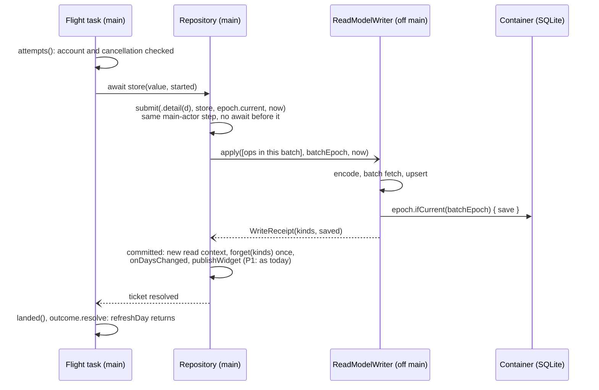

# Read-model writes off the main actor

**Status:** accepted by the lead (§10); P1 built on `perf/persistence-off-main`, P1b in progress. ios-architect, 2026-11-17, against `origin/main` 1b8549d. ADR draft:
`docs/adr/0018-read-model-writes-run-off-the-main-actor.md`.

**Follow-up to** Nocturne PR 3 (#114) review rows 22–24 (`docs/work/2026-11-16-nocturne/review.md` on
`feat/nocturne-gauge`). **Owner:** sync-engineer.

**Sources.** "Read" means from the code at 1b8549d. "Measured" means performance-profiler's PR 3 runs. "Assumed" means
nobody has checked it yet; each Assumed fact is a T0 check (§7.1) that runs before anything else is built.

## 1. Problem

Every cold start drops about 11 frames in the first ~0.3 s after `.active`, with or without the launch sequence. The
longest main-thread gap is 123–171 ms (Measured: Release, iPhone 17 Pro simulator, demo mode, n = 12).

Time Profiler, 0–90 ms after `.active`, 85 main-thread samples (1 ms each):

| Frame (inclusive) | Samples | What it does on main (Read) |
|---|---|---|
| `Repository.store(scores:)` via `refreshHistory` | 28 | 90 single-row fetches (`row(for:)`), 90 encodes, a save |
| `Repository.store(detail:)` via `refreshDay` | 15 | a fetch, 2 encodes (detail, score), a save, `publishWidget()` |
| `row(for:)` / `dayRow` (nested in the two above) | 15 | one `FetchDescriptor` per day |
| `publishWidget` / `widgetFacts` | 12 | decodes 90 history rows (memo just dropped), reads, compares and atomically rewrites `readiness.json` |
| `Repository.store(user:)` | 9 | delete all, insert, encode, save |
| `TrainStore.save` | 8 | most likely the Repository's own saves (`changed()` → `store.save()`) (Assumed; the inverted tree confirms) |
| `TrainSyncService.flush` | 4 | `pendingOps()` fetch |
| JSON encode (nested in the above) | ~20 | `DayDetail`, `User`, `SleepDetail`, `DailyScore` |

About 76 of the 85 samples are persistence or the widget. Then 45–85 ms of Today re-render follow.

A second stall comes about 1.0 s after `.active` (40–90 ms): `store(trend:)` with `TrendSeries.encode`,
`store(activities:)`, and `RyftApp.refreshTrain` → `TrainLibrary.refresh` → `TrainStore.cache(exercises:)` / `save`.

The rule this breaks: CLAUDE.md rule 5 says JSON encoding never runs on the main actor. The Repository encodes every
answer on main, and it also fetches, upserts and saves there.

**Not in scope:** the hand-off stall (row 23, the gauge built twice), the `AppClock.sleep` tolerance (row 24), and the
Today re-render itself. §7.3 explains why the re-render decides whether "≤ 33 ms" is reachable.

## 2. Constraints

- **The sync design doesn't change.** Anchored HealthKit reads, then page → upload → persist anchor, then the
  pipeline `upload → awaitScoring → refreshDays → (trends ∥ insights)`. The anchors live in `UserDefaults`
  (`HealthKitManager.anchorKey`), and `SyncEngine`, `SyncService` and `HealthKitManager` don't touch SwiftData (Read).
  This work changes none of that: it changes only how a refresh's answer reaches the store.
- **ReadScheduler semantics hold** (ADR 0001): coalescing, retries, the budget and the record. Its `store` still runs
  inside the flight, once, even when the caller is cancelled. An answer for an account that has gone is still dropped
  unwritten.
- **The server is the truth.** The read models are a cache, so a write lost to a kill is re-fetched. Nothing here may
  make the cache show another account's data.
- **Upload gates fail closed** (ADR 0008). `OnboardingCoordinator.facts` reads `consentVersion` from `state.user`,
  which is the Repository's cached user (Read). `withdrawConsent()` sets `state.user` and relies on the gate closing in
  the same main-actor step.
- **One owner per row.** Two contexts writing the same row means merge conflicts and failed saves.
- **iOS 17+, Swift 5.10, approachable concurrency, no new dependencies, no schema change, no pbxproj edit.**

## 3. Facts that shape the design

| # | Fact | Source |
|---|---|---|
| F1 | Nothing uses `@Query`. Views see the store only through `Repository` reads, which use per-kind revisions and a memo. | Read |
| F2 | The Repository hands out decoded values only. No `@Model` object leaves it (`dayRow` and the others are private). | Read |
| F3 | Every read-model fetch runs on `container.mainContext` (`TrainStore.context`), the same context that Train's live sessions mutate. | Read |
| F4 | `TrainStore.wipe` runs synchronously on main inside `AuthService.wipeSharedLocalData`, then `ReadinessSnapshot.clear()` runs. Batch deletes commit at once; object deletes land in the final save. | Read; wipe-recovery design §2 (Proved) |
| F5 | The Repository writes 7 tables plus the `CachedDocument` keys `activities.*`. Every other `CachedDocument` key (`reads.state`, `config.*`, `consent.*`, `journal.*`, `push.*`, `devices.*`, `feedback.queue`, `train.*`, `content.trackers`) is written through `Persistence.saveDocument*` on main. | Read |
| F6 | Production code writes the store synchronously through setters in 7 places: `state.user =` (Notification settings, Onboarding ×4; the one in `ProfileView` is a preview), and `repository.store(activity:)` / `forget(activity:)` in the uploader's follow-ups. Previews and about 16 test files seed through the same setters. | Read |
| F7 | `cachedDay(ofActivity:)` reads the store to decide a write (which other day an activity was cached under). | Read |
| F8 | **Measured (T0.1), and the two OSes disagree.** iOS 27.2: a `@ModelActor`'s jobs run synchronously on the thread that *awaits* them, under the context's queue, wherever the actor was made; a main-actor await while a job runs elsewhere blocks main (180 ms of a 200 ms job). iOS 17.0: the thread that *made* the actor decides; made on main, it runs on main even when awaited from a `@concurrent` function. Only "made off main and awaited off main" runs off main on both. | Measured on 17.0 and 27.2; 18–26 not measured |
| F9 | A fresh `ModelContext` on the same container sees rows saved by another context. A context that already fetched a row may keep the old values. | Assumed, T0.2 and T0.3 |
| F10 | Two contexts on one in-memory container share its store (the demo store). | Assumed, T0.2 |
| F11 | Swift actors run jobs by priority, not first in, first out. Two `await writer.apply(…)` calls from different tasks can run in either order. | Language |

## 4. Options

| | **A. One `@ModelActor` writer per store, ordered queue (chosen)** | B. Encode off main, write on main | C. A second `ModelContainer` on the same file |
|---|---|---|---|
| What moves off main | Encode, fetch, upsert, save (P1); the widget's facts and file I/O (P2) | Encode, done in the fetch closure; widget file I/O | The same as A |
| Left on main in the 0–90 ms burst (estimate) | ≤ 5 samples (submit, commit bookkeeping) | ~25–35 samples (batched upsert, 3–5 saves, widget facts) | ≤ 5 |
| SQLite saves on main (device, real data) | None for read models | All of them | None |
| Read-your-writes on main | Needs write-through for `.user` (§5.4) | Free: writes stay synchronous | As A |
| Account wipe vs a write in flight | `StoreEpoch` lock (§5.6) | A plain epoch compare on main | As A, plus two coordinators on one file |
| Ordering | Explicit queue (F11) | Synchronous store inside the flight, as today | As A |
| New types | `ReadModelWrite`, `ReadModelWriter`, `StoreEpoch`, `WriteTicket` | `Encoded<T>` | As A, plus a container |
| Rule 5 (no encoding on main) | Met | Met for flights; setters still encode | Met |
| Risk | Two-context SwiftData behaviour on iOS 17 (T0) | Low | Highest: two row caches and WAL contention on one file, so stale reads are likelier |

**Choice: A.** B removes the encoding but leaves about a third of the burst on main, and every save on a real device.
Both A and B need an awaited store, ordering and an epoch guard, so most of A's cost has to be paid anyway. C gives
nothing that A doesn't, and doubles the coordinators. **B is the fallback** if T0.1 or T0.2 fails: it keeps P2's file
I/O and P3 unchanged.

**One writer per store, not per kind.** All kinds share one container and one file, so their saves serialize at SQLite
anyway. `markTrendsStale` must follow the trend write, so the kinds need one queue. More contexts would mean more places
for stale objects. The live store and demo's in-memory store each get their own writer, two instances.

## 5. Design

### 5.1 Who writes what

| Rows | Writer | Read by |
|---|---|---|
| `CachedDay`, `CachedTrend`, `CachedInsight`, `CachedUser`, `CachedSleepRange`, `CachedWorkout`, `CachedDocument` `activities.*` | the store's `ReadModelWriter`, off main | the Repository's **read context** (main), and nobody else |
| Every other `CachedDocument` (F5) | main context, through `Persistence` | main context |
| Train tables (`LocalSession…`, `CachedExercise`, `CachedPlan`, `PendingTrainOp`, `ImportMapping`, `PendingImport`) and the activity tables | main context (`TrainStore`, `ActivityStore`), unchanged | main context |
| Everything, at sign-out or account change | `TrainStore.wipe` on main. It is the one cross-owner operation, ordered against the writer by `StoreEpoch` | — |
| `compact()` | the writer for read-model rows; main (`Persistence`) for `train.history.*` documents | — |

Review check: outside `ReadModelWrites` and `TrainStore.wipe`, no code calls `insert` or `delete` on a writer-owned type.

### 5.2 Types and signatures

```swift
// Persistence/ReadModelWrite.swift: what a write is, as values. Nothing here is a @Model.
enum ReadModelKind: String, CaseIterable, Sendable { case days, trends, insights, user, sleep, workouts, activities }

enum ReadModelWrite: Sendable {
    case detail(DayDetail)
    case scores([DailyScore])
    case replaceScores([DailyScore])            // previews and tests (AppState.history's setter)
    case trend(TrendSeries, key: String)
    case insights([Insight])
    case user(User)
    case sleepRange(SleepRange)
    case workout(WorkoutDetail)
    case activities([SportActivity], day: String)
    case activity(SportActivity, strip: [String])          // read, modify and write in one job (F7)
    case forgetActivity(UUID, strip: [String], hint: String?)
    case markTrendsStale
    case compact(dayCutoff: Date, month: Date, week: Date)
    case clear                                              // the demo switch
    var kinds: Set<ReadModelKind> { get }
}

struct WriteReceipt: Sendable {
    var kinds: Set<ReadModelKind> = []      // the revisions to bump
    var saved = false
    var dropped = false                     // its epoch was over (a wipe): nothing was written
    var removed = 0                         // compact
    var cachedUnder: [UUID: String] = [:]   // the day an activity was cached under before the write (F7)
}

/// The one implementation of every write, for whichever context runs it: the writer's in the app, a main one in `seed`.
/// Batch fetch: one `#Predicate { keys.contains($0.day) }` per op, not one fetch per day.
enum ReadModelWrites {
    static func apply(_ op: ReadModelWrite, in context: ModelContext, now: Date, into receipt: inout WriteReceipt)
}

// Persistence/ReadModelWriter.swift
@ModelActor
actor ReadModelWriter {
    /// Made and awaited only inside `ReadModelDrain` (F8, decision 8): never made on, nor awaited from, the main actor.
    static func make(_ container: ModelContainer) async -> ReadModelWriter
    /// `MainThread.assertOff` in Debug. Autosave off. Applies `ops` in order; saves once, inside
    /// `epoch.ifCurrent(batchEpoch)`; on a mismatch rolls back and returns `dropped`. Signpost "write" (`Signposts.reads`).
    func apply(_ ops: [ReadModelWrite], batchEpoch: Int, epoch: StoreEpoch, now: Date) -> WriteReceipt
}

// Persistence/StoreEpoch.swift: OSAllocatedUnfairLock<Int> (iOS 16+). Bodies never await and never hop to main.
final class StoreEpoch: Sendable {
    var current: Int { get }
    func advance()                                                    // TrainStore.wipe, first step
    func ifCurrent<R>(_ epoch: Int, _ body: () throws -> R) rethrows -> R?   // the writer's save; P2's file write
}

// Environment/Seams.swift
protocol Persistence: AnyObject {          // + two members; TrainStore implements them
    var epoch: StoreEpoch { get }          // replaces TrainStore's `private(set) var epoch: Int` (TrainSyncService.Generation reads `.current`)
    func readModelWriter() async -> ReadModelWriter   // lazily `make`s one; `wipe` retires it
}

// Repository (stays @MainActor @Observable). The same method names as today, now submitting.
@discardableResult func store(detail: DayDetail) -> WriteTicket           // and scores, trend, insights, user, …
@discardableResult func store(activity: SportActivity) -> WriteTicket      // receipt.cachedUnder replaces cachedDay(ofActivity:)
func settled() async                       // every write submitted so far has committed or was dropped
func seed(_ ops: ReadModelWrite...)        // previews, tests, LegacyCacheMigration: applied at once on a main context
struct WriteTicket: Sendable { func committed() async -> WriteReceipt }

// ReadScheduler (in Repository.swift)
typealias Store = @MainActor (any Sendable, Date) async -> Void   // was synchronous; synchronous closures still convert
```

**Deleted:** `cachedDay(ofActivity:startingOn:)` (now `receipt.cachedUnder`), `Repository.changed`'s `store.save()`, and
`forceLive` with `writingToAccountStore`, if the lead drops `LegacyCacheMigration` (Q2). Otherwise those two become a
`seed` on the live store.

### 5.3 The write path



**The queue** (inside the Repository, main actor):
- `submit` appends `(op, store, epoch, ticket)` and starts the drain task if none is running. It never awaits.
- The drain takes everything pending, cuts it into batches that never span a store or an epoch, and awaits
  `writer.apply` for one batch at a time. On main it then runs `committed(receipt)` and resolves that batch's tickets.
- So one answer becomes one save, and several answers in one turn become one save and one revision bump per kind. The
  drain runs at `.userInitiated`, whoever submits first (decision 12).

**Callers.**

| Caller | Change |
|---|---|
| Repository `refresh*` | `store: { [weak self] in await self?.store(detail: $0).committed() }`. A refresh returns after its rows are readable, as today. |
| `refreshWorkout` (no scheduler) | `await store(workout: w).committed()` |
| `LiveSyncSteps.refreshTrends` | `await state.repository.markTrendsStale().committed()`, so the stage ends written |
| `ActivityUploader.connect` follow-ups | One `Task`: `let r = await repository.store(activity:).committed()`, then `coordinator.run(.daysChanged(days ∪ r.cachedUnder))` |
| `state.user =` in production (F6) | `state.repository.store(user:)`. Write-through (§5.4) keeps the gate's read in the same step. Callers that are already async also await `committed()`. |
| `AppState` setters (`today`, `history`, `user`, `insights`, `readinessWeek`) | `seed`. Previews and tests are unchanged. Debug asserts that the setter isn't used on the live graph. |
| `BackgroundWork` compaction | `compact: @MainActor () async -> Void`, so the task completes after the commit |
| Tests that call `repository.store…` and read at once | `seed(…)`, or `await … .committed()` (mechanical) |

### 5.4 How readers see the writes

- **No `@Query` and no reliance on merges** (F1, F9). The Repository stops reading through `mainContext`. It reads through
  its own **read context** per store, `ModelContext(container)`, created on main, autosave off, never written.
  `committed` and `invalidate()` replace it, so no stale object can survive a commit or a wipe. A fetch then goes to
  the store, and the memo was dropped for those kinds anyway.
- **Revisions bump at commit, once per kind per batch.** The observers re-render and re-read, which is today's
  mechanism. Today renders once per days batch instead of once per store.
- **Write-through for `.user` only.** At submit, `memo["user.current"] = user` and `userRevision` bumps. A commit never
  overwrites that entry: the memo holds the last user submitted, and the store converges when its commit lands.
  `invalidate()` clears it. Reason: the upload gate decides from `state.user` (§2, ADR 0008). Rule for later kinds: a
  kind that a gate or a decision reads back in the same step is written through, and adding one is a review check.
- **Days and activities aren't written through.** Their derived reads (history windows, a day's list) must change
  together, and a render with a new today beside an old history could flash the wrong hero state. Their callers await
  the commit anyway.
- **Freshness checks** (`isDetailFresh`, `refreshTrend` `.ifStale` …) read through the read context, so for the few ms
  before a commit they see the state before it. The worst case is one redundant or one skipped revalidation. That is
  benign: TTL-based, the next trigger corrects it.

### 5.5 Ordering

| Order that matters | How it holds |
|---|---|
| Two answers for one key: the later one wins | The queue runs in submit order (F11 makes the actor alone insufficient) |
| `markTrendsStale` after the readiness-week write | Submitted after it in `refreshTrends`; the queue is FIFO |
| `store(activity:)` before the coordinator's `refreshActivities` for that day | Submitted first, synchronously, in the follow-up |
| `clear()` (demo switch) after the old side's pending writes | FIFO, and each op carries its own store |
| `refreshHistory` vs `refreshDay` | **No order exists today.** `AppState.refresh` and `refreshDays` run them in one task group, and `score(_:)` prefers the detail's score over the list's. The queue keeps landing order, which is today's order. |
| Upload, anchors, the pipeline's stages | Untouched (§2). Each refresh stage still ends after its rows are written. |

### 5.6 Concurrency safety

**Sendable boundaries.** Only `ReadModelWrite`, `WriteReceipt`, `WriteTicket`, `StoreEpoch`, `ModelContainer` and `Date`
cross. The wire structs inside `ReadModelWrite` are already implicitly `Sendable` (`ReadScheduler.run<T: Sendable>`
compiles with them). P1 makes the conformance explicit on `DayDetail`, `DailyScore`, `TrendSeries`, `Insight`, `User`,
`SleepRange` and `WorkoutDetail`, and on their nested types. That adds conformances only, no shape change, so `API.md`
is still mirrored. No `@unchecked Sendable`, no `nonisolated(unsafe)`, no `Task.detached`.

**No `PersistentModel` crosses a context.** The writer returns kinds, counts and day strings. Nothing needs a row
handle today. If an op ever does, it carries a `PersistentIdentifier`, never a model.

**Swift 6 readiness.** `ReadModelKind` moves out of the `@MainActor` Repository so the writer can name it. `ReadModelWrites`
is nonisolated and takes its context as a parameter. Check: a one-off command-line build with
`SWIFT_STRICT_CONCURRENCY=complete` (no pbxproj change, Q6), with zero new diagnostics in the new files.

**Races.**

| Race | Today | After | Guard |
|---|---|---|---|
| An answer lands after the account changed | Dropped in `attempts`, with no await before the store | Same: submit is in that step | ReadScheduler |
| A write is queued when the wipe runs | n/a (synchronous) | The batch's epoch is old, so the writer rolls back and drops it | `StoreEpoch` |
| The writer is saving while the wipe starts | n/a | `advance()` waits for the save (one lock), then the wipe's deletes remove those rows | `StoreEpoch` |
| The wipe runs between the writer's check and its save | n/a | Impossible: check and save are one critical section | `StoreEpoch` |
| The writer's context holds rows the wipe deleted | n/a | `wipe` retires the writer; the next op `make`s a new one | `Persistence.readModelWriter()` |
| The read context holds deleted rows | (mainContext) | `invalidate()` replaces it | Repository |
| A demo switch with writes pending | n/a | Each op writes its own store; `clear()` follows FIFO | queue |
| Two contexts write one row | n/a | The ownership table (§5.1); `seed` asserts the queue is idle | review, Debug |
| The widget file is written after sign-out (privacy) | `clear()` is synchronous | P2: the file write is inside `epoch.ifCurrent`, and `clear()` runs after `advance()` | `StoreEpoch` |

The lock is held on main only for `advance()`, which waits for at most one writer save. It is never held across an
`await`. `TrainStore.wipe` calls `epoch.advance()` as its first step, where `epoch += 1` is today. A failed main wipe
no longer poisons read-model writes, because they're in another context. That is a small improvement on the
wipe-recovery design's §2.

### 5.7 Widget publishing (P2)

P1 keeps it as today, on main in `committed`, so its background timing doesn't move in that PR. P2 moves it:

- `publishWidget()` (from `committed`, `todayStatus`, `tonightBedtime`, `ledgerChanged` and the tracker watch) becomes
  a queue op, `.publishWidget(WidgetInputs)`. `WidgetInputs` is captured on main: the day key, `scoringLedger()[key]`,
  `todayStatus`, the bedtime, `devicesSetup`, the trackers and `now`. Several requests in one batch make one publish,
  and it runs after that batch's writes.
- The writer computes the facts. It reads today's row and the history window through `ReadModelQueries`, which are the
  shared nonisolated helpers that `Repository.score` and `history` also call, so there's one implementation for two
  contexts. Then `TodayPresentation.decide` and `ReadinessSnapshot.make` run there; both are pure and `Sendable` (Read).
  `ReadinessSnapshot.publish` (read, compare, atomic write, `isExcludedFromBackup`) runs inside `epoch.ifCurrent`.
- If it changed, main calls `reloadWidget()`. That keeps the seam; `WidgetCenter` stays behind it.
- **The background keeps its guarantee.** The flights already end after the commit. The BG refresh, backfill and
  compaction tasks, `finishInBackground` and the silent push's completion first await
  `repository.settledBeforeCompletion()`: the writes, but at most 2 s on `env.clock`, and not past the task's expiry.
  So the widget is current before suspension, as ADR 0013 needs, and a stuck write can't hold a completion. The
  HealthKit delivery's `afterUpload` doesn't wait: its completion comes right after the upload (decision 12).
- **Contract with Nocturne PR 4:** `TodayScoreFacts`, `TodayPresentation.decide`, `OrbitGaugeMode.init(_:)` and
  `ScoringWord.state` stay nonisolated and `Sendable`. No P2 edit lands in `Features/Today/`.

### 5.8 Train (P3, its own step)

Train's tables stay owned by the main context. Live sessions hold `LocalSession` objects and mutate them there.
`TrainSyncService` replays against them with its `Generation`. `createExercise` and `savePlan` write the same rows from
the UI. A second writer would split their ownership. So only the CPU work moves:

| Today, on main | P3 |
|---|---|
| `cache(exercises:)` encodes every payload | Payloads encoded in a `@concurrent` helper before the main write. A row whose bytes and fields are equal isn't touched. |
| `exercises = store.exercises()` decodes every payload | Payloads copied out on main, decoded `@concurrent` |
| `saveDocument(catalog / today)` encodes | `saveDocumentData(await encoded)` (the seam already has it) |
| `TrainStore.save()` with nothing changed | `guard context.hasChanges` |
| `TrainSyncService.flush` (4 samples) | Unchanged |

### 5.9 What doesn't change

The HealthKit anchors and their commit order. `SyncEngine` and its off-main encode. The coordinator's stages, coalescing,
priorities and cancellation. ReadScheduler's retry, budget, coalescing and record (only `Store` becomes async).
ADR 0013's ledger (in memory, one owner). The read API (`day`, `score`, `history`, `trend` … stay synchronous and
memoized, with `decodes` counted). The schema. The widget's JSON shape.

## 6. Migration

- **Store:** no schema change, no `VersionedSchema`, no data migration. The same file and the same `ModelContainer`
  instance; the writer is a second context on it, never a second container.
- **Code, in P1's order:**
  1. T0 checks (§7.1). If T0.1 or T0.2 fails, stop and report: option B.
  2. Characterization tests on today's code (§7.2 "before").
  3. `StoreEpoch` and `Persistence.epoch`: `TrainStore.epoch` moves into it, and `TrainSyncService.Generation` reads
     `.current`.
  4. `ReadModelWrite` / `ReadModelWrites.apply`, taken out of today's `store*` bodies with batch fetches; `seed` runs it
     on a main context.
  5. `ReadModelWriter`, the queue, the read context, and `ReadScheduler.Store` made async.
  6. Production callers (§5.3). `cachedDay(ofActivity:)` deleted. The test migration (`seed` or `await`).
  7. Docs: ARCHITECTURE.md §3 ("the rule", "Accounts and demo"), ADR 0018, a CHANGELOG line under Fixed ("Opening the
     app no longer stutters while today's data loads").

## 7. Tests

### 7.1 T0: prove the Assumed facts first (P1's first commit, kept as tests)

| # | Check | Fails → |
|---|---|---|
| T0.1 | `ReadModelWriter.make` from main; `apply` records `Thread.isMainThread == false`, on iOS 27 and on the oldest runtime available (Q3) | The fallback, B |
| T0.2 | A writer commit is read by a fresh main `ModelContext`, in memory (demo) and on disk (`TrainStore(url:)`) | B |
| T0.3 | A main context that fetched the row before the commit: does it see the new bytes? (Documents F9; we replace the context either way) | — |
| T0.4 | A wipe (batch deletes and save on main) while the writer has those rows registered, then the writer upserts the same unique `day`: no error, one row | Retire on every wipe (already planned) |
| T0.5 | `#Predicate { keys.contains($0.day) }` with 400 keys on the writer | Chunk by 100 |

### 7.2 Behaviour, before and after

"Before" tests land first and pass on today's code. They fix the semantics the refactor must keep.

| Test (suite) | Before | After |
|---|---|---|
| `aLaterAnswerForTheSameDayWins` (`RepositoryTests`) | ✓ | ✓ through the queue |
| `aRefreshReturnsAfterItsRowIsReadable`: `refreshDay` returns, then `day(k)`, `lastUpdated` and `onDaysChanged` once | ✓ | ✓ |
| `trendsAreStaleAfterTheRefreshTrendsStage` | ✓ | ✓ |
| `aTrendsWriteNeitherDecodesNorRerendersDays` (`RepositoryInvalidationTests`) | ✓ | ✓ |
| `withdrawingConsentClosesTheUploadGateInTheSameStep` (`ConsentGateTests`): after `withdrawConsent()`'s write, `uploadGate(.healthKit)` before any await | ✓ | ✓ (write-through) |
| `aDemoWriteNeverReachesTheAccountStore` | ✓ | ✓ |
| `compactionRemovesWhatItRemovedBefore` (counts) | ✓ | ✓ |
| `aConfirmedActivityMovedFromAnotherDayRescoresBoth` (`ActivityEditingTests`) | ✓ | ✓ via `cachedUnder` |
| `aWriteQueuedBeforeASignOutLeavesNoRow`: submit, wipe, `settled()`, the store is empty | — | ✓ |
| `aWriteSavingDuringTheWipeIsDeletedByIt`: a test hook holds a batch inside `ifCurrent`; the wipe waits, then deletes | — | ✓ |
| `aWriteAfterTheWipeGoesToAFreshWriter` | — | ✓ |
| `readModelWritesRunOffTheMainThread` (hook records the thread; Debug `assertOff`) | — | ✓ |
| `answersInOneTurnSaveOnceAndBumpEachKindOnce` (receipt and revision counts) | — | ✓ |
| `aWriteSurvivesARelaunch` (`TrainStore(url:)`, a new store on the same URL reads it) | — | ✓ |
| `seedWhileTheQueueIsBusyAsserts` (Debug) | — | ✓ |
| Stress: 200 submits from concurrent tasks plus a wipe in the middle; no old-epoch row, no failed save logged. Run once under TSan locally (Q7). | — | ✓ |
| P2: `aSignOutDuringAPublishLeavesNoSnapshot`; `aDaysBatchPublishesTheWidgetOnce`; the existing `ReadinessSnapshot` and ADR 0013 widget tests are byte-identical | — | ✓ |
| P3: `anUnchangedLibraryWritesNothing` (`hasChanges` false); `exercisesDecodeOffTheMainThread` | — | ✓ |

Every wait goes through `settled()`, `committed()` or the bounded `eventually {}`, never an unbounded loop.

### 7.3 Performance acceptance

**"≤ 33 ms after `.active` in demo mode" isn't reachable by this work alone.** The Today re-render after the first data
is 45–85 ms on its own (Measured), and demo's in-memory store starts empty on every launch, so that render always
happens. The criteria below gate this work; the 33 ms budget for the whole window becomes the criterion of the Today
render follow-up (row 23 and the first data render, Q1).

| # | Criterion | PR |
|---|---|---|
| AC1 | 0–2 s after `.active`, main thread: **0 samples** in `ReadModelWrites`, `ReadModelWriter`, `WireCoding.encode`, `ModelContext.save` reached from the Repository; ≤ 3 samples per batch in `Repository.submit` / `committed` | P1 |
| AC2 | The same for `widgetFacts`, `ReadinessSnapshot.publish` and `make` | P2 |
| AC3 | 0–0.3 s, variant A (skip): dropped frames median ≤ 5 (from 11); longest gap median ≤ 90 ms (from 123–171), and no gap over 33 ms contains a persistence sample | P1 + P2 |
| AC4 | 0.5–2 s window: longest main-thread gap ≤ 33 ms at p90, at most 1 dropped frame (the ~1.0 s stall is gone) | P1 + P3 |
| AC5 | No launch regression: App.init → `first-screen` median within +10 ms of the main baseline (bootstrap CI as in PR 3); variant B's hand-off time unchanged | each |
| — | Not gating, once: a signed-in launch with real data on a device at 120 Hz, the same windows | after P2 |

**How to measure** (performance-profiler, PR 3's harness, quiet machine, the same simulator at 60 Hz):
1. Release build for the iPhone 17 Pro simulator from the branch, installed.
2. Frame cadence: copy the branch to a scratch folder, apply the PR 3 probe (`perf-pr3/src-probe/Ryft/App/PerfProbe.swift`
   and its call sites; never committed), then `python3 -I perf-pr3/tools/probe_harness.py skip,play 24 <out>` and
   `probe_analyze.py <out>`. That gives n = 12 per variant, the first run skipped, and medians and p90 of dropped
   frames and the longest gap per window.
3. Attribution: Time Profiler + Points of Interest (`xctrace record`, 3 cold launches, A), then `perf-pr3/tools/export.sh`
   and `slices.py <pkl> <active> 0 2000 90`. Add `ReadModelWriter`, `ReadModelWrites`, `WireCoding`,
   `ReadinessSnapshot` and `Repository.submit` to `slices.py`'s categories. The new "write" signposts show the writer's
   intervals off main.
4. Compare against the main baseline from the same session: `AB-release.json` is PR 3's, so re-run main on the same day.

## 8. Tickets

| Order | PR (title) | Owner | Scope | Acceptance | Don't touch |
|---|---|---|---|---|---|
| 0 | — | lead | Merge #114 first: P1 touches `RyftApp.swift`, `HealthPermissionView.swift` and `ARCHITECTURE.md`, which #114 changes | — | — |
| 1 | `perf: read-model writes off the main actor` | sync-engineer | §5.1–5.6, §6. `Persistence/` (Repository, ReadModels, three new files), `TrainStore.swift` (epoch, writer handle), `Seams.swift`, `AppState.swift`, `ActivityUploader.swift`, `SyncCoordinator.swift` (`refreshTrends`), `ScheduledWork.swift` / `RyftApp.swift` (compaction), the production `state.user =` sites, `Models.swift` (`Sendable` only), tests, ARCHITECTURE.md §3, ADR 0018, CHANGELOG | T0 green; §7.2 rows P1; AC1, AC5; Unit and UISmoke green; zero warnings; `make lint` | the upload path, `HealthKitManager`, ReadScheduler's retry and budget, `ScoringWord` and the ledger, `TrainSyncService`, the schema, `Features/Today`, `Features/Sleep`, `Design/`, `Preview/` |
| 2 | `perf: the readiness widget publishes off the main actor` | sync-engineer | §5.7: `.publishWidget`, `ReadModelQueries`, `settled()` before system completions (`ScheduledWork.swift`, `AppDelegate`, `RyftApp.observeHealthKit`) | §7.2 rows P2; AC2, AC3; widget JSON unchanged | `Shared/ReadinessSnapshot.swift`'s shape, `RyftWidgets/`, `Features/Today` (contract only) |
| 3 | `perf: Train's library coding off the main actor` | sync-engineer (a Train owner reviews) | §5.8: `TrainLibrary.swift`, `TrainStore.swift` (`cache`, `save`) | §7.2 rows P3; AC4 | sessions, the outbox, `TrainSyncService`, `wipe` |
| 4 (optional) | `perf: an unchanged answer keeps the decoded read models` | sync-engineer | The receipt tells content apart from fetch times; when only the times changed, keep the content memo and drop only `fetchedAt.*`. It helps real accounts, not demo. | measured on a signed-in device first (Q4) | — |

P3 can go in parallel with P2 once P1 is merged (it shares `TrainStore.swift` with P1, not with P2).

**Nocturne PR 4** (`Features/Today/`, `Features/Sleep/`, `Design/`, `Preview/MockData.swift`) doesn't collide with any of
these files. P1 changes no read API that Today or Sleep calls, and `SleepPlannerViewModel`'s `tonightBedtime` setter is
unchanged. P2 depends on PR 4 keeping the four widget types in §5.7 nonisolated and `Sendable`: one line in PR 4's
brief. The order between PR 4 and P1–P3 doesn't matter.

## 9. Risks

| Risk | Impact | Mitigation and detection |
|---|---|---|
| F8: the writer runs on main | The work doesn't move, or main blocks behind a job | The drain makes and awaits the writer inside its own isolation, and it is `private` there (no main-actor path to it); Debug `assertOff` at creation and in every job; the off-main test through `Repository`, passing on iOS 17.0 and 27.2; AC1 |
| F9/F10 differ on iOS 17 (stale reads, demo store not shared) | Wrong or empty screens | Read context replaced at each commit; T0.2 and T0.3 on the oldest runtime (Q3); fallback B |
| The wipe resurrects an account's rows | Privacy | `StoreEpoch` critical sections, retiring the writer, two race tests, the stress test |
| The widget file outlives sign-out (P2) | Privacy, on the lock screen | The file write inside `ifCurrent`; `clear()` after `advance()`; a test |
| The gate reads a stale user | An upload after a withdrawal (ADR 0008) | Write-through for `.user`; the same-step gate test |
| Background completions before the commit | The widget or Today behind after a push or BG run | Flights await commits (P1); `settled()` before completions (P2) |
| Two writers to one row | Failed saves, lost writes | §5.1 table, a review check, `seed` assertion |
| Lock misuse (an await or a main hop inside) | A deadlock (a hang) | Bodies are synchronous and short; the stress test runs under a bounded `eventually` |
| Test churn: a write read before its commit | Flaky tests | `seed` for fixtures, `committed()` / `settled()` for flows; no sleeps |
| A kill before a commit | A cached answer lost | Benign: re-fetched (the server is the truth); flights only resolve after the commit |
| Freshness read before the commit | One extra or skipped revalidation | Accepted (§5.4) |
| Commits change when Today re-renders under the launch overlay | The hand-off timing shifts | AC5 re-measures variant B |
| The re-render keeps the gaps over 33 ms | Expectation | Stated in §7.3; Q1 |

## 10. Open questions for the lead

**Lead decisions, 2026-11-17** (#114 is merged, so ticket 0 is done; the branch is on `main` 7358f0c):
1. **The split criterion is accepted.** AC1–AC5 belong to these PRs. The full-window 33 ms budget moves to the Today
   render follow-up, with Nocturne PR 3 review row 23.
2. **`LegacyCacheMigration` stays.** Deleting it, `forceLive` and `writingToAccountStore` is its own cleanup PR later,
   not part of a performance change.
3. **No iOS 17 runtime here**, only iOS 27.0–27.2, and no device session without the user. T0 runs on iOS 27.2. The
   iOS 17 check goes on the user's list (download a runtime or test a device); the risk is written into the PR.
4. **P4 later**, after P1–P3 are measured.
5. **Yes:** sync-engineer owns the completion edits in `AppDelegate`, `ScheduledWork` and the HealthKit observer.
6. **Yes:** a one-off `SWIFT_STRICT_CONCURRENCY=complete` command-line build is allowed, with no project change.
   Report its new diagnostics in the touched files; don't fix unrelated ones.
7. **TSan runs locally per PR** (a `-enableThreadSanitizer YES` test run of the touched suites). A CI job is a separate
   decision (the runner is the user's Mac).
8. **T0.1 failed; the design takes A′, enforced by structure** (2026-11-17). `ReadModelWriter` is `private` to a plain
   `actor ReadModelDrain` that owns the submit-order queue and calls the writer. `Repository` submits synchronously
   and awaits only the `WriteTicket`, whose completion is a continuation, not a writer job. So no main-actor code can
   await the writer, and the rule is a property of the code, not a review check. Debug `MainThread.assertOff` in
   every writer job, plus a test that a write submitted from the main actor runs off main (the real path, not the
   probe). Option B is not taken: the upserts are most of the stall, not the encoding.
   **Amended after T0 on iOS 17.0:** there the thread that makes the actor decides, so the drain also *makes* the
   writer inside its own isolation, with Debug `assertOff` at creation. Both conditions hold by structure; the gate
   test passes on 17.0 and 27.2 (`ReadModelOffMainTests`).
9. **The completion edits** (`AppDelegate`, `ScheduledWork`, the HealthKit observer) are in P1, as the brief says,
   because P1's flights await the commit.
10. **The other gaps the implementer found** belong to P1: `AppState.patchUser` and the onboarding's `.me` flight store
    are user writers too (write-through), `CountingPersistence` implements the new members, and
    `TrainImportUploader.generation` reads `TrainStore.epoch`.
11. **iOS 17.0: only the newest container of the schema takes inserts (T0.6).** Once the demo's container exists, a
    save of new rows into the account's older container fails (NSCocoaErrorDomain 134020) until a relaunch, on `main`
    too. On `main` the read models still showed in that session (unsaved in `mainContext`) and Train or activity rows
    were lost at relaunch; with P1 the writer rolls back, so Today shows nothing new. The path is "try the demo, then
    sign in", which every new user may take. **Decision: P1b**, in this PR: when the demo ends, the app releases the
    demo's container and reopens the account's, before the account's first write, on every OS (one code path; harmless
    on 27.2). One container with two configurations is not taken: an entity belongs to one configuration, and both
    stores hold every entity. Gate: on iOS 17.0, demo → sign in → a Train row and a read-model write land and read back
    without a relaunch. 17.1–17.6 are not measured.
    **Amended after T0.6 per runtime (2026-11-17), superseding "in this PR":** the app-path test
    (`ReadModelContextFactsTests/TwoContainers/theAccountsFirstWritesAfterTheDemo`) loses the account's first writes on
    iOS 17.0 and keeps them on 18.0, 26.0 and 27.2. So the fault is iOS 17's, not P1's, and it is on `main` already.
    The reopen is not harmless everywhere: a live Train session started in the demo lives in the account store
    (`TrainStore.shared`). **P1b becomes its own follow-up PR, iOS 17 only** (`#unavailable(iOS 18)`): when the demo
    ends, its workouts are discarded after a confirmation (the user's decision), then the account's container is
    reopened so it is the newest. Until then the known issue is in STATUS: on iOS 17, after "demo, then sign in",
    relaunch before the first sync lands. The tests that hit it carry `withKnownIssue` below iOS 18.
12. **The review round (2026-11-17, `523e34d..53d7c48`)** changed four claims in this note; the code comments and
    `ARCHITECTURE.md` say the same:
    - **The demo switch replaces the store** rather than clearing it: `AppState.reset()` calls `Repository.reset()`,
      which releases demo data's store and drops its queued writes, then `invalidate()` (CR1).
    - **`StoreEpoch` has two locks:** a save gate (`advance`, `ifCurrent`), always taken first, and a value lock that
      reading `current` takes alone, so main never waits behind a save (CR2). Writers, read contexts and seeds are
      keyed by a never-reused `StoreID`, not `ObjectIdentifier` (N1).
    - **The drain runs at `.userInitiated`** whoever submits first, instead of inheriting the submitter's priority (§5.3).
    - **System completions wait at most 2 s** (`settledBeforeCompletion()` on `env.clock`, ended at once by expiry or
      cancellation), and **the HealthKit delivery's completion doesn't wait at all** (§5.7).
    - User answers are stored as of their request (`userChange()` / `askedAt`): a PATCH or `/me` answer that the
      sign-out, the demo switch or a later local change overtook is dropped. `Repository.replaceScores` is gone.

1. **Accept the split criterion?** This work gates on AC1–AC5. "Every gap ≤ 33 ms after `.active`" moves to the Today
   first-data render follow-up, together with row 23.
2. **Delete `LegacyCacheMigration`?** It imports pre-SwiftData `ResponseCache` files once. If every install has run a
   build that migrated, it goes, and so do `forceLive` and `writingToAccountStore`. Then `seed` is previews and tests
   only.
3. **iOS 17 coverage.** Is an iOS 17.x simulator runtime installable locally, or is there a device? T0 has to run on
   the oldest supported OS. CI has only iOS 27.
4. **P4 now or later?** It pays off for signed-in launches and pulls, not for demo.
5. **P2 edits the completion paths** (`AppDelegate`, `ScheduledWork`, the HealthKit observer). Is sync-engineer the
   owner of those lines?
6. **A one-off `SWIFT_STRICT_CONCURRENCY=complete` command-line build** as P1's Swift 6 check: allowed (no pbxproj
   change)?
7. **TSan:** a CI job for the persistence suites (a workflow change, ci owner), or a local run per PR?
