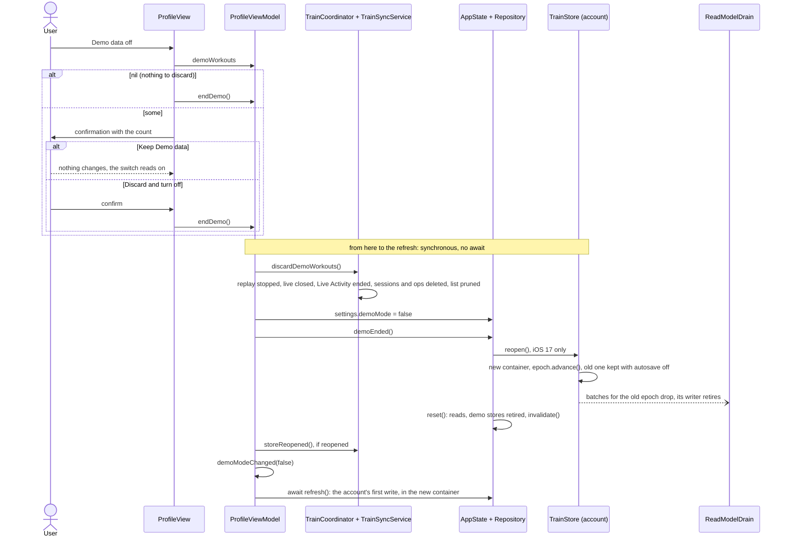

# Ending the demo: its workouts go, and iOS 17 saves again (P1b)

**Amended 2026-11-18:** the user made iOS 18.6 the minimum (its own PR), so the iOS 17 work is not built: the reopen
(§6.2 and its gate, ticket 1) and the one demo store (ticket 6). P1b ships the discard, the exit step without the
reopen, and the confirmation. T0, measured before the decision: T0.7 passed on 17.0, 18.0, 26.0 and 27.2; T0.8 found the
Repository's demo store refusing inserts on 17.0 once `ActivityStore` had made its own (18.0 and later: both save).

**Status:** proposed. ios-architect, 2026-11-18, against `origin/main` 9af6049, on branch `fix/ios17-demo-exit`. ADR:
`docs/adr/0019-ending-the-demo-discards-its-workouts-and-on-ios-17-reopens-the-account-store.md` (new). ADR 0018 gets a
pointer to it.

**Follow-up to** `docs/work/2026-11-17-persistence-off-main/design.md`, decision 11 (as amended), and the STATUS known
issue "iOS 17 only: after 'try the demo, then sign in' …". **Owner:** sync-engineer. ios-developer owns one view,
localization-editor the copy, test-engineer the tests (§10).

**Sources.** "Read" means read in the code at 9af6049. "Measured" means T0.6 runs on iOS 17.0, 18.0, 26.0 and 27.2, as
recorded in `RyftTests/ReadModelContextFactsTests.swift` and the persistence design. "Assumed" means nobody has checked
it yet. Each Assumed fact is a T0 check (§7), and T0 runs before anything is built.

## 1. Problem

Both problems sit on one boundary, the end of the demo.

1. **iOS 17: the account's first new rows after the demo aren't saved until a relaunch.** On iOS 17.0 only the newest
   `ModelContainer` of the schema takes inserts (T0.6). The demo's in-memory stores are made after the account's
   on-disk one, so once the demo ends the account's container is the older one. Every save of a new row into it fails
   with NSCocoaErrorDomain 134020. Train rows stay unsaved in the main context and are lost at the relaunch. The
   read-model writer drops the refused batch (P1, never a rollback), so Today shows nothing new.
2. **On every OS, the demo's workouts become the account's.** Train keeps its sessions in the account's store
   (`TrainStore.shared`), demo or not (§3.2). The user decided on 2026-11-17 that a workout started in the demo is
   discarded when the demo ends, after a confirmation.

## 2. Constraints and decisions already taken

- **The discard is a product rule, so it applies on every OS** (user, 2026-11-17). Final copy is the
  localization-editor's.
- **The container reopen is iOS 17 only**, gated `#unavailable(iOS 18)` (lead). The fault is on `main` already, so this
  is a P1 follow-up and not a regression.
- **17.1–17.6 haven't been measured,** so every iOS 17 counts as affected.
- **No rollback of a refused change.** On 17.0 a rollback of a change to existing rows traps (9ecc6cd, ADR 0018
  decision 6).
- **The server is the truth for scores.** Read models are a cache, so a dropped cache write is fetched again. Train
  sessions and activities are local-first user data, so losing one is not benign.
- **ADR 0018 holds:** one writer per store, submit order, `StoreEpoch` ordering wipes against the writer, no
  `PersistentModel` crossing an actor.
- English only, dark only. No schema change, no pbxproj edit, no new dependency, no `.shared` singleton in new code.

## 3. What happens today (Read, file:line at 9af6049)

### 3.1 Every way out of the demo

The app has one production exit from the demo: **Profile → Data → Demo data, switched off**
(`ProfileView.swift:504` → `ProfileViewModel.setDemoMode(_:)`, `ProfileViewModel.swift:264-283`). The Data section is
always shown, signed in or not.

| Path | How it runs | Where the demo ends |
|---|---|---|
| (a) "Try the demo, then sign in" | Signed out with Demo data on, the tabs show whatever the auth state (`RyftApp.swift:508-509`). No sign-in exists inside the demo: Profile says "Turn off Demo data to log in or create an account." (`ProfileView.swift:188`). The user turns the switch off, Welcome shows (`RyftApp.swift:515`), then signs in. | At the switch. The account's first write comes later, after the sign-in. |
| (b) Signed in, Demo data off | The same switch. | At the switch. The account's next write can come at once (`await state.refresh()`, `ProfileViewModel.swift:268`). |
| Not an exit | Sign-out, expiry, deletion or a sign-in through a link (`auth.handle(url)`, `RyftApp.swift:294`) while Demo data stays on. These are account changes: `AppState.accountChanged(from:)` makes a new demo store at the next read. | — |
| Debug and UI tests only | The simulator default (`Settings.swift:91-95`), the `-demoMode` launch argument, `defaults write`. They set the value outside the switch. | At the launch that reads it. |

On every exit, `setDemoMode(false)` runs the flags, scoring words and import cleanup (`:272-283`), then
`state.reset()` (`AppState.swift:339-353`). That clears the reads, releases the demo's read-model store
(`Repository.reset()`, `Repository.swift:888-896`), releases the demo's activity store
(`ActivityStore.accountChanged()`, `ActivityStore.swift:493-496`), stops the uploader and resets the demo platform's
sources. On the next render `RyftApp`'s `.onChange(of: settings.demoMode)` (`RyftApp.swift:203-219`) calls
`trainSync.demoModeChanged(false)`, which drops every op bound to `"demo"` (`TrainSyncService.swift:177-180`).
**`TrainCoordinator.accountChanged()` doesn't run.** It runs only when `auth.accountID` changes
(`RyftApp.swift:169-173`).

### 3.2 A Train session started in the demo

Train has one store for both sides. `TrainSyncService.store` is `TrainStore.shared` (`TrainSyncService.swift:85`,
`TrainStore.swift:12`), and `TrainLibrary` uses the same store (`TrainLibrary.swift:26`). Only the ops are bound:
`owner()` is `"demo"` while Demo data is on (`TrainSyncService.swift:87-90`). Each op records its owner when it's
queued (`:184-191`, `:131`). In the demo, Train's upload gate is open (`HealthPermissionView.swift:102`), so a demo
session's `PUT` reaches the in-memory platform within the 2 s debounce and gets `uploadedTo = "demo"`.

| Session | (b) signed in, switch off | (a) switch off, then sign in |
|---|---|---|
| **Live** (in progress) | Stays in the store and in `TrainCoordinator.active` (`TrainCoordinator.swift:23`), with the banner and the Live Activity. Its demo ops are dropped. At the next set change, `enqueuePut` binds the new op to the account. **The demo workout uploads to the account**, and Finish completes it there. | Signed out, the tabs go and the session waits in the store. The sign-in wipes nothing unless *another* account signed in before (`AuthService.swift:708-713`; STATUS "demo Train sessions survive a first sign-in"). The account change runs `trainCoordinator.accountChanged()` (`TrainCoordinator.swift:186-194`), which closes the cover and ends the Live Activity. Then `refreshActive()` finds the demo session again as **the account's workout in progress**. Resumed, it uploads to the account. An op queued while signed out has `account == nil`, which belongs to any owner except demo (`TrainSyncService.swift:342-345`). |
| **Finished** | Stays in the store, completed. Its ops went to the platform in memory or were dropped. It **shows as the account's** in Strain (`StrainViewModel.swift:99`), My Day (`MyDayViewModel.swift:332`), Train's history (`TrainLibrary.swift:178`, `:183`) and "done today" (`TrainViewModels.swift:385`), and the import matches against it (`TrainImportUploader.swift:199`). It isn't uploaded unless it's edited; an edit binds a `PUT` to the account. Discarding it later queues a `DELETE` bound to `"demo"` (`TrainSyncService.swift:166-170`), which never goes and stays in the outbox, uncounted. | The same, unless a wipe of a previous account deletes it. |
| **Queued uploads** | Dropped at the switch (`demoModeChanged(false)`). | Dropped. |

**On iOS 17.0 none of the demo's Train rows ever saved.** At launch in demo, and after a switch on,
`AppState.readsChanged(.record)` makes the Repository's demo store at once (`AppState.swift:55`,
`Repository.swift:115-121`), so `TrainStore.shared` is already the older container. The demo session lives as pending
inserts in the main context, and every save of that context fails from then on, including the account's own saves after
the demo. A relaunch loses the pending inserts, and with them the demo session. That is the known issue.

### 3.3 Activities, the journal, the Train library

- **Activities don't leak.** `ActivityStore` keeps the demo's rows in a store of its own in memory, as account
  `"demo"` (`ActivityStore.swift:11-13`, `:56-62`), and lets it go at `state.reset()`. Uploads bound to demo stop
  (`AppState.swift:347`). Activities typed in the demo are discarded silently today.
- **The journal leaks into the account's cache.** `JournalStore` reads and writes `journal.*` documents through
  `env.persistence`, which is the account's store, in demo too (`JournalStore.swift:44-45`, `:63`, `:187`, `:192`). The
  demo platform's behaviors, days and impacts overwrite the account's cached copies, and nothing resets
  `JournalStore.days` at the switch. Nothing is uploaded, because writes went to `env.api`, which was demo. The account
  sees the demo's journal until its own read replaces it; offline, that can last indefinitely.
- **The Train library leaks the same way.** `TrainLibrary.refresh()` in demo caches the demo's exercises, plans,
  catalog, today, histories and sessions list into the account's store (`TrainLibrary.swift:62-77`, `:99`, `:150`,
  `:174`). `cache(exercises:)` and `cache(plans:)` only upsert (`TrainStore.swift:140-175`), so exercise and plan rows
  that exist only in the demo stay until a wipe.
- **Handled already:** the flags (`FlagStore.setDemo`), and the import's mappings and job (`forgetDemo`,
  `ProfileViewModel.swift:279-282`, `RyftApp.swift:211-214`).

P1b fixes the workouts (§6). The journal and library leaks are reported here and left out of this PR (§12 Q3).

## 4. Facts that shape the design

| # | Fact | Source |
|---|---|---|
| F1 | On 17.0 only the newest container of the schema takes inserts. The rule holds for in-memory and on-disk stores, for a fresh context and for the main one. | Measured, T0.6 |
| F2 | Creation order decides. Releasing the newer container doesn't help the older one; opening the older store again makes it the newest. | Measured on 17.0 and recorded in `ReadModelContextFactsTests.swift:213-217`; no test keeps the reopen half. T0.7 keeps it. |
| F3 | 18.0, 26.0 and 27.2 save into either container. | Measured, `theAccountsFirstWritesAfterTheDemo` |
| F4 | Nothing outside `TrainStore` keeps a `ModelContainer` or a `ModelContext` in a property. Every holder reads `store.context` and `store.container` per call (`ActivityStore.swift:64`, `Repository.swift:130-139`, `:513-517`, `TrainSyncService`, `TrainLibrary`, `JournalStore`, the documents). No `@Query`, no `.modelContainer`, no `\.modelContext`. | Read (grep) |
| F5 | The model objects that outlive one main-actor step are `TrainCoordinator.active`, `SessionController.session` (held by `TrainCoordinator.live` and by `SessionView` inside the cover), and the `LocalSession` that `TrainSyncService.perform` keeps across its network await (guarded by `Generation`, which includes `store.epoch.current`). | Read |
| F6 | The widget and the notification service extension don't use SwiftData. | Read (grep) |
| F7 | Off the main actor, only `ReadModelDrain`'s writer writes the account's container. Every other writer (Train, documents, activities, the wipe) runs on main. | Read |
| F8 | In demo, the app makes **two** demo containers: the Repository's (at the first read) and `ActivityStore`'s (at the first activity read, later). On 17.0 that would leave the Repository's demo store refusing inserts (F1). | Read; the effect is Assumed (T0.8) |
| F9 | `ReadModelDrain` reuses a cached writer while its `(epoch, generation)` key matches (`ReadModelDrain.swift:293-296`). The container isn't part of the key. | Read |
| F10 | Every production session starts through `TrainCoordinator.start(_:)` (`TrainCoordinator.swift:115-136`). | Read (grep) |

## 5. Options

### 5.1 Which workouts are the demo's

| | **D1. A list of the sessions started in the demo (chosen)** | D2. Derive it from the bindings | D3. Demo Train in the demo's own store |
|---|---|---|---|
| How | `TrainCoordinator.start` adds the session's id to a list in `UserDefaults` when the binding is demo. At the exit: the sessions on the list that the store still has. | Sessions with an op bound to `"demo"`, or with `uploadedTo == "demo"` | `TrainSyncService`, `TrainLibrary`, the coordinator and the view models get a store provider, as the Repository and `ActivityStore` have. The demo's store goes at the exit. |
| Misses | Nothing that starts through `start(_:)` (F10) | A session started less than 2 s before the switch, with no op yet and nothing uploaded | — |
| Wrongly takes | Nothing | **An account's workout continued in the demo**: its ops get bound to demo, and `uploadedTo` is overwritten (STATUS follow-up). That would delete the account's data. | — |
| New state | One defaults key holding ids only, no health values. Pruned against the store. | None | A store owner and a provider seam |
| Size | ~40 lines and tests | ~20 lines | Every Train type, the live session across the switch, the library and journal leaks too |
| Verdict | **Taken** | Rejected: deleting an account's workout is worse than leaking one | The right end state. Out of scope for a fix; a follow-up (§12 Q3) |

### 5.2 How the account's container becomes the newest on iOS 17

| | **R1. Reopen in place, inside `TrainStore` (chosen)** | R2. A new `TrainStore` instance | R3. Ask for a relaunch | R4. Minimum iOS 18 |
|---|---|---|---|---|
| How | `container` becomes `private(set) var`. `reopen()` opens the same configuration again, advances the epoch and keeps the old container, never written again. | `TrainStore.shared` and `env.persistence` become `var`, and every holder is told about the new one. | After the demo on iOS 17, an honest note asks the user to close and reopen RYFT, and local-first writes wait until then. | Drop iOS 17 support. |
| Holders to change | None (F4). `context` is computed from `container`. | `TrainSyncService.store`, `TrainLibrary.store`, `ActivityStore.liveStore`, `Repository.liveStore` and three view models, all `let` | — | — |
| Risk | Model objects from the old container (F5); a write landing in the old one (§6.6) | Every holder that's missed keeps writing into the old container | UX cost on every demo exit on iOS 17 | Product and App Store decision |
| Verdict | **Taken** | Rejected: more places to miss for the same effect | **The fallback** if T0.7 fails (§7) | The user's call if R1 and R3 both fail; STATUS already lists it as an option before 1.0 |

One container with two configurations was rejected in decision 11 (an entity belongs to one configuration).

## 6. Design

### 6.1 The exit, in one main-actor step



`ProfileViewModel.endDemo()` runs these steps in this order:

1. `train?.discardDemoWorkouts()` (§6.3), on every OS.
2. `settings.demoMode = false`.
3. `state.demoEnded()`. On iOS 17 this first calls `env.persistence.reopen()` (§6.5), then `reset()` on every OS.
   Because `reset()` runs after the reopen, its `invalidate()` already drops the read contexts of the old container, and
   `readsChanged(.record)` reads the new one.
4. If step 3 reopened, `train?.storeReopened()` (§6.5).
5. `demoModeChanged(false)` as today. This moves after the reset, so the import's `forgetDemo` deletes in the new
   container.
6. `await state.refresh()`, the first write to the account's store after the exit.

Steps 1–5 are one main-actor step with no `await`, so no main-actor code can write between the discard and the reopen
(F7). The only writer off main is the drain, which `StoreEpoch` orders (§6.6). `RyftApp`'s
`.onChange(of: settings.demoMode)` runs on the next render, after the step, and works on the new container. It also gets
`WorkoutLauncher.discardPending()` when the switch goes off: a start asked for in the demo doesn't carry over, just as
one doesn't across an account change (`RyftApp.swift:172`).

`setDemoMode(false)` becomes `endDemo()`. Callers of `setDemoMode(false)` have confirmed already, or have nothing to
confirm. `setDemoMode(true)` doesn't change.

**Path (a)** runs the same steps at the switch. It's signed out afterwards, so nothing writes to the account's store
until the sign-in. Whatever writes first then (the wipe of a previous account, `/me`, `purge(notBelongingTo:)`) writes
to the reopened container.

### 6.2 Which workouts are the demo's: one list, one owner

- **Owner: `TrainSyncService`,** which already owns the binding: whose each op is. It stores a list of session ids under
  the defaults key `train.demoSessions` in an injected `UserDefaults` (`.standard` in the app, a suite in tests). It
  holds only UUIDs: no titles, no times, no health values.
- **Written** by `sessionStarted(_:)`, which `TrainCoordinator.start(_:)` calls. It adds the id when `owner()` is
  `demoOwner`.
- **Read** by `demoSessions()`: the sessions on the list that the store has, fetched with
  `#Predicate { ids.contains($0.id) }`. The list is never trusted on its own.
- **Pruned** by the discard. It removes only the ids that a **fresh `ModelContext` on the current container** doesn't
  find, so the file decides, not the main context. On 17.0 the demo's rows never reached the file, so they're pruned at
  once. If a delete didn't save, its id stays, and `storeReopened()` discards again in the new container.
- **What the confirmation shows is computed, never stored.** `TrainCoordinator.demoWorkouts` returns
  `DemoWorkouts(count:, inProgress:)` from `demoSessions()`, or nil when there are none.
- **Launch sweep.** At launch with Demo data off and a non-empty list, `RyftApp.init` calls
  `TrainCoordinator.shared.discardDemoWorkouts()` without asking. That happens only when the demo ended outside the
  switch (Debug launch arguments, `defaults write`). A kill inside the exit leaves Demo data on, because the switch
  comes after the discard, so the next launch is still in the demo. The sweep runs before
  `WorkoutLauncher.updateShortcutItems`.

### 6.3 The discard

`TrainCoordinator.discardDemoWorkouts()` (every OS) does this:

1. **The replay stops first.** `TrainSyncService` cancels the debounce and the replay task and moves its `Generation`,
   the same steps as `accountChanged()`. An answer in flight for a demo session (from the demo's in-memory platform) is
   then dropped before it touches the row being deleted. Without this step, `put` would set `uploaded` on a deleted row,
   and on a 409 it would read `deletedSetIDs`, which is a fatal error on a deleted row (see the wipe's note,
   `TrainStore.swift:259-261`).
2. **The live workout, if it's the demo's.** `live?.stop()` (tickers, the advance, the undo), `live = nil`, then
   `liveActivity?.end()` and `active = nil`. `summary = nil` too if its session is the demo's. `onActiveChange` then
   updates the quick action.
3. **The rows.** For each of `demoSessions()`:
   - read `deletedSetIDs` and `deletedExerciseIDs` first, as the wipe does;
   - `store.dropOps(for:)`;
   - `context.delete(session)`, which cascades to exercises and sets.
   Then one `save()`. **Nothing is queued:** no `DELETE`, because the only copy elsewhere was on the demo's in-memory
   platform, which goes with the demo. `TrainSyncService.discard(_:)` isn't reused, because it queues a `DELETE` bound
   to `uploadedTo`.
4. Prune the list (§6.2), `refreshCount()`, `refreshActive()`.

What goes: the live session, every finished session started in the demo (sent or unsent), their ops, the Live Activity,
the summary and the banner. What stays: an account's session that wasn't started in the demo, even if it continued
during the demo (Q2), and the account's ops. Demo-bound ops of sessions not on the list still go through
`demoModeChanged(false)`, as today.

On iOS 17.0 the deletes run on the old container's main context, and the save fails, because the context holds
other refused inserts. That's harmless: the rows were never in the file, and the reopen abandons that context. The
failed save is logged as domain and code only, as every Train save is.

### 6.4 The confirmation

**Ownership.** Profile's convention holds: the view keeps only which dialog is open (`ProfileViewModel.swift:5-6`), and
the model decides.

- `ProfileViewModel.demoWorkouts: DemoWorkouts?` asks `TrainCoordinator` (injected as `train: TrainCoordinator?`;
  `ScreenModels` passes it; nil in previews and tests that don't need it).
- `ProfileView`'s Toggle setter:
  - on: `Task { await model.setDemoMode(true) }`;
  - off with `demoWorkouts == nil`: `Task { await model.endDemo() }`, with no dialog;
  - off with workouts: `@State confirmDemoExit = workouts`, which opens the dialog.
- The switch's getter stays `model.demoMode` (`env.isDemo`), so it snaps back to on while the dialog is open and after
  a cancel.
- **Cancel keeps the demo running:** `endDemo()` isn't called, so nothing changes. The setting, the session, its
  Live Activity, its ops and the list are untouched.
- **Confirm** calls `endDemo()`, which works out again what to discard at that moment. A quick action or App Intent
  that started a demo workout while the dialog was open is discarded with the rest. A workout finished meanwhile is
  still the demo's.

**The dialog.** It's a system `confirmationDialog` with `titleVisibility: .visible`, the same as Log out and Withdraw
consent, so it needs no custom view. VoiceOver reads the title, the message with the count, the destructive button
(role announced) and the cancel button. Dynamic Type and reduced motion come from the system, and on iPad it's a
popover anchored to the switch. Identifiers are `profile.demo.discard` and `profile.demo.keep`. While demo workouts
exist, the switch gets an `accessibilityHint` saying that turning it off discards them.

**Copy brief for localization-editor.** English only, sentence case, "Demo data" capitalised as on the switch. Don't
say "your account": in path (a) nobody is signed in. Add the comments to the catalog, and don't re-serialise it (a small
diff).

| Key's role | Draft | Comment |
|---|---|---|
| Title | "Turn off Demo data?" | Profile → Demo data switched off while workouts logged in the demo exist |
| Message, plural on the count | one: "The workout you logged with Demo data will be discarded. This can't be undone." other: "The %lld workouts you logged with Demo data will be discarded. This can't be undone." | The count includes one in progress. They're deleted from this iPhone; they only ever reached the demo's sample platform. |
| Destructive button | "Discard and turn off" | Deletes them and turns Demo data off |
| Cancel button | "Keep Demo data" | Demo data stays on; nothing is deleted |
| Switch hint (VoiceOver) | "Turning it off discards the workouts logged with Demo data." | Only while such workouts exist |

### 6.5 The reopen (iOS 17 only)

```swift
// Ryft/Train/Model/TrainStore.swift
private(set) var container: ModelContainer      // was `let`; `context` stays `container.mainContext`
private let configuration: ModelConfiguration   // what `init` opened, and what `reopen()` opens again
private var retired: [ModelContainer] = []      // kept for the process's life: objects from them stay readable

/// iOS 17 after the demo (T0.6, ADR 0019): opens this store's file again, in place, so its container is the newest of
/// the schema and takes inserts. Every holder reads `container` and `context` per call (F4) and gets the new one.
/// False, with nothing changed: in memory (asked for, or the file didn't open at launch), or the file doesn't open now.
@discardableResult
func reopen() -> Bool
```

`reopen()` runs these steps, synchronously on the main actor:

1. `guard isDurable, !lostItsFile` → false. An in-memory store opened again would be empty, so tests that need the
   reopen use `TrainStore(url:)`.
2. `ModelContainer(for: Self.schema, configurations: configuration)`. If that throws, log the domain and code and return
   false, keeping the old container. **Never the in-memory fallback:** it would put the account's data out of reach of
   the app and of the wipe.
3. `epoch.advance()`. A save of the old container in progress finishes first (one lock, milliseconds, as at the wipe).
   Then every batch, replay answer and upload answer for the old epoch is dropped (§6.6).
4. `container.mainContext.autosaveEnabled = false`, then `retired.append(container)`. The old container is never saved
   again and never rolled back (on 17.0 a rollback of the refused change traps). Keeping it means a straggling model
   object stays readable instead of trapping on a released context; writes to it go nowhere.
5. `container = fresh`, then `context.autosaveEnabled = true`.

**The seam.** `Persistence.reopen() -> Bool` is new. `TrainStore` implements it. `CountingPersistence`
(`ConsentGateTests.swift:17`) forwards it or returns false.

**The gate.** `AppState.reopensAccountStoreAfterDemo: Bool` (`@ObservationIgnored`) defaults to
`if #unavailable(iOS 18) { true } else { false }`. Tests set it, so CI on 27.2 exercises the mechanism, and a run on
17.0 shows that it fixes the OS fault.

```swift
// Ryft/App/AppState.swift
/// The demo is over (`ProfileViewModel.endDemo`, after the discard): on iOS 17 the account's store is opened again first,
/// so it's the newest container before its first write (ADR 0019); then what the demo showed goes (`reset()`). True when
/// it reopened.
@discardableResult
func demoEnded() -> Bool {
    let reopened = reopensAccountStoreAfterDemo && env.persistence.reopen()
    reset()
    return reopened
}
```

**Train's sessions live in the account's store, and the reopen invalidates them.** Every `LocalSession`,
`LocalSessionExercise` and `LocalSet` fetched before the reopen belongs to the old container. Train gets the new one
without a hand-over: every Train type holds the `TrainStore`, never a context (F4), and `context` is computed. So:

- `TrainCoordinator.storeReopened()` runs `live?.stop()`, `live = nil` and `refreshActive()`. The demo's live session
  was discarded in step 1, so `active` is now the account's open workout from the new container, or nil. `resume()`
  opens it again, with a new `SessionController` on the new object.
- `TrainSyncService.storeReopened()` stops the replay and the debounce, as in §6.3 step 1. The epoch moved, so a replay
  holding an old object drops its answer anyway. Then it recounts, and if the list still has a session the file keeps
  (§6.2), it runs the discard again. The account's queued ops go at the next trigger, as after today's switch.
- `TrainLibrary`, Strain, My Day and Train Today hold values only. They read again on their next render or load.

**What releases the demo's containers.** It isn't needed for F1 (F2: creation order decides), but it's done anyway, and
T0.7 reopens with the demo's container still alive. In the same step:

| Reference | Released by |
|---|---|
| `Repository.demoStoreInstance`, its read context and seed count | `Repository.reset()` (`Repository.swift:888-896`) |
| The drain's writer for it | `drain.retire(epoch)` advances that epoch. `retireWipedWriters()` drops the writer on the drain's next turn (async, `ReadModelDrain.swift:206-209`). |
| Its batches still queued (`Target.container`) | Dropped by the drain (epoch), on its next turn |
| `ActivityStore.demoStoreInstance` | `ActivityStore.accountChanged()` in `AppState.reset()` |
| Views and view models | They hold no context or container (F4). Snapshots and summaries are values. |

`TrainStore.shared` isn't a demo container. It's the account's, and the demo's rows in it are dealt with by the
discard.

### 6.6 Races: what could write where, and the guard

The rule is that no write meant for the old container lands after the reopen, and no write submitted before it reaches
the new one. A dropped read-model write is fetched again.

| Who | Could land | Guard |
|---|---|---|
| A drain batch queued for the account's store before the exit (rare: in demo the Repository writes demo's store; `writingToAccountStore` is the launch-time legacy import) | The old container | `epoch.advance()` in `reopen()`: dropped at `write` or inside `ifCurrent`, the writer retired. **Also:** a cached writer is reused only if `writer.modelContainer === target.container` (F9). That makes a new container mean a new writer by structure, not only through the epoch. |
| A drain batch mid-save in the old container | The old file (on 17.0 refused anyway) | `advance()` waits for it, then the writer goes |
| A drain batch for the demo's store | The demo's store | `Repository.reset()` → `retire(epoch)`: dropped |
| The Repository's read context | Reads from the old container | `reset()` → `invalidate()` after the reopen, in the same step |
| Train's replay in flight (demo binding) | A deleted demo row | Stopped before the discard (§6.3 step 1); `Generation` |
| Train's 2 s debounce | — | Cancelled. A later flush reads the new context. |
| `SessionController` tickers, the undo, the auto-advance | The live demo session | `live.stop()` before the delete |
| Live Activity buttons and App Intents (in process) | `TrainCoordinator.live` | Nil after the step: a no-op |
| `TrainCoordinator.finish` awaiting its upload | The summary, the Health export | `sync.generation` moved: it returns |
| Activity uploads in flight, the training import's upload | The rows' confirmation | `uploader.accountChanged()` in `reset()`; epoch comparisons. Sent again later (idempotent). |
| The sync pipeline (HealthKit delivery, BG refresh, silent push), compaction, the read record, flags, consent | Repository submits, main-context documents | All main-actor. They run after the step and see the new container. In demo `SyncService.run()` refuses. |
| `TrainLibrary.refresh()`, journal loads in flight from the demo | The account's documents, after the reopen | **Not guarded:** the existing leak (§3.3), not made worse |
| The widget extension, the notification service | — | No SwiftData (F6) |

### 6.7 Types and signatures

```swift
// Ryft/Features/Train/TrainCoordinator.swift (or a file of its own in Features/Train)
struct DemoWorkouts: Equatable, Sendable {
    let count: Int          // started in the demo and still stored, in progress or finished
    let inProgress: Bool
}

extension TrainCoordinator {
    /// What ending the demo would discard; nil: nothing (no confirmation).
    var demoWorkouts: DemoWorkouts? { get }
    /// The demo ends (`ProfileViewModel.endDemo`, the launch sweep): its live workout stops and leaves the lock screen,
    /// then every session started in it goes, with its ops. Nothing is sent.
    func discardDemoWorkouts()
    /// The account's store was opened again (iOS 17): the open workout is found again in the new container.
    func storeReopened()
}

// Ryft/Train/TrainSyncService.swift
init(…, defaults: UserDefaults = .standard)
func sessionStarted(_ s: LocalSession)      // TrainCoordinator.start: on the list when the binding is demo's
func demoSessions() -> [LocalSession]       // the list ∩ the store
func discardDemoSessions()                  // replay stopped, rows and ops deleted, no DELETE, list pruned by the file
func storeReopened()                        // replay stopped, recount, discard again if the file still has one

// Ryft/Environment/Seams.swift: Persistence
@discardableResult func reopen() -> Bool

// Ryft/App/AppState.swift
@ObservationIgnored var reopensAccountStoreAfterDemo: Bool
@discardableResult func demoEnded() -> Bool

// Ryft/Features/Profile/ProfileViewModel.swift
init(…, train: TrainCoordinator? = nil)
var demoWorkouts: DemoWorkouts? { get }
func endDemo() async                        // §6.1; setDemoMode(false) calls it

// Ryft/Persistence/ReadModelDrain.swift: write(_:)
// cached writer reused only when `cached.key == key && cached.writer.modelContainer === first.target.container`
```

### 6.8 What doesn't change

- **On iOS 18 and later:** nothing besides the discard, the list and the launch sweep. No reopen, so the container
  identity and the epoch are the same before and after the exit.
- **Everywhere:** the schema, ADR 0018's queue, batches, locks and write-through, the wipe, the upload gates, ADR
  0008's bindings, `Repository.reset()`'s demo store, `ActivityStore`'s, and the demo switch turning on.

### 6.9 The seed for upgraders (PR #121 review, R1)

The list starts with the build that ships it, so workouts logged in the demo before that build aren't on it, and the
exit would skip them: a finished one would show in the account's history, an in-progress one would upload to the next
account. At the first launch of that build, once (`train.demoSessionsSeeded`), `TrainCoordinator.demoAtLaunch` seeds it
before the sweep:

- **Nobody signed in, Demo data on or off** (re-review R13): every stored `LocalSession` goes on the list. Sign-out
  and expiry wipe Train, and a failed wipe keeps the account's id, so with no session and no `auth.lastUserID` the
  store holds no account's Train rows: each one is the demo's. With Demo data off, the same launch's sweep then
  discards them without asking, as ADR 0019 allows for leftovers.
- **Signed in** (a session, or an account `auth.lastUserID` still names, since its Keychain may be unreadable at a
  background launch): nothing. The account's sessions are there too and can't be told apart. STATUS → Known issues and
  the CHANGELOG say so.

"Nobody signed in" is only known while the defaults can be read: before the first unlock `auth.lastUserID` reads nil.
So the seed runs only with protected data (`UIApplication.isProtectedDataAvailable`, passed in by RyftApp). The flag
is set once it has run, whatever it found, and not when protected data is unavailable or the store can't say what it
holds (a failed fetch, or memory in place of its file): then a later launch decides.

## 7. T0 gate: sync-engineer runs it first, on iOS 17.0

These probes are kept as tests in `ReadModelContextFactsTests/TwoContainers` (serialized). Each prints one `T0.7 …` or
`T0.8 …` line on every OS, like the T0.6 tests. Run them on a fresh iOS 17.0 simulator, created with `xcrun simctl
create` and deleted afterwards, with `-parallel-testing-enabled NO`. Then run them on 18.0, 26.0 and 27.2.

**T0.7 `aReopenedAccountStoreTakesInsertsAfterTheDemo`** uses raw containers and `TrainStore(url:)`, no new API:

1. Open `A1 = TrainStore(url:)` on a temporary folder. Save one `CachedDay` and one `LocalSession`: an account's data
   from before.
2. Make `D = TrainStore(inMemory: true)`, the demo's. An insert into `D` saves. On 17.0 an insert into `A1` fails with
   134020 (the precondition).
3. Leave in `A1.context` one refused insert and one changed existing row, the state of the main context after a demo
   on 17.0. Set `A1.context.autosaveEnabled = false` and don't roll back.
4. With `D` still referenced, open `A2 = TrainStore(url:)` on the same file. **Expect:** it isn't the fallback
   (`isDurable`), and a fresh context on `A2` sees step 1's rows but not step 3's.
5. **Expect saved:** a `LocalSession` insert on `A2.context` (main), and a `CachedDay` insert through a model actor made
   and awaited off main on `A2.container` (`ContextFactsWriter`, the drain's shape). Both read back through
   `ModelContext(A2.container)`.
6. Release `D`. Read properties of `A1`'s pending objects (the refused session's title, the changed row's value).
   **Expect:** no trap. Insert into `A2` again: **saved**.
7. Make `D2 = TrainStore(inMemory: true)`, the demo turned on again. On 17.0 `A2` refuses. Open `A3` on the file:
   **saved.** The exit can happen more than once in a process.
8. Release `A1` while it holds pending changes. **Expect:** no trap. The design keeps old containers anyway, so this
   step only records the fact.

**Pass:** on 17.0, steps 4–7 land and nothing traps. On 18.0, 26.0 and 27.2 every insert lands.

**T0.8 `bothDemoStoresTakeInserts`** checks F8. On a demo graph (as in `TwoContainers.graph`), the Repository's first
read makes its demo store. Then an `ActivityStore(env:)` read in demo makes its own. Write to both: a Repository
`store(scores:)` and an `ActivityStore.save(manual:)`. Record which saves. On 17.0, if the Repository's demo write is
refused, **the demo itself is broken on iOS 17.0** (Today in demo shows nothing new), independently of P1b. Ticket 6
then becomes part of this PR.

**If T0.7 fails:**

- **Step 4 or 5 fails while `D` is alive but passes after step 6's release:** the reopen must wait until the demo's
  containers are gone. That needs one owner for the demo store (ticket 6) and a drain that drops its references
  synchronously (queued `Target`s and the writer). The exit then awaits `repository.settled()` before the reopen, and
  keeps `settings.demoMode` on until the reopen, so no account write can start in that window. Stop and report; the
  design goes back to the lead.
- **The reopened container still refuses, or a step traps:** iOS 17.0 has no in-process fix. Take R3: after the demo
  ends on iOS 17, Profile and Welcome say "Close and reopen RYFT to finish turning off Demo data". Starting a workout
  and adding an activity wait until the relaunch, because those are the local-first writes that would be lost. Refused
  read-model writes stay benign. The discard (every OS) ships either way. R4 (minimum iOS 18) goes to the user.

## 8. Acceptance criteria

The OS matrix is 17.0, 18.0, 26.0 and 27.2, the runtimes installed here (`xcrun simctl list runtimes`). CI runs 27.2.

1. **iOS 17.0, demo → sign in.** On a store on disk:
   - the Repository's demo store is made and written;
   - the exit runs through `AppState.demoEnded()` with the real gate;
   - then a read-model write (`store(scores:)`) commits with `saved == true`, and a `LocalSession` insert on
     `store.context` saves (`save() == true`);
   - both read back through the Repository and through a fresh `ModelContext(store.container)`, with no relaunch.

   The test is `TwoContainers/theAccountsFirstWritesAfterTheDemo`, rewritten to exit through `demoEnded()`. Its 17.0
   branch now expects saved. It passes on 17.0, 18.0, 26.0 and 27.2.
2. **iOS 17.0, the changed user.** `theAccountsUserChangedAfterTheDemo`, through the same exit: the changed user saves,
   and the store has the new birth year. Passes on all four.
3. **No T0.6 known issue is left.** `grep -rn 'withKnownIssue("T0.6' RyftTests` is empty. The two wrappers in
   `ReadModelDrainTests` (`aBatchNeverSpansTwoStores`, ≈254, and
   `manyWritersAndASignOutLeaveOnlyWhatCameAfterIt`, ≈471) become explicit per-OS expectations:
   - below 18: the account's write is refused, dropped with its writer, not rolled back, and nothing traps;
   - 18 and later: it lands.

   **Why they can't simply pass on 17.0:** both write the account's store **while Demo data is on**, through
   `writingToAccountStore`. iOS 17.0 lets only one container take inserts at a time (F1). P1b fixes the account's
   store after the demo, not during it, so these tests document the OS rule instead of a known issue. They pass on all
   four OSes.
4. **The reopen is observable (every OS, gate forced on).** Across `demoEnded()` on `TrainStore(url:)`:
   - `ObjectIdentifier(store.container)` changes;
   - `epoch.current` advances by exactly 1;
   - a batch submitted for the account's store before the exit and held in the writer commits with
     `receipt.dropped`, and none of its rows is in the file;
   - the first write after the exit makes a new writer (`writeHooks.writerMade`) and lands in the new container's file;
   - `TrainCoordinator.active` is the account's session refetched from the new container (`modelContext` is the new
     main context);
   - nothing traps with a refused insert and a changed row pending in the old main context.

   On 17.0 with the real gate, the same criteria hold.
5. **iOS 18 and later, real gate:** `demoEnded()` doesn't reopen. The container identity and epoch are unchanged, and
   a write queued for the account before the exit isn't dropped.
6. **Cancel keeps the demo (every OS).** With a live demo workout, `model.demoWorkouts` is
   `DemoWorkouts(count: 1, inProgress: true)`. While nothing confirms, `settings.demoMode` stays true, the session is in
   the store and in `active`, its ops are queued, and the list is unchanged.
7. **Confirm discards (every OS).** After `endDemo()`:
   - the live demo session, a finished demo session that was sent (`uploadedTo == "demo"`) and a finished one never
     sent are all gone from a fresh context on the store;
   - their ops are gone, and no `DELETE` is queued;
   - `active`, `live` and that session's `summary` are nil;
   - the list is empty;
   - with a recording fake platform, no request for those ids reaches it, before or after a sign-in;
   - `completedSessions()` doesn't return them (so Strain, My Day and Train history don't show them).
8. **No demo workout means no dialog (every OS):** `demoWorkouts == nil`, and `endDemo()` behaves as today's
   `setDemoMode(false)`, plus the reopen on iOS 17.
9. **The account's workout stays (every OS).** A session started before Demo data was turned on survives the exit. It
   stays in the store and in `active` while in progress, and its ops bound to the account stay queued.
10. **The launch sweep:** with Demo data off and the list naming a stored session, `discardDemoWorkouts()` at launch
    removes it without a dialog. With the list empty it fetches nothing.
11. **The view:** the system dialog has a visible title, the message with the count (plural), a destructive
    "Discard…" and a cancel. Identifiers are `profile.demo.discard` and `profile.demo.keep`. The VoiceOver hint is on
    the switch only while demo workouts exist. A UI test in UISmoke covers it:
    1. launch with `-demoMode YES -RyftResetTrain YES`;
    2. start an empty workout and minimise it;
    3. Profile → Demo data off → the dialog → Keep Demo data → still in demo, the banner still there;
    4. off again → Discard and turn off → Welcome.

    Previews and screenshots are unchanged except that the switch now has a hint.
12. **Nothing else changes on iOS 18 and later:** the full Unit plan and UISmoke are green on 27.2, and the touched
    suites (`ReadModelContextFactsTests`, `ReadModelDrainTests`, `ReadModelWipeRaceTests`, `TrainStoreWipeTests`, the
    new suites) pass on 17.0, 18.0 and 26.0.
13. **Housekeeping:** zero warnings in our code; `make lint` (strings, entitlements) passes; CHANGELOG → Unreleased gets
    two lines:
    - Changed: "Turning off Demo data now discards the workouts logged with it, after asking."
    - Fixed: "On iOS 17, what you log right after Demo data is saved without reopening the app."

    STATUS drops the known issue. ARCHITECTURE §3 "Accounts and demo" says what §6 says.

## 9. Tests

| Suite (file) | New or changed | Covers |
|---|---|---|
| `ReadModelContextFactsTests/TwoContainers` | T0.7, T0.8 new. The two app-path tests exit through `demoEnded()`, and their 17.0 branches flip. `Runtime` learns 18.0 and 26.0 as `everyContainerTakesInserts` (measured). | §7, AC1, AC2 |
| `ReadModelDrainTests` | Two `withKnownIssue` become per-OS expectations; one test for the container-identity writer key | AC3, §6.6 |
| `TrainStoreReopenTests` (new) | `reopen()` on `TrainStore(url:)`: identity, epoch, pre-exit batch dropped, post-exit write lands, old container autosave off, in memory → false, an unopenable URL → false and unchanged (no fallback) | AC4, AC5 |
| `DemoWorkoutDiscardTests` (new) | The list (start in demo, start as an account), the discard (live, finished sent and unsent, ops, no `DELETE`, replay stopped before delete with a held fake answer), the account's workout kept, the launch sweep, `storeReopened()` refetch | AC6–AC10 |
| `ProfileDemoExitTests` (new) | `demoWorkouts`, `endDemo()` order (a recording `Persistence` sees `reopen()` before the first write), cancel = no call, no workouts = no dialog | AC6, AC8, §6.1 |
| `DemoExitUITests` (new, UISmoke) | AC11 | AC11 |

Every wait goes through `committed()`, `settled()` or the bounded `eventually {}`. No sleeps.

## 10. Tickets

One PR on `fix/ios17-demo-exit`, title `demo: ending it discards its workouts, and iOS 17 saves after it`. The tickets
land as commits in order. The discard and the reopen go together: a reopen without the discard would leave a live demo
session as an object of the old container.

| # | Ticket | Owner | Files | After | In parallel with |
|---|---|---|---|---|---|
| 0 | T0.7, T0.8 probes, kept as tests; report to the lead | sync-engineer | `RyftTests/ReadModelContextFactsTests.swift` | — | 4 |
| 1 | The reopen: `TrainStore.reopen()`, `Persistence.reopen()`, `AppState.demoEnded()` and its gate, the writer keyed by container | sync-engineer | `Ryft/Train/Model/TrainStore.swift`, `Ryft/Environment/Seams.swift`, `Ryft/App/AppState.swift`, `Ryft/Persistence/ReadModelDrain.swift`, `RyftTests/ConsentGateTests.swift` (`CountingPersistence`), `RyftTests/TrainStoreReopenTests.swift` | 0 green | 2, 4 |
| 2 | Demo workouts: the list, the discard, `storeReopened()`, the launch sweep | sync-engineer (a Train owner reviews) | `Ryft/Train/TrainSyncService.swift`, `Ryft/Features/Train/TrainCoordinator.swift`, `Ryft/App/RyftApp.swift` (sweep; `discardPending` on switch-off; passes `TrainCoordinator.shared` to `ScreenModels`), `RyftTests/DemoWorkoutDiscardTests.swift` | — | 1, 4 |
| 3 | The exit in order: `endDemo()`, `demoWorkouts`, the wiring; flip the T0.6 app-path tests; convert the two known issues | sync-engineer | `Ryft/Features/Profile/ProfileViewModel.swift`, `Ryft/App/ScreenModels.swift`, `RyftTests/ProfileDemoExitTests.swift`, `RyftTests/ReadModelContextFactsTests.swift`, `RyftTests/ReadModelDrainTests.swift` | 1, 2 | — |
| 4 | Copy (§6.4): five keys with comments, plural on the count; no re-serialisation | localization-editor | `Ryft/Resources/Localizable.xcstrings` | — | 0, 1, 2 |
| 5 | The confirmation: the switch's setter, `confirmationDialog`, the hint, identifiers; capture Profile's preview against the board (only the hint changes) | ios-developer | `Ryft/Features/Profile/ProfileView.swift` | 3, 4 | — |
| 6 | **Only if T0.8 shows the Repository's demo store refused on 17.0:** one demo store, owned by `AppEnvironment` (made lazily, released at the exit and at account changes), used by the Repository and `ActivityStore` | sync-engineer | `Ryft/Environment/AppEnvironment.swift`, `Ryft/Persistence/Repository.swift`, `Ryft/Activities/ActivityStore.swift`, their tests | 0, 1 | 2, 4 |
| 7 | Tests from §8: the UI test, the four-OS run of the touched suites, criteria not covered by tickets 1–3 | test-engineer | `RyftUITests/DemoExitUITests.swift`, `TestPlans/UISmoke.xctestplan` (selection only) | 3, 5 | — |
| 8 | Docs: ARCHITECTURE §3, STATUS (drop the known issue; record the OS matrix), CHANGELOG, ADR 0019 status | sync-engineer | `docs/ARCHITECTURE.md`, `docs/STATUS.md`, `CHANGELOG.md`, `docs/adr/0019-…` | 3 | 7 |

## 11. Risks

| Risk | Impact | Mitigation and detection |
|---|---|---|
| A model object from the old container is read after the reopen | A trap on iOS 17 | Old containers are kept (autosave off). `active` and `live` are let go and refetched in the same step. Train's async holders are guarded by `Generation` (epoch). T0.7 step 6, AC4 |
| A write lands in the old container after the reopen | A silent loss | `epoch.advance()`, a writer keyed by container, `invalidate()` in the same step, the exit's synchronous step. AC4 |
| The reopen opens the in-memory fallback | The account's data out of reach, and the wipe can't reach it | `reopen()` never falls back. A test with an unopenable URL |
| The discard deletes an account's workout | Data loss | Only ids added at `start` under the demo binding (D1). AC9 |
| A demo workout survives an exit outside the switch | A leak into the account | The launch sweep. AC10 |
| The demo's replay answers after the delete | A trap reading a deleted row's lists | The replay stops first. A held-answer test |
| Two coordinators on one file while the old container lives | Stale caches, WAL contention | The old one is never fetched or saved again. Only its registered objects stay. A relaunch clears it. |
| 17.1–17.6 behave like 18 | An unneeded reopen | It's harmless: the mechanism is tested on 27.2 with the gate forced |
| The demo itself is broken on 17.0 (F8) | Today in demo empty on iOS 17 | T0.8; ticket 6 |
| On iOS 17, an account's workout continued during the demo loses what was logged during it | Lost sets. They were refused at save and their ops were bound to demo, so they were also lost at a relaunch before P1b. | Accepted, or Q2 |
| `advance()` waits for the old container's save on main | Milliseconds | As at the wipe; in demo the Repository doesn't write the account's store |
| A UI test runs with `-demoMode YES` in the argument domain | The switch's value comes back at the next launch | Only in-process assertions in the UI test |

## 12. Open questions

- **Q1 (user):** do finished demo workouts ask too, or only one in progress? The rule says "a workout started in demo
  mode", so this design asks for both and the message counts them.
- **Q2 (user):** should Demo data refuse to turn **on** while an account's workout is in progress? The alternative is
  finishing or discarding it first. Today it continues in the demo, its ops are bound to demo and dropped, and on iOS 17
  its sets from the demo are lost.
- **Q3 (lead):** are the journal and Train library leaks (§3.3) in this PR or a follow-up? I recommend a follow-up: D3,
  where demo Train and journal reads use the demo's store. A cheap partial fix in this PR would remove the documents the
  demo overwrote (`train.plans`, `train.today`, `train.sessions`, `train.history.*`, `journal.*`) at the exit and
  refresh the library and journal. Exercise and plan rows that exist only in the demo can't be told apart without D3.

  **Answer (lead, 2026-11-18):** the partial fix only if it stays contained ("nothing the account owns and nothing
  unsent may go"), else a follow-up. **Outcome (sync-engineer, P1b): a follow-up**, recorded in STATUS → Open. The
  partial fix isn't safe as one small commit:
  - a `CachedDocument` doesn't record who wrote it, so removing `train.*` and `journal.*` by key also takes the copies
    the demo never overwrote: an account that turned the demo on in Profile loses its offline journal, plans and
    histories until it is online again;
  - the demo's library and journal loads in flight at the exit aren't guarded (§6.6) and can write the documents back
    after the removal;
  - the in-memory copies (`JournalStore.days`, `behaviors`, `impacts`; `TrainLibrary.catalog`, `today`, `histories`)
    need a reset of their own in two more types; `TrainLibrary.wipe()` isn't one, because it also clears the account's
    paused plan;
  - exercise and plan rows that exist only in the demo still can't be told apart.

  D3 (the demo's Train and journal reads and writes in the demo's store) fixes all four at once.
- **Q4 (lead):** if T0.8 confirms F8, does ticket 6 go into this PR (my recommendation) or one of its own before it?
- **Q5 (lead):** should the Live Activity's end be tested? `RestActivityController` has no seam, so AC7 checks it
  through the coordinator's call and a manual run. A protocol seam would be a small addition.
- **Q6 (user, only if T0.7 fails):** R3, the relaunch note, or R4, minimum iOS 18?

## 13. Not in scope

- The journal and Train library leaks (§3.3, Q3).
- Writes into the account's store **while** Demo data is on (AC3). One is the launch-time legacy import with Demo data
  on, on iOS 17. Its `doneKey` is set even when the seed was refused, so that import is lost; the server refills the
  cache.
- Ops of an account's workout continued in the demo that were bound to demo (STATUS follow-up "bind ops to the
  session's owner").
- A sign-out wipe while Demo data is on, on iOS 17. The wipe runs in the older container; the wipe ledger keeps the id
  if it fails.
- Reopening the durable store after a background launch before the first unlock (STATUS). `reopen()` is the mechanism
  that change could reuse.
