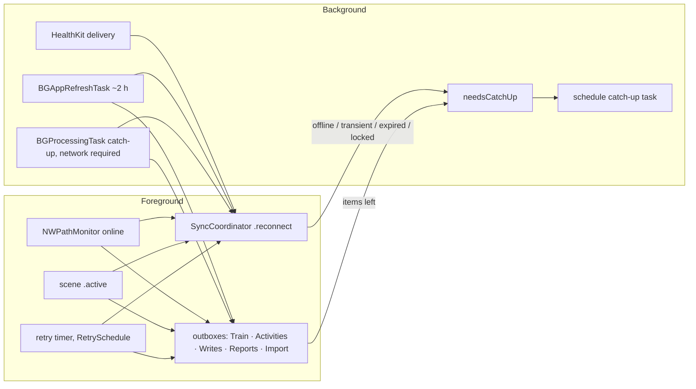
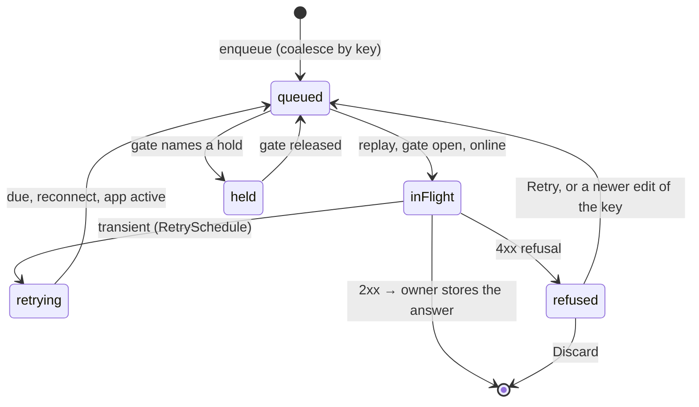

# Offline-first: audit and design note

Author: ios-architect, 2026-11-19. Read-only analysis. No code was edited or built.

Code read: `origin/main` plus PR #107 (`wt-wipe107`, head `608d024`). Paths below are relative to that worktree. Contract:
`plattform/docs/API.md` (cited as `API.md:<line>`).

**The requirement** (the owner, 2026-11-19): while the user has no connection, the app shows everything. Data that
moves between Apple Health and RYFT while offline is kept in RYFT. As soon as the API can be reached again,
everything is uploaded.

**Short answer.** For HealthKit data the app is already close: nothing recorded in Apple Health is lost, because
HealthKit itself is the outbox. The gaps are elsewhere:
- some writes the user makes inside RYFT are lost or silently dropped;
- the app waits too long to upload after a reconnect in the background, or on a network that looks connected but
  isn't;
- offline screens don't say how old their data is, and don't show what Apple Health already has.

## Decisions (the owner, 2026-11-19)

He took every recommended default in §(e) with one "ok":
- **Q1, yes, limited.** Offline, the app shows local, unscored Apple Health values: last night (time asleep, the in-bed
  window, stages), workouts not uploaded yet, and today's steps and active energy. Each is labelled "From Apple Health ·
  not scored yet". Never a score, never on the widget or lock screen, and gone once the platform has it.
- **Q2.** Online, before scoring, only the night card and the not-yet-uploaded workouts; no totals.
- **Q3.** A consent withdrawal made offline takes effect on the iPhone at once; the platform is told at the next connection.
- **Q4.** Unsent workouts and changes are parked for 30 days across a session expiry (O10).
- **Q5.** Logging out offline with unsent items is allowed, with the list of what goes and a warning.
- **Q6.** A setting changed offline is replayed later and the last write wins.
- **Q7.** Background catch-up runs when iOS allows; no silent push for now.
- **Q8 (the lead's order, accepted).** The sync-only tickets run in parallel with the Nocturne restyle as builder slots
  free up, data-loss fixes first. Tickets that touch screens (O2's UI, O9, O12, O13) wait until Nocturne PR 5 and PR 6
  have landed those files, so no two agents restyle the same view.

## Sequencing (lead)

| Wave | Tickets | Base | Why |
| --- | --- | --- | --- |
| 1 | **O1 + O2 (logic)**: Train keeps every op; a custom exercise goes through the outbox; a refusal is a state | `main` after #107 | Data loss; `TrainSyncService` changes in #107 |
| 1 | **O3 + O5**: one retry schedule; after a gap, the night first | `main` | Sync-only |
| 2 | **O1b**: re-queue workouts an earlier build dropped | after O1 + O2 | Heals what #107 and earlier builds dropped, and an install of an older build over O2 (ADR 0022 §8) |
| 2 | **O4**: background catch-up | after O3 | Uses `RetrySchedule` |
| 2 | **O0**: the characterization suite, with known issues only for gaps still open | after wave 1 | No known issue that a parallel ticket closes |
| 3 | **O6, O7, O8**: the app-write outbox (journal first), settings, consent withdrawal | after O3; after PR 6 B's Journal and PR 6 C's Profile subpages | Journal and Profile views are being restyled |
| 3 | **O9, O10**: log-out list, parking across an expiry | after O2 and O6, and after T5.4 | Profile is being restyled |
| 4 | **O2 (UI), O12, O13a, O13b, O14** | after PR 5 and PR 6 | Today, Sleep, Strain, Insights, My Day and Train screens |
| — | **O11**: send deletions | when the platform has `sync.deletions` (P1) | Platform |

The file:line references below are against `origin/main` plus #107 (`608d024`); they move as PRs land.

Contents: (a) what already holds · (b) the gaps, ranked · (c) a design for each gap · (d) tickets ·
(e) questions for the user.

---

## (a) What already holds

### A1. Apple Health → platform: HealthKit is the outbox, and an anchor moves only after a `200`

| Claim | Holds? | Evidence |
| --- | --- | --- |
| A page's anchor is committed only after its upload was accepted | **Yes** | `Sync/SyncService.swift:874-891`: `guard try await upload(…)`, then `health.commit(page, for:)` and `persist()`. `upload` returns `true` only after `api.sync` answered (`:951-980`). A `413` re-reads the same page smaller (`:874-879`). A gate hold throws `HeldAtGate` before the request (`:955`), so nothing is committed. |
| Offline, the data stays in HealthKit and comes back on the next run | **Yes** | `SyncService.run` returns before any HealthKit read when offline (`:240-244`). Anchored reads resume from the committed anchor, with no date bound after the first query (`Environment/HealthStore.swift:249-253`; `Health/HealthKitManager.swift:114-118`). |
| Re-sending is harmless | **Yes** | `API.md:254-256`: samples and segments are unique on their natural keys, workouts on `id`. |
| The first-score window can't lose data | **Yes** | It is date-bounded and its anchors are never committed (`SyncService.swift:742-759`, `Mode.recent` at `:840-845`). The anchored 90-day backfill then starts from no anchor and covers it again. |
| A locked phone is a wait, not a failure | **Yes** | `errorDatabaseInaccessible` → `waitingForUnlock` (`SyncService.swift:768-772`, `HealthStore.swift:153-158`). It resumes on `protectedDataDidBecomeAvailable` (`Sync/ScheduledWork.swift:187-197`) or at the next start. |
| A kill mid-upload is safe | **Yes** | Progress is checkpointed with each anchor (`SyncService.swift:887-890`). The page in flight goes again (`ScheduledWork.swift:136-139`). |
| Leaving the app finishes the page in flight | **Yes** | `windDown` → `stopAfterCurrentPage` (`Sync/SyncCoordinator.swift:253-263`), inside a `beginBackgroundTask` (`ScheduledWork.swift:167-181`). |
| A HealthKit delivery is completed promptly, offline too | **Yes** | The completion is called right after the upload step, however it ended (`SyncCoordinator.swift:378-385, 423-429`). |
| A refresh-token failure for lack of network doesn't sign out | **Yes, as read** | The SDK's refresh throws the transport error, not an `AuthError` (`supabase-swift/Sources/Auth/Internal/SessionManager.swift:74-130`). `AuthService.token` signs out only on `AuthError.endsSession` (`Auth/AuthService.swift:1160-1185`). Verify on a device. |
| The consent policy is asked for again after a long offline period | **Yes** | A record older than `min(ttl, 24 h)` holds as `policyUnknown`. The first run online asks `/v1/config` once, then sends (`SyncService.swift:248-273`; ADR 0008 §5, §8). |

**Foreground reconnect works, even with no new HealthKit sample.** An `NWPathMonitor` flip to online triggers four
things (`App/RyftApp.swift:283-289`):
- `coordinator.run(.reconnect)` at `.userInitiated` priority (`SyncCoordinator.swift:125-130`). Its upload is an
  anchored read, so it picks up everything since the last committed anchor. It doesn't need a new sample;
- Train's flush and library refresh;
- the reports queue;
- the activity uploader and the import, through their own `onChange` hooks (`Activities/ActivityUploader.swift:117-125`,
  `Train/Import/Upload/TrainImportUploader.swift:114`, `Train/TrainSyncService.swift:550-557`).

App active runs the same set (`RyftApp.swift:310-365`).

### A2. The platform's read models are served from SwiftData offline

| Claim | Holds? | Evidence |
| --- | --- | --- |
| Offline, nothing is requested and the cache is served | **Yes** | `Persistence/Repository.swift:142` (`canFetch`), ARCHITECTURE §3 "Offline and failures". Journal, Train's library and the flags have their own cached documents (`Features/Journal/JournalStore.swift:9-10`, `Train/TrainLibrary.swift:1`, ARCHITECTURE §8). |
| A failure keeps the cached copy | **Yes** | Sleep and Strain show an error only when nothing is cached (`Features/Sleep/SleepViewModel.swift:179-184`, `Features/Strain/StrainViewModel.swift:142-143`). |
| My Day says how old the list is offline | **Yes** | `Features/MyDay/MyDayViewModel.swift:163-173` → `MyDayStaleLine` (`MyDayView.swift:112-114`). This is the pattern the other tabs lack (gap 9). |

### A3. Train has a durable outbox

| Claim | Holds? | Evidence |
| --- | --- | --- |
| Every set change is saved and queued at once | **Yes** | `TrainSyncService.sessionChanged` → `enqueuePut` → `store.save()` (`TrainSyncService.swift:128-132, 305-319`). |
| The queue survives a kill and replays in order | **Yes** | `PendingTrainOp` is in SwiftData and fetched by `seq` (`Train/Model/TrainCache.swift:58-82`, `Train/Model/TrainStore.swift:217-244`). |
| Each op belongs to one account | **Yes** | `PendingTrainOp.account` is the binding, and an op goes only through its own binding's client (`TrainSyncService.swift:429-436`, ADR 0008 §4). |
| Replays are idempotent | **Yes** | `PUT /v1/sessions/{id}` (`API.md:1427`) and `complete` (`API.md:1518`). `ended_at` is taken from the session (`TrainSyncService.swift:494-496`). |

**But:** refusals drop ops silently, a custom exercise made offline isn't queued, and nothing retries on a timer or
in the background. See gaps 1, 6 and 7.

### A4. The other durable queues

- **Activities and Add sleep** (`ActivityUploader`, ADR 0004). The rows are the queue (`ActivityUploader.swift:17-37`).
  Each `PUT` is idempotent by id or day. An item backs off on its own: 30 s, 2 min, 10 min, then 1 h, with jitter and
  `Retry-After` (`:42, 551-582`). A refusal is a state with its request ID (`:536-541`). The queue is flushed on
  reconnect, on app active and in `BGAppRefreshTask` (`RyftApp.swift:94-98`).
- **The training import** (`PendingImport`). It is idempotent by derived ids and resumable, with the same backoff
  (`TrainImportUploader.swift:1-27`).
- **Report a problem.** It is saved before it is posted and flushed on reconnect and on app active
  (`Features/Profile/ProfileViewModel.swift:1934-2010`).
- **Push registration.** The app keeps the registration it last sent and sends again on app active and sign-in when
  that changes (`Push/PushRegistrar.swift:89-155`).
- **Local-only settings never wait for the network.** The bedtime schedule is in UserDefaults per account
  (`Features/Sleep/SleepPlannerViewModel.swift:206-217`). The tracker selection is a `CachedDocument`
  (`ProfileViewModel.swift:2142-2143, 2295`).
- **The timezone is re-derived** at every onboarding check (`Features/Onboarding/OnboardingCoordinator.swift:384-391`),
  so it heals itself.

### A5. Inventory of every user write

"Survives a kill" means the write is still there after the app is killed before it was sent.

| Write | Where it waits | Survives a kill | Order | Idempotent | What sends it again |
| --- | --- | --- | --- | --- | --- |
| HealthKit samples, sleep, workouts | HealthKit, plus uncommitted anchors (UserDefaults) | yes | per stream, night first | yes | reconnect, app active, delivery, BG refresh, backfill task |
| HealthKit deletions | `PendingDeletions` (UserDefaults, ≤ 2,000 per stream) | yes | — | yes (`API.md:318`) | **never sent** (gap 4) |
| Train `PUT`, `complete`, `DELETE` | `PendingTrainOp` (SwiftData) | yes | `seq` | yes | reconnect, app active, set change, Finish. **No timer, no background flush; refusals dropped** |
| Custom exercise (`POST /v1/exercises`) | **not queued**: cached locally, the `POST` is tried once | the exercise yes, the `POST` no | — | yes, by id (`API.md:1255`) | **nothing** (gap 1) |
| Plans, enrol, pause | online only; the screen shows the error | no | — | `PUT` yes | the user |
| Manual activities, Add sleep | the rows (SwiftData) | yes | creation, then nights by day | yes | reconnect, app active, BG refresh, edits; backoff. **The live client sends nothing until C1** (`Activities/ActivitiesAPI.swift:31-41`) |
| Journal (`PUT /v1/journal/{day}`) | **not queued**; refused offline (`JournalStore.swift:137-142`) | no | — | `PUT` replaces the day | the user |
| Behaviors (enable, create, delete) | **not queued**; refused offline (`JournalStore.swift:145-181`) | no | — | `PATCH` and `DELETE` yes; `POST` by id | the user |
| Consent: agree or withdraw | online only; error (`OnboardingCoordinator.swift:441-504`) | no | — | yes | the user |
| Birth year, max HR, baseline need (`PATCH /v1/me`) | **in memory**: URLSession waits ≤ 300 s for a network (`Networking/APIClient.swift:271-276`); the form shows "saving" meanwhile (`ProfileViewModel.swift:860-881`) | no | — | absolute values | URLSession's wait, then an error |
| Timezone | re-derived each check | n/a | — | yes | app active (at most once a minute), sign-in |
| Notification preferences | optimistic in memory, reverted on failure (`Features/Profile/NotificationSettingsViewModel.swift:119-141`) | no | — | partial, absolute values | — |
| Bedtime schedule, devices | local only | yes | — | no platform write | — |
| Training import | `PendingImport` (SwiftData), kept 30 days | yes | plans, then sessions oldest first | yes | reconnect, app active, gate release; backoff |
| Report a problem | `CachedDocument "feedback.queue"`, ≤ 20 | yes | oldest first | **no** (`POST` without an id, `API.md:739-753`) | reconnect, app active; not in the background |
| Push registration | the last registration sent, kept in SwiftData | yes | — | yes | app active, sign-in, a new token. The `DELETE` at sign-out is tried once; a failure is ignored (`PushRegistrar.swift:157-170`) |

---

## (b) The gaps, ranked

The ranking is by risk to the user's data first, then by what he would notice. Each gap gives its offline shape (Q1),
its trigger (Q2), its write (Q3) or its screen (Q4), and the files involved.

### 1. Train: refusals drop ops silently, and a custom exercise made offline makes its workout unsendable — data loss

- **The custom exercise isn't queued.** `TrainLibrary.createExercise` caches the exercise locally "so it can be logged
  right away, even offline". It then tries `POST /v1/exercises` once and returns the local copy on failure
  (`Train/TrainLibrary.swift:238-253`). Nothing sends it again.
- **The platform then refuses the workout.** A session's `exercise_id` must be built-in or the user's (`API.md:1457`),
  so the session's `PUT` answers `422`.
- **The refused op is deleted.** Any refusal that isn't retryable dequeues the op (`TrainSyncService.swift:459-464`).
  The `complete` then answers `404`, because the session was never stored (`API.md:1518`), and is dequeued too.
- **The user is told the opposite.** The session keeps `pendingCompletion = true`, so Train shows "Saved on this
  phone. Will sync when you're back online." for good (`Features/Train/TrainSection.swift:189`,
  `TrainComponents.swift:289-292`). `TrainSyncService.lastError` has no reader in any screen.
- **Other refusals are dropped the same way:**
  - `413` above 256 KiB;
  - `422` for more than 50 sets in an exercise;
  - `409` after three merge rounds (`TrainSyncService.swift:514-539`).
- **Realistic case.** Alex Doe creates "Landmine press" at a gym with no signal, logs four sets and taps Finish. The
  workout never reaches RYFT.
- **Files:** `Train/TrainLibrary.swift`, `Train/TrainSyncService.swift`, `Train/Model/TrainCache.swift`,
  `Features/Train/TrainSection.swift`.

### 2. Log out and session expiry silently delete unsent workouts and queued reports — data loss

- **Every wipe deletes Train's outbox.** It deletes `LocalSession` and `PendingTrainOp` with no parking
  (`TrainStore.swift:281-318`). Only activities and nights are parked on an expiry (`:320-340`,
  `AuthService.swift:190-192`). The reports queue is a `CachedDocument`, wiped with the rest (`TrainStore.swift:311`).
- **The log-out warning counts only activities and nights** (`ProfileViewModel.swift:105-124`,
  `ProfileView.swift:95-97`). Workouts that "will sync" go without a word.
- **The likely trigger is a session expiry after time offline.** On reconnect, a refresh token the platform no longer
  accepts ends the session (`AuthService.swift:321-327, 1173-1185`) and the wipe runs. How likely that is depends on
  the Supabase session settings (question Q4).
- **HealthKit data is safe here.** It is re-read from Apple Health after the next sign-in, because the anchors are
  reset with the account.
- **Files:** `Train/Model/TrainStore.swift`, `Auth/AuthService.swift` (`Wipe.parking`), `ProfileViewModel.swift`,
  `ProfileView.swift`.

### 3. Journal, body settings, notification preferences and consent withdrawal aren't queued — input lost

- **Journal.** Saves and behavior edits refuse offline with "You're offline. Save again when you're back online."
  (`JournalStore.swift:24, 137-181`). The morning sheet is exactly what a user fills in on a plane.
- **`PATCH /v1/me`** (birth year, max HR, baseline need) and `PATCH /v1/me/notifications` have no offline check.
  The foreground URLSession waits up to 300 s for a network (`APIClient.swift:271-276`), with the form showing
  "saving". Then it fails, or is lost if the app is backgrounded or killed meanwhile.
- **Consent withdrawal** offline fails with an error (`OnboardingCoordinator.swift:489-504`). The user has to remember
  to do it again.
- **No consent gate yet.** The journal and the body settings aren't gated (STATUS → Open → P2 follow-ups). An outbox
  would add the gate for free.
- **Files:** `Features/Journal/JournalStore.swift`, `Features/Profile/ProfileViewModel.swift` (`BodySettingsEditor`),
  `NotificationSettingsViewModel.swift`, `Features/Onboarding/OnboardingCoordinator.swift`.

### 4. Deletions in Apple Health never reach the platform — data integrity

- **The contract exists, the app doesn't use it.** `POST /v1/sync` has taken `deleted` and `Sample.id` /
  `SleepSegment.id` since 2026-10-31 (`API.md:218-345`). The wire mirror has neither (`Networking/Models.swift:30-81`).
- **Deletions are collected but never sent.** `PendingDeletions` keeps them in UserDefaults, at most 2,000 per stream,
  and drops the oldest silently (`SyncService.swift:607-625`). The sign-out wipe deletes them with the anchors
  (`:595-601`). A fresh anchor never reports them again.
- **The effect:** deleted records, such as Garmin's rewritten workouts ("Tue 20 Oct lists the Garmin run 7 times",
  STATUS), stay on the platform and are scored.
- **Not caused by offline.** A deletion made offline waits in HealthKit's anchor delta until the next read, then joins
  the same list that is never sent.
- **Designed, not built.** The design is data-quality D1 (`docs/work/2026-10-31-data-quality/architecture.md` §D1). It
  waits for the platform's `sync.deletions` flag (ADR 0011), which `API.md:529-560` doesn't list yet.
- **Files:** `Sync/SyncService.swift`, `Networking/Models.swift`, `Environment/Seams.swift` (`FeatureFlag`).

### 5. A process started before the first unlock keeps an in-memory store — rare data loss, not verified on a device

- **What happens.** If the store can't open, `TrainStore` falls back to memory (`TrainStore.swift:82-101`). This
  happens in a background launch before the first unlock.
- **What is lost.** In that process every workout logged, activity recorded or night added lives in memory only, and
  is lost at the next kill. Uploads are held too (`Environment/ConsentState.swift:156`).
- **The user isn't told for workouts.** Activities' pre-start screen says so (`ActivityStore.isDurable`); Train
  doesn't. STATUS → Open lists the device check.
- **Files:** `Train/Model/TrainStore.swift`, `Features/Train/TrainCoordinator.swift`, `Activities/ActivityStore.swift`.

### 6. Nothing uploads when the network comes back in the background — data waits for hours

- **An offline background run ends with nothing scheduled.** Offline, a HealthKit delivery or a `BGAppRefreshTask`
  returns with no backlog (`SyncService.swift:240-244`, `SyncCoordinator.swift:435`). Only `scheduleRefresh` (+2 h)
  follows (`ScheduledWork.swift:102-106`). The backfill task, the one with network required, is scheduled only for an
  unfinished first backfill or a stopped run (`SyncService.swift:199-206`, `SyncCoordinator.swift:316-335`).
- **An expired background run hands nothing on.** A background run cancelled at expiry midway through an incremental
  catch-up leaves no backlog flag, so nothing is handed to the backfill task.
- **The reconnect trigger lives in the scene.** It is in `RyftApp`'s view (`RyftApp.swift:283-289`), and a suspended
  app isn't woken by a reconnect.
- **Train's outbox and the reports never flush in the background.** `afterRefresh` flushes only activities
  (`RyftApp.swift:94-98`).
- **The unlock resume is in-process only** (`ScheduledWork.swift:187-197`).
- **Result:** data recorded offline waits for one of these:
  - the next app open;
  - the next HealthKit delivery, which comes only for sleep, workouts and HRV (`HealthKitManager.swift:185-187`);
  - a refresh task, at iOS's discretion.
- **Files:** `Sync/ScheduledWork.swift`, `Sync/SyncCoordinator.swift`, `Sync/SyncService.swift`, `App/RyftApp.swift`.

### 7. "Connected" but not reachable: no retry in the foreground — data waits for the next trigger

Examples are a captive portal, dead hotel Wi-Fi and a platform outage longer than 6 s. The path stays `.satisfied`, so
`ConnectivityMonitor` never fires (`Networking/ConnectivityMonitor.swift:32-36`).

- **The HealthKit upload gives up quickly.** It tries 3 times, at 0 s, 2 s and 4 s (`SyncCoordinator.swift:504-520`).
- **A failed backlog run doesn't continue** (`SyncCoordinator.swift:307`, `finished(… error == nil)`).
- **Train's replay stops with no timer** (`TrainSyncService.swift:453-458`).
- **Then nothing retries** until app active, a pull, a new set or a HealthKit delivery. The activity uploader and the
  import do have timers: they are the pattern to copy.
- **Files:** `Sync/SyncCoordinator.swift`, `Train/TrainSyncService.swift`, `Activities/ActivityUploader.swift`.

### 8. After days offline, the catch-up uploads everything before Today is refreshed — the score shows late

- **First score first applies only to an account's first sync** (`SyncService.swift:742-759`). An incremental run
  drains every stream, heart rate included (the bulk: tens of thousands of samples per day from a watch), before the
  coordinator waits for scoring and refreshes (`:760-767`, `SyncCoordinator.swift:423-467`).
- **The morning push waits too.** A `MORNING_SCORE` silent push during the drain queues behind it
  (`SyncCoordinator.swift:210-226`).
- **Files:** `Sync/SyncService.swift` (`SyncEngine.run`, `drain`).

### 9. Offline screens don't say how old their data is — visible

- **Today** says "Offline — will sync when back" and never "as of". The line returns `.offline` before the stale line
  (`Features/Today/TodayViewModel.swift:1098-1100`), and `staleSince` is nil offline (`App/AppState.swift:584-585`).
- **Sleep, Strain and Insights** show cached data with no offline or age note (`SleepView.swift`, `StrainView.swift`,
  `InsightsView.swift`: no such state).
- **Strain's failure text** with nothing cached is the system error's own text (`StrainViewModel.swift:142-143`).
  Sleep has the calm VN1 sentence instead (`SleepViewModel.swift:201-205`).
- **Files:** `TodayViewModel.swift` (`SyncLine`), `AppState.swift`, `SleepView.swift`, `StrainView.swift`,
  `StrainViewModel.swift`, `InsightsView.swift`, `MyDayView.swift` (the pattern).

### 10. What Apple Health recorded since the last upload isn't shown — visible; needs the user's decision (Q1)

- **The morning hero contradicts Apple Health.** On an offline morning it says "Waiting for last night's sleep · It's
  scored as soon as Apple Health has it" and "Last night hasn't reached RYFT yet"
  (`TodayViewModel.swift:376, 775-781`), while Apple Health has the night.
- **The existing night card is hidden offline.** `RawNightCard` ("From Apple Health · not scored yet",
  `TodayView.swift:800-804`) shows only once the platform says `pending` (`TodayViewModel.swift:1305-1314`).
- **Sleep shows an error for that night.** An uncached night shows "No connection. Check your internet and try
  again." (`SleepViewModel.swift:201-204`).
- **My Day and Strain miss local workouts.** Their local layer has activities, nights and Train sessions, but no
  HealthKit workouts (ADR 0006). Steps and active energy come only from the platform's `DailyScore`.
- **Files:** `TodayViewModel.swift` (`TodayPresentation.pick`, `PendingNight`), `SleepViewModel.swift`,
  `MyDayAssembler.swift`, `Environment/HealthStore.swift`.

### 11. Activities and Add sleep are queued but can't be sent yet — not lost; blocked on the platform

- **They never leave the phone yet.** The live client is the pre-contract stub (`ActivitiesAPI.swift:31-41`), so rows
  wait as "not available yet". "Send first" is unavailable (`ProfileViewModel.swift:119-124`).
- **Parked rows don't last.** Rows parked by a session expiry are deleted after 30 days (ARCHITECTURE §3).
- **Nothing new is designed here.** C1 is the platform's to publish. The new triggers in gap 6 already include this
  uploader.

### 12. Minor

- **A report sent twice isn't recognised.** `POST /v1/feedback` takes no client id, so a resend after a lost answer
  files the report twice (`API.md:739-753`).
- **The push `DELETE` at sign-out is tried once.** It isn't queued if it fails offline. The local
  `unregisterForRemoteNotifications()` invalidates the token, so APNs answers the platform `410`.
- **The training import has a time limit.** A job not uploaded within 30 days is removed
  (`TrainImportUploader.swift:41-42`).
- **The reports queue keeps the newest 20** (`ProfileViewModel.swift:1808`).

### What the user sees offline, screen by screen (Q4)

| Screen | Cached platform data | Says it's offline, and how old | Apple Health data since the last upload | Gaps |
| --- | --- | --- | --- | --- |
| Today | scores, tiles, trends card, widget | "Offline — will sync when back"; **no time** | last night only after the platform said `pending`; offline mornings say "Waiting for last night's sleep" | 9, 10 |
| Sleep | cached nights, week and month, the planner ("As of", `SleepPlannerView.swift:29-31`) | **none**; an uncached night says "No connection" | the night being scored, only on `pending` | 9, 10 |
| Strain | the cached day; the list with local activities and Train sessions (ADR 0006) | **none**; an uncached day shows the system's error text | no HealthKit workouts, steps or energy | 9, 10 |
| Insights | trends, insight cards, behavior impact | **none** | n/a (server only) | 9 |
| My Day | the platform's layer plus the local layer | yes: the stale line with its time | local activities, nights and Train sessions; **no HealthKit workouts** | 10 |
| Train | library, plans, today's plan, history; sessions logged locally | "Offline — every set is saved on this phone and syncs later" | n/a | 1 (a false "Will sync") |
| Profile | the cached user, sources, Sync details | log out names unsent activities only | n/a | 2, 3 |

### What the app could show from HealthKit, unscored, and what only the platform has

| Local, raw, labelled "From Apple Health · not scored yet" | Platform only |
| --- | --- |
| Last night: time asleep, in-bed window, bedtime and wake, stage minutes and a stage bar, from one source (`RawNight` already does the totals, `HealthStore.swift:41-82`) | readiness, recovery, sleep performance, need, debt, quality, consistency, nap credit (`API.md:779-806`) |
| Today's steps and active energy, from HealthKit statistics. They de-duplicate by source priority, not by the platform's one-device-per-hour rule, so they can differ slightly | day and workout strain, TRIMP, heart-rate zones (they need the platform's max HR and rules) |
| Workouts not uploaded yet: type, time, duration, average and maximum heart rate, energy, distance, source (the fields the app uploads, `HealthKitManager.swift:242-260`) | merges (`also_recorded_by`), which source won, coverage and "provisional" |
| Train: sets and live volume (already local) | records, e1RM, `muscular_trimp`, the session's strain |
| Possible but not recommended in v1: the HRV mean and resting heart rate as the source wrote them. They would show a second, slightly different number next to the platform's `hrv_ms` and `rhr` | HRV and resting-HR baselines, calibration, trends' bands, insights, behavior impact, sleep-plan bedtimes |

---

## (c) A design for each gap

### Constraints for every design

- **Keep the sync design.** Anchored queries, then page → upload → commit the anchor, background delivery and
  `BGAppRefreshTask` all stay. No new dependency.
- **One owner per piece of state.** The server owns scores. The phone owns its outboxes and sync state. Pending values
  are derived from the outbox rows, never written into the read models.
- **Every app write follows the existing rules:**
  - it is bound to its account, with demo as an account of its own (ADR 0008 §4);
  - it asks `uploadGate(for:write:)` before each item, and a `DELETE` is erasure (ADR 0008 §2–3);
  - its answer is dropped if the store's epoch or the account changed meanwhile (ADR 0018 §6);
  - it is wiped, or parked, by the wipe (ADR 0020).
- **Outbox tables live in the existing container** (`TrainStore.schema`), on the main context. They aren't read
  models, so the writer actor doesn't own them (ADR 0018 §2). A new entity is a lightweight migration, like
  `PendingTrainOp.account` (`TrainOutboxSchemaUpgradeTests`).
- **Time goes through `env.clock`.** Every timer is testable on `TestClock`. New code takes its dependencies in its
  initializer: no `.shared`, and no direct use of `ConnectivityMonitor.shared` (as `TrainSyncService`'s default still
  does today).

### Triggers after the changes



### Gap 1. Train: custom exercises go through the outbox, and a refusal is a state

**Options:**

| | Option | For | Against |
| --- | --- | --- | --- |
| A | `PendingTrainOp.Kind.exercise`: the `POST /v1/exercises` queued in the same `seq` order as the sessions | the order is by construction (an exercise is created before it's used); one replay; idempotent by id (`API.md:1255`) | `sessionId` then means "the op's subject"; a doc comment, no migration |
| B | Before each session `PUT`, `POST` every custom exercise it references that the platform hasn't confirmed | no new op kind | needs a "confirmed" flag on `CachedExercise`, and a request per `PUT` until it's set |
| C | Keep it online-only and refuse to create an exercise offline | simplest | contradicts "saved locally first so it can be logged right away, even offline" and the requirement |

**Choice: A.**
- `TrainLibrary.createExercise` caches the exercise and hands the `POST` to
  `TrainSyncService.queueExercise(_:)`, which enqueues and flushes.
- The answer replaces the cached row.
- The op is not a data write (ADR 0008 §1), so the gate doesn't hold it.

**Refusals become a state, as in `ActivityUploader.failed`:**
- A non-retryable 4xx on a session's `PUT` or `complete` keeps the op. It records an `UploadAttempt` on the session
  (`LocalSession.lastAttemptData`, a lightweight field) and passes over that session's ops until Retry or an edit.
  An edit queues a fresh `put` and clears the refusal.
- Other sessions' ops still go.
- `409` after three merge rounds is the same state, with its existing message.
- `TrainSyncService.state(of:) -> UploadState` is derived from the ops and the session, never stored.
- Train's summary and history row show `.failed` with Retry and Details (the request ID) instead of "Will sync".
- `lastError` goes: nothing reads it.

### Gap 2. Unsent work is named at log out, and parked across an expiry

**Log out.**
- The confirmation counts everything not yet sent for the account:
  - activities and nights (existing);
  - sessions with ops;
  - outbox writes (gap 3);
  - queued reports.
- The count is computed from each owner, not stored.
- "Send first" flushes every outbox within the existing 10 s (`ActivityUploader.sendFirstLimit`).
- Offline, the sheet lists what will be deleted, as it does for activities now.

**Session expiry. Options:**

| | Option | For | Against |
| --- | --- | --- | --- |
| A | Park Train's unsent sessions (with exercises and sets), their ops, outbox writes and reports of the leaving account for 30 days, as activities are (`Wipe.parking`) | the same rule for all the user's unsent work; ADR 0020's debt and hold apply unchanged | the riskiest change here: the wipe's `deleteEach(LocalSet/LocalSessionExercise/LocalSession)` must spare parked trees, and iOS 18's fatal reads of deleted relationships (ADR 0020 §7) need the same care |
| B | Delete, but tell the user on Welcome ("2 workouts on this iPhone couldn't be sent and were removed") | honest and cheap | still loses data |
| C | Export the unsent sessions to a file for later re-import | — | a second persistence of health data; rejected |

**Choice: A, if Q4 says expiries are likely.** B ships first as part of the log-out ticket in any case.

- Parked sessions are those with an op bound to the account. They get a `parkedAt`.
- The same account's next sign-in un-parks them and the replay continues.
- Another account, or 30 days, deletes them.
- This amends ADR 0020 (decision 3's parked rows).

### Gap 3. A durable outbox for the other app writes

**Options:**

| | Option | For | Against |
| --- | --- | --- | --- |
| A | One `PendingWrite` table and one `WriteOutbox` replayer, with a small handler per kind (journal day, user settings, notification preferences, consent withdrawal) | one set of rules (binding, gate, epoch, backoff, triggers, refusal state); later the reports queue moves into it and `PersistentFeedbackQueue` is deleted | a generic payload (`Data`), so each kind's handler must decode and validate |
| B | One outbox per feature, copying `ActivityUploader` or the reports queue | each is typed | four more copies of backoff, triggers, binding and gate; four places to forget the wipe |
| C | Optimistic UI plus URLSession's `waitsForConnectivity` | no code | not durable; a kill loses it; the form spins for 5 minutes |

**Choice: A.** The table:

```
@Model PendingWrite
  seq: Int                  // order, per store
  kindRaw: String           // journalDay | userSettings | notificationPrefs | consentWithdrawal
  key: String               // coalescing: "journal.2026-11-18", "me.sleep_base_min", "me.notifications", "consent"
  payload: Data             // the request body as the wire coder encodes it (small: under 4 KB)
  account: String           // the binding; "demo" for demo data
  queuedAt: Date            // when the user made the change (env.clock)
  lastAttemptData: Data?    // UploadAttempt: status, code, request ID; never a body
  refused: Bool
```

**`WriteOutbox`** (`Sync/WriteOutbox.swift`, `@MainActor @Observable`, built in `AppEnvironment`, `env.outbox`):

- **Enqueue.** It replaces a queued row with the same key unless that row is in flight; the latest value wins.
  `PUT /v1/journal/{day}` replaces the day (`API.md:1872-1903`). `PATCH /v1/me` fields are absolute values. Then it
  flushes.
- **Replay.** One request at a time, in `seq` order, for the binding in use.
  - It asks the gate per kind: journal and settings are `.data`; the consent withdrawal is never held except by
    demo or an unreadable record.
  - The policy is asked for once if unknown (as `ActivityUploader.drain` does, `:359-365`).
  - Each answer is checked against `Generation(count, account, demo, store epoch)` (`ActivityUploader.swift:62-67`).
- **Answers.**

  | Answer | What happens to the row |
  | --- | --- |
  | 2xx | Handed to its owner, then deleted. The journal's goes to `JournalStore.store`. The user's goes to `repository.store(user:asOf:)` with the `userChange()` taken at send time (ADR 0018 §6). |
  | Gate (403 with a code) | Held. |
  | Transient | `RetrySchedule` (gap 7). |
  | Refusal (`422`, for example a journal day past `editable`, `API.md:1891`) | `refused`, shown with Retry or Discard and the request ID. |

- **Triggers.** Enqueue, its own `connectivityMonitor.onChange`, app active, a gate release
  (`ScreenModels.gateChanged`), `BGAppRefreshTask`, the catch-up task (gap 6), and Send first.
- **The wipe.** `TrainStore.wipe` adds `batchDelete(PendingWrite.self)`, or parks the rows per gap 2.
- **What the screens show** is derived, never stored twice:
  - the journal card and sheet overlay the pending day on `cachedDay`;
  - `BodySettingsEditor.pendingSleepBase` and `pendingMaxHR` already exist ("shown while its `PATCH` is out") and
    read from the row;
  - each says "Saved on this iPhone · sends when you're online".
  - "Rescore the last 90 days" stays disabled until the platform confirms.
- **Consent withdrawal offline** (if Q3 says yes): `ConsentState.withdrew(at:)` at once, which closes every data gate
  (ARCHITECTURE §10). The `DELETE /v1/me/consent` is queued, and `seq` puts it ahead of everything. Agreeing again is
  online only, and flushes the outbox first, so a withdrawal is never sent after a new consent.



### Gap 4. Send deletions: build D1 as designed

- **Build data-quality §D1 unchanged.** It covers ids on samples and segments, separate deletion requests of at most
  2,000, opening and closing drains, removal only after a `200`, a `400` fallback under the flag, and ADR 0011's
  `sync.deletions`.
- **Two additions:**
  - count deletions dropped at the 2,000-per-stream bound in `SyncEngineState`, for Sync details, instead of losing
    them silently;
  - the log-out flush (gap 2) runs one deletion drain while online.
- **The platform's part:** add `sync.deletions` to `GET /v1/config` and turn it on after its ingest deploy. This is
  already requested (`docs/API_REQUESTS.md` → Sync and performance §2).

### Gap 5. The store before the first unlock

**Options:**

| | Option | Verdict |
| --- | --- | --- |
| A | Re-open the durable container on `protectedDataDidBecomeAvailable` | rejected: one container per process is load-bearing (ADR 0018 §1, ADR 0020 §3). Every holder of rows, contexts or writers would have to switch, and `StoreReset` runs only before the first container |
| B | Say so before a write that wouldn't survive | **chosen.** Train's start sheet, Add activity and Add sleep say "This won't be saved on this iPhone. Close RYFT and open it again first" while `!persistence.isDurable`, as `ActivityStore.isDurable` already does for recordings |
| C | Ignore it | rejected: silent loss |

A device check first (test-engineer): can a process launched before the first unlock reach the foreground with the
fallback store?

### Gap 6. Background catch-up when the network comes back

**Options:**

| | Option | For | Against |
| --- | --- | --- | --- |
| A | A network-required `BGProcessingTask` (the existing `backfill` identifier) whenever work is left: HealthKit possibly pending, or any outbox not empty | uses what is registered and tested; iOS starts it when a network is there | timing is iOS's: often within hours, sometimes overnight |
| B | Background `URLSession` upload tasks for pages | iOS sends them when the network returns, even after a kill | breaks ADR 0008 (the gate is asked before every page, but the body would be handed over earlier); writes health data to files; the anchor commit moves to another launch. Rejected |
| C | A silent "please sync" push from the platform | prompt | the platform can't know what's pending on the phone; Apple throttles silent pushes. Optional later, not now |

**Choice: A.**
- **`SyncEngineState.needsCatchUp`** is a bool, per account, persisted like the rest. `SyncService.run`'s offline
  return and the engine's ends set it when a run ended:
  - offline;
  - transiently failed;
  - cancelled with pages left;
  - locked.

  A completed anchored drain clears it. It's sync state with one owner: the engine's state.
- **What's left is computed, not stored.** `SyncService.backlogBytes` becomes `pendingWork`: the backlog bytes, or 0
  when only `needsCatchUp` is set, plus the outboxes' counts.
- **When to schedule.** `finishInBackground`, the end of each background run, and each outbox replay that stops with
  items left all schedule the catch-up task: network required, power only above the existing 10 MB.
- **What the task runs.** The `.processing` loop as now, then the flushes of Train, the activities, the outbox and the
  reports (limit 20 s each, as `ActivityUploader.backgroundLimit`), then `settledBeforeCompletion()`.
- **What `BGAppRefreshTask`'s `afterRefresh` gains:** Train's, the outbox's and the reports' flushes.
- **What stays.** The unlock resume stays in-process. A process suspended at the unlock is caught up by the next
  delivery, task or app open. That residual is documented, not designed away.

### Gap 7. One retry schedule for every outbox and for the HealthKit upload

- **Extract one type.** `RetrySchedule` is a value type: `[30 s, 2 min, 10 min, 1 h]`, plus up to 20 % jitter, at
  least `Retry-After`, on `env.clock`. It is taken from `ActivityUploader` (`:42-47, 551-582`) and
  `TrainImportUploader` (`:50-54`), which then use it. Two copies are deleted.
- **The coordinator.** After a run whose upload failed transiently (`SyncCoordinator.isTransient`), or a backlog run
  that failed, it arms one `.reconnect` rerun at the schedule's next step. Any run that starts, `cancel()` and
  `windDown()` disarm it. `finished` continues a backlog only on success, as now; the timer covers the failure.
- **`TrainSyncService`** gets the uploader's per-op backoff and timer. Its own `isOnline` flag, set by a transport
  error (`:455`), goes. "Offline" comes from the monitor, and "lost connection" from the last failure, as in
  `ActivityUploader.lostConnection`.
- **`ConnectivityMonitor` is unchanged.** No probing: the timer is the answer to a path that is "satisfied" but
  unreachable.

### Gap 8. A catch-up puts the night first

- **The rule.** In an incremental run, when the gap since the last accepted heart-rate page is over 6 h
  (`StreamProgress.lastUploadAt`), the engine drains the night streams first: sleep, HRV, resting HR, breathing rate
  and SpO₂ (`HealthStore.streams` order, `:240-243`). If that touched any day, it stops with `backlog = true`.
- **Nothing new is needed after that.** The coordinator awaits scoring and refreshes Today, then `.backlog` continues
  (`SyncCoordinator.swift:327-334`). This is the first-score mechanism, applied after a gap.
- **No new layer:** `drain` takes an optional "stop after stream index".

### Gap 9. Every offline screen says how old its data is

- **Today.** `SyncLine.offline(since: Date?)` reads "Offline · data from 14:05" (`SyncLine.dataTime`, `lastUpdated`).
  VoiceOver reads "Offline. Showing data from 14:05."
- **Sleep, Strain and Insights.** One `StaleNote(since:)`, generalized from `MyDayStaleLine`, shows when the screen is
  offline or its last read failed. Its time is the Repository's fetch time for what the screen shows. It is derived;
  nothing new is stored.
- **Strain's failure** uses `SleepLoadFailure`, renamed `LoadFailure`, so offline reads "No connection…" everywhere.

### Gap 10. Unscored Apple Health values where the platform has none (if Q1 is yes)

**Options:**

| | Option | Verdict |
| --- | --- | --- |
| A | Show only items the platform lacks, labelled, computed on read from HealthKit, never persisted, never on the widget | **chosen** |
| B | Persist a local "shadow day" | rejected: a second owner of the same facts (ADR 0006's rejected "storing the merged list") |
| C | Estimate scores locally | rejected: CLAUDE rule 3 |

**The seam:**
- `HealthStore` gains `nightSegments(before:)`, which gives `RawNight`'s stage minutes and the stage bar.
- It also gains `dayTotals(_ day:)`: steps and active energy, from `HKStatisticsQuery` cumulative sums.
- `workouts(on:)` is the existing private query, made public.
- All of these are off the main actor and mocked in `MockHealthStore`. They are memoized per `healthFactsKey`, as
  `loadHealthFacts` is today.

**Where each value shows:**
- **Today, in the morning.** The night card shows when HealthKit has last night and the platform hasn't scored it:
  offline, not uploaded yet, or `pending`.
  - `PendingNight` says "Last night is in Apple Health · RYFT scores it once you're back online" offline, instead of
    "Waiting for last night's sleep".
  - `nightGap`'s "hasn't reached Apple Health" stays the one message for a night that really isn't there.
- **Sleep → Day.** An unscored night shows an unscored card with the stage bar, instead of "No connection".
- **My Day and Strain.** A local-layer row "From Apple Health · not uploaded yet" for each HealthKit workout whose id
  (`Workout.id = HKWorkout.uuid`, `HealthKitManager.swift:255`) isn't in the cached day's workouts and isn't RYFT's
  own (`SyncEngine.withoutOwnWorkouts`). It has no strain. It goes once the day detail lists it (ADR 0006 decision 2).
- **Today's steps and active energy, offline only.** They come with "From Apple Health", to avoid two numbers flipping
  while online.

**Rules:**
- every value carries the label, and VoiceOver says "not scored yet";
- nothing derived: no performance, need, strain, zones or baseline comparison;
- nothing on the widget or the lock screen;
- nothing in SwiftData.

This is an ADR (0024) because it widens rule 3's "raw totals labelled as unscored" into a placement rule.

---

## (d) Tickets

One reviewable PR each. Order: O0, O1, O2, O1b, O9, O3, O6, O7, O4, O12, O5, O11 (needs the platform's flag), then O13,
O8 and O10 (after the user's answers), and O14.

| # | Title (PR title) | Owner | Acceptance criteria | Depends on | Platform |
| --- | --- | --- | --- | --- | --- |
| O0 | `test: offline-first characterization suite` | test-engineer | **(1)** `OfflineFirstTests` covers every shape of Q1 on `AppEnvironment.test`: offline at launch, a drop mid-page, days offline, offline background delivery and refresh, locked, kill mid-upload (a `TrainStore(url:)` reopened), deletions, the first-score backlog. It uses `MockHealthStore`, scripted failures on `MockPlatformAPI`, `TestClock` and `ConnectivityMonitor.preview`. **(2)** Today's guarantees are asserted: no anchor before a `200`, the outbox survives a reopen, reconnect runs an upload. **(3)** Each gap is a `withKnownIssue` naming its ticket. **(4)** A device checklist goes into STATUS (airplane mode, captive portal, reboot, lock). | — | — |
| O1 | `train: custom exercises go through the outbox` | sync-engineer | **(1)** An exercise created offline queues `POST /v1/exercises` ahead of every session op that uses it. **(2)** After a reconnect the requests go in order: exercise, `PUT`, `complete`. **(3)** A resend is idempotent. **(4)** The cached row takes the answer. **(5)** O0's known issue passes. | — | none (`API.md:1255`) |
| O2 | `train: a refused op is a state, never dropped` | sync-engineer | **(1)** `422`, `413`, `409`×3 and `404` keep the op and record an `UploadAttempt` on the session. **(2)** That session's later ops wait; others go. **(3)** Retry or an edit sends it again. **(4)** Summary and history show "Couldn't sync" with Retry and Details (request ID) instead of "Will sync". **(5)** `lastError` is removed. **(6)** Dark and light previews. **(7)** UI (wave 4): U2, a batch `states(for:)`, so a list asks the outbox once instead of once per row; and the platform's caps are visible in the form before they're refused: at most 50 sets per exercise and notes of up to 2,000 characters (`API.md:1430`, `:1479`). | O1 (same file) | — |
| O1b | `train: re-queue workouts an earlier build dropped` | sync-engineer | **(1)** At launch (after the store step) and after each account change, every `LocalSession` with `pendingCompletion == true`, no op and no refusal is queued again for the binding in use: an `exercise` op for each custom exercise it uses that has none (ahead), then `put`, then `complete` with its body weight. A session on the demo's list is queued only under demo's binding. **(2)** Idempotent: a second pass queues nothing. Refused, held and in-progress sessions and a store that `lostItsFile` are untouched. **(3)** The count is logged, never ids. **(4)** Tests: a store as #107 wrote it with an orphan reaches the platform as exercise, `PUT`, `complete`; a store whose exercise op an older build dropped heals the same way; another binding's orphan is left alone. **(5)** O0's known issue for orphans passes, and its STATUS line goes. | O1 + O2 | — |
| O3 | `sync: one retry schedule for the upload and Train's outbox` | sync-engineer | **(1)** `RetrySchedule` is extracted, and `ActivityUploader` and `TrainImportUploader` use it (their copies are deleted). **(2)** A transient upload failure while "online" reruns at 30 s, 2 min, 10 min, 1 h (jitter, `Retry-After`). **(3)** A failed backlog continues. **(4)** Train's ops back off per op. **(5)** Any trigger, `cancel` and `windDown` disarm the timer. **(6)** Tested on `TestClock`. **(7)** From O1 + O2's review: R1, a session's dependency on the custom exercises it uses is explicit, and per-op backoff keeps it (ADR 0022 §7); R2, one classifier for every outbox's errors (`TrainSyncService.disposition`, `ActivityUploader.failed`, `TrainImportUploader`), on `UploadAttempt.isRefusal`; R4, `UploadState` and `UploadAttempt` move to `Sync/`. | — | — |
| O4 | `sync: catch up in the background when work is left` | sync-engineer | **(1)** `needsCatchUp` is set by offline, transient, expired and locked ends, and cleared by a completed drain. **(2)** The network-required processing task is scheduled from `finishInBackground`, from background run ends and from outboxes with items left. **(3)** The task and `BGAppRefreshTask` flush Train, activities, the outbox (after O6) and reports within their limits, then `settled`. **(4)** `ScheduledWorkTests` cover it with the handle fakes; a device check is listed in STATUS. | O3 | — |
| O5 | `sync: after a gap, the night goes first` | sync-engineer | **(1)** An incremental run more than 6 h after the last heart-rate page stops after the night streams with a backlog when it touched days. **(2)** Today refreshes, then `.backlog` sends the rest. **(3)** No change for runs under 6 h. **(4)** `SyncEngineTests` cover it. | — | — |
| O6 | `sync: an outbox for app writes, with the journal first` | sync-engineer | **(1)** `PendingWrite` and `WriteOutbox` are added; ADR 0023 is drafted. "Refused" is derived from the row's attempt (`UploadAttempt.isRefusal`, ADR 0022 §1), never stored as a flag. **(2)** The journal saves offline and shows "Saved on this iPhone"; it survives a relaunch, coalesces per day and is gated `.data`. **(3)** A `422` is shown as refused with Retry or Discard. **(4)** The wipe deletes the rows. **(5)** Answers after an account change are dropped (an epoch test as `ReadModelWipeRaceTests`). **(6)** A schema upgrade test like `TrainOutboxSchemaUpgradeTests`. | O3 | API_REQUESTS P2, P3 (below) |
| O7 | `profile: settings save offline` | ios-developer | **(1)** Sleep need, max HR, birth year and notification preferences are queued through `WriteOutbox`. **(2)** The form shows the pending value from the row, never a 5-minute spinner. **(3)** Coalesced per field. **(4)** Rescore is disabled until confirmed. **(5)** Previews for pending and refused. | O6 | — |
| O8 | `privacy: consent withdrawal works offline` | ios-developer (security-privacy review) | **(1)** Offline, withdrawing holds every data gate at once (`withdrew(at:)`) and queues `DELETE /v1/me/consent` first. **(2)** Agreeing again flushes the withdrawal first. **(3)** The copy says it's withdrawn on this iPhone and RYFT is told when online. **(4)** `ConsentGateTests` extended. | O6, Q3 | — |
| O9 | `profile: log out names every unsent item` | ios-developer | **(1)** The count covers activities and nights, sessions with ops (counted as sessions, not ops: one workout's `exercise`, `PUT` and `complete` are one item), outbox writes (once O6 is in) and reports. **(2)** Send first flushes all within 10 s. **(3)** Offline, the sheet lists what goes. **(4)** After an expiry, Welcome says how many workouts were removed (option B) until O10. | — (O6 for its count) | — |
| O10 | `auth: park unsent workouts and writes across a session expiry` | sync-engineer | **(1)** On `.sessionExpired`, the account's ops, their sessions (with exercises and sets), its `PendingWrite` rows and its reports are kept and marked `parkedAt`. **(2)** The same account's sign-in resumes them; another account or 30 days deletes them. **(3)** ADR 0020 is amended. **(4)** `TrainStoreWipeTests` and `ReadModelWipeRaceTests` are extended, and relationship reads are checked on iOS 18.6. **(5)** From O1 + O2's review (P1): the `CachedExercise` rows that parked `exercise` ops name are parked with them (ADR 0022 consequences). | O2, O6, Q4 | — |
| O11 | `sync: send HealthKit deletions and ids` (data-quality D1) | sync-engineer | **(1)** As §D1, including its tests table. **(2)** Drops at the per-stream bound are counted in Sync details. **(3)** A strict mock answers `400` to unknown fields, and the old shape is used when the flag is off. | — | `sync.deletions` (P1) |
| O12 | `design: offline screens say how old their data is` | ios-developer | **(1)** Today reads "Offline · data from 14:05". **(2)** Sleep, Strain and Insights show `StaleNote` offline or after a failed read. **(3)** Strain's empty failure uses the VN1 copy. **(4)** Dark and light previews at AX3, with VoiceOver labels. **(5)** English strings only (CLAUDE.md). | — | — |
| O13a | `today: last night from Apple Health while it isn't scored` | ios-developer | Depends on Q1. **(1)** Today's night card and Sleep → Day show an unscored night offline or before scoring, labelled. **(2)** The hero's copy is fixed. **(3)** Never on the widget. **(4)** It goes when the platform scores the night. **(5)** `TodayStatesTests` and `MockHealthStore` cover it. **(6)** ADR 0024 is drafted. | O12 | — |
| O13b | `myday: Apple Health workouts not uploaded yet` | ios-developer | **(1)** A local-layer row per HealthKit workout missing from the cached day: no strain, labelled. **(2)** Today's steps and energy show offline with the label. **(3)** `MyDayAssemblerTests` cover it. | O13a | — |
| O14 | `train: say so when a workout can't be saved` | ios-developer (device check: test-engineer) | **(1)** With `!persistence.isDurable`, Train's start, Add activity and Add sleep say it won't be saved. **(2)** The device check of a pre-unlock launch reaching the foreground is recorded in STATUS. | — | — |

**Platform asks** (lines for `docs/API_REQUESTS.md`):

- **P1 — `sync.deletions` in `GET /v1/config`.** Already filed under Sync and performance §2. Please add the flag row
  and turn it on per environment after the ingest deploy (ADR 0011).
- **P2 — Late writes keep their window.**
  - `PUT /v1/journal/{day}` answers `422` once the day is past `editable`, 14 days (`API.md:1891`). Manual activities
    may start at most 14 days back (R15).
  - An item saved offline in time can arrive after the window. Please accept an optional `saved_at` (RFC 3339, the
    phone's time of the edit) and validate the window against it, bounded by `now` and a short grace (for example
    3 days).
  - Otherwise the app shows such an item as refused.
- **P3 — Consent on journal writes.** Please answer `PUT /v1/journal/{day}` and `PATCH /v1/behaviors` with
  `403 consent_required` without a current consent, as `POST /v1/sync` does. This extends R25(1). The app gates them
  through the outbox.
- **P4 — Optional.** `POST /v1/feedback` takes an optional client `id` (uuid), and a repeat answers `204`, so a resend
  after a lost answer files one report.

**ADRs to draft with the tickets:**
- **0022** "A refused upload is kept as state, never dropped; Train's outbox carries custom exercises", with O1 + O2
  (`docs/adr/0022-train-outbox-refusals.md`, accepted).
- **0023** "App writes wait in one durable, account-bound outbox", with O6. It takes ADR 0022's refusal rule as it is.
- **0024** "Unscored Apple Health values may show where the platform has none: labelled, computed on read, never
  persisted, never on the widget", with O13a.
- **An amendment to 0020** for parking, with O10.

---

## (e) Questions only the user can answer

| # | Question | Recommended default |
| --- | --- | --- |
| **Q1** | **Show local, unscored Apple Health values while offline: yes or no?** | **Yes, limited:** <br>• last night (time asleep, in-bed window, stages); <br>• workouts not uploaded yet; <br>• today's steps and active energy while offline. <br>Each is labelled "From Apple Health · not scored yet". Never a score, never on the widget or lock screen, gone once the platform has it. |
| Q2 | While online, before the platform has scored (seconds to minutes), show them too? | Only the night card (as today on `pending`) and not-yet-uploaded workouts. No totals online, so two numbers don't flip. |
| Q3 | Should a consent withdrawal made offline take effect on this iPhone at once, with the platform told when back online? | Yes. Uploads stop at once in any case; the platform hears it at the first connection. |
| Q4 | Does the Supabase project time-box sessions or have an inactivity timeout? If so, should unsent workouts and saved journal or settings changes be kept for 30 days across a session expiry (as activities are), rather than deleted? | Keep them for 30 days (O10). If sessions don't expire, O10 can wait behind O9's honest message. |
| Q5 | Log out with unsent items while offline: allow with the list and a warning, or block until sent? | Allow, with the list and the warning (today's rule for activities). |
| Q6 | A setting changed offline and replayed later overwrites a change made meanwhile on another device. Acceptable (the last write wins)? | Yes. A single-user app; the platform has no per-field version to compare (`User` has no `updated_at`). |
| Q7 | The background catch-up runs when iOS allows (often within hours, sometimes overnight, sooner on Wi-Fi and power). Acceptable, or should the platform add a silent "please sync" push? | Accept. No push for now; the next app open always catches up at once. |

---

## Test strategy

- **Unit, on `AppEnvironment.test`.**
  - `TestClock` for every timer: `RetrySchedule`, the catch-up scheduling, the night-first stop.
  - `MockHealthStore` re-serves uncommitted pages, and HealthKit locked or deleted objects are scripted.
  - `MockPlatformAPI` scripts failures and gets a strict mode (unknown fields → `400`, ADR 0011).
  - `ConnectivityMonitor.preview(online:)` sets the path.
  - A `TrainStore(url:)` closed and reopened stands for a kill.
- **Outbox invariants**, one table each: order, coalescing, the gate per kind, the binding (demo against the account),
  the epoch, refusal, Retry and Discard, the wipe, and parking after O10.
- **Background:** `ScheduledWorkTests` with the `BackgroundTaskHandle` and `BackgroundTaskRunning` fakes cover
  scheduling and completion after `settled`.
- **UI:** previews for every new state, in dark and light at AX3. UISmoke gets an offline launch argument that
  injects `ConnectivityMonitor.preview(online: false)` on the demo graph, for screenshots of each tab.
- **On a device**, because HealthKit and BG tasks don't run in the simulator:
  - airplane mode across a night;
  - a captive-portal Wi-Fi;
  - a reboot, then a background wake before the first unlock;
  - a locked phone during a delivery;
  - kill mid-upload;
  - a Garmin rewrite after O11.

## What could go wrong

- **Duplicate side effects.** Every queued write must be idempotent. The outbox admits only kinds that are: `PUT`,
  absolute `PATCH`, `DELETE`, and `POST` by client id. `POST /v1/feedback` stays as it is until P4.
- **Order across outboxes.** A custom exercise and its session are in one outbox (O1). The journal and settings carry
  no order dependency on Train or HealthKit. A withdrawal must precede a new consent, and O8 flushes first.
- **A late answer writes into a wiped store.** Every replay checks its generation and epoch after each await, as
  `ActivityUploader` and `TrainSyncService` do.
- **Parking trees of Train rows** (O10) can hit the iOS 18 fatal relationship read (ADR 0020 §7). Release first, and
  test on 18.6.
- **Two numbers on screen** (O13). Local totals can differ from the platform's de-duplicated ones. Limit them to
  offline, label them, and drop them the moment the platform has the day.
- **Background budget.** The catch-up task's flushes must stop at expiry and complete the task (the existing
  `ExpiryFlag` pattern), or iOS penalises the app's future tasks.
- **Flag drift** (O11). Until the platform turns `sync.deletions` on, deletions stay local; Sync details should say so.

## Drift found while reading

The `ryft-app-conventions` skill (rule 7) asks for strings in English and German (du-form). `CLAUDE.md` says RYFT is
English only. `CLAUDE.md` wins; the skill should be corrected. New strings in these tickets are English only.
