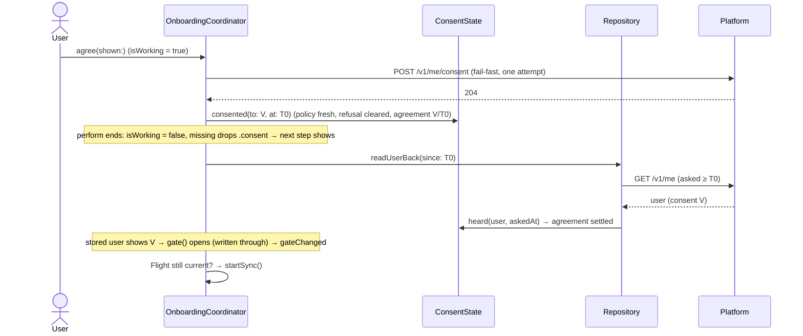
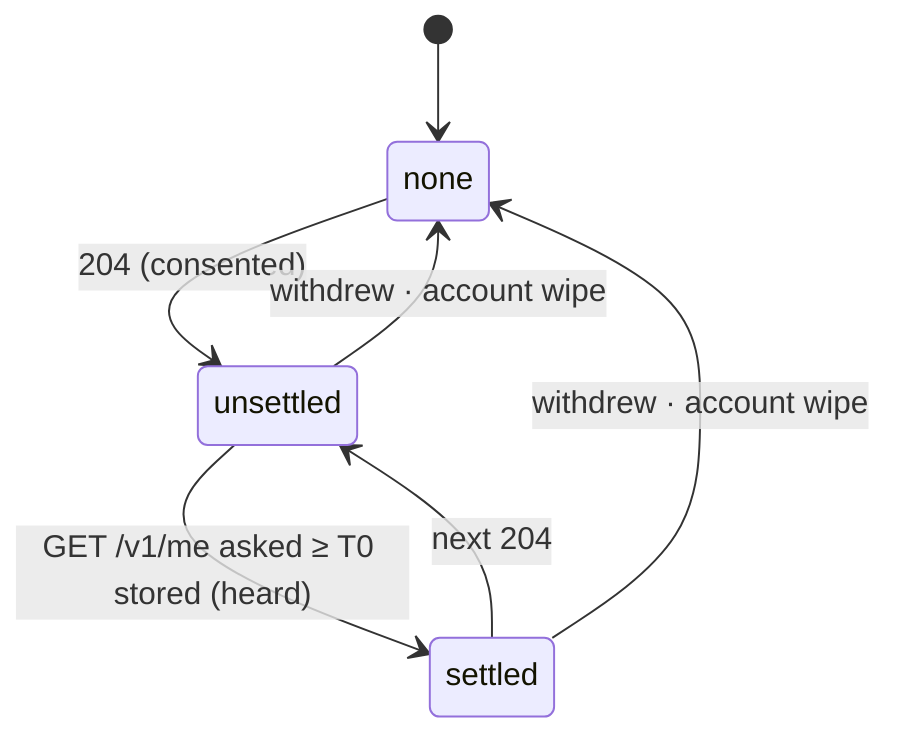

# Consent: Agree moves on at the `204` (design note, ios-architect, 2026-11-22)

Base: `origin/main` 1c5f6fd, branch `fix/consent-agree-lag`. It builds on PR #134 (`origin/fix/withdrawal-hold`:
`withdrawConsent(onRecorded:)`, `revokeFailingFast()`, `Unanswered`). Line numbers are main's. #134 moves only lines
after `OnboardingCoordinator.swift:565`. The debugger's trace is in the brief. A device report (not kept in the repo)
shows the `/v1/me` + `/v1/config` + `/v1/me/sync` triples answering in about 0.1–0.3 s, with no transport errors. The
POST itself had already been pushed out of the 20-entry ring.

## 0. Decisions

| # | Decision |
|---|---|
| D1 | The consent `204` records an **agreement** (version, time) in `ConsentState`'s record. `missing` counts it for the consent step, so the next step shows after the POST alone. The re-read runs after `perform` ends, so it never holds `isWorking`. |
| D2 | `gate()` **ignores the agreement**. An upload opens only when the platform's own user, stored from a `GET /v1/me` (asked for at or after the `204`), shows consent to the fresh policy. `startSync()` runs after that read and only if the gate is open. |
| D3 | A `GET /v1/me/sync` **asked before `204` + 10 s** says nothing about consent, `consent_required` or `null`. That covers the platform's 10 s cache (API.md) and the status the coordinator still holds from before. The rule lives in `ConsentState` and both status doors use it. Real refusals still count at once. |
| D4 | If the re-read fails, the user stays on the next step with no banner and the gate stays closed. Every later `check()` asks `/v1/me` again while the agreement is unsettled, and so does coming back online. |
| D5 | The re-read is one `Repository.readUserBack(since:)`. It doesn't wait for `/v1/config` or `/v1/me/sync`. A `Flight` check after it drops it on a sign-out, another account or Demo. |
| D6 | The POST moves to the fail-fast attempt that #134 uses for the withdrawal (`SettingsWrite.answer`), through one shared helper. When no answer comes, RYFT is asked again via `/v1/me`. |
| D7 | Measurement: a small per-account **agree line** in Copy diagnostics and Report a problem, `Signposts.onboarding`, and the 20-entry ring unchanged (§6). |
| D8 | Platform request: `GET /v1/me/sync` → `gate` is never served from the cache (§9). |
| D9 | This needs **ADR 0025**, which amends ADR 0008 §5 and §7 (§10). 0024 is already taken by the notifications work (commit 31bf0f7). |

## 1. Problem

Today the step can't move before the slowest of four things:

1. `flowStep` (`:216-219`) comes from `missing` (`:77-87`). After the `204` (`:523-528`), two facts there still say
   "consent":
   - the stored user's `consent` (`:81`), which stays nil until `/v1/me` is re-read;
   - `syncStatus.gate` (`:82`), which `check()` assigns only after all three reads return (`:363-366`).
2. `fetchWithTimeout` (`:405-440`) waits for `/v1/config`, which this decision doesn't need, and for the optional tz
   `PATCH` (`:422-428`, on the default session).
3. `await me` also waits for the user's **SwiftData commit** inside the read (`:412-414`). A flight awaits its store
   (`Repository.swift:1420`), so this commit queues behind every read-model write since sign-in (ADR 0018). Mock
   latency can't show this wait (§6.1).
4. The POST runs on the default session (`APIClient.swift:282-291`):
   - it waits for connectivity, with a 60 s timeout and a 300 s resource limit;
   - it runs a `503` loop of up to 3 retries, `Retry-After` 5 s by default (`:609-615`);
   - its connection pool is separate from the reads' warm fail-fast one (`:654`).

Two more bugs sit on the same path:
- **A stale gate makes the step stay put.** Suppose the re-check's status comes from the platform's 10 s cache
  (`syncstatus.go:84-143`). Then `consent.refused(.consentRequired)` (`:376`) records a refusal, and the consent step
  and the upload gate stay. The sync's own status poll does the same through `apiStatus.observe`
  (`SyncCoordinator.swift:778`).
- **A failed re-check leaves the user stuck.** `check()` swallows failures. `perform` returns `true`, the stored user
  still has no consent, and the consent step stays on screen with no message (`:529`, `:541`).

## 2. Constraints

- ADR 0008: nothing uploads before consent to the policy in force, and staleness can only hold. The platform is the
  truth. The phone writes no fact that would *open* the gate; a local write may only close it (the withdrawal,
  `Repository.swift:807-818`).
- One owner per fact. `ConsentState` owns this phone's view of the account's consent standing, and every process reads
  the same record.
- The single-send guarantee (`perform`, `:663-690`, `OnboardingSingleSendTests`) stays as it is.
- #134's withdrawal stays the last word, both on the platform and on this phone.

## 3. Options

| | Option | For | Against |
|---|---|---|---|
| A | **Agreement for the flow, gate on the platform's read (chosen)** | The screen moves after one round trip, and the gate rule doesn't change. The failed re-check and the stale gate get fixed along the way. | Adds one field to the record and one more rule (D3). |
| B | Write the consent into the stored user on the `204`, the way `storeConsentWithdrawn` does | Fewest lines: `missing` and `gate` move together. | The gate would open on a fact the phone wrote itself. The cached user becomes partly a guess, and asOf rules would be needed for an *opening* write. Rejected. |
| C | Keep waiting, but only for `/v1/me`, and drop the config and status reads from the re-check | Smallest change. | The screen still waits a round trip plus a commit on a flaky network, and a failed re-read still strands the user. Only half the fix. |

## 4. Design



### 4.1 The agreement (D1): state and owner

`ConsentState.Record` (`ConsentState.swift:78-92`) gains one optional Codable field. Older records decode it as nil.

- `agreement: Agreement?`, holding `version`, `at` (when the `204` arrived) and `settled`.
- Written in three places:
  - `consented(to:at:)` replaces it, unsettled.
  - `heard(_:askedAt:)` (`:236-240`, called from `Repository.store(fetchedUser:askedAt:)`, `Repository.swift:821-826`)
    settles it when `askedAt >= at`.
  - `withdrew(at:)` removes it.
- It is wiped with the account, as is every `CachedDocument`.
- Two derived reads:
  - `unsettledAgreement: String?` is the version, while unsettled.
  - `statusSpeaksForConsent(askedAt:) -> Bool` is `agreement == nil || askedAt − at ≥ ScoringWord.statusCacheTime`.
    It reuses the API.md constant and the same rule as `ScoringWord.isAnswered(byStatusRequestedAt:)`.
- Why it lives in `ConsentState` and not in coordinator memory:
  - `SyncCoordinator` must apply D3 too, and it sees `env.consent`, not the coordinator.
  - `heard` is already the hook with `askedAt`.
  - If the app relaunches offline before the re-read, the consent step doesn't show again.

### 4.2 `missing` vs `gate` (D1, D2)

- `Facts` gains `agreedVersion` (from `consent.unsettledAgreement`).
- `missing` `:81`: consent counts as given when `consentVersion` **or** `agreedVersion` matches `policyVersion`. The
  agreement satisfies only the `userKnown && !consented` clause. `consentSignal` (`:82`) still shows the step on its own.
- `gate` `:105` asks `missing` with `agreedVersion = nil`. The rest of `gate` doesn't change: the stored user's consent
  must match the fresh policy (`:106`), and no refusal may be counted.
- `facts.serverGate` (`:186`) drops a `consent_required` from a status that doesn't speak for consent (D3). For that,
  the coordinator keeps the status's flight start next to `syncStatus` (`storeAsked:`, as `SyncCoordinator.swift:776`
  does). It resets both at `:460`.

**Why the gate waits for the re-read (item 2).**
- `consented()` makes the policy fresh at the same instant (`ConsentState.swift:212-222`). So "the agreement plus a
  matching `isPolicyFresh`" is just the agreement: the freshness check can't disagree.
- Opening on it would make the phone's own write the first fact that opens a gate. A background launch would then decide
  from that guess.
- The wait costs nothing visible:
  - On the first run, HealthKit isn't authorised until the Apple Health step, screens later (`RyftApp.swift:432-438`).
  - Today `startSync()` also runs only after the re-check.

### 4.3 `agree(shown:)` (`:509-543`)

1. A new guard: if `unsettledAgreement == version` and `missing` no longer has `.consent`, it returns `false` and sends
   nothing. The re-check no longer holds `isWorking`, and this guard keeps the single-send rule across it.
2. `perform`'s body:
   - the policy-TTL branch, as now (`:512-522`);
   - the POST, sent fail-fast (§4.8);
   - `answered(sent)`;
   - `consented(to:at:)` (which records the agreement), `apiStatus.resolved(.consentRequired)` and
     `deferred.remove(.consent)`.
   - Nothing is awaited after that, so `isWorking` ends in the same step the flow moves.
3. Outside `perform`:
   - `readUserBack(since: at)`;
   - `answered(sent)`, as a `Flight` comparison;
   - `startSync()` if it read and `uploadGate(for: .healthKit) == nil`.
   - `agree` returns `true` after that, as today: the pill doesn't track its Task (`PillButton.swift:22`), and tests
     can await it.
4. With #134, a withdrawal now meets no agree request in `perform` to wait for, so it goes at once:
   - its `storeConsentWithdrawn` makes the Repository drop the re-read asked before it (`Repository.swift:821-823`);
   - `withdrew` removes the agreement.
   - #134's doc comment ("an Agree's re-check", `:565`) needs updating.

### 4.4 Ordering rules (item 3)

T0 is when the `204` arrived, on this phone's clock. "Asked" is the read flight's start (ReadScheduler `storeAsked`).

- **R1.** The `204` is the newest word at T0:
  - `consented` clears the kept refusal and ends a withdrawal;
  - `apiStatus.resolved(.consentRequired)` clears the session's refusal;
  - the status the coordinator holds from before T0 stops counting for consent (R2).
- **R2.** A `/v1/me/sync` asked before `T0 + 10 s` doesn't touch consent:
  - no `consent.refused`, no `apiStatus.observe([.consentRequired])`, no `serverGate`;
  - and also no `apiStatus.resolved(.consentRequired)` for its `null`.
  - Its other fields count, the invite included.
  - Where: `check()` `:370-376` and `SyncCoordinator.swift:778`. For the `gated` flag at `:543` and `:598` the rule is
    optional: they only pause the scoring poll.
- **R3.** A `/v1/me` asked at or after T0 that the Repository stores settles the agreement. From then on the stored
  user decides:
  - consent V opens the gate;
  - anything else shows the consent step again, which is the platform's word.
  - An answer asked before T0 settles nothing.
- **R4.** Real refusals win at once, whatever the agreement says:
  - a `403 consent_required` or `X-RYFT-Gate: consent_required` on an upload. The platform evaluates these fresh from
    the request's user row (`gate.go:35-41`; `days.go:18-21`, loaded per request);
  - a status asked at or after `T0 + 10 s`;
  - this phone's withdrawal (R5).
  - They reach `reported` and show the step: full screen while the first run lasts (`flowStep`), as the sheet afterwards
    (`sheetStep`).
- **R5.** `withdrew` removes the agreement. The next `204` replaces it.
- **R6.** A `422` on the POST means nothing was advanced: the agreement is recorded only on a `204`. The step stays with
  "The privacy policy was just updated…" and the new policy is read (`:530-539`), as now.



### 4.5 When the re-read fails (item 4)

| Outcome of `readUserBack(since: T0)` | On screen | Gate | Next try |
|---|---|---|---|
| Offline (nothing sent) | The next step, no banner | Closed (`.gate(.consentRequired)`) | Any `check()`. While unsettled it is never answered from `lastCheck` (`:347`) and asks `/v1/me` `.changed(since: T0)` (`:408`). Triggers: foreground (`RyftApp.swift:353-356`), Apple Health's bootstrap (`:423`), launch, a gate change (`:248-250`), and **new:** back online (`:300-306`) |
| Timeout, transport error, `5xx` after the scheduler's retries | Same | Closed | Same |
| `401` | APIClient refreshes once; a final `401` signs out (§4.6) | n/a | n/a |
| Answer without consent V | The consent step again, or the sheet | Closed | The user's Agree |
| Answer with V | No change | Opens in that step (written through, ADR 0018). `gateChanged` reruns a held sync (`ScreenModels.swift:143-151`) | n/a |

- Today's line already asks `pendingGate` (`TodayViewModel.swift:150-158`), and that honours the agreement.
- Devices & sync still reads `sync.pausedFor` directly (`ProfileViewModel.swift:580` →
  `DevicesSyncPresentation.swift:62`). It must ask `pendingGate` first, as Today does. Otherwise a held run says
  "Action needed" to someone who just agreed.

### 4.6 Sign-out, account switch, Demo (item 5)

- The re-read compares its `Flight` (binding + `turn`, `:645-656`) after it answers. A sign-out cancels it
  (`ReadScheduler.cancelAll`), and so does another account: `switchAccount` bumps `turn` and frees `isWorking`
  (`:450-458`). Demo changes the binding.
- In each case nothing is stored for the previous account, and `startSync()` doesn't run.
- `ConsentState` writes nothing in Demo, and its record is per account: A's agreement can never be B's.

### 4.7 `/v1/config` (item 6)

- The re-read doesn't touch it.
- `check()` uses `answer.config` only at `:385-388`. Without it, `consent.cleared` is skipped, which is safe because the
  `204`'s `consented` already cleared the refusal.
- The policy-TTL read before the POST (`:512-517`) stays: it keeps a stale version from being agreed to.

### 4.8 The POST (item 7)

| | Default session (today) | Fail-fast attempt, as #134 (chosen) |
|---|---|---|
| Wait | Up to 60 s per attempt, plus `waitsForConnectivity` and up to 3 `503` waits; the busy pill says nothing meanwhile | An answer or words within `SettingsWrite.deadline` (25 s). Offline is said at once, with nothing sent |
| Connection | Cold, a separate pool (`APIClient.swift:654`) | The reads' warm fail-fast session |
| `503` / `429` | Waited out automatically | Said in `APIError`'s own words; the user taps again |
| No answer | A failure, though the consent may have landed | `Unanswered`: RYFT is asked via `readUserBack(since: sentAt)`. Consent V there means it's recorded as a `204` (settled, as #134's `reread`). Otherwise `consentUnansweredMessage` ("RYFT didn't answer in time. Your consent may still have arrived; try again to be sure."). Trying again is safe: a repeat keeps the first `granted_at` (API.md) |

- #134's `revokeFailingFast()` (#134 `:636`) becomes one helper, `failingFast(_ send:)`, for both requests.
- The "ask again" read runs inside `perform`, which is the failure path only.
- The `401` refresh and the App Attest retry stay.
- The new string needs `Localizable.xcstrings`.

## 5. Migration

1. **PR 1, `onboarding: the agree line and signposts`** (§6). It changes no behaviour and measures today's build.
2. **PR 2, `onboarding: Agree moves on at the consent's 204`**, after #134 merges:
   - `ConsentState`: the agreement and `statusSpeaksForConsent`;
   - `Facts`, `missing`, `gate`, and `serverGate` with the flight start;
   - `check()`: `:347`, `:408`, `:370-376`;
   - `agree` and the shared fail-fast helper;
   - `SyncCoordinator.swift:778`;
   - the reconnect hook;
   - Devices & sync asking `pendingGate`;
   - ADR 0025, the tests (§7), and a CHANGELOG line ("Agree and continue moves on as soon as RYFT has your consent").
3. When the platform ships D8, R2 stays. It becomes a no-op, so nothing needs removing.

## 6. Measuring it on a device

### 6.1 Can `agree` wait behind a sign-in `check()` or a tz `PATCH`?

**Not through `turn` or `Flight`:**
- `check()` never sets `isWorking` (`:340-394`).
- Only `withdrawConsent` waits for a turn (`:575`).
- `perform` returns `false` at once while a step's request is out. It never waits (`:669`).
- `turn` moves only in `switchAccount` (`:453`), which a check runs only for another account (`:346`).
- The tz `PATCH` belongs to the check's task group (`:422-428`), not to a step.

**Indirect waits that remain:**
1. **The policy-TTL branch** (`:512-517`). Its `fetchConfig(userInitiated: true)` joins a `/v1/config` flight already in
   the pipeline (`ConsentState.swift:280-287`), such as a sign-in check's that outlived its 10 s timeout. This happens
   only when the policy isn't fresh; the line's `policy_read` field shows it.
2. **After the invite step.** `redeemInvite` holds `isWorking` through its own `check(force: true)` (`:482-487`). The
   `/v1/me` stored inside the read (`:412-414`) drops the invite step (`:79-80`) before config, status and the tz
   `PATCH` answer. So the consent step can appear with its checkbox disabled (`OnboardingSteps.swift:328`) and its pill
   busy (`:342`).
   - The user could tick the box, so this isn't his case.
   - It is a real wait for invited users (open question 1).
3. **The default session.** The POST opens a cold connection: the reads are warm on another session, and a phone already
   in Europe/Berlin sends no tz `PATCH` that would warm it.
   - A `503` loop and `waitsForConnectivity` can each add seconds.
   - The App Attest first-token wait (up to 3 s, `AppAttestor.swift:118-125`) applies only once this install has seen
     the routes served (`servedSeen`).
4. **The step change after the `204`** waits for the user's commit (§1, item 3). This design removes that wait.

### 6.2 The agree line

- `OnboardingCoordinator` records one `AgreeTiming` per account and keeps it as a `CachedDocument`
  (`onboarding.agree`), following `TrackerCheckRecord`'s pattern (`ProfileViewModel.swift:1746-1780`).
- It is written once, when the path ends, not at each mark, and is wiped with the account.
- Times come from `env.clock.uptime()` (the `TestClock`-able seam), in ms from the tap.
- Example:
  `agree: sent +3 · answered +3120 (204; attempts 204/3080) · step +3121 · shown +3380 · confirmed +3530 ok · committed +5000 · session fail_fast · policy_read no · busy_taps 0`
- The fields:
  - `sent`: the POST handed to APIClient. The gap before it is the policy read.
  - `answered`: its status (`0` = no answer).
  - `attempts`: the POST's own entries copied from `APIStatus.requests` at the answer (newest first, `POST
    /v1/me/consent`, dated after the tap), as status/`duration_ms`. `answered − sent − Σ attempts` is the token, bearer
    and `503` wait.
  - `step`: the agreement recorded.
  - `shown`: `OnboardingFlow`'s `onChange(of: flowStep)` (`OnboardingSteps.swift:10-21`), or the sheet's.
  - `confirmed`: `ok`, `none`, `failed <status>` or `dropped`.
  - `committed`: when `readUserBack` returned.
  - `busy_taps`: taps that found a step's request out.
- It appears in Copy diagnostics (`ProfileViewModel.swift:754-781`) and in Report a problem as an `agree` key, within
  `maxDiagnosticsBytes` (`:2136-2166`).

### 6.3 The ring

- It stays at 20. Growing it only delays the eviction (a first sync's pages and the launch reads fill 20 in seconds) and
  costs Report a problem bytes. Pinning step requests would add a second policy to one buffer.
- The line copies the POST's attempts at the moment they happen, so it doesn't need the ring.

### 6.4 Signposts

- `Signposts.onboarding`, category `onboarding`, next to `SyncService.swift:17-21`:
  - intervals `agree` (tap to shown), `consent-post` and `agree-confirm`;
  - an event `step-shown`.
- In `AppAttestor`, an interval `first-token-wait` around `:124`.
- In `APIClient`, an event per attempt with its status, and an interval `retry-wait` around `:612-614`.
- Instruments: os_signpost, SwiftUI, Network (HTTP Traffic shows connection reuse and TLS) and Hangs (main-actor work).

### 6.5 Privacy

- The line holds only durations, statuses, counts and the session kind.
- It holds no date or time of day, account, device ID, request ID, policy version or health value.
- Signpost messages are `.public` only for statuses and codes.
- It leaves the phone only in a report the user sends.

## 7. Tests and acceptance criteria (item 8)

The suite is `ConsentAgreeTests` (Swift Testing, synthetic data). It uses these seams:
- `MockPlatformAPI.beforeConsent`, `beforeMe` / `beforeMeRead`, `beforeSyncStatus`, `beforeConfig`;
- `faults[...]` and `failNext`, `count(_:)`;
- `TestClock` (the 10 s window, `SettingsWrite.deadline`), a fake connectivity, `Gate` and `eventually`.
- **New, DEBUG only:** `MockPlatformAPI.syncStatusOverride: SyncStatus?`. It pins the status answer the way the
  platform's cache does. The mock computes `gate` live (`PlatformAPI.swift:358-380`).

| # | Given / when | Then |
|---|---|---|
| T1 | `beforeMe`, `beforeSyncStatus` and `beforeConfig` held after the `204` | `flowStep` is the next step while they are held; `isWorking == false`; `count("consent") == 1` |
| T2 | As T1 | Every data path reports `.gate(.consentRequired)` and the `startSync` closure is never called. Erasure still goes. After `beforeMe` opens: the gate is `nil` and `startSync` ran once |
| T3a | The sign-in status (`consent_required`, asked before T0) is still held after the `204` | Nothing bounces; the gate opens after `/v1/me` |
| T3b | `syncStatusOverride` = `consent_required`; `check(force: true)` and `SyncCoordinator.syncStatus()` at T0 + 3 s | Neither the step nor the gate changes; no `consent.refusals`; `apiStatus.gates` empty |
| T3c | Same at T0 + 11 s, or a `403 consent_required` upload at T0 + 2 s | The consent step shows (flow or sheet) and the refusal is recorded |
| T4 | `/v1/me` fails (offline / `503` / timeout) | Next step shown, no error, gate closed, no `startSync`. A non-forced `check()` within 60 s still asks and settles it; so does back online |
| T5 | `/v1/me` asked after T0 answers without consent | The consent step shows again |
| T6 | Sign-out, another account, or Demo on while `beforeMe` is held | No store for A, no `startSync`, B's steps free. A's record isn't written after the wipe |
| T7 | `OnboardingSingleSendTests`, unchanged | Green. Plus: a second `agree()` during the re-read sends nothing |
| T8 | POST held past the deadline (TestClock), or offline, or `503` | No answer → asked again: consent there means advanced, not there means `consentUnansweredMessage`. Offline: `count("consent") == 0`. `503`: one attempt, its words |
| T9 | #134: `withdrawConsent()` during the held re-read | Goes without waiting; the late `/v1/me` is dropped; gate closed; agreement removed |
| T10 | A relaunch (new coordinator, same record) with an unsettled agreement, offline | No consent step; gate closed |
| T11 | The agree line under TestClock | Fields as §6.2; no date, account, device or request ID in it (regex) |

## 8. What could go wrong

- **An agreement that never settles** (offline for days). The flow stays advanced and uploads are held. This is honest:
  Today shows no action, and Devices & sync must say "Paused", not "Action needed" (§4.5). The line shows `confirmed
  none`.
- **The clock set back after agreeing.** A status "asked before T0 + 10 s" stays silent until the clock passes it.
  Uploads' own refusals (R4) still count, as `ScoringWord` accepts.
- **Rule drift.** R2 must stay in both status doors; T3b covers both. D8 makes R2 moot, but it keeps working.
- **#134's withdrawal** no longer waits for an agree re-check (§4.3, item 4). T9 pins that the withdrawal still wins.

## 9. Platform request (for `docs/API_REQUESTS.md`)

```markdown
## Consent and the sync status cache (open, 2026-11-22)

1. **`GET /v1/me/sync` → `gate` is always current.** The answer is cached 10 s per user (API.md; `syncstatus.go:84-143`),
   and nothing drops it on `POST`/`DELETE /v1/me/consent` or `POST /v1/me/invite`, so a status read right after a
   consent still says `consent_required`.
   - **Proposal:** cache the rest of the status, but set `gate` from the request's user on every answer
     (`gateFor(userOf(r))`: the auth middleware loaded the row already). Unlike deleting the cache entry on consent,
     this also holds with several API instances, whose caches are their own. API.md: "Cheap to call (cached 10 s per
     user); `gate` is always current."
   - **Until then:** the app ignores `consent_required` and `null` in a status asked within 10 s of its own consent
     `204` (`docs/work/2026-11-22-consent-agree-lag/design.md` §4.4 R2) and relies on `GET /v1/me` and the uploads'
     own `403` / `X-RYFT-Gate`.
```

## 10. ADR

**ADR 0025, "A consent `204` moves onboarding, never an upload"**, amending ADR 0008 (0024 is the notifications ADR, commit 31bf0f7):
- §5: the record also keeps this phone's agreement until a `/v1/me` asked after it is heard.
- §7: a status asked within `statusCacheTime` of this phone's consent word records nothing about consent.

Draft it with PR 2, once the lead accepts this note.

## 11. Open questions

1. Should `redeemInvite`'s re-check leave `perform` the same way (§6.1, item 2)?
2. Platform: a fresh `gate` or a cache delete (D8)? How many API instances run?
3. Should #134's "ask again" use `readUserBack(since:)` instead of a full `check(force:changedSince:)`, which also waits
   for `/v1/config`?
4. Product: should a `503` on Agree be said, the fail-fast way (recommended), or waited out?
5. The localization editor needs to word `consentUnansweredMessage`.
