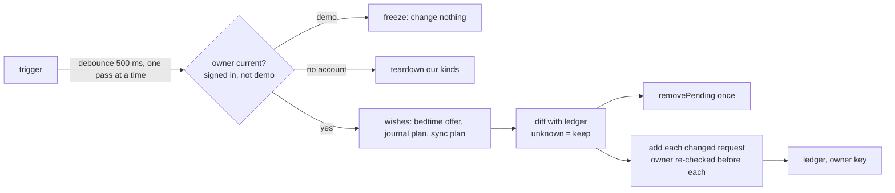

# Notifications: design (N0)

Plan and lead decisions: `plan.md` (they stand). Contract: platform `API.md` → `PATCH /v1/me/notifications`,
`POST /v1/devices/{id}/push`, Push notifications; the `ACTIVITY_SCORED` request is NT1 in `docs/API_REQUESTS.md`
(api-contract-keeper, in parallel). Record: **ADR 0024**. Account wipes: ADR 0020. Written against `main` at 1c5f6fd.

**Problem.** RYFT has two notification paths that know nothing of each other. The platform sends `MORNING_SCORE`,
`SESSION_SCORED`, `PR` and `SYNC_STALE` behind `push.enabled`. `BedtimePlanner` writes its own local `BEDTIME` requests
and enumerates `pendingNotificationRequests()` on every reschedule. This ticket adds two local kinds (the journal
reminder and a "not syncing" fallback) and one server kind (`ACTIVITY_SCORED`). Three writers to iOS's pending set, each
with its own teardown, account rule and quiet-hours logic, would be three places to get the sign-out wrong.

**Constraints.** Swift 5.10, approachable concurrency, iOS 18.6+, no dependency. Everything that touches time,
notifications and flags goes through a seam. There is no Notification Service Extension, so nothing runs when an alert
or a local notification is shown while RYFT isn't running. iOS keeps at most 64 pending requests per app (a repeating
trigger counts as one) and drops the rest silently. Lock screen: no health value in a title, no habit names anywhere.

---

## 1. Kinds and states (stable: ui.md builds on this section)

### 1.1 The kinds

| # | Page row (group) | Origin | Category id | Preference, owner | Default | Fires | Tap opens |
| --- | --- | --- | --- | --- | --- | --- | --- |
| K1 | Your day is ready (Morning) | server | `MORNING_SCORE` | `categories.MORNING_SCORE`, server | on | API.md: the day is final, once a day; held through quiet hours | `/day/<day>` |
| K2 | Journal reminder (Morning) | **local** | `JOURNAL_REMINDER` | on/off + time, **device, per account** | on at 09:00 (Q1) | daily at the time, only with habits chosen and yesterday not answered; moved out of quiet hours | the journal sheet on the day it asks about |
| K3 | Activity scored (Training) | server (NT1) | `ACTIVITY_SCORED` | `categories.ACTIVITY_SCORED`, server | on | NT1: an Apple Health workout scored, ≤ 3 a day | the workout (`/activity/<id>`) |
| K4 | Session scored (Training) | server | `SESSION_SCORED` | `categories.SESSION_SCORED`, server | on | API.md | `/train/session/<id>` |
| K5 | Records (Training) | server | `PR` | `categories.PR`, server | on | API.md, when K4 is off | `/train/session/<id>` |
| K6 | Bedtime reminder (Sleep) | **local** | `BEDTIME` | Bedtime & wake's reminder switch and wind-down, device, per account | off until set in Bedtime & wake | bedtime − wind-down, the next 7 nights; **not** moved by quiet hours | Today (Tonight) |
| K7 | Not syncing (Sync) | server `SYNC_STALE`, **or** a local fallback when push can't reach (§5.2) | `SYNC_STALE` (both) | `categories.SYNC_STALE`, server: **one switch for both paths** | on | server: no heart rate or steps for 20 h; local: no successful sync for 20 h. Both 09:00–21:00, outside quiet hours | Today, and a sync |
| H | Background sync hint (Devices & sync; not a notification) | in-app | — | — | — | Background App Refresh off or restricted, Low Power Mode | Open Settings (off only) |

The wake alarm (AlarmKit on iOS 26+, a `wake.<n>` notification below) is Bedtime & wake's and not a row here. It counts
against the 64 (§3.3) and, like K6, ignores quiet hours.

### 1.2 Row states

- **Server rows (K1, K3–K5):** `rollingOut` (`push.enabled` off: listed with when they're sent, no switch), `notAsked`
  (switch, and Allow notifications on the page), `denied` (switch, and Open Settings), `allowed`. K3 is **hidden** until
  `ACTIVITY_SCORED` is a key in the cached `User.notifications.categories` (§6).
- **Local rows (K2, K6):** `notAsked` (turning it on asks iOS; provisional counts as not asked, as Bedtime & wake does),
  `denied` (Open Settings), `allowed`. **Never `rollingOut`**: local kinds don't wait for `push.enabled` (lead decision 2).
- **K2 also:** `noHabits` (on, but no habit chosen: says so and links to Profile → Journal; nothing is scheduled) and
  hidden while the journal isn't live (`JournalStore.availability == .notLive`). Its time row: a time in 15-minute
  steps; when the time falls in quiet hours the row says it arrives when they end.
- **K6:** a link row to Bedtime & wake, value "Off", "30 min before bedtime" or "Waiting for tonight's plan"
  (`BedtimePlanner.remindersWaiting`). Hidden while `sleep.planner` is off.
- **K7:** a live switch in **every** mode (it governs the local fallback too, and `PATCH /v1/me/notifications` works
  whatever the flag). Its detail line follows the delivery route (`SyncStaleRoute`, §5.2): `.server` (the platform's
  rule), `.thisIPhone` ("when RYFT couldn't sync for 20 hours"), `.off`.
- **Quiet hours:** apply to K1–K5 and K7; the row says the bedtime reminder and the wake alarm still come at their times.
- **H:** `none`, `refreshOff` (Open Settings), `restricted` (Screen Time or a profile: no button), `lowPower` (transient,
  no button). Shown in Devices & sync while it holds; on Today only inside the existing sync status once the last
  successful sync is older than 20 h (no permanent card).

### 1.3 Content rules (every kind)

- Title: no health value, no habit name. Body: no habit names; health values only where they are today (K1, K4, K5,
  K3's strain, K6's need), hidden with previews off.
- Every category gets a `hiddenPreviewsBodyPlaceholder` without a health value, and **no** `.hiddenPreviewsShowTitle`.
  Note for the plan's decision 6: by default iOS shows **neither title nor body** with previews hidden, only the
  placeholder. Only that option would show the title, and `MORNING_SCORE`'s title is "Recovery 82%".
- Local requests carry the server alerts' `userInfo` shape: `ryft: {category, day, url, account}`, so one decoder
  (`PushMessage`) and one tap path serve both. `thread-id` = the category.

---

## 2. One scheduler or three

| | Option | For | Against |
| --- | --- | --- | --- |
| A | Each feature schedules its own (as `BedtimePlanner` does now) | no change to bedtime | three teardowns, three account and demo rules, three quiet-hours copies; each enumerates `pendingNotificationRequests()`; no shared budget |
| **B** | **One `ReminderScheduler` owns RYFT's local requests. Each kind is a pure plan, and the scheduler diffs what the plans want against what it put on iOS** | one writer, one owner check, one wipe, one budget, one quiet-hours rule; a pass that changes nothing makes no system call | bedtime's reminders move onto it (a narrow change in a well-tested class) |
| C | B, plus the wake alarms | everything in one place | the alarms are AlarmKit on 26+, a different system with its own seam (`WakeAlarms`); nothing to gain |

**Choice: B.** `BedtimePlanner` keeps the planning: the plan fetch, the 10-minute rule, its `Owner`, the demo rule. It
hands its requests to the scheduler instead of calling `notifier.add`. `WakeAlarms` stays separate and is counted.
The existing `ReminderScheduler` in `Sync/ScheduledWork.swift` (a repeating daily trigger) has no caller but one test.
It is deleted and its name reused.

---

## 3. `ReminderScheduler` (`Ryft/Push/ReminderScheduler.swift`, plans in `Ryft/Push/ReminderPlans.swift`)

### 3.1 Shape

```swift
enum ReminderKind: String, CaseIterable, Sendable {
    case bedtime, journal, syncStale
    var prefix: String { switch self { case .bedtime: "bedtime."; case .journal: "journal."; case .syncStale: "sync.stale." } }
}

/// One request as RYFT wants it on iOS. Pure and Equatable: the ledger compares these, tests assert them.
struct LocalReminder: Equatable, Sendable {
    let id: String                 // "journal.2026-11-21"
    let kind: ReminderKind
    let fire: DateComponents       // year…minute, no time zone: a floating local time
    let title: String, body: String
    let category: String           // "JOURNAL_REMINDER"
    let route: String?             // ryft.url
    let day: String                // ryft.day
    let account: String            // ryft.account
    init?(_ request: UNNotificationRequest)   // read back from iOS (§3.4); nil if it isn't one of ours
    var request: UNNotificationRequest { get }
}

/// What a kind wants. `.unknown` leaves that kind's requests exactly as they are.
enum ReminderWish: Equatable { case unknown, these([LocalReminder]) }

@MainActor
final class ReminderScheduler {
    init(env: AppEnvironment, inputs: ReminderInputs, calendar: Calendar = .autoupdatingCurrent)   // review S2
    func reschedule(_ reason: ReminderReason)       // coalesced, debounced 500 ms on env.clock; returns at once
    func rescheduleNow() async                      // one pass now, awaited (the BG refresh's completion)
    func offerBedtime(_ wish: ReminderWish, owner: BedtimePlanner.Owner)   // BedtimePlanner's only write
    func answered(journalDay: String)               // journal.<day> off iOS, pending and delivered, at once
    func accountChanged() async                     // this side's teardown, then a pass for whoever is current
    func forget()                                   // in the wipe's turn: generation += 1, ledger = nil, pass cancelled
    static func wipe(_ center: NotificationWiping)   // sign-out: every pending and delivered request (@MainActor protocol)
}
```

The calendar follows the iPhone's time zone (`.autoupdatingCurrent`, not a launch-time snapshot), and
`NSSystemTimeZoneDidChange` asks for a pass beside `significantTimeChangeNotification` (review S2): the fallback's wall
times, the journal's "yesterday" and the daytime window are the new zone's at the next pass, and a request iOS holds as a
floating time keeps its wall time until then.

`ReminderInputs` reads the owners and never stores a copy: the cached user's `notifications` (`Repository.user()`),
`JournalReminderSettings` (§4.4), `JournalStore` (habits, `cachedDay`), `Settings.lastSync`, `FlagStore`,
`PushRegistrar`'s accepted `Record`, `BedtimePlanner`'s last offer, and the authorization status, which the
scheduler reads itself (§3.4). The plans are pure static functions over values:

```swift
enum JournalReminderPlan { static func wish(_ s: JournalReminderSettings?, habits: Bool?, answered: (String) -> Bool?,
                                            quiet: QuietHours?, account: String, now: Date, calendar: Calendar) -> ReminderWish }
enum SyncStalePlan { static func wish(lastSync: Date?, route: SyncStaleRoute?, quiet: QuietHours?, scheduled: Date?,
                                      account: String, now: Date, calendar: Calendar) -> ReminderWish }
enum QuietWindow { static func firstAllowed(atOrAfter: Date, quiet: QuietHours?, daytime: ClosedRange<Int>?,   // minutes of day
                                            calendar: Calendar) -> Date }
```

### 3.2 A pass



1. **Owner.** `AccountBinding(env)` plus the store epoch, captured at the start and re-checked after every `await`.
   Signed out: teardown. Demo data: **freeze**, adding, moving and removing nothing (the account's stay, as
   `BedtimePlanner.keepsTheAccounts` already does).
2. **Wishes.** Each kind is `.unknown` while its inputs aren't known. That covers a background launch before the
   journal's catalog is read, bedtime before the planner's first pass, and the authorization not read yet. **Unknown
   never removes**, so a background launch with half its inputs never tears anything down.
3. **Diff.** `remove` = ids in the ledger that no known wish holds any more (and every past one-shot); `add` = wished
   requests whose `LocalReminder` differs from the ledger's. One `removePending(ids:)` (synchronous), then `add` per
   request. An `add` that throws (`UNError.notificationsNotAllowed`) isn't written to the ledger, and the pass doesn't
   retry it.
4. **After.** If the owner changed during the adds, the ids this pass added are removed again (`BedtimePlanner`'s alarm
   pattern). The account is written to `notifications.owner` (UserDefaults, per install): whose requests iOS holds.

### 3.3 Ids, windows, budget

| Kind | Ids | Trigger | Window | Max pending |
| --- | --- | --- | --- | --- |
| bedtime | `bedtime.<wake day>` (unchanged) | one-shot calendar | next 7 nights (`nightsAhead`) | 7 |
| journal | `journal.<asked day>`: it fires the morning **after** that day | one-shot calendar | next 3 mornings | 3 |
| syncStale | `sync.stale.1`, `sync.stale.2` | one-shot calendar | 20 h and 72 h after the last sync (§5.1) | 2 |
| wake (iOS < 26, `WakeAlarms`) | `wake.0` … `wake.6` (unchanged) | repeating weekly | — | 7 |

19 at most, against iOS's 64. The scheduler's own kinds have a budget of 32 (`ReminderScheduler.budget`). Debug
asserts it; Release keeps the soonest. One-shot triggers with full dates, not a repeating daily trigger, so today's
journal reminder can go while tomorrow's stays. A journal id keyed by the day it asks about makes the cancel on save a
lookup, and stays right across time zones and DST.

**Why 3 journal mornings.** Every app open and every BG refresh extends the window. Three mornings without RYFT running
at all is the sync fallback's case. A longer window would keep reminding about days the user may have answered
elsewhere (§4.3).

### 3.4 Reading iOS back: once per process

The ledger (`[id: LocalReminder]`) lives in memory. The **first pass of a process** reads `pending()` once (a new seam
method returning the requests, replacing `pendingIDs()`) and rebuilds the ledger with `LocalReminder(request)`. It reads
the authorization status once too, and again on every app-active trigger. If `notifications.owner` names an account
other than the current one, or there is none, every pending id with our prefixes goes first. That covers a kill
between a wipe and its removals, an owed wipe resumed as `storeOnly` (which skips the device steps), and a restore.
After that, no pass enumerates iOS. `BedtimePlanner.removeReminders` and `SystemWakeAlarms.cancelAll` stop calling
`pendingIDs()`. The wake ids are fixed, so they are removed by name.

### 3.5 Triggers

| Trigger | Where it comes from | Debounced | Changes |
| --- | --- | --- | --- |
| App active | `scenePhase == .active` (RyftApp, after the launch barrier) | yes | all; re-reads the authorization |
| BG refresh | `BackgroundWork` `afterRefresh`, after `bedtime.refresh()`: `await rescheduleNow()` before the completion | no | all |
| A successful sync | an `ObservationWatch` on `Settings.lastSync` (written only by a run that uploaded, §5.1) | **no** (hysteresis instead, §5.1) | syncStale |
| Journal answers saved, or a loaded day answered (another device) | `answered(journalDay:)` from `JournalStore.store` when `answered`; plus a watch on the habits and availability | removal at once; the pass debounced | journal |
| Journal reminder switch or time | `JournalReminderSettings` set | yes | journal |
| Notification prefs (a category, quiet hours) | the page's confirmed save and `Repository`'s user refresh (a watch on `user.notifications` if the read is observable, else these two call it) | yes | journal, syncStale (bedtime: no) |
| `push.enabled` applied, push record accepted or removed | `FlagStore.applyPending`, `PushRegistrar.send` / `signOut` | yes | syncStale (§5.2) |
| Bedtime's reminders computed | `BedtimePlanner` → `offerBedtime` | yes | bedtime |
| Account change | `onChange(of: auth.accountID)` → `accountChanged()`; `finishOwedWipe(train:bedtime:)` too | no | teardown, then all |
| Sign-out wipe | `wipeSharedLocalData` → `ReminderScheduler.wipe`; the forgetter → `forget()` | — | everything (§9) |
| Demo data on/off | `onChange(of: settings.demoMode)` | yes | on: freeze; off: all |
| Time zone or significant time change | `UIApplication.significantTimeChangeNotification` | yes | all |

### 3.6 Quiet hours on local kinds

- **Source:** `User.notifications.quiet_hours` from the cached user (SwiftData). Offline, and in a background launch,
  the last value fetched applies. Never fetched: none. Another device's change arrives with the next `GET /v1/me`.
- **Rule (`QuietWindow.firstAllowed`):** equal times = none; `from > to` spans midnight; a time inside moves to the
  window's end (on that day, or the next for a window across midnight).
  - **Journal:** moved to the end, never dropped (it's daily; the server holds `MORNING_SCORE` the same way).
  - **Sync fallback:** the first minute that is outside quiet hours **and** inside 09:00–21:00, as the server's `SYNC_STALE`.
  - **Bedtime and wake: exempt** (ADR 0024 §4). The default window, 22:30–07:00, would hold most bedtime reminders until
    the morning and turn a working feature off without a word. Both are timers the user set for that minute.

---

## 4. Journal reminder

1. **Time: fixed, default 09:00**, one time for every day, 15-minute steps. Not relative to the wake time. The
   question is about yesterday's habits, whenever you woke. It also keeps the reminder off the `sleep.planner` flag and
   off `BedtimePlanner`'s state, and its line stays one sentence ("Every day at 9:00 AM"). 09:00 is outside the default
   quiet hours. "After my wake time" can come later as an option of the same setting.
2. **When.** For each of the next 3 mornings D whose reminder time (after the quiet-hours move) is still ahead: asked day = D − 1. Skipped
   when `JournalStore.cachedDay(D − 1)?.answered == true`. Nothing is scheduled while the switch is off, while no habit
   is chosen (`enabledBehaviors` empty), while the journal isn't live, or while iOS doesn't allow notifications. While
   the catalog isn't known yet: `.unknown`.
3. **Answered → gone at once.** `JournalStore.store(_:as:)` with `answered` calls `answered(journalDay:)`. That runs
   `removePending(ids: ["journal.<day>"])` and `removeDelivered(ids: ["journal.<day>"])` synchronously, so one already in
   Notification Center goes too, then a pass follows. That covers the sheet's save and any read that finds the day
   answered. **Another device:** there is no push or sync event for the journal. The app learns from
   `GET /v1/journal/{day}`: Today reads yesterday after every refresh, and the BG refresh's `afterRefresh` reads yesterday
   once, through `ReadScheduler`. It does so only when the reminder is on, yesterday isn't known answered and today's
   reminder is still ahead. That is one request at most per refresh, before `rescheduleNow()`.
4. **Where it lives.** `JournalReminderSettings { on: Bool; minute: Int }` (minutes after midnight), UserDefaults
   `notifications.journal.<account>`, an `@MainActor @Observable` store in `Ryft/Push/`. Read by the page and the
   scheduler, written by the page only. Wiped by prefix in the sign-out wipe, next to `BedtimePlanner.wipe`. Demo data
   has none. Not on the server: there is no field, and none is requested now. If it should follow the account across
   devices, that becomes an `API_REQUESTS.md` item (Q7).
5. **Tap.** `ryft.url` `https://ryftlab.de/journal/<asked day>` → `AppRoute.journal(Date)` → Today with the journal sheet
   on that day (`JournalSheetModel(store:day:)`). The sheet's own states cover not live, no habits and not editable.

---

## 5. Not syncing

### 5.1 The local fallback

- **The successful sync:** the line `settings.lastSync = env.clock.now()` in `SyncService.run()`, which every uploading
  trigger reaches: app active, pull to refresh, reconnect, HealthKit delivery (foreground and background), BG refresh,
  backlog, backfill. Only a run that passed the gates and finished its upload counts. These don't: a silent push or
  `.daysChanged` (no upload), a held, failed or cancelled run, the locked phone, demo data. A run with nothing new does
  count: the fallback is about RYFT being able to sync, and "no new data" is the server's `SYNC_STALE`. The scheduler
  derives from that one fact. No second timestamp, no new hook in `SyncService`.
- **When:** `sync.stale.1` at `firstAllowed(lastSync + 20 h)`, `sync.stale.2` at `firstAllowed(lastSync + 72 h)`; none
  while `lastSync` is nil. 20 h is the server's own threshold, so the row's "20 hours" holds whichever path delivers.
- **Hysteresis (the cost rule):** `.1` is kept when the new time is later than the scheduled one by less than 1 h, and
  moved otherwise or when it is earlier. `.2` moves with it. A foreground burst of syncs (app active, HealthKit
  deliveries, pull to refresh) costs no system call. Background syncs, about 2 h apart, move it once each. At worst it
  fires 1 h early, at 19 h.
- **Background:** the watch runs on the next main-actor turn, without a debounce. A HealthKit delivery's completion
  isn't held for it. If iOS suspends first, the next sync moves it, and at worst it fires once too early. The BG
  refresh awaits `rescheduleNow()`.
- **Foreground:** a local `SYNC_STALE` isn't presented while RYFT is open (§7.2); it's moved instead.

### 5.2 Dedupe with the server's `SYNC_STALE`

| | Option | For | Against |
| --- | --- | --- | --- |
| **A** | **The local one only when push can't reach this iPhone** | never two for one gap; the server keeps the case only it sees (the app syncs, but no heart rate or steps arrive) | relies on the app's belief that push reaches (§13) |
| B | Both, the local one later (30 h) | a backstop if the push didn't come | two notifications in the commonest outage, a force-quit with push working, since the app can't see that the push arrived |
| C | The local one replaces the server's (the app turns `SYNC_STALE` off on the server) | one path | loses "the app syncs but nothing arrives from the watch"; writes a server preference behind the user's back |

**Choice: A.** One derived value, used by the scheduler and the page alike (`SyncStaleRoute`, pure):

```swift
enum SyncStaleRoute: Equatable { case off, server, thisIPhone }
static func decide(category: Bool, pushEnabled: Bool, allowed: Bool, registered: Bool) -> SyncStaleRoute
// category off → .off; push.enabled on, notifications allowed and this account's push Record accepted → .server; else .thisIPhone
```

The switch is the server's category, so turning "Not syncing" off silences both paths. A flag flip or a first accepted
registration moves the route, and the next pass removes or adds `sync.stale.*`. Permission denied makes neither
possible: K7 shows `denied`.

### 5.3 Background App Refresh and Low Power Mode

- **A new seam, `BackgroundAvailability`** (`@MainActor`): `refreshStatus: UIBackgroundRefreshStatus`,
  `isLowPowerMode: Bool`. The live one is observable, from `UIApplication.backgroundRefreshStatusDidChangeNotification`
  and `.NSProcessInfoPowerStateDidChange`. The mock is fixed (previews draw every H state). It goes in `AppEnvironment`
  with a default argument, so no existing call site changes.
- **What it changes:** only H (§1.2). With refresh off, `BGAppRefreshTask` doesn't run. The fallback is unchanged, and
  this is the case it exists for.
- **Low Power Mode** pauses background refresh while it's on. Whether `backgroundRefreshStatus` reads `.denied` meanwhile
  isn't documented, so both values are read and `lowPower` wins only when refresh is otherwise available (device check
  D2).

### 5.4 Force-quit: what iOS does

| What | After the user swipes RYFT away | Source |
| --- | --- | --- |
| Scheduled local notifications | **delivered** by the system whatever the app's state, and they survive a restart | the `UNUserNotificationCenter` model; device check D1 for our fallback |
| Alert pushes (`MORNING_SCORE`, `SYNC_STALE` …) | **shown** by iOS: they don't need the app | the APNs model |
| Silent push (`content-available`) | **not** delivered to the app until the user opens it or restarts the phone | documented in `application(_:didReceiveRemoteNotification:fetchCompletionHandler:)` |
| `BGAppRefreshTask` / `BGProcessingTask` | **not** run until the user opens the app again | Apple's stated behaviour (WWDC19 "Advances in App Background Execution", DTS on the forums), not in the API reference |
| HealthKit background delivery | **not documented**; reports disagree. The design assumes it stops | device check D3 |
| `applicationWillTerminate` | **not called** for a suspended app: a swipe kills it with no code run. Called only if RYFT was running in the background (inside `finishInBackground`'s background task), with seconds to spare | `UIApplicationDelegate` docs |

**No notice at termination.** For a suspended app (the usual case) it is impossible. In the rare running case the
`add` may not reach the system before the process ends, and RYFT can't tell a force-quit from a system termination. A
notice right after the user closed the app on purpose would also nag. The moving fallback is the dependable part: after
a force-quit it fires 20 h after the last sync, in the daytime window. Its copy (ui.md) can say what helps ("If you
closed RYFT from the app switcher, open it to sync."). There is no public API to learn at the next launch that the last
exit was a force-quit (MetricKit's exit counts are daily totals), so the app reasons from the gap, not the cause.

---

## 6. `ACTIVITY_SCORED` (the app's side of NT1)

- **Category:** registered now with the others (`PushCategories.activityScored = "ACTIVITY_SCORED"`, a string). That is
  harmless while nothing sends it. `NotificationCategory` gets its case only when API.md publishes it (wire models mirror
  API.md).
- **Tap:** `ryft.url` `https://ryftlab.de/activity/<workout id>` → `AppRoute.activity(UUID)` (also `/activities/<id>`;
  `url` writes `activity/<id>`). The day hint is `ryft.day`, so `PushMessage.alert` gains `day`. `DeepLinkRouter`:
  Strain on that day (today if absent), then that workout's page: from the day's cached detail, else from
  `GET /v1/workouts/{id}` through the Repository. A hidden duplicate answers `200` and opens. A `404` stays on the day.
- **Preference:** `categories.ACTIVITY_SCORED`, read from the cached user.
- **Before the platform sends it: the switch is hidden.** It appears when the key is in `GET /v1/me`'s `categories`, and
  is never PATCHed before then (as NT1 says). A switch for a notification that can't arrive would be a dishonest state,
  and showing it this way needs no flag and no app release.
- **Tests:** the route from NT1's payload example (moved to API.md's once published); the category registered; the row
  hidden without the key and shown with it.

---

## 7. Categories, actions, presentation, taps

### 7.1 Categories (`PushCategories.all`): **no actions**

A tap already does the one thing each kind is for. "Open journal" would repeat the tap, and a "Later" would be a second
reminder system.

| Category | Origin | Placeholder (previews hidden) | Foreground | Tap |
| --- | --- | --- | --- | --- |
| `MORNING_SCORE` | server | yes, no score | banner, list, sound | `ryft.url` |
| `SESSION_SCORED`, `PR`, `ACTIVITY_SCORED` | server | yes | banner, list | `ryft.url` |
| `SYNC_STALE` | server | yes | banner, list (the app syncs, so the gap is data) | Today, then `.userInitiated` (today's path) |
| `SYNC_STALE` | local | yes | **none**: moved instead | same |
| `BEDTIME` | local | "Bedtime reminder" (exists) | banner, list, sound | Today (Tonight) |
| `JOURNAL_REMINDER` | local | yes | banner, list | `/journal/<day>` |

`willPresent` and `didReceive` go through one pure function: `PushPresentation.options(category:isLocal:accountMatches:)`
and `PushPresentation.route(message:currentAccount:isDemo:)`. A local request is one whose trigger isn't a
`UNPushNotificationTrigger`.

### 7.2 Account on a notification

A local request's `ryft.account` that isn't the signed-in account, or arrives while Demo data is on, is not presented
in the foreground, and its tap opens Today only. Server alerts get the same check once API.md carries `ryft.account`
(NT1 asks for it on every alert). Until then the sign-out's removal of delivered notifications (§9) covers them.

### 7.3 `AppRoute` additions

`/journal/YYYY-MM-DD` → `.journal(Date)`, `/activity/<uuid>` → `.activity(UUID)`. Unknown paths still open Today.
`DeepLinkRouter` gains a `today` target (`requestedJournalDay`) and `strain.requestedWorkout`.

---

## 8. Preferences: server or device

| Preference | Owner | Offline | Wiped on sign-out |
| --- | --- | --- | --- |
| `MORNING_SCORE`, `SESSION_SCORED`, `PR`, `SYNC_STALE` (+ `ACTIVITY_SCORED`), quiet hours | server, `User.notifications` (cached with the user) | the cached value shows; a change says offline (today's behaviour) | with the store |
| Journal reminder on/off and time | device, `JournalReminderSettings` per account | always | yes (prefix) |
| Bedtime reminder and wind-down | device, `SleepSchedule` (`BedtimePlanner`) | always | yes (`BedtimePlanner.wipe`) |
| Not syncing, local path | **none of its own**: `SYNC_STALE` and `SyncStaleRoute` | — | — |
| Push usable, Background App Refresh | derived, never stored | — | — |

`NotificationSettingsViewModel` reads each from its owner and copies nothing. Server rows keep today's queued PATCH and
rollback. The journal rows write `JournalReminderSettings` at once, with no network, and the scheduler follows. K6 reads
`BedtimePlanner.schedule` and links to Bedtime & wake. `mode` splits into a server mode (today's four) and a local mode
(`notAsked`/`denied`/`allowed`). The page drops `rollingOut` for local rows.

---

## 9. Account boundaries (with ADR 0020)

1. **Sign-out wipe (any reason: user, expiry, deletion, final 401, another account).** In
   `AuthService.wipeSharedLocalData`'s device step (`before`): `ReminderScheduler.wipe(UNUserNotificationCenter.current())`,
   meaning `removeAllPendingNotificationRequests()` and `removeAllDeliveredNotifications()`. Both are synchronous and
   need no enumeration, and on iOS 26+ `AlarmKitWake.cancelAll()` runs too. Then `notifications.owner` and
   `notifications.journal.*` are removed. The step takes a `NotificationWiping` protocol, which `UNUserNotificationCenter`
   and `MockNotifier` conform to. It never reads `AppEnvironment.live` (ADR 0020's rule: a launch wipe runs inside its
   `swift_once`). This removes the previous account's **delivered** server alerts too ("Recovery 82%" in Notification
   Center), the part of W4b that a normal sign-out can do now (Q4).
2. **In the same turn:** the scheduler's `forget()` is an account-state forgetter (`state.forgetsAccountState`), as
   `BedtimePlanner.forget` is. Its generation is bumped, its ledger dropped and its debounce cancelled, so a pass that
   began for the leaving account adds nothing after the wipe.
3. **Account change** (`onChange(of: auth.accountID)`, and `finishOwedWipe(train:bedtime:)` for a wipe resumed later):
   `accountChanged()` tears down our kinds from the ledger and runs a pass for the new account. That account starts
   with no journal setting (the default), no schedule and no `lastSync`, so its first requests come with its own
   setup and first sync.
4. **Every launch:** the owner check of §3.4. It catches what a kill or a `storeOnly` retry left.
5. **A debt with no published session** schedules nothing, because there is no account. When W4a's ledger gate lands
   (`Repository.publishWidget`), the scheduler asks the same gate: a notification is a lock-screen surface (ADR 0020,
   Rules).
6. **Demo data:** freeze (§3.2). The account's local requests stay and may fire; their taps open Today, not the demo's
   journal (§7.2). Demo answers never cancel the account's journal reminder: `JournalStore`'s owner differs, and the
   demo writes no account document.

---

## 10. Test seams and acceptance criteria

**Seams:** `Notifier` gains `pending() async -> [UNNotificationRequest]` (replacing `pendingIDs()`),
`removeDelivered(ids:)`, `removeAllPending()` and `removeAllDelivered()`. `MockNotifier` counts `pendingReads`, `adds`
and `removals`, and keeps delivered ids. Time and the debounce run on `TestClock`. `Calendar` is injected (tests use
Europe/Berlin, DST included). `BackgroundAvailability` is fixed. The plans and `QuietWindow` are pure. Scheduler tests
build `AppState(env: .test(clock:notifier:auth:))` as `StoreResetTests` does.

| Kind | Schedule trigger | Cancel paths | Proved by |
| --- | --- | --- | --- |
| journal | settings on, habits known, app active, BG refresh | answered (sheet or a read), switch off, habits emptied, not live, sign-out, account change | `JournalReminderPlanTests`, `ReminderSchedulerTests` |
| syncStale | a successful sync (`lastSync`), route `.thisIPhone` | route `.server`, category off, sign-out, account change | `SyncStalePlanTests`, `ReminderSchedulerTests` |
| bedtime | `BedtimePlanner` offer (unchanged rules) | reminder off, teardown, sign-out, account change | existing bedtime tests, unchanged in their assertions |
| server kinds | — | delivered removed at sign-out | `PushPresentationTests`, `PushAndDeepLinkTests` |

**N3 (scheduler, journal, fallback):**
1. Journal: 3 requests `journal.<D−1>` at 09:00 floating, none with no habits, the switch off or denied; an answered day
   has none; the time inside quiet hours moves to their end; quiet hours across midnight; a DST day.
2. Saving yesterday removes `journal.<yesterday>` pending **and** delivered in the same turn, before any pass; a read
   that finds it answered (another device) does the same; a demo save doesn't.
3. Fallback: `lastSync + 20 h` into 09:00–21:00 and out of quiet hours; `.2` at 72 h; none without `lastSync`; moved by
   a sync ≥ 1 h later, kept under 1 h (no `add`), moved when earlier; nothing for a silent push, a held, failed or locked
   run.
4. Dedupe: `.server` → no `sync.stale.*` and existing ones removed; a flag flip or an accepted registration removes
   them; `.off` → none; `.thisIPhone` → scheduled.
5. Unknown never removes: a pass with the journal catalog unknown leaves `journal.*`; bedtime before its first offer
   leaves `bedtime.*`.
6. Accounts: the wipe leaves `requests` and delivered empty, wake included; a pass in flight for A adds nothing after
   the wipe (mutant: drop the owner re-check → fails); `accountChanged` removes A's before B's are set; owner key
   mismatch at the first pass removes ours; demo freezes (no add, no remove), off again resumes.
7. Bedtime migration: today's `BedtimePlanner` and `StoreResetTests` reminder tests pass unchanged; no `pendingIDs` /
   `pending` call in a bedtime reschedule.
8. Budget: wishes over 32 assert in Debug.

**N5 (tests and fixtures):** the `ACTIVITY_SCORED` payload from NT1 decodes into `PushMessage.alert` with url, day and
account; `/activity/<id>` and `/journal/<day>` parse and round-trip `url`; `PushPresentation` for every row of §7.1; the
row hidden without the key; each scheduler test above fails against its mutant: no hysteresis, quiet hours ignored, a
removal of unknown, a missing delivered removal, `.server` ignored.

---

## 11. Performance

- A pass that changes nothing makes **zero** system calls: no `pending()`, no `add`, no `remove`. The authorization is
  read once per process and on app active.
- `pending()` is read **once per process** (§3.4). The bedtime and wake paths stop enumerating.
- Syncs move the fallback at most once per hour (hysteresis), with no debounce in the background. Everything else is
  coalesced into one pass per 500 ms.
- A pass computes at most 12 requests on the main actor: microseconds. The system calls are async and never block it.
- Signpost `reminders.pass` (in `Signposts.sync`) with the counts of adds and removes, for the performance-profiler. Its
  test: 50 `lastSync` writes inside an hour → at most 1 `add`; 10 app-active triggers within 500 ms → one pass.

---

## 12. Migration (PRs from `plan.md`)

1. **PR 1 (docs):** this note, ADR 0024, ui.md, NT1.
2. **PR 2 (N3), in commits:** (a) the `Notifier` seam and mock; (b) `QuietWindow`, the plans, `LocalReminder` with tests;
   (c) `ReminderScheduler` with journal and syncStale, `JournalReminderSettings`, the wipe step, the forgetter, the
   triggers, and the old `ReminderScheduler` deleted; (d) **bedtime onto the scheduler**: `scheduleReminders`,
   `cancelReminders` and `removeReminders` become `offerBedtime(.these(…))` and `offerBedtime(.these([]))`, and
   `SystemWakeAlarms.cancelAll` removes `wake.0…6` by id; (e) `JOURNAL_REMINDER` and the placeholders,
   `PushPresentation`, `/journal/<day>`; (f) docs: ARCHITECTURE §4 and §7, STATUS, CHANGELOG.
3. **PR 3 (N4):** the page (§1.2, §8), `BackgroundAvailability` and H, `ACTIVITY_SCORED`'s category, route and hidden row.
4. **PR 4:** the `NotificationCategory` case and fixture once API.md publishes NT1.

---

## 13. What could go wrong

- **A pass lands on the next account.** Owner re-checked after every await, and a post-pass removal when it changed;
  the wipe removes everything synchronously; the per-launch owner check covers kills. Tested by mutant (§10, N3.6).
- **A background launch tears down with half its inputs.** Unknown never removes (§3.2). Tested.
- **"Push reaches" is wrong:** the APNs key is withdrawn, or the platform dropped a stale token without the app knowing.
  Then neither path fires a gap. That is the opposite of a duplicate, and rare. The record is sent again when the token
  changes. Option B's backstop was rejected for the duplicate it causes.
- **iOS suspends before the fallback's add.** It fires up to once too early. The BG refresh awaits its pass.
- **Adds while permission is off** throw `notificationsNotAllowed`. They aren't put in the ledger, and the next app
  active (where the status is re-read) tries again.
- **DST:** a floating time that doesn't exist on the spring-forward day (02:30) isn't a default for any kind. The
  journal's earliest pick is the user's to make. The plan tests one DST day.
- **The wipe removes the wake alarm's notification below iOS 26** while the planner's in-memory `alarmsSet` still says
  set. Its own teardown follows at the account change (`alarmsSet = nil`); with no account, nothing re-adds it.
- **Two iPhones on one account:** with push not reaching, the idle one reminds "couldn't sync" while the other syncs.
  This is honest about that iPhone and rare.

## 14. Drift found (not fixed here; architect writes only docs/work and docs/adr)

- `ARCHITECTURE.md` §4 says `ReminderScheduler` puts bedtime on a repeating calendar trigger. Bedtime uses one-shot
  requests from `BedtimePlanner`, and that class has no caller. PR 2 rewrites the line.
- `ARCHITECTURE.md` §7 says push loc-keys ship "en and de"; `CLAUDE.md` says English only.
- `plan.md` decision 6 says that with previews hidden iOS shows the title. It shows only the placeholder unless a
  category opts into `.hiddenPreviewsShowTitle` (§1.3).

## 15. Open questions

- **Q1 (user):** journal reminder **on by default** at 09:00 for accounts with habits (recommended: it only fires for a
  journal you set up and haven't answered), or off until turned on?
- **Q2 (user/lead):** quiet hours don't hold the bedtime reminder and the wake alarm (recommended; ADR 0024 §4).
- **Q3 (lead):** the fallback at 20 h, with a second one at 72 h, inside 09:00–21:00. Is one enough?
- **Q4 (security-privacy):** remove **all** delivered RYFT notifications at sign-out now (recommended), ahead of W4b.
- **Q5 (lead):** the BG refresh reads yesterday's journal (one GET, bounded, §4.3) so a day answered elsewhere silences
  the reminder. Accept the extra request?
- **Q6 (lead):** Demo data freezes the account's local requests (consistent with bedtime), so the account's journal
  reminder can fire during the demo and its tap opens Today. Accept, or pause the account's kinds while Demo data is on?
- **Q7 (later):** should the journal reminder follow the account across devices? That would be an `API_REQUESTS.md` item
  for a `NotificationPrefs` field; nothing is requested now.
- **Device checks (Needs you):** **D1** the fallback arrives after a force-quit and after a restart; **D2**
  `backgroundRefreshStatus` with Low Power Mode on; **D3** whether HealthKit background delivery wakes RYFT after a
  force-quit (record a watch workout, check Sync details' last sync); **D4** each kind on the lock screen with previews
  hidden (placeholders only); **D5** a silent push with Background App Refresh off.
