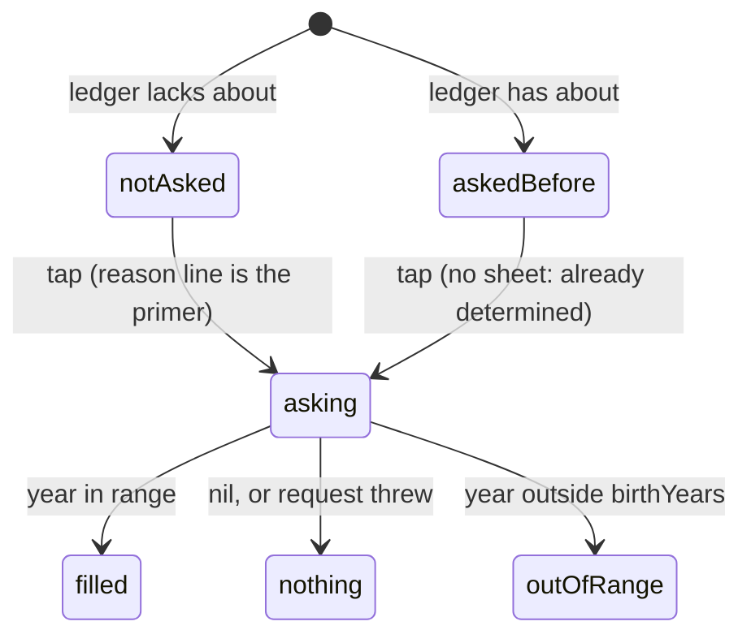

# H0 — Apple Health by group (design note)

Ticket H0 of PR 3 (brief `../docs/briefs/2026-11-23-onboarding-health-app.md` §2, plan `../docs/work/2026-11-23-connect-and-onboarding/plan.md` §2).
Decision record: ADR 0027. Owners: sync-engineer (registry, ledger, seam), ios-developer (About you), test-engineer.

## 1. Problem and constraints

- Today the ten read types are hard-coded in four places, and nothing ties them together: `HealthKitManager.quantities`
  + `readTypes`, `observedTypes`, `HealthKitManager.streams` (`HealthStore.swift`), and the English list in
  `NSHealthShareUsageDescription` (`Info.plist` and `Resources/InfoPlist.xcstrings`, two copies).
- `requestAuthorization()` takes no argument and always asks for the ten. It is called from 5 places
  (§6). `accessStatus()` asks HealthKit about the same ten.
- HealthKit grants are **per install**. They are never visible for reads. "Asked" is a product fact the app has to
  remember, **per account**.
- Fixed: `core` is exactly today's ten, with the same prompts, observers and background delivery. No new type is read
  except date of birth. Consent, the gates and the engine's paging don't change. The date of birth never leaves `Health/`.

## 2. Options

| | Option | For | Against |
|---|---|---|---|
| A | **Registry enum in `Health/`. The live store owns a per-account ledger (as it owns the anchors). The seam takes a group.** | One source for types. The ledger is readable synchronously at launch, where observers are registered before any scene. Same account scoping as anchors (`AccountScope`). | The ledger lives behind the seam, so `MockHealthStore` needs its own in-memory copy. |
| B | Add an ad hoc `requestDateOfBirth()` and keep `readTypes` | Smallest diff | No registry, and nothing for the tests to enumerate. Every later group copies the pattern, which fails the brief. |
| C | A `@MainActor HealthPermissions` model in `AppEnvironment` owns the ledger. The seam stays stateless and takes type sets. | Account comes from `env.auth`. The seam stays pure. | `RyftApp.init` and `enableBackgroundDelivery` (off main) need the set before the graph is up. Types and "asked" get two owners. |

**Choice: A.** It follows the existing anchor precedent and adds one enum, one value type and a group argument. Nothing
else gets a new layer.

## 3. The registry (Q1)

New file `Ryft/Health/HealthPermissionGroup.swift`, with **no `import HealthKit`**. Everything in it is a plain `Sendable` enum:

```swift
enum HealthDataType: String, CaseIterable, Sendable {      // raw value = the HealthKit identifier string
    case heartRate = "HKQuantityTypeIdentifierHeartRate", /* … */ dateOfBirth = "HKCharacteristicTypeIdentifierDateOfBirth" /* … */
    var usageName: String       // as the usage description names it: "breathing rate", "date of birth"
}
enum HealthConsumer: String, Sendable { case scores, birthYearPrefill, fuel, journalAutofill, physiologyCard }
enum HealthPermissionGroup: String, CaseIterable, Codable, Sendable {
    case core, about, body, fuel, habits, physiology
    var types: [HealthDataType]
    var reason: LocalizedStringResource   // the one line on the group's primer
    var consumer: HealthConsumer
    var isRequestable: Bool               // core, about; flipping one is a reviewed edit with its feature
    var streams: [HealthStream]           // anchored uploads: core → today's ten in today's order; others []
    var observed: [HealthDataType]        // background delivery: core → [sleep, workout, hrvSDNN]; others []
}
```

| Group | Types | Consumer | Requestable |
|---|---|---|---|
| `core` | heart rate, HRV (SDNN), resting HR, respiratory rate, SpO₂, VO₂ max, active energy, steps, sleep analysis, workouts | `scores` (sync) | yes |
| `about` | date of birth (characteristic) | `birthYearPrefill` | yes |
| `body` | biological sex, height, body mass, body fat %, lean body mass | `fuel` (M12) | no |
| `fuel` | dietary energy, protein, carbohydrates, total fat, water, basal (resting) energy | `fuel` (M12) | no |
| `habits` | caffeine, alcoholic beverages, mindful session, time in daylight | `journalAutofill` | no |
| `physiology` | sleeping wrist temperature, heartbeat series | `physiologyCard` | no |

- `Ryft/Health/HealthPermissionGroup+HealthKit.swift` maps `HealthDataType` to `HKObjectType` on demand. The mapping
  is never stored in a `Sendable` value, so `HKObjectType`'s missing `Sendable` conformance never matters. Previews,
  the mock and the tests use only the plain enums.
- `HealthKitManager.quantities` stays: it holds units and scale. A test pins it to `core`. The registry adds the
  grouping and does not duplicate the mapping logic.

## 4. The per-account "asked" record (Q2)

New `Ryft/Health/HealthPermissionLedger.swift`. It is a value type, `init(defaults:account:)`, built when needed and
never shared across actors.

- **Key:** `health.asked.<account>`, a `[String]` of raw values. This follows `onboarding.<name>.<account>` and
  `notifications.journal.<account>` (ADR 0024). Unknown raw values are kept when the key is rewritten, so a newer
  build's groups survive a downgrade. The value is group names only, no health data.
- **Owner:** the live store. `HealthKitManager` builds the ledger with `AccountScope.current(defaults)`, as it does for
  anchors. `account == nil` (signed out, Demo data) never writes, and there is no `signed-out` bucket.
- **When it is written:** right after `requestAuthorization(group)` returns without throwing. The account is captured
  **before** the await (the same rule as `AccountBinding`), so a switch while the sheet is up records for the account
  that asked. A throw records nothing.
- **What it decides:** the derived sets in §5, and which UI state a feature shows. It **never skips a request.** Every
  read of a group is preceded by `requestAuthorization(group)` in the same action, so a stale record (a backup restore,
  for example) can't cause a read without HealthKit's own determination.

| Event | Record |
|---|---|
| Sign-out (user or 401) | Kept, like the onboarding keys. HealthKit's grant is per install and stays too. |
| Account switch | B starts empty. HealthKit shows B no sheet for what A answered, but B's sets and primers follow B's own record. |
| Account deleted (`Wipe.reason == .accountDeleted`) | Removed in `wipeSharedLocalData` |
| Demo data | Not read, not written. About you is never shown in demo, so no prefill is offered there. |
| Reinstall | Gone with `UserDefaults`. iOS also drops the app's Health authorisation, so both start over. |

**Migration (no prompt):** a synchronous rule when the ledger is read. If the record lacks `core` and
`Settings.healthIntroDone` is true, `core` is added. Today `healthIntroDone` implies that `core` was requested
(`connect()`, or the `accessStatus == .asked` skip in RootView), or that bootstrap requests it on this run (after
"Not now", see Q3). The rule needs no network and no HealthKit call, so it also holds in a background launch
(`RyftApp.init`). Bootstrap's `requestAuthorization(.core)` then records `core` anyway, because HealthKit returns at once
without a sheet for determined types. Both writes are idempotent.

## 5. Derivation, and proof that `core` is unchanged (Q3)

```swift
func readTypes(_ asked: Set<HealthPermissionGroup>) -> Set<HKObjectType>   // ∪ group.types, requestable only
func observedTypes(_ asked: Set<HealthPermissionGroup>) -> [HKSampleType]  // ∪ group.observed, in group order
var streams: [HealthStream] { HealthPermissionGroup.core.streams }         // unchanged: no paging change in H0
```

- `enableBackgroundDelivery()` and `startObserving` use `observedTypes(ledger.asked)`. The disable loop runs over
  `readTypes(asked)` filtered to sample types, as today.
- `accessStatus(_ group:)` asks `statusForAuthorizationRequest(read:)` for that group's types only. `core`'s answer
  is today's answer.
- **Proof, as tests:** (a) `readTypes([.core])` identifiers equal a pinned literal of today's ten, and equal
  `quantities.map(\.hkType) + [sleepType, workoutType]`. (b) `observedTypes([.core]) == [sleep, workout, HRV]`, same
  order. (c) `observedTypes([.core, .about]) == observedTypes([.core])`. (d) `core.streams` equals today's literal stream
  order. (e) The launch gate stays `isSignedIn && healthIntroDone && isAvailable`. With the migration rule, an upgraded
  account gets the same three observers on its first background launch.
- **`about` is a characteristic.** `HKCharacteristicType` is not an `HKSampleType`, so it has no anchor, no observer,
  no background delivery and no upload. `about.streams` and `about.observed` are empty, and a test asserts both.
- Later, when a group with sample types becomes requestable, `streams` derives from the asked groups (core first) and
  `startObserving` must register observers added mid-session. Neither is needed in H0.

## 6. Call sites of `requestAuthorization` (Q6)

The no-argument `requestAuthorization()` and `accessStatus()` are **removed**, so every call names its group.

| Call site | Today | After |
|---|---|---|
| `HealthPermissionView.swift:46` `connect()` (first run) | ten types | `.core` |
| `RyftApp.swift:436` `bootstrap()` (every start, intro done) | ten types | `.core` only. Feature groups are requested only by their feature. |
| `ProfileViewModel.swift:341` `requestHealthAccess` (Profile → Data) | ten | `.core` |
| `ProfileViewModel.swift:1983` tracker check, "Allow access" | ten | `.core` (`TrackerCheckRules.streams` are core streams) |
| `ProfileViewModel.swift:3006` `requestHealthAccess` (devices and sync) | ten | `.core` |
| `AboutYouView` (new) "Use my birth year from Apple Health" | none | `.about` |
| `HealthStore.swift:427` `requestWorkoutWriteAccess` | write only | unchanged. Writes are not in the registry. |

The `accessStatus()` callers (RootView `.task`, `HealthOnboardingViewModel`, Profile ×2, the tracker check) become
`accessStatus(.core)`. The live `requestAuthorization(_:)` throws `HealthPermissionError.notRequestable` for a group
with `isRequestable == false`, before any HealthKit call.

## 7. The `about` read path (Q4)

**Seam:** `func birthYear() async -> Int?` on `HealthStore`. The live implementation is `@concurrent`, so
`dateOfBirthComponents()`, a synchronous XPC call, stays off the main actor. It calls the pure
`static func gregorianYear(_ c: DateComponents) -> Int?`, which converts through `c.calendar` when one is set and is
not Gregorian, then returns the year. `DateComponents` never leaves `Health/`, and the protocol has no `Date` in it.
The mock gets `var birthYearValue: Int?`.

**Nil:** HealthKit throws for a read it was never asked for, and either throws or returns components without a year
when access was refused or no date is set. All of these map to `nil`, so refused and unset look the same, as HealthKit
intends. sync-engineer confirms the exact behaviour on a device and writes it into the doc comment.

**Flow on About you** (new state on `OnboardingCoordinator`, `birthYearPrefill`):



- `notAsked` shows the button and `about.reason` ("RYFT reads your date of birth and keeps only the year."). That line
  is the primer: the wheel below is the concrete example. `askedBefore` shows the same button without the reason.
- `filled(year)` sets the view's `@State year` and shows a caption, "From Apple Health". Nothing is sent until
  Continue, which is the existing `saveAboutYou(birthYear:)` → `PATCH /v1/me {birth_year}`. The year is the only value
  that leaves.
- `nothing`: an inline, honest note ("Apple Health didn't share a birth year. Choose it below.") with
  **Allow in Health** (`HealthLinks.open`), and the catalog's route (`healthAccess`). The wheel stays usable. "Not
  asked" and "asked, nothing returned" differ by the ledger, never by HealthKit.
- **Range:** `OnboardingCoordinator.birthYears(now:)` (1920 through this year − 16). A year outside it is **not
  clamped**, because clamping would invent a wrong year (Q1). The wheel stays untouched and a note says the year in
  Health is outside the range.
- The button is hidden when `!health.isAvailable` or `env.isDemo`. Everything new uses `Localizable.xcstrings` through
  Xcode, with dark previews of all five states from the mock.

## 8. Usage-description test (Q5)

- `RyftTests/HealthUsageDescriptionTests.swift`, hosted (the precedent is `DarkOnlyTests`, which reads
  `Bundle.main.infoDictionary`):
  1. `infoDictionary["NSHealthShareUsageDescription"] == localizedInfoDictionary[…]`. This catches drift between
     `Info.plist` and `InfoPlist.xcstrings`.
  2. For every type of every requestable group, the description contains `type.usageName`.
  3. For every type of a group that is not requestable, the description does **not** contain its `usageName`. The
     description names only what a shipped group reads.
- **Staying current:** the names live on the registry's cases, so a new type can't compile without one. Flipping
  `isRequestable` fails test 3 until the description is extended, which forces the copy and App Review change in the
  same PR. Ten names are pinned once against today's string, and `HealthPermissionView`'s "What RYFT reads" is
  checked against `core` the same way.
- New wording, proposed: "…sleep and workouts to calculate your recovery, strain and sleep scores, and, only when you
  ask, your date of birth, of which RYFT keeps only the year. The data is sent…".

## 9. Acceptance tests

Registry
1. Every `HealthDataType` is in exactly one group. There are no orphan types and no type in two groups.
2. Every requestable group's types have a consumer in code. `core.types` equals the types of `HealthKitManager.streams`
   (plus `quantities`), and `about.types == [.dateOfBirth]`, which `birthYear()` reads.
3. `allCases.filter(\.isRequestable) == [.core, .about]`, pinned.
4. Every `HealthDataType` maps to an `HKObjectType` whose `identifier == rawValue`.
5. Today's ten types, observers and streams are pinned literals (§5 a–e). `about` has empty `streams` and `observed`.

Requests
6. **No type of a not-yet-requestable group is ever in a request.** The live `requestAuthorization(.body)` and the
   other three throw `notRequestable`, and `HKHealthStore` is never reached (the type-set builder returns
   nothing). The first run, bootstrap, the three Profile sites and About you are driven against `MockHealthStore`,
   which records `requests: [HealthPermissionGroup]`. Each one asserts ⊆ `{core, about}`, and asserts `{core}` for all
   but About you.
7. Bootstrap never requests `about`, even when the ledger has it.

Ledger
8. A record is per account: A's `about` is not B's. Sign-out keeps it, and an account deletion wipe removes it.
9. `account == nil` (signed out, demo) never writes.
10. Migration: `healthIntroDone` with no `core` adds `core` with **zero** requests. Without `healthIntroDone`, nothing
    is added. It also works when the record holds `[about]` only.
11. A throwing request records nothing. An account switch during the request records for the account that asked.

`about`
12. **The date never crosses the seam.** `gregorianYear` for 1990-05-17 gives 1990, for no year gives `nil`, and for
    Buddhist-calendar components gives the Gregorian year. After a prefill and Continue, `MockPlatformAPI` saw exactly
    one `UserPatch(birthYear: 1990)` and no other field, and none before Continue. The env's defaults suite gained only
    `health.asked.<account>`, which holds no date. The analytics sink got no event carrying a year. A `make lint`
    grep fails if `dateOfBirthComponents` appears outside `Ryft/Health/`.
13. The states: not asked, asked before, filled, nothing (with Allow in Health), out of range for 2015 and 1900 (the
    wheel unchanged). The button is hidden in demo and when HealthKit is unavailable.
14. Usage description: the three tests in §8.
15. Device (sync-engineer, noted in STATUS): the sheet lists only Date of Birth, a refusal gives `nothing`, an unset
    date gives `nothing`, and an upgrade from 1.x gets no new sheet and keeps background delivery.

## 10. Risks

- **Migration gap:** a background launch right after the update, before bootstrap ever ran. It is covered by the
  synchronous `healthIntroDone` rule (test 10). Without it the observers would silently stop.
- **About you comes before Connect Apple Health.** A new user may see the date-of-birth sheet first, and it shows the
  whole usage description. This is accepted, and the copy says "only when you ask".
- **HealthKit semantics for characteristics** are only partly documented. Every outcome maps to `nil` (test 15 on
  a device).
- **Calendar:** `latestBirthYear` uses `Calendar.current`. Under a Buddhist or Japanese calendar the wheel and
  `birth_year` are not Gregorian. This existing issue is out of scope and needs its own ticket. The prefill uses
  Gregorian.
- **Doc drift:** `APP_STORE.md` §1 says `InfoPlist.xcstrings (en, de)`. RYFT is English only, so this should be fixed
  when the group table goes in.
- The privacy label doesn't change: `birth_year` is already collected and the date is not.

## 11. Open questions (each with a recommendation)

1. **Out-of-range year:** clamp or reject? *Reject:* leave the wheel alone and say why. A clamped year is a wrong one.
2. **Sign-out:** keep the record? *Keep it* (the onboarding precedent). Remove it on account deletion only.
3. **"Not now" on Connect Apple Health is followed by the system sheet anyway.** Bootstrap requests once
   `healthIntroDone` is set (`RyftApp.swift:436`). *Keep it in H0* (behaviour unchanged) and open its own ticket. The
   ledger records `core` only when a request really ran.
4. **Profile's birth-year editor:** offer the prefill there too? *Not in this PR.* The same coordinator state and seam
   can be reused later.
5. **Data inventory:** there is none under `app/docs/`. *Put the group table into `APP_STORE.md` §1* as the app's
   inventory. head-architect decides whether the root privacy package (`docs/work/2026-11-20-privacy-c2`) needs it too.
6. **Analytics:** an event for the `about` request? *Only if PR 2's first-run events have landed.* It would carry the
   group name only, never a year.

## Lead decisions (ios-lead, 2026-11-23)

1. Out-of-range year: **reject**, as recommended.
2. Sign-out keeps the record; an account deletion removes it. It holds group names only.
3. "Not now" followed by the system sheet breaks the first-run rule "everything but consent can be skipped". It goes to
   the first-run audit and PR 2, not here. H0 keeps today's behaviour.
4. No prefill in Profile's editor in this PR.
5. `APP_STORE.md` §1 carries the group table as the app's data inventory. The root privacy package is head-architect's
   call (reported).
6. The `about` analytics event comes after PR 2's events, carrying the group name only.
7. Added for test §8.3: each `usageName` must be distinct enough that no non-requestable name is a substring of the
   description by accident (e.g. "energy", "temperature"). Pick names as the description would say them, and pin them.
